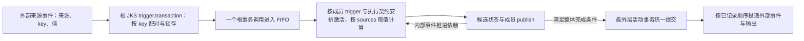

# JKRD7（JK 规则与设计 7.0.0）

- **版本：7.0.0**
- **确认日期：2026-10-29**
- **状态：用户已批准的 JKI／JKS 设计、规则、JSON 示例及格式。**
- **范围：JKI 节点定义、JKS 组合与事务、事件与计算来源、静态定义与实时状态，以及 JKI.FACTORY／RAM.FACTORY 模块设计。**
- **补充确认：JKS 支持嵌套；非空 `trigger.transaction` 直接声明原子事务，最外层活动事务统一提交；queue 与 runtime 位于 JKS 顶层。**
- **2026-10-30 补充确认：批准 JKS.runtime 的字段、事务执行状态、嵌套调用身份、pending/calls 转换规则及示例；版本保持 7.0.0。**
- **2026-10-31 补充确认：按用户“更新到 JKRD7 和 web 渲染结构图”的指令，纳入本次工厂 JKS 设计、六位输入协议、七种 publish、pro.jksid、模块操作与 JSON 附件；版本保持 7.0.0。**

本文依据本次对话的最终确认整理。设计获批不等于现有加载器、执行器或 CUDA 内核已经实现；尚未确定的执行细节单独列出，不影响本文已确认部分的有效性。

本文件独立维护，不修改 [JKRD V5.0.0](docs/JKRD.md) 或 README。V5 与 [jkcuda.v6.1 运行格式](docs/cuda-runtime.md)用于历史与实现对照，不能反向覆盖本版规则；本文件也不宣称已完成全部旧格式迁移。Web 的定义投影与实际运行视图分别标明，新增图形不代表执行器已支持本版工厂。

## 1. 三层职责

| 层级 | 定义 | 职责 |
| --- | --- | --- |
| JKI | 单个 JK 计算节点 | 定义自身状态、完整触发来源、计算来源与 J/K 顺序、发布条件 |
| JKS | 可由 JKI 和子 JKS 递归组成的结构 | 基于成员内容组织输入配对、统一调用、内部依赖、事件传播、对外输出及事务边界 |
| 运行时 | 执行与数据管理机制 | 管理事件身份、事务输入配对缓存、FIFO 任务、成员激活、实际取值、候选状态、提交和发布进度 |

JKI 是节点行为的定义来源，JKS 是这些行为的组合与执行边界。JKS 不通过清空成员触发来源、改写成员计算或丢弃成员事件来实现组合。

JKI 的一次完整 EX 是一次节点计算；JKS 的一次调用可以包含多个成员、同一成员的多次计算。非空 `trigger.transaction` 同时声明输入配对与原子事务，不再设置 `pro.atomic`。没有 transaction 声明的普通 JKS 不自带事务边界，但在活动祖先事务内执行时仍属于该事务。

## 2. JSON 基本约定

1. 使用普通 JSON，不使用 JSON Schema；不得包含注释、数组空位或省略号。
2. bit 值仅为整数 `0`、`1`；`null` 表示当前显示位置没有实际值，不等于 `0`。字符串 `"0"`、`"1"` 和布尔值不能代替 bit。
3. 对象字段顺序只是展示约定；数组位置、长度和顺序具有语义。
4. 来源、成员和对象 ID 必须能在所属模型上下文中解析。最小示例引用外部已有节点，不是独立完整模型。
5. JKI 固定六个顶层字段，推荐顺序为 `id`、`state`、`trigger`、`sources`、`publish`、`pro`。其他节点扩展字段只有获得用户明确批准后才能放入 `pro`，不继续增加同级分类字段；pro 不是可任意扩展的入口。
6. 本版已确认的 JKS 展示层级为六个顶层字段，推荐顺序为 `id`、`members`、`trigger`、`queue`、`pro`、`runtime`。queue 是静态队列声明，runtime 是实时状态容器；其余组合扩展进入 pro，不在 pro 中重复保存 queue、runtime 或 atomic。
7. 本文版本 `7.0.0` 是设计与格式版本，不等于节点的程序修订号。完整模型文件的版本封装、导入与迁移格式尚待单独定义。

## 3. JKI 字段结构

“必填”指本文已确认的六字段最小展示格式。实时值尚未取得时仍保留对应数组，用 `null` 占位。

| 字段 | 必填 | 取值／结构 | 含义 |
| --- | --- | --- | --- |
| `id` | 是 | 非空字符串 | 节点身份，例如 `Q5` |
| `state` | 是 | 恰好一个 `q` 或 `seed` 分支 | 声明有状态或无状态节点 |
| `state.q` | 有状态节点必填 | `0` 或 `1` | 运行视图中的当前已提交持久状态 |
| `state.seed` | 无状态节点必填 | `0` 或 `1` | 每次执行都使用的固定计算起点 |
| `trigger` | 是 | 对象 | 节点自身的触发声明及一次激活的实际事件值 |
| `trigger.any` | 是 | 非空来源引用数组 | 任一声明来源的一项事件投递产生一次节点激活 |
| `trigger.v` | 是 | 与 `trigger.any` 等长的数组 | 对应位置为本次事件的实际 bit，其他位置为 `null` |
| `sources` | 是 | 对象 | 节点计算来源、操作序列和实际操作数 |
| `sources.s` | 是 | 非空来源数组 | 每一步 J/K 的取值来源 |
| `sources.ex` | 是 | 与 `sources.s` 等长；元素为 `"J"` 或 `"K"` | 按数组顺序执行的操作 |
| `sources.v` | 是 | 与 `sources.s` 等长；元素为 bit 或 `null` | 该次节点执行实际使用的操作数，未绑定时为 `null` |
| `publish` | 是 | 对象 | 节点完整计算后的发布规则 |
| `publish.always` | 本文最小示例使用 | `[0, 1]` | 无论结果为 0 或 1，都发布本次实际结果 |
| `pro` | 是 | 对象，可为 `{}`；其中每个字段须经用户明确批准 | 只容纳已批准的节点扩展；不存放 JKS 的事务输入配对或事务调用属性 |
| `pro.jksid` | 本版工厂管理或生成的节点必填 | 所属管理 JKS 的非空 id 字符串 | 唯一直接管理归属；引用或嵌套不自动转移管理权。工厂内部节点为 F1，为 R1 生成的节点为 R1 |

JKI.pro 采用逐字段批准规则：

- 其中任何字段，包括新增字段和拟沿用的历史字段，都必须有用户明确批准的依据；没有批准依据时，不得擅自加入示例、默认补齐或使其在模型中生效。
- 字段曾被讨论、出现在能力归属表、被旧代码使用或通过测试，都不单独构成批准。
- 批准定义应明确字段名称、含义、类型／取值范围及适用条件；需要默认值时也应明确。改变已批准字段的语义不能借用原批准。
- 已明确批准的字段按其定义使用，无须逐节点重复批准；不能无依据撤销已有的明确批准。
- §9 的一般最小 JKI 示例仍可保持 `pro: {}`；§13 工厂管理或生成的节点使用本次明确采纳的 `pro.jksid`。其余扩展能力讨论不自动成为 JKI.pro 的已批准字段清单。

### 3.1 状态、初始化与计算起点

- 有状态节点采用 `state: {"q": 0}` 或 `state: {"q": 1}`。
- 无状态节点采用 `state: {"seed": 0}` 或 `state: {"seed": 1}`。
- `q` 与 `seed` 互斥；不再同时设置 `pro.state`、`pro.seed`。
- 有状态节点每次从实际取得的状态开始；无状态节点每次从固定 `seed` 开始，计算结果不回写为下一次 seed。
- 在原子 JKS 内，前序成员执行形成候选状态，后续执行按已建立的依赖读取前序候选。对外可见的持久状态在整体提交时更新，不能把未提交候选冒充已提交的 `state.q`。
- 同一个节点在同一次 JKS 调用中多次激活时，有状态节点后一次执行可以接续前一次候选；无状态节点仍每次从同一个 seed 开始。

静态定义中的初始状态与运行视图中的当前状态必须区分：定义上下文中的 `state.q` 用于表达初始化值，运行上下文中的 `state.q` 用于表达当前已提交值。本文第 9 节明确采用运行视图，不把其中的 q 同时解释成初始化配置。

如果初始化由模型／JKS 的状态声明统一提供，节点初始值必须来自同一声明，不再增加独立可写的 `initial_q` 副本。旧格式 `initial_q` 的迁移映射另行定义；恢复运行状态不能退回初始化值。

### 3.2 事件来源与计算来源分开

`trigger.any` 只说明哪些事件会激活本节点；`sources.s` 只说明计算从哪里取值。两者允许重合，但不互相隐式补充：

- 出现在 `sources.s` 的来源，不自动成为触发来源。
- 出现在 `trigger.any` 的来源，不自动提供所有计算参数。
- 同一个 Q3 同时作为触发源和状态取值源时，Q3 的事件载荷与执行时读取的当前状态可能不同。
- 算术上没有影响结果的来源，也不能未经可取得性和事件语义分析就删除。

### 3.3 数组与 EX

同一下标对应同一步操作：`sources.s[i]` 提供 `sources.v[i]`，由 `sources.ex[i]` 指定如何作用于当前累加值。

```text
J(x): q ← q AND x
K(x): q ← q XOR x
```

一次节点激活按顺序完成全部操作，中途值不作为该次 EX 的最终发布结果。重复使用同一来源的操作必须保留，不能对 `sources.s` 去重后破坏 EX。

对于 `s = [Q2, Q3, Q4]`、`ex = [J, K, J]`：

```text
result = ((q_start AND value(Q2)) XOR value(Q3)) AND value(Q4)
```

其中 `q_start` 是这一次执行的固定起点，不是运算过程中不断变化的累加值。

### 3.4 取值时机与保留的来源能力

| 来源能力 | 取值规则 | 归属 |
| --- | --- | --- |
| 状态来源 STATE | 成员实际执行时取得；事务内可以读取前序内部候选 | JKI 计算来源，运行时完成读取 |
| 事件／参数 PARAM | 在对应输入接纳、事件投递或配对形成调用时锁存 | JKI 参数绑定；JKS 负责组合输入的分配 |
| 常量 CONST | 定义中固定的 bit | JKI 计算来源 |
| 固定自身起点 SELF | 本次执行固定的 `q_start`，不是中间累加值 | JKI 计算上下文 |
| 不可变值 VALUE | 已有、可取得的不可变值，不隐含等待未来任务 | JKI 计算来源及运行时值存储 |

这些能力不因最小 JSON 省略扩展而删除。对话中讨论的 `pro.source_kind`、参数引用和状态引用用于区分绑定方式；涉及 JKI.pro 的具体字段仍须按逐字段批准规则确认，不能仅凭本段讨论直接加入。最小示例已明确 Q2、Q3、Q4 均为持久状态来源。混合来源的完整校验与引用编码须明确后再用于通用导入，不能让执行器凭名称猜测。

## 4. JKI 触发与发布

### 4.1 ANY：完整来源必须保留

成员加入 JKS 后，`trigger.any` 仍完整、非空。不得以“由 JKS 内部调用”为由清空它。

对于 `trigger.any = [Q1, Q3]`：

| 一次实际投递 | 该次激活的 `trigger.v` | 激活次数 |
| --- | --- | --- |
| Q1 发布 0 | `[0, null]` | 1 |
| Q3 发布 1 | `[null, 1]` | 1 |
| Q1、Q3 各发布一项 | 分别记录上述两次激活 | 2 |

事件数据为 0、与上次相同、或与另一来源相同，均不取消事件。不能用数值变化代替事件身份，也不能把两次 ANY 激活合并成一次 `[0, 1]` 激活。

### 4.2 发布

publish 使用七种正式单键数组写法。数组表示允许发布的**结果值集合**，不表示前后值序列，不存放观测值；一个对象恰好使用一个模式键，不混用多个模式。

| 写法 | 判定 |
| --- | --- |
| `{"always": [0, 1]}` | 每次成功完整 EX 都发布一次实际结果 |
| `{"zero": [0]}` | result=0 |
| `{"one": [1]}` | result=1 |
| `{"never": []}` | 不发布 |
| `{"always_changed": [0, 1]}` | result≠q_start |
| `{"zero_changed": [0]}` | q_start=1 且 result=0，即本次下降沿 |
| `{"one_changed": [1]}` | q_start=0 且 result=1，即本次上升沿 |

q_start 是本次完整 EX 开始固定的起点：有状态节点取该次实际取得的 q／合法前序候选，无状态节点取固定 state.seed。它不是执行中的累加值，也不是上一次发布值。不得为有状态节点额外增加一份 state.seed。

`{"always": [0, 1]}` 不表示同时发布一个 0 和一个 1。七种模式都最多为本次 EX 发布一次结果；b4=1 通常用于有状态节点，但不额外禁止无状态节点。无状态 seed=0 时 zero_changed 永不成立、one_changed 在结果1时成立；seed=1 时相反。

状态更新与是否发布是不同事项。发布条件不满足时，不发送事件，而不是发送值为 0 的事件；也不能仅因此取消合法的状态更新。

原子 JKS 成员仍遵守自己的 `publish`。同一成员在一次调用中执行两次并各产生发布时，必须保留两次发布，不能只保留最终 q。

### 4.3 其他触发／发布能力的记录边界

此前讨论过的能力保留如下。已确认 `JKI.trigger.any`、`JKS.trigger.transaction` 及 §4.2 七种 publish 写法；其他触发或历史比较能力的名称不等于已规定其通用 V7 编码。

| 触发能力 | 行为 | V7 归属／格式状态 |
| --- | --- | --- |
| ANY | 每项投递分别产生激活 | JKI；已确认 `trigger.any` |
| ALL_LATEST | 每来源保留最新未匹配项，收齐后消费本组并清空 | 保留能力；V7 的具体层级、字段编码与组合方式待补充 |
| ZIP | 按每来源 FIFO 队首配对，保留余项 | 保留能力；V7 的具体层级、字段编码与组合方式待补充 |
| 事务触发（按 key 配对，原称 KEYED） | 在同一 key 桶内按每来源 FIFO 配对 | JKS；使用 `trigger.transaction`，不放在 JKI |

手动调用、启动、计时、完成通知、ACK、业务过滤是事件产生方式或协议，不因名称不同就自动成为新的匹配模式。

| 发布能力 | 判定 | 格式／组合边界 |
| --- | --- | --- |
| always | 每次成功完整 EX 都发布 | 已确认 `{"always": [0, 1]}` |
| zero／one／never | 见 §4.2 | 本版正式写法 |
| always_changed／zero_changed／one_changed | 见 §4.2 | 本版正式写法，比较本次固定起点 |
| changed（此前讨论名称） | `result != q_start` | 行为由正式 always_changed 表达；不新增并列配置键，旧格式须显式迁移 |
| history_changed | `result != previous_result` | 需要显式历史状态及比较结构 |
| unchanged | `result == previous_result` | 需要显式历史状态及比较结构 |
| rising | `previous_result == 0` 且 `result == 1` | 需要显式历史状态及比较结构 |
| falling | `previous_result == 1` 且 `result == 0` | 需要显式历史状态及比较结构 |

历史比较须另行明确初始历史值、比较后更新的时机、事务内多次执行的历史推进和失败恢复；不能声称仅创建一个 JKS 就自动获得这些机制。尤其对无状态 seed=0 的节点，连续两次得到 result=1 时，`changed` 可以两次均成立。

## 5. JKS 字段结构

| 字段 | 必填／条件 | 取值／结构 | 含义 |
| --- | --- | --- | --- |
| `id` | 是 | 非空字符串 | JKS 身份；例如 `G1` |
| `members` | 是 | 非空成员引用数组；元素可引用 JKI 或子 JKS | 可混合包含节点与子结构，并继续嵌套；不等同于执行步骤表 |
| `trigger` | 是 | 对象 | 组合层的触发声明 |
| `trigger.transaction` | 声明原子事务时必填 | 非空外部触发来源数组 | 按同一 key 配齐来源，同时声明本次调用按原子事务规则执行 |
| `queue` | 独立事务入口必填；本文最小展示包含 | 已声明 FIFO 的名称 | 独立启动根事务时进入的队列，例如 `work`；嵌套执行采用根事务的调度归属 |
| `pro` | 是 | 对象，可为 `{}` | 其他组合级扩展；不包含已提升的 queue、runtime，也不再设置 atomic |
| `runtime` | 本文六字段展示包含 | 对象，可为 `{}` | 顶层实时状态容器；空对象表示未展开运行现场，不代表已确认没有事件或调用 |
| `runtime.instance_id` | 展开完整运行观测时必填 | 实际 JKS 实例的唯一标识 | 区分同一定义产生的不同实例 |
| `runtime.pending` | 展开完整运行观测时必填 | 数组，可为空 | 尚未配齐的输入缓存；详细字段见 §5.5 |
| `runtime.calls` | 展开完整运行观测时必填 | 数组，可为空 | 已形成的调用记录；详细字段见 §5.6；不是实际 FIFO 或完整执行日志 |

`members` 本身不规定执行顺序，也不表示每个成员只执行一次。叶子 JKI 保留自身的 `trigger` 和 `sources`；子 JKS 保留自身的触发规则与成员结构。事件连接来自相应触发声明，叶子节点的计算取值关系来自 `sources`。计算引用本身不新增触发或等待条件，STATE 读取实际执行时的状态或合法前序候选。调度必须遵守另行明确的执行依赖契约，不能由另一份不一致的连接表覆盖成员声明。

`trigger.transaction` 必须引用本层结构合法的外部触发来源，依据直接 JKI 的触发声明及子 JKS 的边界契约确定。它表达“本次必须配齐哪些来源”，不能把所有后代的外部引用并集都变成父结构必等输入，也不能把只用于计算的 STATE 引用自动变成事件输入。子 JKS 的跨层输入／输出映射仍须明确。

`trigger.transaction` 是本版正式字段名，替代此前示例的 `trigger.keyed`。保留按同一 key、每来源 FIFO 配对的行为，并按最新批准规则同时声明原子执行；这已不只是字段更名。KEYED 仅作为匹配机制及旧实现的名称，不是本版并列配置字段。

| 声明 | 确定含义 |
| --- | --- |
| 非空 `trigger.transaction` | 同一 key 下按来源 FIFO 配齐，并按原子事务规则调用 |
| 没有 `trigger.transaction` | 该 JKS 不创建自己的事务边界；是否处于事务中取决于活动调用上下文 |
| `trigger.transaction: []` | 非法，不能表示关闭事务或自动启动 |

原子性不再由另一份 pro.atomic 配置决定。旧字段的迁移必须显式处理，尤其不能静默忽略原有 `atomic: false` 后把旧输入改为原子执行。transaction 来源仍不是成员列表，不会把来源节点自动加入 members。

### 5.1 三类身份

| 原先讨论的标识 | 本版表达 | 含义 |
| --- | --- | --- |
| `transaction_group = G1` | `JKS.id = "G1"` | 哪个组合／事务定义；不在每个 JKI 重复设置 |
| `key = order-42` | `JKS.runtime.calls[].key` | 这组输入关联哪个业务对象 |
| `task_id = TX101` | `JKS.runtime.calls[].task_id` | 所属根原子事务的任务身份 |

同一 JKS 可以被调用多次，同一个业务 key 也可以对应多次调用。相同 key 不等于相同 task_id，不等于幂等请求标识，也不等于一份独立状态。

根事务占一个外部 FIFO 位置，task_id 同时标识该次根调用。内部子调用沿用根任务身份，以包含每层实例和局部调用序号的 path 区分；调用身份为 task_id + path，具体编码见 §5.7。不能给每个子调用再创建一个独立事务任务；成员 JKI 的逐次激活记录与完整执行现场仍须另行定义。

普通 JKS 若在没有活动祖先事务时组织多个独立事务，应记录这些调用各自的 task_id，不能用其中一个任务代表全部流程。

### 5.2 key 的来源与匹配

- key 由调用方或上游业务事件携带，也可以由明确的帧／业务适配器生成；不能从节点名称、CUDA 线程、物理批次或事务成员列表中猜测。
- key 随事件和调用上下文传递。它属于运行时数据，不是 JKI 的固定配置。
- 整数 `1` 与字符串 `"1"` 是不同 key；`null` 是一个明确的共同桶，不表示自动分配唯一 key。
- 同一 key 桶内，每个来源维护 FIFO。每配齐一组，就取各来源的一个队首形成一次调用；余项继续保留。
- 不跨 key 拼组，不把同来源的多项事件改成“仅保留最新值”，不按 key 数值或字典序重排已经形成的调用。
- 业务 key 不自动隔离节点 q。按订单分别保存状态需要明确状态实例机制，不能仅凭 key 达成。

### 5.3 成员嵌套

1. `members` 正式允许引用 JKI 或子 JKS；同一数组可以混合两类成员，子 JKS 可以继续包含更小的 JKS。
2. 数组元素继续使用对象 ID 引用，由所引用对象的定义确定它是 JKI 还是 JKS，不需要为示例新增一套成员 kind 字段；引用必须可无歧义地解析。
3. 叶子 JKI 的完整、非空触发来源及计算、发布规则在嵌套后仍保留。不能通过嵌套删除、合并合法的成员激活。
4. 事务边界由最外层活动事务决定，不由静态包含树的最顶层对象决定。子 JKS 被单独合法调用且没有活动祖先事务时，可以建立自己的根事务。
5. 在活动父事务中调用子 JKS 时，子结构加入同一事务上下文，不另占外部 FIFO，不独立提交；中间经过普通 JKS 也不会切断事务上下文。
6. 结构嵌套不自动复制状态，也不自动建立按 key 隔离的 q。共享成员及状态实例必须明确解析；同一状态实例的后续读取可见合法前序候选。
7. 支持嵌套不自动批准包含环、事件反馈或无限展开的执行方式。层级实例、跨层输入输出映射及完整恢复编码仍需补充，但父子统一提交原则已经确定。

| 执行情形 | 事务与队列归属 |
| --- | --- |
| G0 声明 transaction，且没有活动祖先事务 | G0 建立根事务，使用 G0.queue，占一个外部 FIFO 位置 |
| G0 的活动事务调用声明 transaction 的 G1 | G1 保留自己的触发条件，加入 G0 的事务，共用根任务与最终提交边界 |
| 活动事务经过普通 JKS，再调用事务子结构 | 继续使用原根事务，不因中间结构普通而脱离上下文 |
| 普通组合在没有活动祖先事务时调用 G1、G2 | G1、G2 分别建立独立事务，使用各自的 queue；普通组合整体不保证原子性 |

子 JKS 的顶层 queue 只在其独立启动事务时生效。嵌套执行采用根事务的调度归属，不改写子结构的静态 queue，也不为子调用额外入队。普通组合不能仅凭自身的 queue 覆盖独立子事务的队列。

### 5.4 JKS.runtime 的范围与顶层字段

JKS.runtime 是当前实际 JKS 实例的输入匹配、调用身份和执行状态记录，由运行时提供。本节字段设计已经批准；它完整描述的是这一层运行记录，不是 CUDA 物理内存镜像或完整恢复快照。

| 字段 | 必要性 | 取值／结构与含义 |
| --- | --- | --- |
| `instance_id` | 展开完整运行观测时必填 | 当前实际 JKS 实例的唯一标识，示例为字符串；不是可复用的 JKS 定义 ID，也不是 GPU 内存地址 |
| `pending` | 必填，可为空数组 | 当前实例尚未配齐的输入缓存 |
| `calls` | 必填，可为空数组 | 当前实例已经形成的调用记录，不自动包含全部历史 |

未展开时仍可使用 `runtime: {}`。只有明确提供空数组，才能表示相应观测范围为空；不能把空对象解释成没有缓存或调用。

pending 与 calls 是不同阶段的数据。calls 不是实际调度 FIFO，其数组排列不额外定义执行顺序；顶层 queue 是队列声明，实际入队与执行由运行时管理。

对于 trigger.transaction=`[Q1, Q3]`，calls 中的 v=`[0, 1]` 表示本次锁存的 Q1=0、Q3=1，不表示计算结果或发布输出。同一个 key 可以出现在多个根调用中，每次根调用具有自己的 task_id。

### 5.5 pending：未配齐输入的字段

pending 数组的每一项表示一个独立配对桶，目标实例由 runtime.instance_id 确定。

| 字段 | 必要性 | 取值／结构与含义 |
| --- | --- | --- |
| `task_id` | 必填，可为 `null` | 所属根事务身份；独立入口尚未配齐、尚未创建根任务时为 null |
| `parent_path` | 必填，数组 | 本桶所属父调用的路径；根入口或直接属于根调用时为 `[]`，由 task_id 是否为空区分 |
| `key` | 必填，可为 `null` | 字符串、整数或 null；按类型敏感的业务 key 配对 |
| `inputs` | 必填，数组 | 与绑定定义的 trigger.transaction 等长；每个位置保存该来源的一条 FIFO |
| `inputs[i][j].id` | 每项投递必填 | 输入投递项的唯一身份，示例为字符串；用于区分同值事件及识别重试 |
| `inputs[i][j].v` | 每项投递必填 | 实际输入 bit，只能为整数 0 或 1 |
| `definition_ref` | 条件必填 | 本桶绑定的不可变触发／执行定义引用，防止不同版本的来源位置被混用 |

inputs 的外层下标对应触发来源，内层数组按 FIFO 顺序保存投递项。某来源尚无输入时用空数组表示，不用 null 伪造一个事件；数值 0 始终是有效输入。

投递 id 标识输入投递项。一个来源事件合法地投递到多个位置时，各位置必须具有可区分的投递身份，不能按来源发布事件或数值统一去重。

### 5.6 calls：已形成调用的字段

| 字段 | 必要性 | 取值／结构与含义 |
| --- | --- | --- |
| `task_id` | 必填 | 所属根事务的任务身份；同一根事务中的子调用共用它 |
| `path` | 必填，数组 | 本次调用的嵌套身份；根调用为 `[]`，子调用逐层追加实例和序号 |
| `key` | 必填，可为 `null` | 本次调用的业务关联键；字符串、整数或 null |
| `input_ids` | 必填，数组 | 本次实际消费的输入投递身份，按 trigger.transaction 的来源位置排列 |
| `v` | 必填，bit 数组 | 已锁存输入值，与 input_ids、绑定定义的 trigger.transaction 等长 |
| `phase` | 必填 | 执行推进到哪个阶段；取值见 §5.8 |
| `status` | 必填 | 本条调用当前正常、暂停、阻塞或故障；取值见 §5.8 |
| `issue` | 必填，可为 `null` | 非正常状态的原因；NORMAL 时为 null |
| `issue.code` | issue 非空时必填 | 可供程序识别的原因码，字符串 |
| `issue.message` | issue 非空时必填 | 面向人的具体原因说明，字符串 |
| `definition_ref` | 条件必填 | 本调用绑定的不可变定义引用，用于解释来源顺序和执行规则 |

pending 与 calls 的 definition_ref 只有在外层已经唯一绑定一份不可变定义、且全部记录均属于该定义时才可省略。仅仅“当前看起来只有一个版本”不满足省略条件。不同冻结定义的余项不能因 key 相同就混组；该字段本身不构成动态迁移许可。

一次 calls 记录可以包含多次 JKI 激活，不等于一次 EX，也不替代成员激活日志。调用是否完成由 phase 及根事务上下文判断，不能仅凭条目存在就认定完成。

### 5.7 嵌套调用身份：task_id + path

每段 path 包含以下两个字段，不再增加独立的事务 call_id：

| 字段 | 必要性 | 含义 |
| --- | --- | --- |
| `path[i].instance` | 每段必填 | 该层实际 JKS 实例的标识 |
| `path[i].seq` | 每段必填 | 该实例在当前父调用中的局部调用序号，正整数 |

| 调用 | path |
| --- | --- |
| 根事务调用 | `[]` |
| 根事务内 G1 的第 2 次调用 | `[{"instance":"I_G1","seq":2}]` |
| 上述 G1 调用内 G2 的第 1 次调用 | `[{"instance":"I_G1","seq":2},{"instance":"I_G2","seq":1}]` |

调用唯一身份为 task_id + 完整 path。每一层父调用的序号都必须保留；仅用静态结构路径再附一个末层序号，会使重复父调用中的子调用发生身份冲突。

父调用路径是去掉最后一段后的前缀，因此 calls 不重复保存 parent_id 或 depth。pending.parent_path 引用所属父调用；目标实例由当前 runtime.instance_id 指定，尚未配齐时不预占子调用序号。

seq 在“根 task_id＋父调用路径＋目标实例”范围内分配，不能按业务 key 分别从 1 重用。重试原调用时，task_id 与 path 均保持不变。

### 5.8 事务执行状态：phase 与 status

phase 表示执行推进阶段，status 表示本条调用当前是否受暂停、阻塞或故障影响。两者分别记录，不能用一个 FAILED 覆盖已经到达的提交阶段。

| phase | 适用对象 | 含义 |
| --- | --- | --- |
| `QUEUED` | 根调用 | 已形成并进入外部 FIFO |
| `READY` | 子调用 | 已配齐，等待事务内部调度 |
| `RUNNING` | 根／子调用 | 正在推进成员计算和内部事件 |
| `RETURNED` | 子调用 | 本次子调用内部工作完成，不表示根事务已经提交 |
| `COMMITTING` | 根调用 | 正在提交，尚不能仅凭此阶段确认提交结果 |
| `PUBLISHING` | 根调用 | 已确认提交，正在对外传播及安排后继 |
| `COMPLETE` | 根调用 | 本次事务及必要传播、后继入队已完成，不等于业务 ACK 已收到 |

正常阶段推进分别为：

```text
根调用：QUEUED → RUNNING → COMMITTING → PUBLISHING → COMPLETE
子调用：READY → RUNNING → RETURNED
```

| status | 含义 |
| --- | --- |
| `NORMAL` | 本条调用当前没有暂停、阻塞或故障 |
| `PAUSED` | 被显式暂停 |
| `BLOCKED` | 被依赖、资源或预算条件阻塞 |
| `FAULTED` | 当前阶段发生故障 |

status 非 NORMAL 时，通过 issue.code 和 issue.message 说明原因。阶段与问题分别保留，例如 `phase=PUBLISHING`、`status=FAULTED` 表示已经提交但传播失败，只能续传已有输出，不能重新计算事务。

`COMMITTING + FAULTED` 必须核对实际提交记录，不能直接认定“尚未提交”并重算。子调用即使为 `RETURNED + NORMAL`，也只表示本次内部调用正常返回；必须查询同一 task_id 的根调用（path=[]）才能判断事务是否提交，不能据此声称输出已对外发布。

### 5.9 pending → calls 的转换规则

1. 在同一实际实例、冻结定义、根事务、父调用路径和 key 范围内匹配。独立入口还没有根事务时，用 task_id=null 的入口桶配对。
2. 各来源 FIFO 均有输入时，各取一个队首，按来源顺序形成 input_ids 和 v。
3. 独立入口创建根 task_id，根 path=[]；事务内部沿用根 task_id，并在父路径后追加目标实例和新分配的 seq。
4. 建立调用记录、锁存 input_ids/v 与消费对应 pending 项，必须构成一次不可分割的交接；根调用按 QUEUED 进入外部 FIFO，子调用按 READY 进入内部调度。
5. 余项继续留在 pending。一份投递不能同时作为该消费者的待匹配项和已消费项；重试已有调用不能自动把其输入重新塞回 pending。

不可分割交接是本版的逻辑行为要求，不表示当前代码已经实现，也不自动承诺崩溃后的耐久性；具体资源管理与持久化机制仍须另行明确。

pending 与 calls 数组本身不定义全局调度顺序。调用形成后，成员仍按完整 trigger.any 逐项激活，不能因为新增调用记录而减少 ANY 激活次数。

## 6. JKS 统一执行规则

### 6.1 事务触发与 ANY 各自负责一层

`trigger.transaction` 按同一 key 配齐一次原子调用的输入；ANY 决定本次调用中的哪些投递会激活哪些叶子 JKI。子 JKS 加入父事务后仍须满足自己的配对条件，不能因共用提交边界而跳过子触发或合并成员激活。

Q5、Q6 都声明 `any: [Q1, Q3]` 时，同 key 的 Q1、Q3 各到达一项，形成一个 JKS 调用，但分别产生两次 Q5 激活和两次 Q6 激活，共四次成员计算。不能因为只形成一个事务，就把四次计算改成两次。

### 6.2 唯一调度归属

1. JKS 基于成员声明接收并组织相关输入事件。
2. 按 `trigger.transaction` 配齐后形成一次调用，运行时锁存该组事件；独立启动时分配根 task_id，事务内部调用则保留根任务身份并记录子调用位置。
3. 根事务调用占一个外部 FIFO 位置，内部子调用不再独立入队；运行时在根事务上下文中安排成员激活。
4. 对已经属于这次调用的同一份投递，不再额外建立独立成员任务。
5. 这不取消合法的多来源投递、多订阅投递、重复同值事件或后续新调用。
6. 不得把已经独立排队或执行中的任务，事后因为 key 相同而临时合并。

防止重复执行靠调度归属，不靠清空 `trigger.any`、数值去重或业务 key 去重。未加入本次组合调用的独立节点调用，仍应遵循自身的合法执行契约。

### 6.3 原子状态与传播边界

下图表示根事务。嵌套子调用在已有事务内部配对与执行，不重复经过外部 FIFO 入口。



- 成员依自己的来源顺序完成 EX，生成候选结果，并按自己的 publish 决定是否生成事件。
- 事务内部事件在同一根事务上下文中推进成员依赖；对应候选状态供合法后继执行使用。子结构完成后可以推动父事务内部的后继，但完成不等于提交。
- 外部与内部以最外层活动事务的边界区分，不能只以某个子 JKS 的边界区分。越过根事务边界的事件与输出暂存到整体提交后投递，不能提前暴露未提交结果。
- 一次发布同时存在内部与外部订阅时，分别处理；内部投递推进本事务，外部投递等待根提交。
- 成员的逐次发布及其因果顺序必须保留。不得只输出最终状态，也不得在提交后将已经内部消费的投递再次当作新内部输入。
- 当前原子调用的计算、提交、必要外部传播及正式后继入队完成后，才选择下一独立任务。内部成员激活不等于多个独立 FIFO 任务并发运行。
- 原子性限定于声明的状态和事件边界，不能据此承诺所有外部副作用可回滚、完整 ACID 或自动持久化。

图中“满足整体完成条件”必须由执行契约明确，不能替换成“每个成员执行一次”“members 数组遍历结束”或“暂时没有可执行节点”。完成的约束见下节，具体完成条件的字段编码仍需补充。

### 6.4 调用隔离、缓存与完成条件

1. 根事务形成前，入口待配齐事件按目标 JKS 实例、冻结定义及业务 key 归属。进入根事务后的内部匹配缓存，区分根 task_id、所属父调用路径、子结构实例、冻结定义和业务 key；同一 key 的不同根调用不能混组。字段与交接规则见 §5.5—§5.9。
2. 候选状态、事件消费、内部配对缓存及已形成的子调用都是事务现场的一部分。子结构共用提交边界，不等于可以丢弃其缓存或执行记录。
3. 子结构可以等待本事务其他分支产生的结果；不能占着根事务等待只有后续独立任务才能产生的输入或处理的外部 ACK。此类外部依赖应安排在原子边界之外。
4. 成功提交必须满足规定的完成条件，并处理本次应完成的内部事件。若必需输入未配齐且内部无法继续，应报告依赖阻塞，保留现场，不能当作成功完成。
5. 内部配对余项不能悄悄丢弃或混入下一根事务。需要跨调用积累时，必须明确建模为持久匹配状态，并规定其归属与提交规则；不能默认把临时子缓存跨调用使用。
6. 不要求没有被触发的成员强行执行一次；实际成员激活仍由其触发规则和本次执行契约决定。

### 6.5 失败与恢复边界

- 提交前子结构失败时，根事务不得提交部分候选或提前对外发布，须保留已锁存输入及失败现场。暂停、恢复或重试不能丢失或重复消费输入。
- 临时等待与最终失败应区分，不能仅因资源等待就抹掉当前调用身份和状态。
- 根事务提交后若外部传播失败，应续传已有输出并维持事件身份，不能重新计算事务或声称已经提交的状态被整体回滚。
- 普通 JKS 组织的独立子事务若已经提交，外层普通组合不能承诺把这些提交整体回滚。
- 以上提交与失败原则已经确定；持久化、恢复游标、重试接口及具体序列化格式仍需单独定义，不因原则确认而宣称已经实现。

## 7. 静态定义与实时状态

| 内容 | 静态定义 | 实时状态／运行视图 |
| --- | --- | --- |
| JKI 身份与计算 | id、来源引用、J/K 序列、发布规则 | 本次实际取值和计算结果 |
| 节点状态种类 | 选择 q 或 seed 分支；seed 固定值 | 有状态节点的当前 q；事务候选另由运行时维护 |
| 触发 | 非空的 trigger.any | 一次成员激活的 trigger.v |
| JKS 组合 | id、members、trigger.transaction、顶层 queue、pro 扩展 | 顶层 runtime 中的配对缓存、调用记录、执行与提交进度 |
| 业务身份 | 不把某个订单 key 写成固定节点属性 | 每次调用的 key 和 task_id |
| 初始化 | 单一初始状态声明 | 恢复与继续执行使用当前状态，不重新初始化 |

静态展示沿用 JKS 的六字段层级时，顶层 `runtime: {}` 仅作结构占位，不写入实时值。展开完整运行记录时必须提供 instance_id、pending 和 calls，并按 §5.4—§5.9 表达调用与状态。空对象不代表已经确认没有缓存或调用，只有明确观测的空数组才表示对应范围为空。运行记录不放在 pro 中。

JKI 的两个 v 数组在静态展示中仅保留等长的 `null` 占位，不把观测到的 STATE 值预填成未来执行的绑定值；JKI 原有六字段结构不变。

JKI 的 v 数组只表示选定的一次成员激活。一个 JKS 调用可能包含多次同一成员激活，完整运行记录必须能够区分这些激活，不能用一份节点面板覆盖后就丢失历史事件。

JKS 的 `runtime.calls[].v` 是组合层配齐的输入组，与绑定定义的 trigger.transaction 按位置对应；JKI 的 trigger.v 是成员的一次 ANY 投递，二者不能互相替换。pending 的非空条目、JKS 子调用身份及状态编码已经确定；成员 JKI 的逐次激活现场仍须另行定义。

### 7.1 运行记录与完整恢复快照

| 已批准的 JKS.runtime 记录 | 完整恢复还需要的信息 |
| --- | --- |
| 实际实例标识、调用路径、输入配对桶 | 完整实例／状态绑定和实际调度队列现场 |
| 输入投递 id、锁存值、不可变定义引用 | 所引用的定义内容，以及内部成员激活和事件队列 |
| phase、status、问题说明 | 可核实的提交事实、恢复位置和未完成操作的续接信息 |
| 根／子调用关系及输入消费记录 | 候选状态、待发布输出事件、传播游标及重试／去重现场 |

本版 runtime 是输入匹配、调用身份和执行状态的运行记录契约，不能仅凭这些 JSON 恢复整个执行器。尤其 COMMITTING 中断后的提交结果不能由字段名称推断，PUBLISHING 阶段的外部续传也需要实际输出记录与游标。

完整恢复快照的字段、持久化与安装校验另行设计。运行记录完整、JSON 可解析、界面可展示，都不等于已经具有可恢复快照或已验证 CUDA 恢复能力。

## 8. 扩展属性与能力归属

本版精简的是分类与字段归属，不以省略示例字段为由删除能力。下面是能力及归属说明，不是 JKI.pro 字段批准清单；属于 JKI.pro 的具体字段仍须有用户逐字段明确批准。

| 内容／此前字段 | 归属与整理结果 |
| --- | --- |
| `pro.state`、`pro.seed` | 合并到 JKI 顶层 state，禁止重复维护 |
| `initial_q` | 属初始化来源／旧格式迁移；不再引入第二份独立可写初值 |
| `pro.jksid` | 本次明确采纳的直接管理归属，见 §3、§13；不等同于事务身份、业务 key 或实际实例 id |
| `generation`、程序 `version` | 节点或组合自身的生命周期元数据；放入 JKI.pro 前须逐字段明确批准，本表不自动批准；不是事务业务 key |
| `state_ref`、`source_kind` | 拟用于 JKI 状态／计算绑定的扩展，放入 JKI.pro 前须逐字段明确批准；不能凭猜测支持歧义引用 |
| `transaction_group` | 一个 JKS 即一个组时，由 JKS.id 代替 |
| trigger.transaction、匹配缓存、事务 key、事务 task_id | JKS.trigger.transaction 与顶层 JKS.runtime；不放入 JKI 静态属性 |
| 事务 queue | 提升到 JKS.queue；独立启动时使用，嵌套执行采用根事务的调度归属 |
| 原 pro.atomic | 删除，由非空 trigger.transaction 直接声明原子事务 |
| 整体提交与完成控制 | 运行时执行已声明的根事务契约；其他组合扩展可在 JKS.pro 中声明 |
| `output`、整体输入／输出映射 | 组合级映射归 JKS 与外部适配器；JKI 仍定义自身结果及 publish。此前节点 pro.output 的兼容或迁移方式须明确，并受逐字段批准规则约束；不因最小示例省略而删除输出能力 |
| `trigger_order`、传播顺序、内部执行次序 | 连接与调度契约；须保留事件因果，V7 的完整配置格式待补充 |
| `budget_group`、公平性、资源限额 | 调度／运行时能力；不属于节点的 J/K 计算公式 |
| 业务角色、PRE／COMP／POST、输入／输出阶段 | JKS 的结构职责或展示信息，不新增另一套 JKI 算法类型 |
| 图形类别、颜色、布局、统计标签 | 展示元数据；不能决定触发、状态归属或事务边界 |
| 队列桶、控制任务、完成通知、ACK | JKS 协议与运行时控制；不得冒充普通 JKI 的隐式 EX |
| 历史比较、门控、存储组合 | 可由 JKI／JKS 显式组合；需要的历史状态、比较与更新机制必须可见 |
| 动态创建／删除、版本切换、回收、快照恢复 | JKS 声明生命周期行为，运行时实施结构操作和保护；工厂模块契约见 §13，不由 J/K 公式隐式完成 |

PRE／COMP／POST、输出、完成控制和 ACK 可以组成更大的 JKS 流程，但不意味着整个闭环必须是一笔原子事务。不能让一个活动原子任务等待只有后续独立任务才能处理的外部 ACK。

现有帧模块的 ACK0 重发、ACK1 消费见 [V6.1 帧与业务模块](docs/cuda-runtime.md)；这不是所有 V7 JKS 通用 ACK 协议的自动定义。本版 RAM 工厂的编码与边界见 §13；不宣称现有 V6.1 加载器已支持该编码。

## 9. 已批准的最小普通 JSON 示例

### 9.1 示例上下文

- Q1～Q4 是所属模型中已存在的节点；Q2、Q3、Q4 在本例均作为持久状态取值来源。
- Q5 是有状态 JKI；Q6 是无状态 JKI。二者都保留 Q1、Q3 两个完整事件来源。
- G1 已按 `order-42` 配齐 Q1 的 0 和 Q3 的 1，形成调用 TX101；成员尚未执行该调用。
- 本例 G1 独立启动根事务，实际实例为 I_G1；它唯一绑定一份不可变定义，所有记录都属于该定义，因此省略 definition_ref。
- `state.q = 0` 表示当前已提交状态；两个 JKI 的 v 数组尚未绑定，所以使用 `null`。
- 示例是最小运行视图，没有展开外部节点定义、队列定义、内部调度顺序、输出映射或完整恢复现场。

### 9.2 JKI

```json
[
  {
    "id": "Q5",
    "state": {"q": 0},
    "trigger": {
      "any": ["Q1", "Q3"],
      "v": [null, null]
    },
    "sources": {
      "s": ["Q2", "Q3", "Q4"],
      "ex": ["J", "K", "J"],
      "v": [null, null, null]
    },
    "publish": {"always": [0, 1]},
    "pro": {}
  },
  {
    "id": "Q6",
    "state": {"seed": 0},
    "trigger": {
      "any": ["Q1", "Q3"],
      "v": [null, null]
    },
    "sources": {
      "s": ["Q2", "Q3", "Q4"],
      "ex": ["J", "K", "J"],
      "v": [null, null, null]
    },
    "publish": {"always": [0, 1]},
    "pro": {}
  }
]
```

### 9.3 JKS

```json
{
  "id": "G1",
  "members": ["Q5", "Q6"],
  "trigger": {
    "transaction": ["Q1", "Q3"]
  },
  "queue": "work",
  "pro": {},
  "runtime": {
    "instance_id": "I_G1",
    "pending": [],
    "calls": [
      {
        "task_id": "TX101",
        "path": [],
        "key": "order-42",
        "input_ids": ["D1", "D2"],
        "v": [0, 1],
        "phase": "QUEUED",
        "status": "NORMAL",
        "issue": null
      }
    ]
  }
}
```

### 9.4 该组输入如何执行

TX101 的 `[0, 1]` 分别来自 Q1、Q3，属于一次组合调用。投递给每个成员时分别产生 `[0, null]` 与 `[null, 1]` 两次 ANY 激活。

为说明状态与事件的区别，假设本次示例轨迹先处理 Q1 事件、再处理 Q3 事件，且各次计算实际读取的 Q2、Q3、Q4 状态均为 `[1, 1, 1]`：

| 成员 | 触发投递 | 本次 trigger.v | 实际 q_start | 计算结果 | 对状态的作用 |
| --- | --- | --- | --- | --- | --- |
| Q5 | Q1=0 | `[0, null]` | 0 | 1 | 形成候选 q=1 |
| Q5 | Q3=1 | `[null, 1]` | 1 | 0 | 接续候选，形成 q=0 |
| Q6 | Q1=0 | `[0, null]` | 0 | 1 | seed 仍为 0 |
| Q6 | Q3=1 | `[null, 1]` | 0 | 1 | seed 仍为 0 |

表格按成员列示，不规定 Q5 与 Q6 之间的全局交错顺序。来源值不变、状态无别名是本段示例条件，不是所有模型的默认假设。

Q5 最终提交的 q 虽然仍为 0，但两次执行分别产生结果 1、0，`always` 必须保留两次发布。Q6 两次都产生 1，也必须保留两次发布。四次发布如何映射为外部端口，由 JKS 的输出契约另行规定。

### 9.5 事务触发：多业务对象与余项

来源顺序为 `[Q1, Q3]`，按下列次序投递：

| 次序 | 来源 | key | 值 | 本次形成的 JKS 调用 |
| --- | --- | --- | --- | --- |
| 1 | Q1 | A | 0 | 无，等待 A 的 Q3 |
| 2 | Q1 | B | 1 | 无，等待 B 的 Q3 |
| 3 | Q1 | A | 1 | 无，A 的 Q1 保留两项 FIFO |
| 4 | Q3 | B | 0 | B，v=`[1, 0]` |
| 5 | Q3 | A | 1 | A，v=`[0, 1]`；A 的 Q1 仍余一项 |
| 6 | Q3 | A | 0 | A，v=`[1, 0]` |

调用形成顺序为 B、A、A，三次调用身份不同。第 4 次投递形成的调用即可入队，不需要等全部六项到齐。事务输入配对不按业务 key 排序，也不因 A 已出现过就丢弃后一次调用。

### 9.6 JKI 与多个子 JKS 混合嵌套

下面展示用户批准的六字段静态结构：G0 包含已有 JKI Q7 和两个子 JKS G1、G2。G1 可采用 §9.3 的静态定义部分，不能把该节独立调用 TX101 的运行记录直接搬入 G0；G2 是另一个已定义子结构。本例假设 Q1、Q3 是已明确的 G0 边界触发来源。

```json
{
  "id": "G0",
  "members": ["Q7", "G1", "G2"],
  "trigger": {
    "transaction": ["Q1", "Q3"]
  },
  "queue": "work",
  "pro": {},
  "runtime": {}
}
```

G0 在没有活动祖先事务时启动，使用 work 队列并建立根事务；在其活动上下文中触发的 G1、G2 加入同一事务，不另占外部 FIFO，也不提前独立提交。子调用共用根 task_id，以结构路径及局部序号区分。G0 的 runtime 空对象只是未展开现场，不表示所有缓存和调用已经为空。

本例仍没有展开跨层输入输出映射、状态实例和具体完成条件；这些内容不能仅从 members 推导。非空 transaction 已声明原子性，因此不再添加 atomic 字段。子 G1 若在没有活动祖先事务时经合法入口独立调用，则建立自己的根事务，使用自身 queue。

### 9.7 子 JKS.runtime：正常返回与未配齐输入并存

本节另设一个嵌套调用场景，使用根事务 TX201 与投递 D11、D12、D13，避免与 §9.3 的独立根调用混淆。G0 的根事务 TX201 仍在执行；子 G1 的实际实例为 I_G1，trigger.transaction=`[Q1, Q3]`。

G1 第一次子调用已正常返回，消费的输入为 Q1=0、Q3=1；下一组只收到 Q1=1，仍等待 Q3。此实例及全部记录唯一绑定一份不可变定义，所以省略 definition_ref。下面是 G1.runtime 的完整最小观测内容：

```json
{
  "instance_id": "I_G1",
  "pending": [
    {
      "task_id": "TX201",
      "parent_path": [],
      "key": "order-42",
      "inputs": [
        [
          {"id": "D13", "v": 1}
        ],
        []
      ]
    }
  ],
  "calls": [
    {
      "task_id": "TX201",
      "path": [
        {"instance": "I_G1", "seq": 1}
      ],
      "key": "order-42",
      "input_ids": ["D11", "D12"],
      "v": [0, 1],
      "phase": "RETURNED",
      "status": "NORMAL",
      "issue": null
    }
  ]
}
```

这里 pending.parent_path=[] 指向 TX201 的根调用，pending 的目标为当前实例 I_G1。D11、D12 已由第一次子调用消费，不再留在 pending；D13 仍是下一组未配齐输入，不与已消费输入混用。

若同一作用域随后收到 Q3 的投递 D14=0，可以消费 D13、D14，形成 path=`[{"instance":"I_G1","seq":2}]`、input_ids=`[D13,D14]`、v=`[1,0]`、phase=READY 的第二次子调用。它继续共用 TX201，不创建独立根事务或外部 FIFO 任务；首次调用的输入身份和值保持不变。

RETURNED 只说明第一次子调用内部工作完成，不能认定 TX201 已提交。根事务后续可能继续执行、阻塞或发生故障，提交状态必须查询 TX201 的根调用记录。

## 10. 必须撤回的旧表述

| 旧表述或隐含理解 | 本版确定规则 |
| --- | --- |
| 由 JKS 调用，因此清空 JKI.trigger.any | 保留完整、非空来源；通过唯一调度归属避免重复任务 |
| 多个节点具有相同业务 key，就自动成为原子事务 | JKS 明确声明成员与原子执行契约；key 只关联输入业务对象 |
| transaction_group、事务 key、事务 task_id 都作为 JKI 固定属性 | 分组由 JKS.id 表达，调用身份归顶层 JKS.runtime |
| 一个 JKS 调用意味着每个成员只执行一次 | ANY 逐项保留激活，一次调用可以多次执行同一成员 |
| members 只能引用 JKI，JKS 嵌套本身仍未批准 | members 可混合引用 JKI 和子 JKS；最外层活动事务统一提交 |
| `trigger.keyed` 是本版最终字段名 | 改为 `trigger.transaction`，保留按 key 配对语义；不并列维护两份来源 |
| transaction 只表示配对，还必须配置 pro.atomic | 非空 transaction 直接声明原子事务，删除 pro.atomic；空 transaction 非法 |
| JKS 的 queue 与 runtime 位于 pro 内 | 提升到 JKS 顶层，pro 只保存其他组合扩展 |
| 子 JKS 声明 transaction 就必须独立排队和提交 | 有活动祖先事务时加入其上下文；没有活动祖先时才独立启动 |
| 子结构完成或暂时没有可执行节点就表示事务完成 | 子完成可推进内部后继；根事务必须满足明确完成条件，依赖阻塞不能当作成功 |
| calls 只保存 key、task_id、v，不能表达执行状态 | 已批准 path、input_ids、phase、status、issue 及条件 definition_ref；根与子调用分别表达 |
| 单独用 task_id 或静态结构路径就能区分所有子调用 | 调用身份为 task_id + 包含每层实例和 seq 的完整 path |
| 用 FAULTED 覆盖执行阶段，或把子 RETURNED 当作根已提交 | phase 与 status 分开；根提交事实独立核实，子正常返回不等于根提交 |
| pending 消费后再另行尝试建立 calls，失败时可丢弃输入 | 消费输入与建立调用必须不可分割，余项保留，重试不能自动重新投递 |
| runtime 字段完整就等于完整恢复快照 | 当前为匹配／调用／状态记录；候选、激活队列、输出缓存和恢复游标等仍须另行定义 |
| JKS 配齐的 v 可以直接作为成员一次 ANY 的 v | 两个层级分别记录；ANY 只标记该次实际投递位置 |
| 只保留最终 q 就等同于保留所有输出 | 每次 publish 与其实际载荷独立保留 |
| publish.always=[0,1] 表示同时发布两个值 | 每次成功 EX 只发布该次实际结果 |
| 组合、字段或设计获批意味着执行器已实现 | 设计状态和实现证据分别记录 |

## 11. 尚待补充的细节

下列事项没有在已批准的最小格式中完整定义。实现前应补充明确契约，不能通过默认猜测改变本版规则，也不能据此把整份 7.0.0 再标回未批准草案。

§13 已给出工厂范围的实例共享、参数绑定、阶段操作和生命周期契约；以下清单保留通用模型与实现验证边界，不将已经明确的工厂设计重新列为未定义，也不把模块约定自动推广为全部 JKS 的默认规则。

1. **完成条件的具体表达与内部调度顺序**：§6.4 的完成／阻塞原则已经确定；仍需规定完成条件的字段与判定方式、独立可执行成员的稳定顺序，以及事件环、运行时递归调用、预算和中断。运行时递归调用不同于已批准的结构嵌套。
2. **实例绑定与成员执行现场**：instance_id、task_id + path 及每层 instance/seq 编码已经确定；同一 JKI／JKS 被多处引用时的实际实例解析、显式共享／复制声明，以及成员 JKI 逐次激活的完整现场仍需补充。
3. **输入契约与参数映射**：trigger.transaction 配齐来源之外的事件如何处理；锁存输入如何绑定成员参数；嵌套结构如何声明跨层输入／输出映射；不得自动把所有外部引用都变成必等输入。
4. **完整事件、定义存储与恢复记录**：pending 的 inputs/{id,v}、calls 的 input_ids/v、definition_ref 条件及 phase/status 已批准；内部成员事件与激活队列、不可变定义引用的解析／存储、状态引用和完整恢复载荷仍需另行定义。
5. **整体输出映射**：哪些成员发布映射到哪些外部端口、顺序和输出身份如何表示；不能用示例 members 的排列隐式决定。
6. **失败、重试、恢复与回收的具体机制**：§6.5 的提交前后处理原则已经确定；重试接口、恢复游标、外部续传去重、耐久性、版本切换与缓存回收仍需完整实现契约。
7. **其他模式与扩展校验**：ALL_LATEST、ZIP、历史比较、独立节点队列等的通用编码。§4.2 七种 publish 及 §13 工厂范围的来源绑定已纳入，不再整体列为未定义。
8. **通用业务协议与实现验证**：§13 已纳入 RAM 工厂的 PRE／POST、完成控制、ACK、存储及生命周期设计；业务 COMP 仍由接入方明确声明。任意业务模型的自动转换、跨任务流程的通用身份封装及执行器实现仍须分别定义和验证。
9. **模型级封装与迁移**：版本标记、静态文件与运行快照的可识别封装、旧 initial_q 和旧 EX／订阅结构的显式迁移；不能静默按不同版本解释同一输入。

## 12. 来源、实现位置与验证边界

本版规则的直接来源是本次对话经修正后获得用户批准的设计。下面的文件是已有机制的对应与差异证据，不是用旧实现替代 V7 规范。

| 来源／条款 | V7 预期行为 | 当前对应位置 | 验证依据与边界 |
| --- | --- | --- | --- |
| 本文 §2、§3、§5.3、§9 | 六字段 JKI、六字段 JKS、嵌套成员及 trigger.transaction 原子事务声明 | [现有加载器](jkcuda/model.py) | 当前节点字段与 trigger 的 `{mode, ports}` 是 V6.1 格式；不能直接视为支持 V7 或 JKS 嵌套的加载器 |
| 本文 §3.3 | J=AND、K=XOR，完整 EX 顺序执行 | [V5 J/K 基本规则](docs/JKRD.md)、[现有核心](jkcuda/native/core.hpp) | 真值运算可独立推导；相同运算不证明组合调度一致 |
| 本文 §3.4、§7 | 事件锁存与状态实际取值分开 | [来源绑定说明](docs/cuda-runtime.md)、[现有核心](jkcuda/native/core.hpp) | 已有 STATE/PARAM/SELF 机制提供对照；V7 候选与视图格式仍需适配 |
| 本文 §4、§5.2、§6.1 | ANY 保留逐项激活，JKS 的 trigger.transaction 按 key 配组 | [匹配说明](docs/cuda-runtime.md)、[现有加载器](jkcuda/model.py) | 现有 KEYED 仍配置在节点上；尚不能证明 V7 的 JKS 归属与多次成员激活 |
| 本文 §5.3、§6.2—§6.5 | 根事务统一提交、内部事件推进、父子调用隔离及提交前后失败边界 | [现有事务接口](jkcuda/runtime.py)、[现有核心](jkcuda/native/core.hpp) | 现有接口依赖显式有序 steps；不自动提供 V7 的嵌套事务内事件调度与完整现场管理 |
| 本文 §5.4—§5.9、§9.7 | runtime 字段、阶段与状态、嵌套路径、按定义隔离及不可分割输入交接 | 当前有文档及只读定义投影，未实现执行器的本版 JKS.runtime 接口 | 校验 JSON 与规则推导，不等于已经实现或验证生产调度、并发交接及故障恢复 |
| 本文 §7.1、§11 | 运行记录与完整恢复快照分开 | [现有快照说明](docs/cuda-runtime.md) | 已有输入身份、阶段和定义引用仍不能代替候选、激活队列、输出缓存及恢复游标 |

### 12.1 后续实现的最小验收案例

以下预期直接来自本文规则，不能由被测运行时的同一判断函数生成。

| 案例 | 应满足的结果／应识别的错误 |
| --- | --- |
| 结构校验 | 六字段 JKI 的数组对齐；q/seed 互斥；加入 JKS 后 trigger.any 仍非空 |
| JKI.pro 字段批准 | 任一实际使用字段都有用户明确批准依据；不能因历史实现、讨论或默认补齐而自动生效；最小示例保持 pro={} |
| JKS 字段层级 | 顶层为 id、members、trigger、queue、pro、runtime；queue 与 runtime 不再嵌入 pro |
| runtime 完整观测 | 展开时具有 instance_id、pending、calls；空 runtime 仅作未展开占位 |
| 嵌套成员 | members 可以解析为 JKI 或子 JKS，支持混合引用；不能将子 JKS 错判为普通 JKI 或自动改写其叶子节点声明 |
| 事务字段 | 非空 trigger.transaction 直接声明原子事务；空数组非法；runtime.calls 中的 v 与该数组对齐；同 key、每来源 FIFO 规则不变 |
| 动态事务根 | 没有活动祖先时创建根事务；活动父事务中调用子 JKS 时共用根事务；普通中间 JKS 不切断上下文 |
| 队列与任务身份 | 根事务一个外部 FIFO 位置；嵌套子调用不额外入队，保留根 task_id，以路径和局部序号定位 |
| 同 key 隔离 | 两个根事务即使 key 相同，其内部缓存及子调用也不能混组 |
| 定义隔离 | 相同实例和 key 但不同冻结定义的输入不混组；definition_ref 仅在外层唯一绑定不可变定义且全部记录属于它时省略 |
| 父调用重复 | 同根事务中 G1 第 1、2 次调用内的 G2 第 1 次调用具有不同完整 path；不能省略父层 seq |
| 子序号与重试 | seq 在根 task_id＋父路径＋目标实例范围分配，不按 key 重用；原调用重试保持 task_id/path |
| 零值与重复值 | 0 和重复同值都形成有效事件，不得被当成缺失或自动去重 |
| ANY 与事务触发组合 | §9 的一组输入形成一个 JKS 调用、四次成员激活，而不是两次 |
| 两层 v | 根调用 runtime.calls 中的 v=`[0,1]`；成员两次 trigger.v 分别为 `[0,null]`、`[null,1]` |
| 计算状态 | §9.4 的 Q5 候选依次为 1、0；Q6 两次结果为 1，seed 保持 0 |
| 取值时机 | 同一来源的事件值与稍后的 STATE 值可以不同；不得把两者强制绑定为同一个数 |
| 事务输入 FIFO | §9.5 调用形成顺序为 B、A、A，各值依次为 `[1,0]`、`[0,1]`、`[1,0]` |
| pending/calls 交接 | 按各来源队首次序锁存 input_ids/v，建立 calls 与消费输入不可分割；余项保留，重试不自动重新塞回 pending |
| 子调用例子 | §9.7 中 D11、D12 已消费，D13 仍在等待；D14 到达后形成 TX201 下 seq=2 的新子调用，不改写 seq=1 的记录 |
| key 类型与身份 | 整数 1 与字符串 1 不配对；相同 key 的两组输入形成不同调用身份 |
| 唯一调度归属 | 一份属于 JKS 调用的投递不再额外生成独立成员任务；合法多项投递仍分别保留 |
| 原子发布 | 提交前不暴露外部输出；提交后保留成员逐次发布，不只保留最终 q |
| 子结构完成 | 子完成后可推进根事务内部后继；越过根边界的输出必须等根提交，提交后不重投已消费内部事件 |
| 依赖阻塞与余项 | 必需输入未齐且无法内部推进时不得成功提交；余项不得丢失或默认跨根事务使用 |
| 分阶段失败 | 提交前不部分提交并保留现场；提交后传播失败只续传，不重算或冒称回滚已提交状态 |
| phase/status 区分 | 根阶段为 QUEUED/RUNNING/COMMITTING/PUBLISHING/COMPLETE；子阶段为 READY/RUNNING/RETURNED；暂停、阻塞或故障不覆盖阶段 |
| 提交事实 | PUBLISHING+FAULTED 表示已提交而传播失败；COMMITTING+FAULTED 必须核验提交记录；RETURNED+NORMAL 不证明根已提交 |
| 空 runtime | runtime={} 只表示未展开现场；不能推断为已确认 pending=[] 或 calls=[] |

JSON 语法与示例算术检查只能验证实际覆盖的格式和推导，不构成 V7 执行器或 CUDA 正确性、恢复性、并发性与性能验证。2026-10-31 的工厂模块及 Web 定义投影见下一节。

## 13. JKI.FACTORY 与 RAM.FACTORY 的 JKS 设计

### 13.1 模块归属与批准范围

依据本次用户确认及后续写入指令：**JKI.FACTORY 也是 JKS；异步结构存储模块称为 RAM.FACTORY，它是 RAM 结构与工厂子 JKS 的组合。** 本节及所链接 JSON 是纳入 7.0.0 的模块设计契约。实际安装、动态展开、并发、恢复和 CUDA 执行证据与设计批准分别记录。

| 对象 | 示例 id | 职责 |
| --- | --- | --- |
| JKI.FACTORY | F1 | 用真实 JKI 保存配置值、有效标志及 b5 前态，组织节点 JSON 生成 |
| RAM.FACTORY | R1 | 包含 F1 和 RAM1；配置、安装、改接、释放其管理节点，组织帧与块生命周期 |
| RAM 结构 | RAM1 | PRE／POST、选择、读出、中转、输出、ACK 与回收的子 JKS 组合 |
| 运行时 | 无新增 JKI 类型 | 执行 JKS 声明的编号分配、结构编辑、事务提交、交接和保护操作 |

工厂不是本版新增的 J/K 运算，也不以宿主业务算法代替 EX。**何时成为活动节点、怎样安全修改、何时释放以及失败怎样交接，属于 JKS 行为。** 运行时落实这些行为，不改变其归属。

### 13.2 六位输入与状态编码

| 位 | 含义 | 取值 |
| --- | --- | --- |
| b0 | 状态类别 | 1：有状态 q；0：无状态 seed |
| b1 | 创建初值／固定起点 | bit |
| b2 | 允许发布0 | bit 开关 |
| b3 | 允许发布1 | bit 开关 |
| b4 | 变化限制 | 1 时额外要求 result≠q_start |
| b5 | 清空／创建控制 | 0 清输入；0→1 且五位齐备才创建 |

状态映射固定为 `10→{"q":0}`、`11→{"q":1}`、`00→{"seed":0}`、`01→{"seed":1}`。b1 是创建时写入的值；后续执行不把它恢复为每次有状态计算的起点。

| b2 b3 b4 | publish |
| --- | --- |
| 000、001 | `{"never":[]}` |
| 100 | `{"zero":[0]}` |
| 010 | `{"one":[1]}` |
| 110 | `{"always":[0,1]}` |
| 101 | `{"zero_changed":[0]}` |
| 011 | `{"one_changed":[1]}` |
| 111 | `{"always_changed":[0,1]}` |

两个结果开关都关闭时，b4 不影响 never。此前提议的 allow、changed_only 不作为本版 publish 字段使用。

### 13.3 输入控制、有效性与创建时机

五个值和五个有效标志分别由持久 JKI.q 保存。初始化均为0，但有效标志为0表示尚未输入；一个真实的0输入必须把对应有效标志置1。

| 输入事件／条件 | 动作及结果 |
| --- | --- |
| b0—b4 任一路到达 | 本路值 JKI 执行复制 EX，对应有效标志 JKI 执行置1 EX；后到值替换本路暂存值 |
| 任一次 b5=0 | 清空五个值及五个有效标志；b5 前态实际更新为0；不创建或删除节点 |
| b5 从0到1，五位已齐 | 锁存本次配置，分配一个编号，生成一份 JSON；生成结果可靠纳入本事务交接记录后清五个值和有效标志 |
| b5 从0到1，缺任一位 | 正常拒绝 INPUT_INCOMPLETE，不分配编号、不等待后到输入；b5 前态保持1 |
| 前态已为1，再收到1 | 真实输入及 EX 仍可发生，但 one_changed 不发布，不创建新节点 |

成功后只清五位输入及有效性，**不把 b5 前态自动改回0**。下一次创建顺序为：b5=0 → 重新输入 b0—b4 → b5=1。输入未齐拒绝后同样需要这一完整顺序，补齐后再送一个1不会自动产生上升沿。

清空表示逻辑输入无效，不能解释为“五个有效的0”。它只影响本调用方实际 F1 实例的当前输入区，不取消已形成的调用、已返回草稿、已安装节点、RAM 帧或独立输出载荷。

每个实际 F1 实例只有一条有序配置输入流；并发独立配置流使用不同实例。业务 key 不自动隔离这组状态。R1 在活动事务内逐个执行完整的工厂配置序列，避免两个构造过程混用五位暂存。

不能用六路 `trigger.transaction=[b0,b1,b2,b3,b4,b5]` 代替上述协议：清空必须能在五位未齐时执行，且当前配置缓存不等于按来源 FIFO 配组。b5 的上升沿是工厂专用行为，不改变通用 ANY 对重复同值事件的规则。

### 13.4 F1 的真实成员与事务组织

| 成员 | 作用 |
| --- | --- |
| Q1—Q5 | b0—b4 值；完整 EX 从0复制实际事件值 |
| Q6—Q10 | 五位有效性；数据输入复制1，清空输入复制0 |
| Q11 | 无状态复制 b5，publish.zero；每个 b5=0 都产生清空依据 |
| Q12 | 有状态复制 b5，publish.one_changed；q 的初值为0，不因初始化制造事件 |
| Q13 | seed=1，对五个有效标志依次 J；结果1表示齐备，0表示本次拒绝 |
| F1.WRITE0—F1.WRITE4 | 每路值＋有效性各一个局部事务，入口为对应单项输入事件 |
| F1.CONTROL | b5 控制局部事务，可在同一调用内实际执行清空涉及的十个节点 |

WRITE 和 CONTROL 重复引用的 Q1—Q10 必须解析到 F1 实例内同一实际状态，不复制。未触发的成员不强行执行；完成必须包含实际要求的 EX、结果交接及动作，不以 members 遍历结束代替。

F1 外层是普通 JKS，六个子 JKS 的非空 transaction 才声明局部原子入口。R1 在活动事务内调用它们时，仍按最外层活动事务统一提交，保留完整调用 path，不新增独立 FIFO 或子提交。

### 13.5 编号、管理归属与草稿交接

1. 同一模型共享 Q 编号分配器。装入静态节点及已有保留号后，以最大数值编号为高水位，每次分配高水位＋1；不按 F1 实例分别从头计数。
2. 删除不降低高水位，逻辑 Q 编号不复用。物理容量可复用，但不得使旧任务命中新节点身份。
3. 同一次操作的重试保留原预约；不同请求即使 key 和五位值都相同，也分配不同编号。失败的预约可以留下空号，不回退为其他请求可用的号。
4. F1 内部节点 pro.jksid=F1；F1 为 R1 生成的节点 pro.jksid=R1。内部控制子 JKS 不能把请求方偷偷改成自己的 id。
5. pro.jksid 不等于实际实例 id。每个请求还要绑定实际调用方实例；重复实例化控制节点时分配新的实际身份并重映射引用，不能共享另一实例的 q。
6. 新节点的 trigger={}、sources={} 是**待配置草稿**，不进入活动成员表。R1 填入完整非空 trigger.any 和来源数组，执行必要的真实装载 EX，通过结构检查后才原子安装。
7. 草稿、Q 候选、交接记录及输入消费属于同一根事务域；编号预约不因该域回滚而重新对外分配。父事务内部可以使用实际已返回草稿，外部可见性仍等待根提交。
8. 子工厂生成后父安装失败，JKS 保留原草稿、编号、实际输入和调用现场；重试续接原操作，不要求重新制造 b5 上升沿。提交后交付失败只续传既有记录，不重新生成节点。

只读引用或把节点列入另一 JKS 的 members，不授予修改权。安装、改接和释放均校验管理归属、实际实例、冻结定义及被保护依赖，不以自行改写 jksid 获得权限。

### 13.6 R1 的 RAM 结构与业务接入

R1 包含 F1 和 RAM1。单独使用时 FRAME_IN 直接写 POST；接入业务 JKS 时先写 PRE，业务输出通过 RESULT_IN 真实锁存后分别保存 POST 和 NEXT。RAM 不猜测或代算 COMP；接入方必须提供明确的有限业务结构、位序、结果和状态清单。

- 本模块实际帧宽为1—8，每块每世代8槽；数据槽占恰好 W 个数据 JKI，辅助有效性、领取、请求类型等节点另计。这是本模块配置，不是 JKI 的通用限制。
- 值及业务控制状态存于 JKI.q；帧、槽、块、位序、世代、请求顺序保存结构身份和节点引用，不持有第二份长期业务 bit 数组。未完成交接的任务可以保留独立不可变参数。
- FRAME_IN=0 只清未提交接入，不取消已接纳帧或任务。FRAME_IN=1 必须拥有完整真实输入；0和重复帧均有效。
- PRE 领取要求有效队首、READY、未领取。POST 与 NEXT 从已经产生的真实结果分别执行复制 EX，不能用“将来会完成的 COMP”认定保存事务就绪。
- 第一批 POST 从空变为非空时安排首发；慢 ACK 保留 POST，不自动阻塞已经完成状态交接后的下一轮业务。
- 所有新数据／控制节点走 F1 完整 reset→program→enable 序列。按角色选择状态和发布位，创建初值不代替本帧装载；各位和标志都执行自己的 J/K。

RAM1 的局部事务为 ACCEPT、READY、CLAIM、RESULT、READ、RELAY、SEND、COMPLETE、DEC0、DEC1、ACT0、ACT1、GC。required EX、动作和内部投递全部完成后才提交；各阶段通过明确的提交后事件安排下一独立调用。

### 13.7 输出、ACK 与回收闭环

1. READ 只处理准备请求队首且 BUSY=0的批次。位数据与完成节点分别读取该阶段已经存在的值；完成节点通过真实 EX 得1，数据0不阻止完成。
2. RELAY 使用首发 B 或已接纳重发的独立 H 锁存，锁定每个输出任务的位值、marker、帧及世代后才释放准备 BUSY。准备顺序属于业务状态，不新增执行 FIFO。
3. SEND 的输出 EX 按实际 W 位及最后 marker 顺序执行。首发 marker=1，重发 marker=0，不补发未使用通道。
4. 实际 W 位和 FRAME_OUT 都成功交付后，可靠形成 OUTPUT_DONE；其成功交付事实向后续 ACK 接入可见前先登记完成通知。回调不直接写资格。
5. COMPLETE 仅为仍匹配当前未消费队首的有效首发建立独立 H 保留 q、有效状态及资格 token，并共同提交。旧批次或重发完成正常 NOOP，不能复活资格。
6. 每项 ACK 都形成独立 DEC0、DEC1 译码检查。DEC 在各自实际 EX 入口绑定当时帧、世代和资格；无资格不等待未来 READY。0输入和重复 ACK0 都是实际请求，不套用工厂 b5 的上升沿过滤。
7. 有效 DEC 通过提交后事件形成独立 ACT。ACT 再核对原绑定身份；陈旧动作 NOOP，不改绑下一帧。ACK0 锁存已有 H 安排同帧重发；ACK1 通过真实 EX 清资格／槽有效性，消费并推进队首。
8. 已接纳的旧输出／重发继续使用自己的参数。部分使用的空块仍在本世代继续剩余槽；整块复用必须同时满8次接纳、全部消费、无未完成引用／任务／到达／输出持有依赖，随后增加世代并给新节点分配新逻辑编号。

声明结构操作不赋予节点豁免。真实来源、读者、保持及引用闭合按模板展开并检查；管理线不计 EX 引用。模板本身不是已安装节点，不能以静态模板的存在证明任意动态展开后的合法性。

### 13.8 JKS.pro 扩展字段与操作契约

下表字段属于组合定义，不增加 JKI 顶层分类。除 pro.jksid 外，未在 JKI.pro 增加生命周期、版本、队列或控制字段。

| 字段组 | 类型／内容 | 含义 |
| --- | --- | --- |
| name、design_status | 字符串 | 模块名称与设计状态，不能决定计算语义 |
| imports | 文件名映射 | 装入已有 JKS 定义；限定本模块显式文件，不从字符串猜测类型 |
| definitions | id→JKI／JKS 对象表 | 解析 members、绑定及局部事务；重复成员引用不复制状态 |
| ports | inputs／outputs 对象 | bit 接口、实际参数交接及记录输出；JSON 草稿返回不是普通 JKI bit publication |
| context、scope | 对象 | 请求方、实际实例、共享成员、局部引用重映射及内部调用上下文 |
| dispatch | 控制来源→入口映射 | 每项投递进入一个明确组合调用，不额外生成重复独立节点任务 |
| bindings | 来源名→绑定对象 | 显式 const、param、state、state_ref、self 及 by_source／by_batch 分支；PARAM锁存、STATE在EX入口读取、SELF固定 |
| bits、state_map、publish_map、changed_start | 字段映射与数组 | 六位控制参数、四种状态与八组发布位到七模式的确定映射 |
| input_protocol | 对象 | 当前输入覆盖、有效性、清空、拒绝、上升沿、成功后消费与实例隔离 |
| allocator | 对象 | 模型级编号预约、幂等身份、不回退高水位及空号处理 |
| actions | 数组 | `on={node,value,phase}` 与有序 steps；每步含 op 及该操作参数；guard未通过时本分支正常终止，不继续修改 |
| commit、atomicity、failure、failure_handoff | 对象 | 候选／草稿／交接提交域、父子统一提交、正常拒绝与故障、重试和续传 |
| factory_call | 对象 | F1 目标、请求方透传、逐节点配置顺序及按角色选择创建位 |
| layout、templates | 对象 | PRE／POST、块槽、角色配方、JKI来源与EX模板、装载及安装条件 |
| stage_binding、protocol_events、output_protocol | 对象 | 阶段实际身份绑定、完成事件与数据位的区别、输出顺序、ACK资格及旧批次保护 |
| metadata_contract、validation | 对象 | 实例范围结构记录、完整快照边界及安装前应做的实际校验 |
| 子 JKS 的 complete、bind_at_ex_entry | 对象／数组 | 当前局部调用要求完成的EX、条件分支、动作交接及入口身份锁定 |

definitions 按显式 id 解析；绑定从所属模块及子调用的词法上下文取得。模板内 `$reserved_id`、`$slot.load` 等是构造时占位，不作为实际节点身份或来源安装。路径引用读取已经绑定的上下文，不是任意可执行代码。

结构／协议操作包括：编号预约、草稿生成、成员／槽登记、绑定／断开、请求真实 EX、参数锁存交接、输出暂存、队首先后关系及安全回收。禁止以 write_q 或宿主业务算法代替真实 EX。每种 op、参数及 guard／续接含义以[操作契约 JSON](assets/jks-factory-v7-design/design-contract.json)和 actions 定义为准。

`after_commit.emit` 使用对象数组，每项含 source、v，可带 when。它明确指出正式后继来源和成立条件；成员顺序或自然语言名称不补造调用关系。guard、反馈、取值和成员关系不作为前进执行依赖。

### 13.9 完整 JSON 与示例

以下附件随本节一并纳入模块设计，保留六字段 JKS／JKI 层级；它们是普通 JSON，不是 JSON Schema：

- [JKI.FACTORY 完整 JKS](assets/jks-factory-v7-design/JKI.FACTORY.json)：F1.WRITE0—4、F1.CONTROL 和 Q1—13 的实际定义、绑定和动作。
- [RAM.FACTORY 完整 JKS](assets/jks-factory-v7-design/RAM.FACTORY.json)：R1、F1 导入、RAM1、阶段子 JKS、控制与输出节点、动态模板及操作。
- [生成交接示例](assets/jks-factory-v7-design/generation-example.json)：初始最大编号79，R1依次输入 b5=0、b0—4=`[1,0,1,1,1]`、b5=1，返回 Q80；输入清空而 b5前态为1。

该示例生成的草稿为：

```json
{
  "id": "Q80",
  "state": {"q": 0},
  "trigger": {},
  "sources": {},
  "publish": {"always_changed": [0, 1]},
  "pro": {"jksid": "R1"}
}
```

这里 state.q 是创建初值；空 trigger／sources 仅用于未安装草稿。活动节点仍必须具有完整非空触发来源及来源数组。静态 JKS 的 runtime={} 仍只表示未展开，不伪造空 pending／calls 或正在执行的 phase。

### 13.10 Web 投影与验证边界

控制台“已安装模型 · 实时”继续显示实际 V6.1 模型与 task_activity。“JKRD7 · 工厂结构”通过只读 `/api/factory-design` 装入本节原始 JSON，支持闭环总览、F1内部、RAM内部、全部成员／操作、层级展开、搜索、来源查看及完整JSON复制／下载。

工厂图中的 JKS、真实 JKI、结构操作、接口、存储区域、模板分别展示。成员包含关系不决定执行顺序，STATE来源不隐含等待，ACK独立输入；完成通知不得画成自动产生ACK。定义 q／seed 不作为当前实例状态，不能因为 id相同就叠加 V6.1 统计。

| 来源条款 | 预期行为 | 本次实现位置 | 验证及限制 |
| --- | --- | --- | --- |
| §13.2—§13.5 | 状态／发布映射、零值有效、清空、上升沿、拒绝、草稿交接 | JSON定义与本次静态／独立JK真值核对 | 不代表现有执行器已经实现工厂操作 |
| §13.1、§13.4、§13.6—§13.8 | F1/R1嵌套，普通组合与局部事务、真实JKI和运行时结构操作分开 | jkcuda/web/factory.mjs；Web结构视图 | 图为只读契约投影，不执行EX，不生成替代运行数据 |
| §13.7 | 完成与ACK分离、DEC→ACT绑定、重发／消费反馈 | 工厂图的 actions／dispatch 投影 | 不以设计边证明实际条件成立 |
| §13.9及§7.1 | 原始JSON、初始化定义、实时状态和完整快照分别表达 | /api/factory-design；工厂JSON面板 | 只读接口不安装模型、接收输出或推进运行时 |

原[设计核对记录](assets/jks-factory-v7-design/verification.json)覆盖JSON、静态成员和来源映射、128组状态／发布判定、输入时序及ACK门控真值。完整动态RAM展开、真实EX引用与DAG、任意交错、恢复及CUDA执行仍未由此验证；安装时必须实际执行对应检查，不能由模板或网页可显示替代。

### 13.11 本轮修改差异

| 修改前 | 修改后 |
| --- | --- |
| 仅 always 有正式最小写法，其余发布编码待补充 | 七种正式单键数组模式，按本次固定起点判断 changed |
| 一般最小 pro={}，工厂归属未写入 | 工厂管理节点使用已确认的 pro.jksid，其他字段仍逐字段批准 |
| RAM 工厂只是历史机制对照，工厂模块JSON尚未纳入 | F1与R1均为JKS，完整附件、输入控制、结构操作和局部事务契约纳入7.0.0 |
| Web只显示已安装V6.1运行图 | 新增独立工厂定义视图和原始JSON；实时图继续只使用实际观测 |
