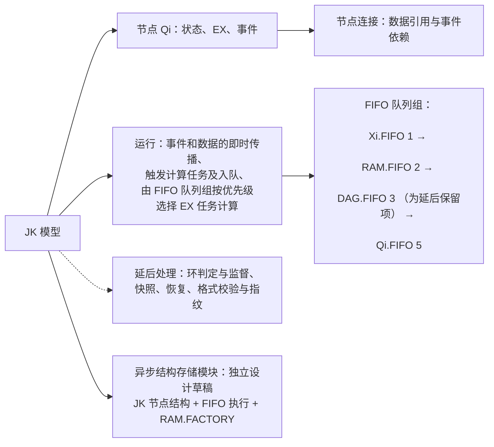
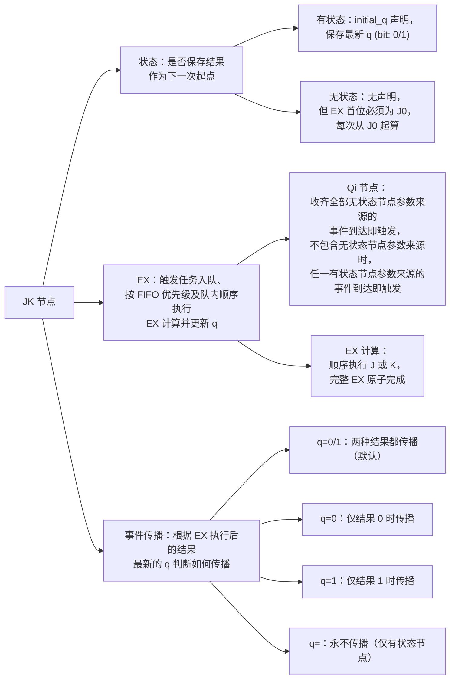
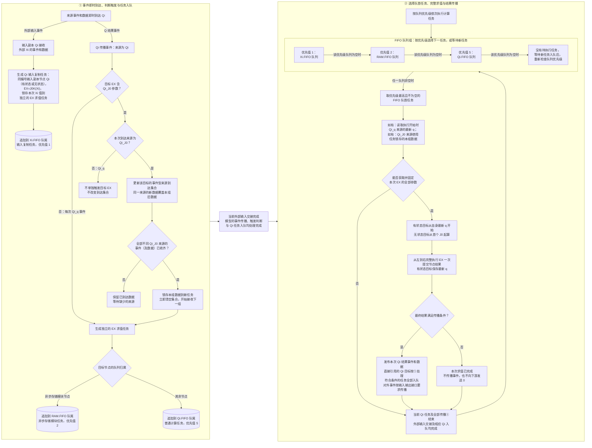
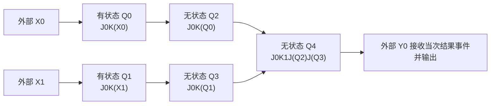

# JKRD（JK规则与设计 V5.0.0）

> 2026-10-19 按用户明确授权更新。本文是 JK 项目的统一计算契约；正文区分已生效的基础规则、独立模块设计与延后处理事项。版本升级不表示所有原始提案均获批准，也不表示执行器已完成迁移。

JK_NET、JK_LOGIC、ModelShow 及其他相关 JK 项目以本文件为规则主源。具体结构与验证记录放在专题页，代码和历史测试不能反向定义规则。

## 本版的三个区域

| 区域 | 内容与状态 | 入口 |
| --- | --- | --- |
| 一、基础规则修订 | 保留 V4 的 J/K、节点、EX、传播及引用约束；修改输入副本、逐次输入锁存与参数取值，补充目标归属及 RAM 事务的执行边界 | 下文“模型概览”至“优化与验证边界” |
| 二、异步结构存储模块 | 由 JK 节点组合的异步处理结构、FIFO 队列组、RAM.FACTORY 三部分协作；存储节点属于第一部分。模块专有规则与设计统一在独立草稿维护 | [异步结构存储模块设计草稿](logic_units/async-structural-storage-draft.md) |
| 三、延后处理 | 环判定、允许反馈环的扩展、DAG.CARE、定时队列，以及快照、恢复、格式校验与指纹 | [环监督待处理稿](drafts/JKRD-V5.0.0-ring-supervision-pending.md)；[快照恢复待处理稿](drafts/JKRD-V5.0.0-snapshot-recovery-pending.md) |

**不批准节点豁免。** 级联链尾、池节点、停用节点只要仍是模型中的 Q，就遵守与其他节点相同的规则。“只定义首个节点、其余自动延伸”是链式结构的构建方法，不改变展开后每个节点的合法性要求。

本次修改前后对照及原稿 E01–E67 的处置见 [V5 更新对照](drafts/JKRD-V5.0.0-integration.md)。V4 的快照内容保存在 [历史参考](drafts/JKRD-V4.0.0-snapshot-reference.md)，不作为 V5 快照格式。

## **阅读顺序**：模型概览 → 节点规则 → 触发与参数 → FIFO 执行 → 外部输入输出 → 结构示例与模块入口 → 优化边界 → 延后处理。

## 模型概览

- JK 模型只操作 Qi 节点；`send` 输入 Xi 和 Yi 输出由外部处理，接口要求集中在“send 输入 Xi 和 输出 Yi 的事件与数据要求”。

| 组成 | 标记 | 行为主体 | 职责 |
| --- | --- | --- | --- |
| 输入位 | `X0..Xn` | 外部输入数据和事件 | 外部输入 bit（位）0 或 1 数据，每次更新数据并传播事件到同编号输入副本 Qi 节点，<br/>每次到达的数据由该次输入复制任务锁存（被当作 Qi_J0 无状态节点事件及数据传播） |
| JK 节点 | `Q0..Qn` | JK 模型内部处理数据和事件 | 可保存当前 q，按自己的 ex 执行计算，再按条件传播事件。彼此连接为运行结构 |
| 输出位 | `Y0..Yn` | 外部接收数据和事件 | 通过 q_y 绑定一个传播条件为 `q=0/1` 的已有 Q 节点，接收其事件和当次 0 或 1 数据并输出 |

#### 设计的核心是把计算公式分解成一个或多个节点的 `ex` 和连接结构，把需要保留的数据（带记忆）写成有状态节点的 q，把何时执行写成参数来源和事件规则，并用节点的传播条件决定计算完成后是否发布事件。同一个 Q 结果可以供多个后继 Qi 节点使用，外部输出可按 q_y 绑定接收。计算来源从 ex 解析，外部绑定从 q_y 解析，无需另存一套来源关系。引用数量的约束及计数口径见“来源引用与关系”。

### JK 模型组成概览



### JK 节点组成概览

| 分支 | 职责 |
| --- | --- |
| 状态 q | 保留 EX 计算结果数据（带记忆） q (bit: 0/1)，有状态的下一次计算从 q 开始 |
| EX | 参数事件满足触发条件后形成求值任务并入队，<br/>按 FIFO 队列优先级和队内先进先出次序<br/>计算 EX 并把本次结果更新到 q |
| 事件传播 pro | EX 计算完成后根据结果 q 和传播条件 pro 决定是否传播事件 |



## 节点规则

<a id="input-latching"></a>

### 节点状态分类

| 分类 | initial_q 的要求 | EX 的要求 | q 的作用 |
| --- | --- | --- | --- |
| 有状态节点 Qi_q | 在 initial_q 中仅出现一次 | 遵守 EX 规则 | q 值会被初始化，<br/>q 值会被 EX 计算后更新，并按传播条件发布，<br/>作为下一次起点 |
| 无状态节点 Qi_J0 | 在 initial_q 中不出现 | 遵守 EX 规则<br/>且 EX 必须以 J0 开头 | 每次 EX 从 J0 清零起算；<br/>结果 q 仅作为临时值并按传播条件发布，<br/>不作为下一次起点 |

- 节点分类只由 initial_q 决定：出现在 `initial_q["0"]` 或 `initial_q["1"]` 中的 Q 是有状态节点，并且仅出现一次；未列入的 Q 是无状态节点。本文的 Qi_q 和 Qi_J0 仅为分类记号，不因有状态 EX 以 J0 开头而改变分类。
- 有状态节点可以在 EX 中（像常量一样）显式引用自己；无状态节点不得显式引用自己。有状态节点自身的结果事件不会触发自身下一次 EX。
- 每个 Xi 必须唯一对应同编号的输入副本 Qi，表达式固定为 `J0K(Xi)`；输入副本可以是有状态节点（在 initial_q 中声明初始值 0 或 1），也可以是无状态节点（不在 initial_q 中出现）。
- Xi 到达时锁存：每次到达形成的输入复制任务携带该次 Xi 值，执行时使用锁存值，不读取执行时的最新 Xi。
- 触发、到达集合、任务锁存与参数取值统一按来源类别表述：Qi_J0 来源按无状态事件规则收齐并锁存数据，Qi_q 来源在任务执行开始时读取最新 q。来源类别遵循“模型概览”中的输入定义，不改变 initial_q 决定的节点状态分类。
- 收齐全部按 Qi_J0 规则处理的参数来源的事件及数据后触发；不包含此类来源时，任一 Qi_q 来源事件到达即触发。
- Xi 只能被该输入副本引用，后续计算节点只能引用 Q 节点及常量（字面量） 0、1；N 个输入 `X0..X(N-1)` 对应 `Q0..Q(N-1)`，其他节点继续使用后续编号。

### J 和 K 的基本规则

这里的 J 和 K 是项目自定义的布尔操作。每一步使用上一步的 q 和当前参数 x，执行后得到新的 q。下式中 AND 表示逻辑与，XOR 表示逻辑异或。

```text
J(x): q ← q AND x
K(x): q ← q XOR x
```

| q | x | J 真值表 |
| --- | --- | --- |
| 0 | 0 | 0 |
| 0 | 1 | 0 |
| 1 | 0 | 0 |
| 1 | 1 | 1 |

| q | x | K 真值表 |
| --- | --- | --- |
| 0 | 0 | 0 |
| 0 | 1 | 1 |
| 1 | 0 | 1 |
| 1 | 1 | 0 |

| ex 中 JK 真值操作 | 效果（JK 设计始源） |
| --- | --- |
| `J0` | 置 0 |
| `J1` | 保持 q |
| `K0` | 保持 q |
| `K1` | 翻转 q |
| `J0K1` | 在 ex 中先置 0 再翻转，得到 1 |

### EX 格式与顺序计算

| 基本操作 | 功能 | 严格 ex |
| --- | --- | --- |
| 逻辑非 | NOT Q0 | `J0K1K(Q0)` |
| 逻辑与 | Q0 AND Q1 | `J0K1J(Q0)J(Q1)` |
| 逻辑或 | Q0 OR Q1 | `J0K1K(Q0)J(Q1)K(Q0)` |
| 逻辑异或 | Q0 XOR Q1 | `J0K(Q0)K(Q1)` |
| 逻辑同或 | Q0 XNOR Q1 | `J0K1K(Q0)K(Q1)` |
| 逻辑与非 | Q0 NAND Q1 | `J0K1J(Q0)J(Q1)K1` |
| 逻辑或非 | Q0 NOR Q1 | `J0K1K(Q0)J(Q1)K(Q0)K1` |
| 复制输入 | 输入副本 Q0 复制 X0 | `J0K(X0)` |

- 允许的操作单元只有 `J0`、`J1`、`K0`、`K1`、`J(Xi)`、`K(Xi)`、`J(Qi)`、`K(Qi)`，Xi 引用还必须满足输入副本的专用约束。
- ex 是非空、扁平无嵌套的 J/K 操作序列，从左到右依次执行。
- 输入副本的 ex 固定为 `J0K(Xi)`；其他节点的 ex 必须至少引用一个非自身的 Q 节点。
- 复杂或嵌套逻辑可通过多节点结构引用进行拆分。
- 一次求值任务原子完成整个 ex，另一 ex 不插入其中，无嵌套。
- RAM.FIFO 任务可以以事务方式执行，在一个任务内原子完成一组操作（可执行多个 EX），见“FIFO 队列组的选择、求值与即时传播”。

### 常量节点的定义及拒绝

- 纯常量参数计算节点指 ex 的全部操作仅包含 `J0`、`J1`、`K0`、`K1` 作为完整节点 ex；必须拒绝该类常量节点。（该约束按参数来源判定，不因合法表达式某次计算得到 0 或 1 就将其判为非法。）

### 来源引用与关系

| 关系 | 从哪里确定 | 用途 |
| --- | --- | --- |
| EX 参数使用位置 | ex 中每个 Xi 或 Q 引用的位置 | 确定每个 J/K 操作使用的参数，重复使用同一来源的操作仍分别执行 |
| 引用数量 ex_source | 对节点 ex 中的 Xi 和 Q 来源按节点编号去重，再排除节点自身 | 统计该节点引用的不同于自身的来源数量 |
| 来源事件关系 | 对目标 ex 中的来源去重，并排除目标自身 | 建立非自身来源到目标 Qi 的事件关系，并判断所需 Qi_J0 来源是否收齐；显式自引用只提供计算参数 |
| 外部 Yi 绑定 | q_y 中的 Yi 与 Q 对应关系 | 计入该 Q 的被引用数量，不增加 EX 参数或 Qi 计算任务；外部接收与输出要求见输入输出章节 |

- 节点的引用数量就是 `ex_source`，下限为 ≥ 1；同一来源在该节点的 ex 中重复出现只计 1 个，常量 0、1 不计数。
- Xi 与 Q 属于不同来源类型，按完整编号区分；输入副本 `Qi = J0K(Xi)` 引用的是 Xi，不属于自引用，其 `ex_source` 为 1。
- 节点的被引用数量下限为 ≥ 1，按引用它的不同其他 Q 节点数量与通过 `q_y` 绑定它的不同 Yi 数量之和计算；同一其他 Q 的 ex 多次引用它只计 1 个，每个不同 Yi 的绑定分别计 1 个。
- 有状态节点自身保存的 q 是求值起点，不计入引用数量或被引用数量；节点在 ex 中显式引用自身时，这条自引用也不计入这两项数量。
- 有状态节点显式引用自身时，保留对应 J/K 操作，但不建立自身到自身的事件关系，不因自身结果生成自己的下一次求值任务；无状态节点显式自引用必须拒绝。
- 检查全部 Q 来源到引用目标的连接；排除合法的有状态自身引用后，必须形成 DAG（Directed Acyclic Graph，有向无环图），不允许多个节点之间形成事件触发环，不能因节点有状态或传播条件过滤而豁免。
- 上述引用数量、被引用数量、表达式及连接约束适用于全部现存 Q，包括链尾、池节点和停用节点；静默、不执行或工厂成员身份均不是豁免理由。工厂管理、成员关系、任务 cause 及展示连线不计入 EX 引用或被引用数量。
- 链式自动延伸后逐节点满足同一规则；没有未完成依赖的节点可以按模块生命周期安全删除，删除后的空闲容量记录不是仍在模型中但免检的 Q。
- 多节点反馈环的许可与判定、DAG.CARE 和相应调度方案统一延后。延后处理期间沿用上面的 V4 无环约束，不以 `pro=q=` 排除真实 Q 引用。

## 事件的触发与传播、EX 的参数数据与执行

### EX 基本流程

- 下图只描述模型对 Qi 的处理：左侧接收外部 Xi 或非自身 Qi 的来源事件，立即处理数据并将符合触发条件的 Qi 任务加入对应队列；右侧按优先级执行 Qi 的 EX，事件本身不排队。
- 每次选择下一任务前，当前完整 EX（或 RAM 事务）及全部结果传播、已发生来源事件对应的 Qi 任务入队必须完成，并满足外部输入交接要求。此处定义执行边界；保存恢复协议见延后处理区域。外部输入的更新次序与执行期间到达要求见输入输出章节。
- Qi 传播事件来源为非自身 Qi，自身不向自身传播事件，自身结果不触发自身



- `Xi.FIFO`、`RAM.FIFO` 和 `Qi.FIFO` 各自按先进先出次序执行；优先级只决定下一任务，不能打断当前完整 EX、结果传播或 RAM 事务。`DAG.FIFO` 的环任务启用属于延后处理，不在上图分配任务。
- 图中左侧的入队与右侧的取队首操作使用同一组队列；结果传播会再次触发左侧流程，所有直接目标处理完成后，才允许选择下一计算任务。
- “当前已经发生的”，不包含“等待缺少的 Qi_J0 来源”这一未来过程。未收齐的集合可以继续等待，已有任务仍可执行。
- 无法获取并固定本次 EX 的全部参数时，直接结束本次任务，不进入 EX 求值与结果传播；之后仍经过完整任务边界，再按队列组优先级选择下一任务。输入复制任务携带 Xi 到达时锁存的值，执行时使用锁存值，不因外部 Xi 当前不可读而结束。

### 触发求值任务，依据 参数来源结构 与 触发规则

| 目标 ex 的参数情况 | 允许的来源 | 触发 EX 求值任务，<br/>生成一个任务追加到对应队列队尾 | EX 的参数数据，<br/>固定为本次 EX 的参数 | EX 的实际开始计算 |
| --- | --- | --- | --- | --- |
| 输入副本 `J0K(Xi)` | 字面量 0、同编号 Xi | 每次 Xi 到达时，锁存该次 Xi 值，加入 `Xi.FIFO` | 使用任务锁存的该次 Xi 值，不读取执行时的最新 Xi | 按优先级选中任务后 |
| 普通节点，没有 Qi_J0 参数 | 0、1、Qi_q | 每次 Qi_q 来源的事件到达时，加入目标所属队列 | 任务开始执行时读取 Qi_q 的最新实际 q | 按优先级选中任务并读完参数后 |
| 普通节点，至少有一个 Qi_J0 参数 | 0、1、Qi_q、Qi_J0 | 仅收齐全部不同 Qi_J0 来源的事件及数据时，<br/>携带本组数据加入目标所属队列 | 任务开始执行时读取 Qi_q 的最新实际 q ，<br/>加上任务保存的本组 Qi_J0 数据 | 按优先级选中任务并读完参数后 |

- “触发”表示满足条件并形成一次待执行任务；完整 EX 在该任务按队列优先级和队内次序被选中时求值，事件本身即时传播，不进入计算队列。
- 同一非自身来源在 ex 中出现多次，只形成一条来源到目标的事件关系，多次独立到达仍分别处理。字面量 `0/1` 不产生事件。
- 未收齐全部不同 Qi_J0 来源的事件及数据时，同一 Qi_J0 来源的新数据覆盖该目标同一位置的旧数据，来源已经到达的数据继续保留。
- 输入复制任务归 `Xi.FIFO`；其余目标为 RAM.FACTORY 成员时归 `RAM.FIFO`，否则归 `Qi.FIFO`。按目标身份判定，不按触发来源或参数来源判定；环相关归属延后，见 FIFO 队列表。

### 事件传播/事件发布规则

- 节点先完成整个 EX 计算并更新 q 值，再依据该结果判断本次传播条件。发布的事件携带本次完整计算的 0 或 1 数据，立即传播到直接引用本节点的其他 Qi；对外传播要求见“send 输入 Xi 和 输出 Yi 的事件与数据要求”。

| 传播条件 | 发布行为 | 适用节点 |
| --- | --- | --- |
| `q=0/1` | 每次完整 EX 执行结束后都发布一次事件 | 有状态、无状态 |
| `q=0` | 仅当本次完整 EX 的最终结果为 0 时发布一次事件 | 有状态、无状态 |
| `q=1` | 仅当本次完整 EX 的最终结果为 1 时发布一次事件 | 有状态、无状态 |
| `q=` | 永不发布事件，无论本次结果为 0 还是 1 | 仅有状态 |

- Qi 节点通过可选字段 `pro` 配置传播条件；未配置时默认采用 `q=0/1`，显式 `q=0/1` 与默认值语义相同，输入副本也遵循这一规则。
- 传播条件适用于该节点的全部结果事件，只在完整 EX 结束后判断一次，不因中间的 `J0` 清零而发布。
- 条件不满足时，节点仍已完成求值和结果更新；未发布事件不等于向下游发送 0，被过滤的 Qi_J0 结果不计入目标到达集合。
- `q=` 仅关闭事件发布，不关闭输入触发、任务入队、EX 求值或 q 更新；它不表示未配置、q 没有值或前后结果相同，无状态节点采用 `q=` 必须拒绝。
- pro = `q=` 的有状态节点，仍然可被其他 Qi 节点引用或读取 q 值。
- 相同结果连续出现时，符合传播条件的每次结果仍分别发布，不按结果值合并或跳过。
- 初始化只设置声明的初始状态，不执行 EX、不发布事件，不用初始值补齐到达集合；外部输出行为见输入输出章节。快照恢复另见延后处理区域。

<a id="fifo"></a>

### EX 求值任务与 FIFO 队列组

FIFO 队列组统一选择下一次要执行的计算任务。任务生成、任务参数和队列选择分别由以下规则确定。

#### 事件到达与任务入队

- 每次触发生成一个独立任务，同一目标可以同时有多个待执行任务，不按节点编号、相同输入值或相同结果值合并、去重或跳过。
- 一个参数来源的一次到达事件只能生成一个任务或不生成任务。EX 中多次重复使用同一参数来源也视为一个参数来源，同一触发也不能因重复检查当前数据而再次入队。
- 一次结果传播期间，所有直接引用的其他 Qi 目标立即处理到达数据并判断触发条件，符合条件的任务全部加入对应队列，不递归执行后继 EX。
- 同一次传播使多个目标满足条件时，按目标 Q 的数字编号升序逐个追加到各自所属队列，同一队列内的并列任务因此按编号升序入队。多个目标分到不同队列时，执行先后按队列优先级决定，不按编号跨队列统一排序；这种跨队列的先后依赖是设计结构所需。
- 已入队任务的触发条件已经满足，不因来源后来改变 q 而撤销；执行时不重新检查来源当次的传播条件，也不等待原到达集合重新收齐。输入复制任务使用 Xi 到达时锁存的值，执行时不重新读取 Xi。

#### Qi_J0 到达集合与任务数据

- 每个目标分别维护自己的无状态（Qi_J0）来源到达集合。集合保存尚未组成任务的数据；已组成任务的数据由该任务独立持有。

| 到达阶段 | 数据处理 | 是否生成任务 |
| --- | --- | --- |
| 还缺少某个不同 Qi_J0 来源 | 保留已有数据；同一来源再次到达时，只覆盖当前集合中该来源的位置 | 否 |
| 全部不同 Qi_J0 来源收齐 | 将本组数据锁存到新任务，立即清空该目标的到达集合，开始收集下一组 | 是，追加到目标所属的 FIFO 队列 |
| 旧任务已入队，下一组数据到达 | 新数据进入下一组集合，不改写旧任务携带的数据 | 按下一组是否收齐判定 |
| 目标含 Qi_J0 参数，但到达来源为 Qi_q | 不增加 Qi_J0 来源到达项，不单独触发该目标，也不改写来源实际 q | 否 |

- 各目标的到达集合互相独立，旧任务执行结束不得清空正在收集的下一组数据，也不得清除其他目标的集合。
- 未收齐的数据可以跨多次 `send` 保留，计算队列清空不清除到达集合。
- 未收齐的数据属于当前运行实例的待完成状态，与已入队任务分别保存；它们如何序列化及恢复，列入延后处理，不沿用 V4 的空集合恢复方式宣称完整续算。
- 到达集合没有默认的输入批次配对机制；需要同批数据配对时，必须由模型结构明确保证。

#### 任务保存与参数取值

- 每个任务标识目标 Q；有 Qi_J0 参数时，任务独立持有形成任务时锁存的本组数据，不被后续到达改写。参数取值完成后，整个 EX 使用同一组固定参数。
- 任务携带的帧参数按 Qi_J0 来源的数据锁存与随任务传递规则处理；帧参数使用有序数组，数组长度即帧宽。

| 数据 | 取值时机与使用方式 |
| --- | --- |
| Qi_q 来源 | 任务开始执行时读取来源的最新实际 q，不使用早先发布事件携带的历史 q |
| Qi_J0 来源 | 形成任务时锁存本组数据，执行时使用该任务保存的数据，不重新读取来源的当前值 |
| 目标自身的有状态 q | 任务开始执行时读取最新 q，作为本次求值起点；同一目标的下一任务读取前一任务已提交的状态 |
| 有状态目标显式引用自身的 Q 参数 | 读取任务开始时自身已保存的 q 并固定；不随本次 J/K 操作的累加值变化，也不产生自身事件触发 |
| 无状态目标的起点 | 按合法 EX 的首个 `J0` 清零，再执行后续操作；暂存结果不使节点变为有状态 |
| 字面量 0 和 1 | 直接使用 EX 中的常量，不产生到达事件或任务 |

- 同一来源在 EX 中重复出现时使用同一个已读取的值，不在各 J/K 操作之间重新读取参数。
- J/K 操作逐步改变的是本次求值的累加值，整个 EX 完成后一次提交节点结果。
- 使用锁存数据或读取来源 q 不执行来源 EX、不改变来源状态，也不产生事件。
- 任务等待期间的 Qi_q 变化会影响任务开始时的读取；Xi 的后续到达不改写已入队复制任务锁存的值；已经开始的任务继续使用固定参数，已锁存的 Qi_J0 数据不被后续到达改写。
- 有状态节点允许以 `J0` 开头，但初始化时不提前执行这个操作；输入副本也只在复制任务实际执行时清零并复制。恢复协议见延后区。
- 输入复制任务出队后直接使用锁存的 Xi 值执行 `J0K(Xi)`，不读取外部 Xi 当前值；外部 Xi 当前不可读或已被后续输入更新，都不影响该任务。
- 锁存的 Xi 为 0 或 1 都是有效数据；不得把 Xi=0 当作缺失，也不得用 Qi 的已保存 q 代替锁存的 Xi。
- 异步结构存储模块的输出节点采用显式锁存协议：任务触发时固定输出参数，执行时使用该任务的数据。这一模块接口例外的来源、生命周期与 ACK 规则统一见 [模块草稿](logic_units/async-structural-storage-draft.md#output-ack)；普通有状态来源仍按上表读取最新 q。

#### FIFO 队列组的选择、求值与即时传播

FIFO 队列组由多条独立的 FIFO 队列组成，统一选择下一次要执行的任务。

- 每条队列有自己的任务范围和优先值；当前队列组的成员、任务归属与选择条件如下表所示。

| 队列 | 保存的任务 | 固定优先值 | 选择条件 / 状态 |
| --- | --- | --- | --- |
| `Xi.FIFO` | 每次 Xi 到达形成的同编号输入副本任务，携带该次 Xi 锁存值 | 1 | 非空时优先选择队首 |
| `RAM.FIFO` | 除输入复制任务外，RAM.FACTORY 成员节点的任务，含模块输出及事务任务 | 2 | Xi.FIFO 为空且本队非空时选择队首 |
| `Qi.FIFO` | 除上述目标外的普通节点任务 | 5 | Xi.FIFO、RAM.FIFO 均为空且本队非空时选择队首 |
| `DAG.FIFO` | 拟承接非 RAM 环内节点任务 | 3（保留） | 随环扩展延后，当前不分配任务；启用后的归属与监督见延后区 |

- 同一队列组内，各队列分别按入队先后执行；不同队列之间按优先级选择，不按跨队列的统一入队先后选择。
- 每个任务只进入一条队列，依次判定：输入副本复制任务 → `Xi.FIFO`；其余 RAM.FACTORY 成员任务 → `RAM.FIFO`；其余任务 → `Qi.FIFO`。不能因参数来源改变目标任务的归属，也不能把 RAM 输出节点固定放入 Qi.FIFO。
- 优先值越小优先级越高；当前执行顺序为 `Xi.FIFO`（1）→ `RAM.FIFO`（2）→ `Qi.FIFO`（5）。每次重新从最高优先级开始检查，只取第一条非空队列的一个队首任务，全空则等待。保留的 3 不参与当前就绪竞争。
- 同一队列组内优先值必须不同，确定后不允许修改；Xi=1、RAM=2、Qi=5，DAG 的 3 为延后保留值。
- 新增队列须同时定义任务归属和不重复的固定优先值；尚未启用的队列不提前分配任务。DAG.CARE 和定时队列全部位于延后区。
- 每次开始下一任务前，当前已经发生的输入更新和结果传播所触发的全部任务必须先加入各自队列，完成本次交接后再按优先级选择队首任务。
- “全部任务”只包括当前已经触发的任务；尚未执行的任务将来产生的新事件，在实际产生并满足条件时再形成后继任务。
- 每个任务结束并完成全部结果传播后，重新从最高优先级检查；未执行 EX 而结束的任务也经过同一任务边界。不能连续处理低优先级队列而忽略新到达的高优先级任务。
- 优先级只决定下一任务，不能打断正在执行的完整 EX，也不能将下一计算任务插入当前结果传播的处理过程。
- 队列组内所有队列均为空时不选择任务；新任务入队后仍须满足上述执行边界，再从最高优先级检查。严格优先级不保证低优先级任务在持续高优先级输入下及时执行；本版不暗中增加轮转、公平配额或入口暂停规则。
- 一次计算单步处理按上述规则选出的一个任务：参数可读时完整执行 EX 及其结果传播，可以形成零个、一个或多个后继 Qi 任务，并按传播条件发布 Qi 结果事件；无法获取全部参数时，只结束该任务，不执行 EX。
- RAM.FIFO 的事务绑定实际目标节点任务：该节点执行完整 EX，并原子提交获授权的工厂结构操作、多个 q 写入、控制 q 与事件。事务期间不插入其他任务，只能观察到提交前或提交后状态；整个事务为一次单步。具体动作、权限及生命周期在 [模块草稿](logic_units/async-structural-storage-draft.md#factory) 定义；不得在事务中把其他节点尚未执行的 EX 计为已执行。

```text
当前输入更新与当前完整求值、结果传播结束
→ 当前已触发任务全部加入各自队列
→ 按 Xi.FIFO、RAM.FIFO、Qi.FIFO 的优先次序，取第一条非空队列的队首
→ 取得参数：Qi_J0 来源使用任务锁存的本组数据，Qi_q 来源读取执行开始时的最新 q；无法获取全部参数时直接结束本次任务
→ 参数可读时固定本次参数，完整执行 EX，一次提交结果；RAM.FIFO 事务任务原子完成整组操作
→ 执行过 EX 时判断传播条件，立即传播 Qi 事件和数据，并完成后继 Qi 任务入队
→ 回到输入更新、求值与传播均结束的边界；重新从最高优先级检查队列，全空则等待
```

## send 输入 Xi 和 输出 Yi 的事件与数据要求

### 外部处理与 JK 模型的职责边界

- `send` 输入 Xi 和 Yi 输出均由外部处理任务完成；JK 模型只操作 Qi，负责 Qi 的状态、EX 求值、结果事件传播及 Qi 计算任务队列。
- Xi 是外部提供的事件与数据来源，对 Qi 而言只读，Yi 是外部接收 Qi 结果事件和数据的输出端；Xi、Yi 均不是模型内部的计算节点。
- 各 FIFO 保存节点的 EX 求值任务，归属见队列表；不保存或执行外部 `send` 任务、独立 Yi 输出任务。输出节点可以有自己的求值任务，Yi 本身没有独立计算队列。
- 本模块规定外部与模型衔接时必须满足的事件和数据要求；外部如何采集输入、调用 `send`、展示或使用 Yi 结果，由外部应用实现。

| 处理范围 | 对象 | 职责 |
| --- | --- | --- |
| 外部输入处理 | `send`、`X0..Xn` | 更新所提交的 Xi 当前值，并将每次输入事件和 0 或 1 数据传播到对应 Qi |
| JK 模型内部 | `Q0..Qn` | 按触发规则生成 Qi 任务，按队列规则执行 EX，保存有状态 q 并传播结果事件和数据 |
| 外部输出处理 | `Y0..Yn` | 按 q_y 绑定接收 Qi 结果事件及当次数据，完成对外输出 |

### send 输入 Xi 的事件与数据要求

`send` 是外部输入处理任务，负责提交并更新外部 Xi 当前值。

- 外部每更新一个 Xi，立即将该次输入事件和数据传播到同编号输入副本 Qi；JK 模型由此生成该 Qi 的复制任务并锁存该次 Xi 值，有状态 Qi 仅在对应任务完整执行并提交结果后更新。

| 外部输入情况 | 外部 Xi 更新与模型 Qi 复制任务 | 对应 Qi 的状态 |
| --- | --- | --- |
| 初始化后，Xi 尚未收到数据 | 不生成复制任务 | 有状态输入副本保留 initial_q 声明的初始值，无状态输入副本没有保存值；初始值不发布事件，不计入下游到达集合 |
| 本次 send 提交了 Xi | 立即更新 Xi，每次到达形成一个锁存该次 Xi 值的复制任务 | 有状态副本在复制完成前保留初值或上次 q；无状态副本不因此获得保存值 |
| 本次 send 未提交某个 Xi | 不更新该 Xi，不因此生成新任务 | 本次省略输入不直接改变它；已有待执行复制任务仍可能在之后更新它 |
| 同一 Xi 多次到达，复制任务尚未执行 | 每次保留独立任务，各任务锁存各自到达的 Xi 值 | 各任务按入队次序复制各自锁存的值，相同值也分别执行并判断传播条件 |

- 外部 `send` 允许只提交部分端口，每次必须至少提交一个 Xi；外部输入处理必须拒绝空提交，每个输入数据只能是 0 或 1。
- 同一次外部 `send` 按 Xi 数字编号升序逐个更新指定端口，每次到达立即触发模型生成对应 Qi 复制任务并加入 `Xi.FIFO`；不能先替换全部指定输入值再统一触发。
- 更新 Xi 当前值属于外部 `send`；生成 Qi 复制任务、入队和执行 Qi 的 EX 属于 JK 模型，`send` 本身不是 Qi 的 EX 操作，也不直接改写 Qi 的 q。
- 同一次 `send` 的全部指定 Xi 完成数值更新和任务入队后，才允许开始下一计算任务；输入事件本身不另设等待传播的队列。
- 外部接收新输入不要求先清空模型计算队列；模型正在执行 Qi 输入复制或普通计算时，外部仍可更新 Xi 并使模型形成新的 Qi 复制任务。
- 外部新输入不修改正在执行的 EX 参数；当前 EX 及其结果传播全部结束、当前 `send` 的指定端口也全部完成更新和相应 Qi 任务入队后，模型在完整任务边界按优先级选择下一任务。
- 暂停模型计算时，外部仍可接收输入并使模型按规则形成 Qi 任务；已入队任务等待继续或单步执行。
- 一次 `send` 的输入更新与入队结束，不表示其后计算或输出已经完成；`send` 不自动建立输入批次与输出事件的配对关系。

### 输出 Yi 的事件与数据要求

`q_y` 声明外部 Yi 与已有 Qi 节点的事件和数据绑定；按绑定接收事件及对外输出由外部处理任务完成。

- Qi 完成 EX 后按自身传播条件发布结果事件和数据；外部 Yi 按合法绑定即时接收该次事件及数据并输出，JK 模型不执行 Yi 的输出处理。

| 绑定 Q 的情况 | 是否允许绑定 Yi | 输出行为 |
| --- | --- | --- |
| 默认或显式 `q=0/1`，有状态或无状态 | 允许 | 每次 Qi 发布事件时，外部 Yi 接收该次数据并输出一次 |
| `q=0` 或 `q=1` | 不允许 | 不能直接作为 Yi 的绑定来源 |
| `q=` | 不允许 | 该节点只保存内部状态，不发布事件 |

- 每个 Yi 绑定一个已有 Q 节点，绑定不改变该节点的状态分类、触发条件或传播条件。
- Yi 使用当次事件携带的 0 或 1，不用稍后读取 Q 的最新 q 替代；相同数据的多次发布分别输出，值为 0 的输出也必须保留。
- Yi 的输出时机由绑定 Q 的发布决定，无需等待计算队列组清空，也不要求不同 Yi 同时输出；绑定输入副本时也不等待其他副本完成复制。
- 初始化后、绑定 Q 首次发布前，本次运行不产生新的 Yi 输出；外部不用初始化值或尚未计算的结果补成输出。
- 输入提交后的计算过程可以产生零次、一次或多次输出；即使队列组内所有队列均为空且当前没有正在执行的 EX 或传播，也允许没有新输出。
- 绑定 Q 本次没有发布时，不重新输出其以前的结果；没有输出和输出数据为 0 是不同情况。
- 外部 Yi 不另设结果筛选条件，不执行新的 EX；Yi 的输出处理不加入模型计算队列，也不因绑定而增加 Qi 计算触发。
- 输入连续到达或 Qi_J0 数据跨多次 `send` 收齐时，输出按实际 Q 发布发生；需要将输出与特定输入配对时，必须由模型结构或另行定义的接口契约保证。
- 异步结构存储使用的 FRAME_OUT、位序、首发/重发标记及 ACK 协议统一见 [模块草稿](logic_units/async-structural-storage-draft.md#output-ack)，其 Yi 绑定仍遵守本节通用规则。

### 外部接口配置与业务存储的边界

- `inputs`、`outputs`、`input_bits`、`output_bits` 描述外部端口及位宽，`q_y` 描述 Yi 与已有 Q 的绑定；配置不改变外部输入输出由谁执行。
- 输入端口对应关系、输出绑定合法性及 q_y 对被引用数量的计数遵守前文节点规则；这些配置的序列化、统计、快照字段和指纹统一延后。
- 已入队复制任务只依赖自己的 Xi 锁存值；后续 Xi 改变或外部当前值不可读，都不改写旧任务。
- 任务锁存不提供逐项业务长期保存、ACK 消费或动态节点生命周期；相关内容统一在异步结构存储模块草稿。

### 外部输入输出与 Qi 计算的配合示例

- 以下示例中的 `send` 和 Yi 输出均为外部动作；Qi 复制、任务入队、EX 求值及 Qi 结果传播由模型执行。
- 以下示例除特别注明外，传播条件均为默认 `q=0/1`，输入副本均在 `initial_q` 中声明；从空计算队列组和空 Qi_J0 到达集合开始，未列出的输入不在示例期间额外到达。
- 连续列举多次 `send` 时，除暂停或执行中到达示例外，均完成前一次全部已触发任务后再提交下一次；这是示例的输入顺序，不是运行时入口限制。

#### 部分输入时等待其他输入副本的事件

Q0、Q1 分别为 X0、X1 的有状态输入副本，初始 q 均为 0。无状态 Q2 的 EX 为 `J0K(Q0)K(Q1)`，Y0 绑定 Q2。

| 动作 | 输入复制队列 | 普通计算与输出 |
| --- | --- | --- |
| `send(X0=1)` | 只生成锁存 X0＝1 的 Q0 复制任务，不生成新的 Q1 任务 | 尚未形成 Q2 任务 |
| Q0 完成复制并发布 1 | Q0.q 更新为 1，Q1.q 仍为初值 0 | Q0＝1 计入 Q2 的到达集合，仍缺少 Q1，不形成 Q2 任务，Y0 没有输出 |
| 之后 `send(X1=0)` | 生成锁存 X1＝0 的 Q1 复制任务；Q1 完成复制并发布 0 | Q2 的到达集合收齐，Q2 使用锁存的 Q0＝1、Q1＝0，Y0 输出一次 1 |

本例没有读取尚未收到数据的 X1，也不用 Q1 的初值补齐参数；Q2 等到 Q1 的事件到达、到达集合收齐后才形成任务。

#### 一次输入提交收齐后触发一次完整计算

Q0、Q1 是初始为 0 的输入副本，有状态 Q2=`K(Q0)K(Q1)` 的初始 q 为 0，Y0 绑定 Q2。先后两次提交 `send(X0=1, X1=1)`，期间没有其他输入。

每次提交的两个复制任务先全部进入 `Xi.FIFO`，分别锁存 X0＝1、X1＝1；Q0、Q1 完成复制并各自发布 1。Q0 的事件只计入 Q2 的到达集合，Q1 的事件到达后集合收齐，形成一个锁存 Q0＝1、Q1＝1 的 Q2 任务。

| 提交次序 | Q2 任务锁存的 Q0、Q1 | 完整 EX 计算 | 结果与 Y0 输出 |
| --- | --- | --- | --- |
| 第一次 `send` | 1、1 | 0 异或 1 异或 1 | 0 |
| 第二次 `send` | 1、1 | 0 异或 1 异或 1 | 0 |

每次提交只形成一次完整计算；两次结果相同也不使任务合并，Y0 分别输出两次 0。

#### 正在计算时收到新输入

Q0 是 X0 的输入副本，当前 q 为 0；普通 Q1=`J0K(Q0)` 已开始执行并固定参数 Q0＝0。

| 顺序 | 动作 | 结果 |
| --- | --- | --- |
| 1 | 外部执行 `send(X0=1)` | 外部 Xi 当前值更新为 1，模型生成锁存 X0＝1 的 Q0 复制任务并加入输入复制队列，Q0.q 仍为 0 |
| 2 | Q1 完成当前完整 EX 及结果传播 | 使用固定的 0 得到 0，此次传播触发的任务全部入队 |
| 3 | 重新检查队列优先级 | 先执行 Q0 复制任务，使用锁存的 X0＝1 将 Q0.q 更新为 1，发布 1 后形成锁存 Q0＝1 的 Q1 任务，并完成此次传播及后继任务入队 |
| 4 | 输入复制队列为空后执行普通任务 | 新形成的 Q1 任务使用锁存的 Q0＝1；早于本次输入就已入队、引用 Q0 的任务仍使用各自锁存的 Q0 数据，不改读最新值 |

#### 输入改变后，待执行复制任务使用各自锁存的 Xi

Q0 是初始为 0 的输入副本；有状态 Q1=`K(Q0)` 初始 q 为 0，Y0 绑定 Q1。暂停计算时先接收 X0＝1，再接收 X0＝0，继续计算后没有新输入；本例不涉及快照加载。

| 执行次序 | 任务 | 参数 | 结果 |
| --- | --- | --- | --- |
| 1 | 第一次到达形成的 Q0 复制任务 | 锁存 X0＝1 | Q0 发布 1，形成锁存 Q0＝1 的第一个 Q1 任务 |
| 2 | 第二次到达形成的 Q0 复制任务 | 锁存 X0＝0 | Q0 发布 0，形成锁存 Q0＝0 的第二个 Q1 任务 |
| 3 | 第一个 Q1 任务 | 锁存 Q0＝1，自身 q＝0 | Q1 更新为 1，Y0 输出 1 |
| 4 | 第二个 Q1 任务 | 锁存 Q0＝0，自身 q＝1 | Q1 保持 1，Y0 再输出 1 |

复制任务不读取执行时的最新 Xi，第二次到达不改写第一个复制任务锁存的 X0＝1。若两次到达均为 X0＝1，仍保留两个复制任务和两个 Q1 任务，Q1 的状态依次为 `0→1→0`，Y0 依次输出 1、0。

#### 已入队任务与下一组到达分别保存

目标 Q4 等待无状态来源 Q2、Q3。

| 到达或执行动作 | 已入队任务的数据 | Q4 正在收集的集合 |
| --- | --- | --- |
| Q2＝1、Q3＝1 收齐 | 第一个任务保存 `(1,1)` | 立即清空，开始下一组 |
| 旧任务执行前，Q2＝0 又到达 | 旧任务仍保存 `(1,1)` | 保存 Q2＝0，等待 Q3 |
| 旧任务执行完成 | 使用 `(1,1)` 完整计算 | Q2＝0 继续保留，不被旧任务清除 |
| 下一次 Q3 到达 | 可形成第二个任务 | 收齐后再次清空，开始后续组 |

若 Q4 还引用 Qi_J0 来源 Q0，Q0 的事件数据也计入到达集合，须与 Q2、Q3 一起收齐才形成任务，Q4 执行时使用任务锁存的 Q0、Q2、Q3 数据。若 Q4 还引用 Qi_q 来源，该来源更新不单独触发 Q4，Q4 执行时读取其最新 q。另一来源缺失期间，同一来源多次到达只更新当前集合中的一个位置；未收齐数据可跨多次输入提交保留。

#### 队列组内所有队列均为空而本次输入没有新输出

Q0、Q1 是初始为 0 的输入副本；无状态 Q2=`J0K(Q0)` 配置为 `q=1`；无状态 Q3=`J0K(Q1)` 和 Q4=`J0K1J(Q2)J(Q3)` 采用默认传播条件；Y0 绑定 Q4。

| 输入 | Q2 的行为 | Q3 的行为 | Q4 与 Y0 输出 |
| --- | --- | --- | --- |
| 第一次 X0＝1、X1＝1 | 发布 1 | 发布 1 | Q4 收齐后得到 1，Y0 输出一次 1 |
| 第二次 X0＝0、X1＝0 | 得到 0，不发布 | 发布 0 | Q4 缺少新的 Q2 数据，不形成任务，Y0 没有新输出 |

第二次输入的任务全部执行后，队列组内所有队列均为空，Q4 的集合保留 Q3＝0，Y0 不重复输出上一轮的 1。初始化后、第一次结果事件产生前，Y0 同样尚未输出。

## 扩展设计与结构示例

- 本章保留通用节点组合示例和专题入口。异步结构存储的输入接力、存储、ACK、工厂及回收设计统一移至独立模块草稿。
- 扩展设计以已定义的 Qi 节点、EX、事件传播与计算队列规则为基础；其结构与示例不能反向定义基础计算契约，也不改变 send 输入 Xi、Yi 输出由外部处理的职责。
- Xi 到达时锁存到复制任务、Qi_J0 来源收齐后将数据锁存到求值任务，属于基础计算规则；独立模块的业务锁存、逐项历史保存与动态扩展另有设计要求，两者不能混同。
- 已确认的设计要求、已验证的结构示例、受限历史原型和待确认机制分别说明适用范围；归入扩展设计不取消已确认要求，也不表示已经实现或验证。

### 模型组合与结构示例

- 本节结构示例采用前文已定义的 Qi、EX、事件传播和队列规则，不增加新的基础操作或内置传播条件。
- 以下结构示例中的 send 与 Yi 输出由外部处理；除特别注明外，Qi 采用默认传播条件 q=0/1，输入副本均声明初始 q；从空计算队列组和空到达集合开始。
- 表中连续输入按轮次完成前一次全部已触发任务后再提交下一次，期间没有额外输入；这是示例条件，不限制外部输入时机。

#### 组合条件与携带数据的事件

| 组合条件 | 含义 | 结构方式 |
| --- | --- | --- |
| `changed` | 前后值改变 | 保存旧值，与本次值比较，按比较结果控制传播 |
| `unchanged` | 前后值相同 | 保存旧值，与本次值比较，按比较结果控制传播 |
| `rising` | 从 0 变为 1 | 保存旧值，组合判断旧值 0 与本次值 1 |
| `falling` | 从 1 变为 0 | 保存旧值，组合判断旧值 1 与本次值 0 |

- 这些条件由节点组合实现，不新增为内置传播条件，比较必须先于旧值回写。
- 控制是否发布与事件携带的数据分别由结构保证；需要输出时，可由内部许可结构控制数据节点求值，再由 `q=0/1` 数据节点发布本次 0 或 1 事件数据，外部 Yi 按输入输出章节的绑定要求接收并输出。
- 仅把某个许可节点设为 `q=1`，不能证明输出已被许可条件控制；必须按触发表检查其他来源是否会独立触发数据节点，并保证该任务使用的数据与许可对应。

完整表达式和历史验证见 [JK计数器与事件组合](logic_units/counters-events.md)；历史原型的数据递交结构见 [JK异步结构静态原型](logic_units/static-prototypes.md)。

#### 用到达屏障汇合两个输入

Q0、Q1 是初始为 0 的有状态输入副本；无状态 Q2、Q3 分别复制 Q0、Q1，再由无状态 Q4 等待这两个来源并计算逻辑与，Y0 绑定 Q4。同一次 `send` 各提交一次 X0、X1，期间没有其他输入。



本例先执行两个输入复制任务，再执行普通任务。Q2、Q3 的结果收齐后形成一个 Q4 任务，Q4 发布一次结果事件，外部 Y0 接收并输出两输入的逻辑与结果；这一配对由本例的输入和执行顺序保证，到达集合本身不标记 `send` 批次。

#### 有状态节点保存累计奇偶

Q0 是 X0 的输入副本，Q1 是 EX 为 `K(Q0)` 的有状态累计节点，两者初始 q 都为 0，Y0 绑定 Q1。

| 输入轮次 | X0 与 Q0 复制结果 | Q1 执行前 q | Q1 执行后 q 与本次 Y0 输出 |
| --- | --- | --- | --- |
| 1 | 1 | 0 | 1 |
| 2 | 1 | 1 | 0 |
| 3 | 0 | 0 | 0 |
| 4 | 1 | 0 | 1 |

相同输入 1 连续到达两次，仍分别产生复制、累计计算和输出事件。

#### 只更新状态而不传播

沿用输入副本 Q0，将有状态 Q1=`K(Q0)` 配置为 `q=`，初始 q 为 0；另设无状态 Q2=`J0K(Q0)K(Q1)`，Y0 绑定 Q2。

| X0 输入 | Q1 更新后的内部 q | Q1 是否发布 | Q2 结果与 Y0 输出 |
| --- | --- | --- | --- |
| 1 | 1 | 否 | 0 |
| 1 | 0 | 否 | 1 |
| 0 | 0 | 否 | 0 |

Q0 的事件使 Q1、Q2 按编号先后入队，Q2 在 Q1 之后执行并读取其最新实际 q。Q1 自身不发布事件，也不直接绑定 Yi。

<a id="storage-module"></a>

### 异步结构存储模块入口

[async-structural-storage-draft.md](logic_units/async-structural-storage-draft.md) 是本模块规则与设计的统一整理位置。本文只规定共享的节点、输入、任务归属和原子执行契约；模块的 W 位帧、块/槽、FRAME、ACK、输出锁存、工厂操作、扩展回收及链式构建都在该草稿维护。

模块由三部分协作：JK 节点组合的异步处理结构（包含存储节点）、顺序执行 EX 的 FIFO 队列组、创建/扩展/回收结构的 RAM.FACTORY。存储结构是第一部分的内部结构，RAM.FIFO 是队列组的成员，二者不另立第四种执行主体。

基础输入锁存独立于该模块：所有模型都遵循逐次 Xi 锁存规则。业务帧的长期数据和控制状态则保存在模块的 JK q 中；队列任务参数仅在接力和执行期间持有。模块中的确认项、待设计项、既有实验和已知偏差分别标明，引用该草稿不等于批准所有历史提案。

### 结构示例与专题入口

| 页面 | 负责内容 |
| --- | --- |
| [JK逻辑单元库](logic_units/logic-units.md) | 基础布尔单元与可复用结构入口 |
| [JK计数器与事件组合](logic_units/counters-events.md) | 计数器、前后值比较及组合事件的结构与验证 |
| [JK锁存与动态等待区](logic_units/latch-dynamic-waiting.md) | 持续接收、逐项保存、按需伸缩、递交与确认 |
| [JK异步结构静态原型](logic_units/static-prototypes.md) | 有限异步原型、模型 JSON、Q39 与 Q41 接口及历史验证边界 |
| [异步结构存储模块设计草稿](logic_units/async-structural-storage-draft.md) | 本版模块完整设计、确认差异、待定项、实验及验证记录 |

## 优化与验证边界

### 优化方法与证明范围

| 优化对象 | 必须保留的约束 |
| --- | --- |
| 输入副本 | 同编号关系、唯一性、由 initial_q 决定的状态分类及固定 EX：J0K(Xi) |
| 单节点 EX | 来源集合、传播条件、由 initial_q 决定的分类；完整“旧 q 与所有参数到新 q”真值表等价 |
| 恒等操作 J1 和 K0 | 可在等价证明成立时移除，但结果仍须非空、保留合法来源；输入副本仍满足固定表达式 |
| 常量化简与输出 | 必须证明状态和事件行为等价；不创建或保留纯常量节点，不将保留节点化简为空；q_y 仍绑定已有且传播条件为 q=0/1 的合法 Q |

- 后续节点优化不得重新引入 Xi 直接引用，也不能通过增删 `J0` 推断或改写状态分类；无状态节点优化后仍须以 `J0` 开头。
- 优化后须重新检查来源约束、触发和传播行为，不能只因最终数值相同就接受删边、改源或任务合并。
- 单节点真值证明不证明整个网络节点数最少，也不自动证明任意重连、删边、常量折叠或跨输入更新的调度保持完整事件行为。
- 优化验证须核对外部 Yi 依据 Qi 发布事件形成的每次输出序列、模型状态序列、任务生成与执行次数、队列归属、队内入队与执行顺序、优先选择次序、任务锁存数据与执行时读取的参数、传播次数、到达条件和待消费缓存。
- 达到枚举限制必须报告未完成，不能视为已经证明最小。
- 优化后仍须检查全部 Q 来源连接；有状态显式自引用保留为计算参数且不触发自身，无状态节点不得显式引用自己，排除合法自引用后的全部 Q 来源连接必须无环。

### 规则来源与实现边界

- **规则主源**：JKRD 是统一计算契约，用户最新明确确认优先；规则先在本文件明确，再对齐相关项目，README、代码、测试、生成器、技能及历史模型不能反向定义规则。
- **实现边界**：JK_NET、JK_LOGIC、ModelShow 等消费者须分别完成规则对齐与定向验证；文档更新不代表执行器已兼容，单个消费者的验证结果不代表其他消费者已通过。
- **专题边界**：专题提供设计细节、模型示例与验证记录，涉及计算规则时以本文为准；引用专题不代表其中模型或原型已符合现行规则。
- **历史边界**：历史原文、报告及附件保持原始内容与原版本验证范围；规则差异另行记录，不通过改写历史材料宣称已符合现行规则。
- **设计边界**：已确认设计不等于已实现或已验证；扩展设计的适用范围、结构示例及待确认事项统一见“扩展设计与结构示例”。
- **验证边界**：结论仅适用于实际验证的版本、输入与检查范围；结构合法、单节点真值等价、具体示例通过不能互相替代，也不能推定整个网络事件等价、消费者全面兼容、训练收敛或泛化。

<a id="deferred"></a>

## 延后处理区域

延后内容已按主题完整迁入 `docs/drafts/` 中的对应待处理稿，包括原设计条款、后续补充、待定边界和历史基线。下列入口保留三个区域的组织关系；这些设计**不作为本版已启用机制**，基础节点合法性和引用约束继续适用。

<a id="deferred-rings"></a>

### 环判定、DAG.CARE 与定时队列

完整内容见 [环监督待处理稿](drafts/JKRD-V5.0.0-ring-supervision-pending.md)，保留环许可、活环与死环、SCC 判定、候选队列归属、预算、挂起恢复、定时队列及相关优化设计。

<a id="deferred-snapshot"></a>

### 快照、恢复、格式校验与指纹

完整内容见 [快照恢复待处理稿](drafts/JKRD-V5.0.0-snapshot-recovery-pending.md)，保留字段与恢复范围、任务与到达集合、输出及 ACK 进度、保存边界、格式校验、规范化与指纹、JSON 及恢复算例；V4 基线与 V5 待定方案分别标明。

模块失败重试、工厂权限等尚未补齐的业务细节仍在 [模块草稿](logic_units/async-structural-storage-draft.md) 列明。

### 本次授权记录

2026-10-19 用户明确授权按基础修订、独立模块、延后处理三个区域更新 JKRD 到 V5，并拒绝节点豁免。本次授权覆盖原文“第 1 到 230 行”的修改限制；该旧行号备注由本记录替代。今后修改本文件仍须遵守 AGENTS.md 的明确授权及差异对照要求。
