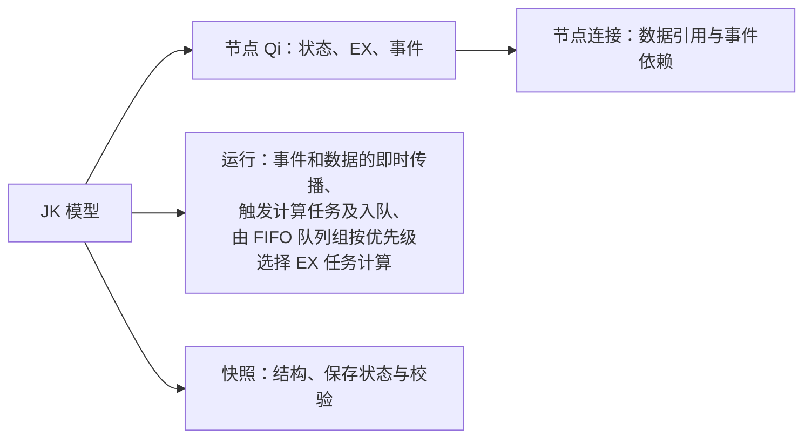
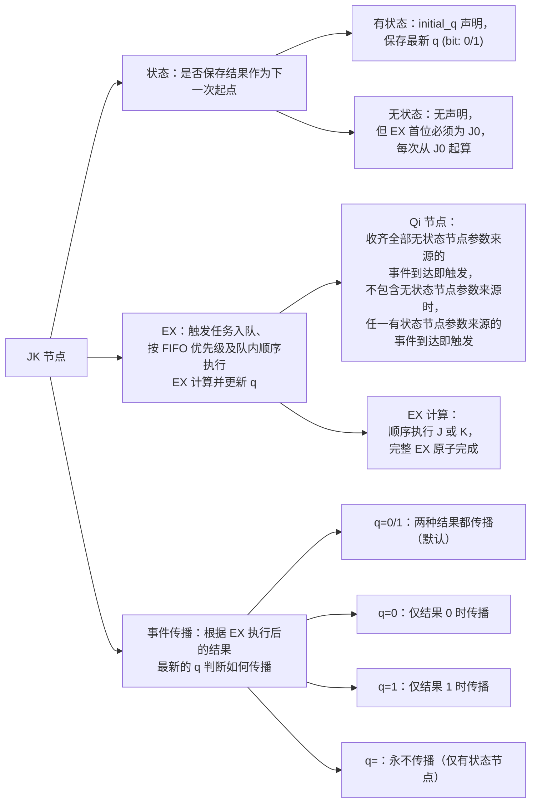
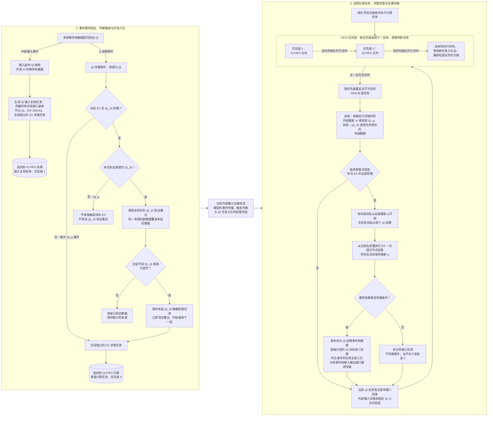
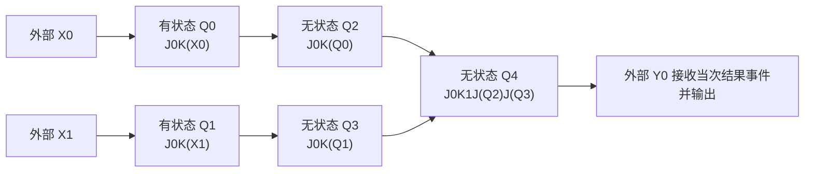

# JKRD（JK规则与设计 V4.0.0）

> 现行主源：本地 JK 项目。2026-10-03 从 JK 空间迁入；原文、块元数据与来源版本保存在 provenance。后续规则在本项目维护。原有历史验证日期与范围保持不变。

### 本文件是 JK 项目的统一且唯一计算契约 JKRD，定义模型组成、节点状态与 EX（节点的 J/K 顺序求值表达式）格式、输入副本、J/K 顺序求值、事件触发与即时传播、计算任务的 FIFO（First In, First Out，先进先出）队列组及执行优先级、外部输入输出的事件与数据要求、扩展设计与结构示例、快照与校验及优化边界。

## JK_NET、JK_LOGIC、ModelShow 及其他相关 JK 项目均以 JK 项目为规则与设计主来源，并引用本文件，不重复定义 JKRD 内容。

## 具体结构及验证分别记录在专题页，不由旧代码或历史测试另行定义规则。

## **阅读顺序**：模型概览 → 节点规则 → 事件的触发与传播、EX 的参数数据与执行 → send 输入 Xi 和 输出 Yi 的事件与数据要求 → 快照与校验 → 扩展设计与结构示例 → 优化与验证边界。

## 模型概览

- JK 模型只操作 Qi 节点；`send` 输入 Xi 和 Yi 输出由外部处理，接口要求集中在“send 输入 Xi 和 输出 Yi 的事件与数据要求”。

| 组成 | 标记 | 行为主体 | 职责 |
| --- | --- | --- | --- |
| 输入位 | `X0..Xn` | 外部输入数据和事件 | 外部输入 bit（位）0 或 1 数据，每次更新数据并传播事件到同编号有状态 Qi 节点 |
| JK 节点 | `Q0..Qn` | JK 模型内部处理数据和事件 | 可保存当前 q，按自己的 ex 执行计算，再按条件传播事件。彼此连接为运行结构 |
| 输出位 | `Y0..Yn` | 外部接收数据和事件 | 通过 q_y 绑定一个传播条件为 `q=0/1` 的已有 Q 节点，接收其事件和当次 0 或 1 数据并输出 |

#### 设计的核心是把计算公式分解成一个或多个节点的 `ex` 和连接结构，把需要保留的数据（带记忆）写成有状态节点的 q，把何时执行写成参数来源和事件规则，并用节点的传播条件决定计算完成后是否发布事件。同一个 Q 结果可以供多个后继 Qi 节点使用，外部输出可按 q_y 绑定接收。计算来源从 ex 解析，外部绑定从 q_y 解析，无需另存一套来源关系。引用数量的约束及计数口径见“来源引用与关系”。

### JK 模型组成概览



### JK 节点组成概览

| 分支 | 职责 |
| --- | --- |
| 状态 q | 保留 EX 计算结果数据（带记忆） q (bit: 0/1)，有状态的下一次计算从 q 开始 |
| EX | 参数事件满足触发条件后形成求值任务并入队，<br/>按 FIFO 队列优先级和队内先进先出次序<br/>计算 EX 并把本次结果更新到 q |
| 事件传播 pro | EX 计算完成后根据结果 q 和传播条件 pro 决定是否传播事件 |




## 节点规则

### 节点状态分类

| 分类 | initial_q 的要求 | EX 的要求 | q 的作用 |
| --- | --- | --- | --- |
| 有状态节点 Qi_q | 在 initial_q 中仅出现一次 | 遵守 EX 规则 | q 值会被初始化，<br/>q 值会被 EX 计算后更新，并按传播条件发布，<br/>作为下一次起点 |
| 无状态节点 Qi_J0 | 在 initial_q 中不出现 | 遵守 EX 规则<br/>且 EX 必须以 J0 开头 | 每次 EX 从 J0 清零起算；<br/>结果 q 仅作为临时值并按传播条件发布，<br/>不作为下一次起点 |

- 节点分类只由 initial_q 决定：出现在 `initial_q["0"]` 或 `initial_q["1"]` 中的 Q 是有状态节点，并且仅出现一次；未列入的 Q 是无状态节点。本文的 Qi_q 和 Qi_J0 仅为分类记号，也不因有状态 EX 以 J0 开头而改变分类。
- 有状态节点可以在 EX 中（像常量一样）显式引用自己；无状态节点不得显式引用自己。有状态节点自身的结果事件不会触发自身下一次 EX。
- 每个 Xi 必须唯一对应同编号的有状态输入副本 Qi，表达式固定为 `J0K(Xi)`，并在 initial_q 中声明初始值 0 或 1。
- Xi 只能被该输入副本引用，后续计算节点只能引用 Q 节点及常量（字面量） 0、1；N 个输入 `X0..X(N-1)` 对应 `Q0..Q(N-1)`，其他节点继续使用后续编号。

### J 和 K 的基本规则

这里的 J 和 K 是项目自定义的布尔操作。每一步使用上一步的 q 和当前参数 x，执行后得到新的 q。下式中 AND 表示逻辑与，XOR 表示逻辑异或。

```text
J(x): q ← q AND x
K(x): q ← q XOR x
```

| q | x | J 真值表 |
| --- | --- | --- |
| 0 | 0 | 0 |
| 0 | 1 | 0 |
| 1 | 0 | 0 |
| 1 | 1 | 1 |

| q | x | K 真值表 |
| --- | --- | --- |
| 0 | 0 | 0 |
| 0 | 1 | 1 |
| 1 | 0 | 1 |
| 1 | 1 | 0 |

| ex 中 JK 真值操作 | 效果（JK 设计始源） |
| --- | --- |
| `J0` | 置 0 |
| `J1` | 保持 q |
| `K0` | 保持 q |
| `K1` | 翻转 q |
| `J0K1` | 在 ex 中先置 0 再翻转，得到 1 |

### EX 格式与顺序计算

| 基本操作 | 功能 | 严格 ex |
| --- | --- | --- |
| 逻辑非 | NOT Q0 | `J0K1K(Q0)` |
| 逻辑与 | Q0 AND Q1 | `J0K1J(Q0)J(Q1)` |
| 逻辑或 | Q0 OR Q1 | `J0K1K(Q0)J(Q1)K(Q0)` |
| 逻辑异或 | Q0 XOR Q1 | `J0K(Q0)K(Q1)` |
| 逻辑同或 | Q0 XNOR Q1 | `J0K1K(Q0)K(Q1)` |
| 逻辑与非 | Q0 NAND Q1 | `J0K1J(Q0)J(Q1)K1` |
| 逻辑或非 | Q0 NOR Q1 | `J0K1K(Q0)J(Q1)K(Q0)K1` |
| 复制输入 | 输入副本 Q0 复制 X0 | `J0K(X0)` |

- 允许的操作单元只有 `J0`、`J1`、`K0`、`K1`、`J(Xi)`、`K(Xi)`、`J(Qi)`、`K(Qi)`，Xi 引用还必须满足输入副本的专用约束。
- ex 是非空、扁平无嵌套的 J/K 操作序列，从左到右依次执行。
- 输入副本的 ex 固定为 `J0K(Xi)`；其他节点的 ex 必须至少引用一个非自身的 Q 节点。
- 复杂或嵌套逻辑可通过多节点结构引用进行拆分。
- 一次求值任务原子完成整个 ex，另一 ex 不插入其中，无嵌套。

### 常量节点的定义及拒绝

- 纯常量参数计算节点指 ex 的全部操作仅包含 `J0`、`J1`、`K0`、`K1` 作为完整节点 ex；必须拒绝该类常量节点。（该约束按参数来源判定，不因合法表达式某次计算得到 0 或 1 就将其判为非法。）

### 来源引用与关系

| 关系 | 从哪里确定 | 用途 |
| --- | --- | --- |
| EX 参数使用位置 | ex 中每个 Xi 或 Q 引用的位置 | 确定每个 J/K 操作使用的参数，重复使用同一来源的操作仍分别执行 |
| 引用数量 ex_source | 对节点 ex 中的 Xi 和 Q 来源按节点编号去重，再排除节点自身 | 统计该节点引用的不同于自身的来源数量 |
| 来源事件关系 | 对目标 ex 中的来源去重，并排除目标自身 | 建立非自身来源到目标 Qi 的事件关系，并判断所需 Qi_J0 来源是否收齐；显式自引用只提供计算参数 |
| 外部 Yi 绑定 | q_y 中的 Yi 与 Q 对应关系 | 计入该 Q 的被引用数量，不增加 EX 参数或 Qi 计算任务；外部接收与输出要求见输入输出章节 |

- 节点的引用数量就是 `ex_source`，下限为 ≥ 1；同一来源在该节点的 ex 中重复出现只计 1 个，常量 0、1 不计数。
- Xi 与 Q 属于不同来源类型，按完整编号区分；输入副本 `Qi = J0K(Xi)` 引用的是 Xi，不属于自引用，其 `ex_source` 为 1。
- 节点的被引用数量下限为 ≥ 1，按引用它的不同其他 Q 节点数量与通过 `q_y` 绑定它的不同 Yi 数量之和计算；同一其他 Q 的 ex 多次引用它只计 1 个，每个不同 Yi 的绑定分别计 1 个。
- 有状态节点自身保存的 q 是求值起点，不计入引用数量或被引用数量；节点在 ex 中显式引用自身时，这条自引用也不计入这两项数量。
- 有状态节点显式引用自身时，保留对应 J/K 操作，但不建立自身到自身的事件关系，不因自身结果生成自己的下一次求值任务；无状态节点显式自引用必须拒绝。
- 检查全部 Q 来源到引用目标的连接；排除合法的有状态自身引用后，必须形成 DAG（Directed Acyclic Graph，有向无环图），不允许多个节点之间形成事件触发环，不能因节点有状态或传播条件过滤而豁免。

## 事件的触发与传播、EX 的参数数据与执行

### EX 基本流程

- 下图只描述模型对 Qi 的处理：左侧接收外部 Xi 或非自身 Qi 的来源事件，立即处理数据并将符合触发条件的 Qi 任务加入对应队列；右侧按优先级执行 Qi 的 EX，事件本身不排队。
- 每次选择下一任务前，当前完整 EX 及全部结果传播、已发生来源事件对应的 Qi 任务入队必须完成，并满足外部输入交接要求；若有快照保存请求，先在此边界完成保存。外部输入的更新次序与执行期间到达要求见“send 输入 Xi 和 输出 Yi 的事件与数据要求”。
- Qi 传播事件来源为非自身 Qi，自身不向自身传播事件，自身结果不触发自身



- `Xi.FIFO` 和 `Qi.FIFO` 各自按先进先出次序执行；优先级只决定下一任务，不能打断当前完整 EX 或其结果传播。
- 图中左侧的入队与右侧的取队首操作使用同一组队列；结果传播会再次触发左侧流程，所有直接目标处理完成后，才允许选择下一计算任务。
- “当前已经发生的”，不包含“等待缺少的 Qi_J0 来源”这一未来过程。未收齐的集合可以继续等待，已有任务仍可执行。
- 无法获取并固定本次 EX 的全部参数（包括输入复制任务无法读取对应 Xi）时，直接结束本次任务，不进入 EX 求值与结果传播；之后仍先处理保存请求，再按队列组优先级选择下一任务。

### 触发求值任务，依据 参数来源结构 与 触发规则

| 目标 ex 的参数情况 | 允许的来源 | 触发 EX 求值任务，<br/>生成一个任务追加到对应队列队尾 | EX 的参数数据，<br/>固定为本次 EX 的参数 | EX 的实际开始计算 |
| --- | --- | --- | --- | --- |
| 输入副本 `J0K(Xi)` | 字面量 0、同编号 Xi | 每次 Xi 到达时，加入 `Xi.FIFO` | 任务开始执行时读取最新 Xi；无法读取时结束本次任务 | 按优先级选中任务且成功读取 Xi 后 |
| 普通节点，没有 Qi_J0 参数 | 0、1、Qi_q | 每次 Qi_q 来源的事件到达时，加入 `Qi.FIFO` | 任务开始执行时读取 Qi_q 的最新实际 q | 按优先级选中任务并读完参数后 |
| 普通节点，至少有一个 Qi_J0 参数 | 0、1、Qi_q、Qi_J0 | 仅收齐全部不同 Qi_J0 来源的事件及数据时，<br/>携带本组数据加入 `Qi.FIFO` | 任务开始执行时读取 Qi_q 的最新实际 q ，<br/>加上任务保存的本组 Qi_J0 数据 | 按优先级选中任务并读完参数后 |

- “触发”表示满足条件并形成一次待执行任务；完整 EX 在该任务按队列优先级和队内次序被选中时求值，事件本身即时传播，不进入计算队列。
- 同一非自身来源在 ex 中出现多次，只形成一条来源到目标的事件关系，多次独立到达仍分别处理。字面量 `0/1` 不产生事件。
- 未收齐全部不同 Qi_J0 来源的事件及数据时，同一 Qi_J0 来源的新数据覆盖该目标同一位置的旧数据，来源已经到达的数据继续保留。

### 事件传播/事件发布规则

- 节点先完成整个 EX 计算并更新 q 值，再依据该结果判断本次传播条件。发布的事件携带本次完整计算的 0 或 1 数据，立即传播到直接引用本节点的其他 Qi；对外传播要求见“send 输入 Xi 和 输出 Yi 的事件与数据要求”。

| 传播条件 | 发布行为 | 适用节点 |
| --- | --- | --- |
| `q=0/1` | 每次完整 EX 执行结束后都发布一次事件 | 有状态、无状态 |
| `q=0` | 仅当本次完整 EX 的最终结果为 0 时发布一次事件 | 有状态、无状态 |
| `q=1` | 仅当本次完整 EX 的最终结果为 1 时发布一次事件 | 有状态、无状态 |
| `q=` | 永不发布事件，无论本次结果为 0 还是 1 | 仅有状态 |

- Qi 节点通过可选字段 `pro` 配置传播条件；未配置时默认采用 `q=0/1`，显式 `q=0/1` 与默认值语义相同，输入副本也遵循这一规则。
- 传播条件适用于该节点的全部结果事件，只在完整 EX 结束后判断一次，不因中间的 `J0` 清零而发布。
- 条件不满足时，节点仍已完成求值和结果更新；未发布事件不等于向下游发送 0，被过滤的 Qi_J0 结果不计入目标到达集合。
- `q=` 仅关闭事件发布，不关闭输入触发、任务入队、EX 求值或 q 更新；它不表示未配置、q 没有值或前后结果相同，无状态节点采用 `q=` 必须拒绝。
- pro = `q=` 的有状态节点，仍然可被其他 Qi 节点引用或读取 q 值。
- 相同结果连续出现时，符合传播条件的每次结果仍分别发布，不按结果值合并或跳过。
- 初始化只设置初始状态；快照恢复还原结构、有状态 q 及 FIFOS 中的任务。不执行 EX、不发布事件；外部输出行为见输入输出章节。

### EX 求值任务与 FIFO 队列组

FIFO 队列组统一选择下一次要执行的计算任务。任务生成、任务参数和队列选择分别由以下规则确定。

#### 事件到达与任务入队

- 每次触发生成一个独立任务，同一目标可以同时有多个待执行任务，不按节点编号、相同输入值或相同结果值合并、去重或跳过。
- 一个参数来源的一次到达事件只能生成一个任务或不生成任务。EX 中多次重复使用同一参数来源也视为一个参数来源，同一触发也不能因重复检查当前数据而再次入队。
- 一次结果传播期间，所有直接引用的其他 Qi 目标立即处理到达数据并判断触发条件，符合条件的任务全部加入对应队列，不递归执行后继 EX。
- 同一次传播使多个普通目标满足条件时，按目标 Q 的数字编号升序追加到普通计算队列，以确定并列入队次序。
- 已入队任务的触发条件已经满足，不因来源后来改变 q 而撤销；执行时不重新检查来源当次的传播条件，也不等待原到达集合重新收齐。输入复制任务无法读取 Xi 时，按参数取值规则结束该任务，这不属于重新检查触发条件。

#### Qi_J0 到达集合与任务数据

- 每个目标分别维护自己的无状态来源到达集合。集合保存尚未组成任务的数据；已组成任务的数据由该任务独立持有。

| 到达阶段 | 数据处理 | 是否生成任务 |
| --- | --- | --- |
| 还缺少某个不同 Qi_J0 来源 | 保留已有数据；同一来源再次到达时，只覆盖当前集合中该来源的位置 | 否 |
| 全部不同 Qi_J0 来源收齐 | 将本组数据锁存到新任务，立即清空该目标的到达集合，开始收集下一组 | 是，追加到 `Qi.FIFO` |
| 旧任务已入队，下一组数据到达 | 新数据进入下一组集合，不改写旧任务携带的数据 | 按下一组是否收齐判定 |
| 目标含 Qi_J0 参数，但到达来源为 Qi_q | 不增加无状态来源到达项，不单独触发该目标，也不改写来源实际 q | 否 |

- 各目标的到达集合互相独立，旧任务执行结束不得清空正在收集的下一组数据，也不得清除其他目标的集合。
- 未收齐的数据可以跨多次 `send` 保留，计算队列清空不清除到达集合。
- 未收齐的数据只在当前运行实例中保留，不写入快照；快照恢复后各目标的到达集合为空，已入队任务携带的锁存数据单独恢复。
- 到达集合没有默认的输入批次配对机制；需要同批数据配对时，必须由模型结构明确保证。

#### 任务保存与参数取值

- 每个任务标识目标 Q；有 Qi_J0 参数时，还持有收齐入队时锁存的本组数据。参数取值完成后，整个 EX 使用同一组固定参数。

| 数据 | 取值时机与使用方式 |
| --- | --- |
| 输入副本引用的 Xi | 复制任务开始执行时读取最新 Xi，不保存触发当时的历史值；无法读取时结束该任务，不执行 EX |
| 普通节点引用的 Qi_q | 任务开始执行时读取来源的最新实际 q，不使用早先发布事件携带的历史 q |
| 普通节点引用的 Qi_J0 | 全部来源收齐并形成任务时锁存，执行时使用该任务保存的本组数据 |
| 目标自身的有状态 q | 任务开始执行时读取最新 q，作为本次求值起点；同一目标的下一任务读取前一任务已提交的状态 |
| 有状态目标显式引用自身的 Q 参数 | 读取任务开始时自身已保存的 q 并固定；不随本次 J/K 操作的累加值变化，也不产生自身事件触发 |
| 无状态目标的起点 | 按合法 EX 的首个 `J0` 清零，再执行后续操作；暂存结果不使节点变为有状态 |
| 字面量 0 和 1 | 直接使用 EX 中的常量，不产生到达事件或任务 |

- 同一来源在 EX 中重复出现时使用同一个已读取的值，不在各 J/K 操作之间重新读取参数。
- J/K 操作逐步改变的是本次求值的累加值，整个 EX 完成后一次提交节点结果。
- 读取 Xi 或来源 q 不执行来源 EX、不改变来源状态，也不产生事件。
- 任务等待期间的 Xi 或 Qi_q 变化会影响任务开始时的读取；已经开始的任务继续使用固定参数，已锁存的 Qi_J0 数据不被后续到达改写。
- 有状态节点允许以 `J0` 开头，但初始化和恢复时不提前执行这个操作；输入副本也只在复制任务实际执行时清零并复制。
- 输入复制任务出队后，先判断对应 Xi 是否可读；无法读取时结束并移除该任务，不执行任何 J/K 操作，连首个 J0 也不执行，Qi 的已保存 q 保持不变，不产生 Qi 结果事件。
- Xi 的 0 和 1 都是可读的有效数据；不得把 Xi=0 当作缺失，也不得用 Qi 的已保存 q 代替缺失的 Xi。
- 不在快照加载时提前删除 Xi 不可读的任务；若任务执行前已有新输入更新对应 Xi，该任务仍读取执行时的最新 Xi 并正常执行。

#### FIFO 队列组的选择、求值与即时传播

FIFO 队列组由多条独立的 FIFO 队列组成，统一选择下一次要执行的任务。

- 每条队列有自己的任务范围和优先值；当前队列组的成员、任务归属与选择条件如下表所示。

| 队列 | 保存的任务 | 优先值 | 选择条件 |
| --- | --- | --- | --- |
| `Xi.FIFO` | Xi 到达后生成的同编号 Qi 输入复制任务 | 1 | 队列非空时优先选择队首任务 |
| `Qi.FIFO` | 除输入副本外，其他节点满足触发条件后生成的普通 EX 求值任务 | 5 | 仅当 `Xi.FIFO` 为空且本队列非空时，才选择本队列的队首任务 |

- 同一队列组内，各队列分别按入队先后执行；不同队列之间按优先级选择，不按跨队列的统一入队先后选择。
- 当前每个任务只加入与其目标节点相符的一条队列；输入副本任务归入 `Xi.FIFO`，其余节点的任务归入 `Qi.FIFO`，不因任务参数中引用输入副本而改变归属。
- 优先值 1 高于优先值 5；每次从最高优先级开始检查，找到第一条非空队列后只取一个队首任务，所有队列均为空时进入等待。
- 同一队列组内，各队列的优先值必须不同，确定后不允许修改；当前 Xi.FIFO 固定为 1，Qi.FIFO 固定为 5。
- 新增队列时必须同时定义其任务归属规则及与已有队列不同的固定优先值；尚未新增的队列不提前分配任务。
- 每次开始下一任务前，当前已经发生的输入更新和结果传播所触发的全部任务必须先加入各自队列；若有快照保存请求，先完成保存，再按优先级选择队首任务。
- “全部任务”只包括当前已经触发的任务；尚未执行的任务将来产生的新事件，在实际产生并满足条件时再形成后继任务。
- 每个任务结束后，先处理保存请求，再从队列组最高优先级重新检查；执行过 EX 的任务须先完成全部结果传播，无法读取 Xi 的输入复制任务结束后同样经过保存边界，不能连续处理普通队列而忽略新到达的输入复制任务。
- 优先级只决定下一任务，不能打断正在执行的完整 EX，也不能将下一计算任务插入当前结果传播的处理过程。
- 队列组内所有队列均为空时不选择任务；新任务入队后仍须满足上述执行边界，再从最高优先级检查。存在持续触发时，不能假定队列一定会清空。
- 一次计算单步处理按上述规则选出的一个任务：参数可读时完整执行 EX 及其结果传播，可以形成零个、一个或多个后继 Qi 任务，并按传播条件发布 Qi 结果事件；输入复制任务无法读取 Xi 时，只结束该任务，不执行 EX。

```text
当前输入更新与当前完整求值、结果传播结束
→ 当前已触发任务全部加入各自队列
→ 若有快照保存请求，先保存同一边界的节点状态及队列任务
→ 优先取 Xi.FIFO 队首；Xi.FIFO 为空时才取 Qi.FIFO 队首
→ 读取参数；输入复制任务无法读取 Xi 时直接结束本次任务
→ 参数可读时固定本次参数，完整执行 EX，一次提交结果
→ 执行过 EX 时判断传播条件，立即传播 Qi 事件和数据，并完成后继 Qi 任务入队
→ 回到输入更新、求值与传播均结束的边界；先处理保存请求，再从最高优先级检查队列，全空则等待
```

## send 输入 Xi 和 输出 Yi 的事件与数据要求

### 外部处理与 JK 模型的职责边界

- `send` 输入 Xi 和 Yi 输出均由外部处理任务完成；JK 模型只操作 Qi，负责 Qi 的状态、EX 求值、结果事件传播及 Qi 计算任务队列。
- Xi 是外部提供的事件与数据来源，对 Qi 而言只读，Yi 是外部接收 Qi 结果事件和数据的输出端；Xi、Yi 均不是模型内部的计算节点。
- `Xi.FIFO` 保存的是 Qi 输入副本的 EX 求值任务，`Qi.FIFO` 保存的是普通 Qi 的 EX 求值任务；两条队列均不保存或执行外部 `send` 任务、Yi 输出任务。
- 本模块规定外部与模型衔接时必须满足的事件和数据要求；外部如何采集输入、调用 `send`、展示或使用 Yi 结果，由外部应用实现。

| 处理范围 | 对象 | 职责 |
| --- | --- | --- |
| 外部输入处理 | `send`、`X0..Xn` | 更新所提交的 Xi 当前值，并将每次输入事件和 0 或 1 数据传播到对应 Qi |
| JK 模型内部 | `Q0..Qn` | 按触发规则生成 Qi 任务，按队列规则执行 EX，保存有状态 q 并传播结果事件和数据 |
| 外部输出处理 | `Y0..Yn` | 按 q_y 绑定接收 Qi 结果事件及当次数据，完成对外输出 |

### send 输入 Xi 的事件与数据要求

`send` 是外部输入处理任务，负责提交并更新外部 Xi 当前值。

- 外部每更新一个 Xi，立即将该次输入事件和数据传播到同编号输入副本 Qi；JK 模型由此生成该 Qi 的复制任务，有状态 Qi 仅在对应任务完整执行并提交结果后更新。

| 外部输入情况 | 外部 Xi 更新与模型 Qi 复制任务 | 对应 Qi 的状态 |
| --- | --- | --- |
| 初始化后，Xi 尚未收到数据 | 不生成复制任务 | 保留 initial_q 声明的初始值，下游可读取该值 |
| 快照恢复后，外部尚未提供可读 Xi | 保留 FIFOS 恢复的复制任务，出队时若仍无法读取 Xi 则结束该任务 | 不执行 EX，保留快照恢复的 q |
| 本次 send 提交了 Xi | 立即更新 Xi，每次到达形成一个复制任务 | 复制完成前仍保留初始值或上次复制结果 |
| 本次 send 未提交某个 Xi | 不更新该 Xi，不因此生成新任务 | 本次省略输入不直接改变它；已有待执行复制任务仍可能在之后更新它 |
| 同一 Xi 多次到达，复制任务尚未执行 | 每次保留独立任务，各任务执行时读取最新 Xi | 多个任务可能复制同一个最新值，仍分别执行并判断传播条件 |

- 外部 `send` 允许只提交部分端口，每次必须至少提交一个 Xi；外部输入处理必须拒绝空提交，每个输入数据只能是 0 或 1。
- 同一次外部 `send` 按 Xi 数字编号升序逐个更新指定端口，每次到达立即触发模型生成对应 Qi 复制任务并加入 `Xi.FIFO`；不能先替换全部指定输入值再统一触发。
- 更新 Xi 当前值属于外部 `send`；生成 Qi 复制任务、入队和执行 Qi 的 EX 属于 JK 模型，`send` 本身不是 Qi 的 EX 操作，也不直接改写 Qi 的 q。
- 同一次 `send` 的全部指定 Xi 完成数值更新和任务入队后，才允许开始下一计算任务；输入事件本身不另设等待传播的队列。
- 外部接收新输入不要求先清空模型计算队列；模型正在执行 Qi 输入复制或普通计算时，外部仍可更新 Xi 并使模型形成新的 Qi 复制任务。
- 外部新输入不修改正在执行的 EX 参数；当前 EX 及其结果传播全部结束、当前 `send` 的指定端口也全部完成更新和相应 Qi 任务入队后，模型先处理保存请求，再按优先级选择下一任务。
- 暂停模型计算时，外部仍可接收输入并使模型按规则形成 Qi 任务；已入队任务等待继续或单步执行。
- 一次 `send` 的输入更新与入队结束，不表示其后计算或输出已经完成；`send` 不自动建立输入批次与输出事件的配对关系。

### 输出 Yi 的事件与数据要求

`q_y` 声明外部 Yi 与已有 Qi 节点的事件和数据绑定；按绑定接收事件及对外输出由外部处理任务完成。

- Qi 完成 EX 后按自身传播条件发布结果事件和数据；外部 Yi 按合法绑定即时接收该次事件及数据并输出，JK 模型不执行 Yi 的输出处理。

| 绑定 Q 的情况 | 是否允许绑定 Yi | 输出行为 |
| --- | --- | --- |
| 默认或显式 `q=0/1`，有状态或无状态 | 允许 | 每次 Qi 发布事件时，外部 Yi 接收该次数据并输出一次 |
| `q=0` 或 `q=1` | 不允许 | 不能直接作为 Yi 的绑定来源 |
| `q=` | 不允许 | 该节点只保存内部状态，不发布事件 |

- 每个 Yi 绑定一个已有 Q 节点，绑定不改变该节点的状态分类、触发条件或传播条件。
- Yi 使用当次事件携带的 0 或 1，不用稍后读取 Q 的最新 q 替代；相同数据的多次发布分别输出，值为 0 的输出也必须保留。
- Yi 的输出时机由绑定 Q 的发布决定，无需等待计算队列组清空，也不要求不同 Yi 同时输出；绑定输入副本时也不等待其他副本完成复制。
- 初始化或快照恢复后、绑定 Q 首次发布前，本次运行不产生新的 Yi 输出；外部不用初始化值或尚未计算的结果补成输出。
- 输入提交后的计算过程可以产生零次、一次或多次输出；即使队列组内所有队列均为空且当前没有正在执行的 EX 或传播，也允许没有新输出。
- 绑定 Q 本次没有发布时，不重新输出其以前的结果；没有输出和输出数据为 0 是不同情况。
- 外部 Yi 不另设结果筛选条件，不执行新的 EX；Yi 的输出处理不加入模型计算队列，也不因绑定而增加 Qi 计算触发或标准快照字段。
- 输入连续到达或 Qi_J0 数据跨多次 `send` 收齐时，输出按实际 Q 发布发生；需要将输出与特定输入配对时，必须由模型结构或另行定义的接口契约保证。

### 外部接口配置与快照的关系

- `inputs`、`outputs`、`input_bits`、`output_bits` 描述外部端口及位宽，`q_y` 描述外部 Yi 与模型 Qi 的绑定；这些接口配置随快照保存，但不表示 JK 模型负责执行外部输入输出处理。
- 端口映射、位宽、绑定合法性及 q_y 对被引用数量的计数仍须校验，字段格式、指纹和保存范围见“快照与校验”。
- 标准快照不保存外部 Xi 当前值或 Yi 已发生的输出事件历史；恢复模型不执行外部 `send`，不恢复 Xi 当前值，不重放或清空外部系统已保存的 Yi 历史。
- 仅凭快照无法得到可读 Xi；外部尚未为本次运行提供可读 Xi 时，对应 Qi 复制任务在出队后结束而不执行 EX。外部在任务执行前提供新 Xi 时，任务仍按最新 Xi 正常求值。

- 外部输入输出接口和 Qi 计算任务不自动提供逐项业务历史保存；相关模型组合、扩展存储要求及结构示例见“扩展设计与结构示例”。

### 外部输入输出与 Qi 计算的配合示例

- 以下示例中的 `send` 和 Yi 输出均为外部动作；Qi 复制、任务入队、EX 求值及 Qi 结果传播由模型执行。
- 以下示例除特别注明外，传播条件均为默认 `q=0/1`，输入副本均在 `initial_q` 中声明；从空计算队列组和空 Qi_J0 到达集合开始，未列出的输入不在示例期间额外到达。
- 连续列举多次 `send` 时，除暂停或执行中到达示例外，均完成前一次全部已触发任务后再提交下一次；这是示例的输入顺序，不是运行时入口限制。

#### 部分输入使用其他输入副本的初始值

Q0、Q1 分别为 X0、X1 的有状态输入副本，初始 q 均为 0。无状态 Q2 的 EX 为 `J0K(Q0)K(Q1)`，Y0 绑定 Q2。

| 动作 | 输入复制队列 | 普通计算与输出 |
| --- | --- | --- |
| `send(X0=1)` | 只生成 Q0 复制任务，不生成新的 Q1 任务 | 尚未形成 Q2 任务 |
| Q0 完成复制并发布 1 | Q0.q 更新为 1，Q1.q 仍为初值 0 | Q2 入队，执行时读取 Q0＝1、Q1＝0，Y0 输出一次 1 |

本例没有读取尚未收到数据的 X1，已初始化的 Q1 提供了明确参数。

#### 一次输入提交触发两次完整计算

Q0、Q1 是初始为 0 的输入副本，有状态 Q2=`K(Q0)K(Q1)` 的初始 q 为 0，Y0 绑定 Q2。提交 `send(X0=1, X1=1)`，期间没有其他输入。

两个复制任务先全部进入 `Xi.FIFO`；Q0、Q1 分别完成复制，各形成一个 Q2 任务。输入复制队列清空后，两个 Q2 任务均读取 Q0＝1、Q1＝1。

| Q2 任务的触发来源 | 执行时读取的 Q0、Q1 | 完整 EX 计算 | 结果与 Y0 输出 |
| --- | --- | --- | --- |
| Q0 发布 1 | 1、1 | 0 异或 1 异或 1 | 0 |
| Q1 发布 1 | 1、1 | 0 异或 1 异或 1 | 0 |

本例有两次完整计算和两次值为 0 的输出，结果相同不使任务合并。

#### 正在计算时收到新输入

Q0 是 X0 的输入副本，当前 q 为 0；普通 Q1=`J0K(Q0)` 已开始执行并固定参数 Q0＝0。

| 顺序 | 动作 | 结果 |
| --- | --- | --- |
| 1 | 外部执行 `send(X0=1)` | 外部 Xi 当前值更新为 1，模型生成 Q0 复制任务并加入输入复制队列，Q0.q 仍为 0 |
| 2 | Q1 完成当前完整 EX 及结果传播 | 使用固定的 0 得到 0，此次传播触发的任务全部入队 |
| 3 | 重新检查队列优先级 | 先执行 Q0 复制任务，将 Q0.q 更新为 1，并完成此次传播及后继任务入队 |
| 4 | 输入复制队列为空后执行普通任务 | 引用 Q0 的新开始任务读取最新值 1，即使它早于本次输入就已入队 |

#### 输入改变后，待执行复制任务读取最新 Xi

Q0 是初始为 0 的输入副本；有状态 Q1=`K(Q0)` 初始 q 为 0，Y0 绑定 Q1。暂停计算时先接收 X0＝1，再接收 X0＝0，继续计算后没有新输入；本例不涉及快照加载。

| 执行次序 | 任务 | 参数 | 结果 |
| --- | --- | --- | --- |
| 1 | 第一次到达形成的 Q0 复制任务 | 最新 X0＝0 | Q0 发布 0，形成第一个 Q1 任务 |
| 2 | 第二次到达形成的 Q0 复制任务 | 最新 X0＝0 | Q0 发布 0，形成第二个 Q1 任务 |
| 3 | 第一个 Q1 任务 | 最新 Q0＝0，自身 q＝0 | Y0 输出 0 |
| 4 | 第二个 Q1 任务 | 最新 Q0＝0，自身 q＝0 | Y0 再输出 0 |

若两次到达均为 X0＝1，仍保留两个复制任务和两个 Q1 任务，Q1 的状态依次为 `0→1→0`，Y0 依次输出 1、0。

#### 已入队任务与下一组到达分别保存

目标 Q4 等待无状态来源 Q2、Q3。

| 到达或执行动作 | 已入队任务的数据 | Q4 正在收集的集合 |
| --- | --- | --- |
| Q2＝1、Q3＝1 收齐 | 第一个任务保存 `(1,1)` | 立即清空，开始下一组 |
| 旧任务执行前，Q2＝0 又到达 | 旧任务仍保存 `(1,1)` | 保存 Q2＝0，等待 Q3 |
| 旧任务执行完成 | 使用 `(1,1)` 完整计算 | Q2＝0 继续保留，不被旧任务清除 |
| 下一次 Q3 到达 | 可形成第二个任务 | 收齐后再次清空，开始后续组 |

若 Q4 还引用有状态输入副本 Q0，Q0 更新不单独触发 Q4；Q4 执行时读取 Q0 最新 q，并使用任务锁存的 Q2、Q3 数据。另一来源缺失期间，同一来源多次到达只更新当前集合中的一个位置；未收齐数据可跨多次输入提交保留。

#### 队列组内所有队列均为空而本次输入没有新输出

Q0、Q1 是初始为 0 的输入副本；无状态 Q2=`J0K(Q0)` 配置为 `q=1`；无状态 Q3=`J0K(Q1)` 和 Q4=`J0K1J(Q2)J(Q3)` 采用默认传播条件；Y0 绑定 Q4。

| 输入 | Q2 的行为 | Q3 的行为 | Q4 与 Y0 输出 |
| --- | --- | --- | --- |
| 第一次 X0＝1、X1＝1 | 发布 1 | 发布 1 | Q4 收齐后得到 1，Y0 输出一次 1 |
| 第二次 X0＝0、X1＝0 | 得到 0，不发布 | 发布 0 | Q4 缺少新的 Q2 数据，不形成任务，Y0 没有新输出 |

第二次输入的任务全部执行后，队列组内所有队列均为空，Q4 的集合保留 Q3＝0，Y0 不重复输出上一轮的 1。初始化后、第一次结果事件产生前，Y0 同样尚未输出。

#### 快照恢复后的输入与输出示例

以下使用“快照 JSON 示例”中的结构、Qi 状态及任务数组，展示外部输入输出与恢复后 Qi 任务的关系。

- 仅凭示例快照恢复、外部尚未提供可读 X0 时，两个 Q0 输入复制任务依次结束，均不执行 EX，Q0 保持恢复值；随后 Q4 使用任务携带的 Q2=1、Q3=0 和执行开始时 Q0=0 求值，得到 0 并发布结果事件，外部 Y0 接收当次数据并输出一次 0。
- 接着 Q2 使用 Q0=0 求值，结果为 0，不满足自身 pro="q=1"，因此不传播事件；所有队列清空，不再产生新输出。
- 若恢复后、处理队列前提交 X0=0，则两个已恢复任务及本次新生成的 Q0 任务均保留，执行时各自读取有效值 0 并正常完成复制；不会因为值为 0 而结束并跳过 EX。

## 快照与校验

### 快照字段与恢复范围

快照保存可加载的节点结构、指定有状态节点的已保存 q，以及 `FIFOS` 中的待执行任务。`initial_q` 同时决定有状态节点集合并保存其初始化值或最近一次完整 EX 已提交的状态，加载后作为起始状态；`q_y` 保存外部 Yi 与 Q 节点的事件和数据绑定。快照同时记录接口配置，不表示模型执行外部输入输出任务，接口要求见“send 输入 Xi 和 输出 Yi 的事件与数据要求”。

| 字段组 | 含义 |
| --- | --- |
| name | 快照名称，不参与计算语义或指纹 |
| format | 当前格式固定为 `jk-logic-structure-V4.0.0`，用于识别本节定义的结构与指纹规则 |
| nodes | 连续编号 Q0 至 Qn 的 id、ex 及可选 pro，按 Q 数字编号排序；默认传播条件规范化为省略，非默认值保留 |
| initial_q | 按 q 为 0、1 分组的有状态 Q，各数组按编号排序；每个成员恰好出现一次，未列入的 Q 为无状态 |
| q_y | 外部输出绑定配置，按 Y 编号排列，每个 Yi 绑定一个已有且传播条件为 q=0/1 的 Q |
| FIFOS | 按队列名称保存 Xi.FIFO、Qi.FIFO 的有序任务，每个任务写为 `{目标Q: {锁存的Qi_J0来源Q: 值}}`；无锁存数据时值为 `{}` |
| inputs 和 outputs | 外部有序 X 和 Y 端口的身份映射 |
| input_bits 和 output_bits | 外部输入输出位宽，当前标准快照各不超过 216 |
| jk_bits 和 jk_bits_max | `jk_bits=nodes.length`，且不超过 `jk_bits_max`；输入副本计入节点总数 |
| ex_source_max 和 ex_source_sum | 各节点引用数量 ex_source 的最大值及总和；每个节点内对来源去重并排除自身，跨节点不再去重 |
| ex_operation_max 和 ex_operation_sum | 单节点最多及全模型的 J/K 操作单元数量 |
| format_md5 | format、nodes、initial_q、q_y 的规范化指纹，包含有状态 q 的保存值 |
| md5 | 在 format_md5 对应字段的基础上，再包含 FIFOS、created_at 的规范化指纹 |
| created_at | UTC（协调世界时）日期小时与 Unix 纳秒时间戳组成的生成标记，参与 md5 |
| display | 展示配置对象，当前用字符串字段 show 保存展示方式；示例为 `{"show": "5D"}`，不改变计算语义或指纹 |

| 恢复范围 | 标准快照的处理 |
| --- | --- |
| 节点结构与有状态 q | 保存并恢复，包括每个 Xi 对应的同编号有状态输入副本 |
| 外部 Xi 当前值、无状态 Q 运行结果、未收齐的 Qi_J0 到达集合 | 不保存 |
| 计算队列组的待执行任务、各队列顺序及任务携带的 Qi_J0 锁存数据 | 通过 FIFOS 保存并恢复，保留重复任务 |
| 执行中的 EX 参数与累加中间值 | 不保存；等待当前任务及完整 EX、全部传播和当前输入更新入队结束后再保存 |
| 外部 Yi 已发生的输出事件历史 | 不保存，不重放；不清空外部系统已有历史 |
| 加载后的动作 | 恢复结构、指定状态及保存的任务，不提前执行 J0、输入复制或其他 EX，不自动发布 Qi 事件，也不执行外部输入输出任务 |

- 快照必须包含同编号有状态输入副本及合法的 Yi 绑定，加载后的运行遵循本文的输入、FIFO 队列组与输出规则。
- 保存请求到来时，等待当前任务及其完整 EX、全部结果传播、当前外部 send 的全部输入更新和相关 Qi 任务入队结束，再保存同一边界的节点状态与 FIFOS，保存完成后才能选择下一任务。
- 保存不要求队列为空，也不等待尚未到达的 Qi_J0 来源；尚未开始首个任务时，以及输入复制任务因 Xi 不可读而结束后，同样在选择下一任务前处理保存请求。
- 保存边界必须一致，不能把不同时间取得的节点状态与队列拼成一份快照；本节规定保存边界，不额外保存执行中间值。
- 标准快照恢复已保存的队列任务，但不保存 Xi 当前值和未收齐的 Qi_J0 到达集合，因此不保证与未中断运行产生相同的后续任务和输出；完整运行现场恢复须另行定义。
- 快照恢复时，模型的 Qi 计算队列组按 FIFOS 还原，Qi_J0 到达集合从空开始，下游可读取输入副本恢复后的 q；外部 Xi 的可读数据及 Yi 的历史不由模型恢复，按输入输出章节衔接。
- 快照恢复后的任务仍按队列优先级与队内顺序处理，不重新判断触发条件；含 Qi_J0 参数的任务使用自身已恢复的锁存数据，不等待这些来源再次产生事件。
- 快照恢复的输入复制任务若在出队时无法读取对应 Xi，就结束本次任务，不执行 EX；之后收到新输入时，按正常输入规则生成新的复制任务。
- 本节定义现行静态快照的字段与恢复范围；动态结构及其保存恢复要求集中在“扩展设计与结构示例”。

#### FIFOS 队列任务字段

- FIFOS 是以队列名称为键的对象，当前必须包含 `Xi.FIFO` 和 `Qi.FIFO`；每条队列用数组保存任务，第一个元素为队首，空队列保存为 `[]`。
- 每个任务是恰好含一个目标 Q 键的对象，键对应的值是该任务的 Qi_J0 锁存数据对象；例如 `{"Q4": {"Q2": 1, "Q3": 0}}`，无 Qi_J0 参数时写为 `{"Q2": {}}`。
- 任务锁存数据的键为来源 Q 编号，值只能为 0 或 1；必须恰好包含目标 EX 全部不同的 Qi_J0 来源，不含 Xi、有状态来源或未引用的来源。
- Xi.FIFO 只保存输入副本任务，其锁存数据对象固定为空；Qi.FIFO 只保存其他节点的任务，恢复时保持队列归属、数组顺序和重复任务。
- 相同目标的每次任务各占一个数组元素，不按目标 Q 合并；`[{"Q0": {}}, {"Q0": {}}]` 表示两个独立任务。
- FIFOS 不保存 Xi 当前值，也不复制有状态来源的 q；有状态 q 仍由 initial_q 保存，任务执行时读取来源最新 q。
- 未收齐的 Qi_J0 到达集合不写入 FIFOS；恢复任务携带的锁存数据只属于该任务，不能用它补充恢复后从空开始的到达集合。
- 队列优先值不作为可修改的快照字段，Xi.FIFO 固定为 1，Qi.FIFO 固定为 5；JSON 对象键排列不表示队列优先级。
- 新队列的名称、任务归属与不同于已有队列的固定优先值，在新增该队列时一并定义；当前格式不接受未定义的队列。

### 统计与快照指纹

- `ex_source` 就是节点的引用数量：统计其 ex 中不同的 Xi 和 Q 来源，排除节点自身，不计常量 0、1，同一来源重复使用只计 1 个。
- `ex_source_max` 为所有节点 `ex_source` 的最大值，`ex_source_sum` 为所有节点 `ex_source` 的总和；同一来源被不同节点引用时，在各引用节点中分别计数，不对全模型的来源再次去重。
- 例如 Q2 的 ex 为 `J0K(Q0)K(Q0)J(Q1)` 时，来源为 Q0、Q1，`ex_source` 为 2；重复使用 Q0 的操作仍执行，J/K 操作单元数量 `ex_operation` 为 4。
- `q_y` 绑定计入所绑定 Q 的被引用数量，不计入其 `ex_source`，也不增加 `ex_source_max` 或 `ex_source_sum`。
- 统计字段由实际结构计算，不能把显示统计误当成 EX 的固定长度限制。
- 指纹载荷的规范 JSON（JavaScript Object Notation，JavaScript 对象表示法）采用 UTF-8（Unicode 字符的 8 位编码格式）；递归按对象键排序，键值及元素分隔符分别为 `:` 和 `,`，不添加排版空格、换行或末尾换行，非 ASCII（American Standard Code for Information Interchange，美国信息交换标准代码）字符直接编码，不转义为 Unicode 编号。
- 字符串内容保持原值，不删除 ex 内部字符；数组保留各自规定顺序，尤其 FIFOS 中的任务数组不得排序、合并或去重；可读导出文件另按示例缩进。
- MD5（消息摘要算法第五版）用于计算下列两个指纹，结果写为 32 位小写十六进制字符串，不能替代功能验证。
- 公式中的字段组合表示建立包含这些字段名及对应值的 JSON 对象，再对该对象的规范 JSON 字节计算指纹；不是直接拼接字段值字符串，也不是把 format_md5 字符串拼入 md5。

```text
normalized_nodes = nodes 省略显式 pro="q=0/1"，保留非默认 pro
format_payload = {format, nodes: normalized_nodes, initial_q, q_y}
snapshot_payload = {format, nodes: normalized_nodes, initial_q, q_y, FIFOS, created_at}

format_md5 = MD5(format_payload 的规范 JSON 字节)
md5 = MD5(snapshot_payload 的规范 JSON 字节)
```

| 变化内容 | format_md5 | md5 |
| --- | --- | --- |
| format、nodes、initial_q 或 q_y | 纳入指纹计算 | 纳入指纹计算 |
| 同一有状态成员的保存值从 0 变为 1 或从 1 变为 0 | 纳入指纹计算 | 纳入指纹计算 |
| FIFOS 的任务数量、队内顺序、目标或锁存数据 | 不参与 | 纳入指纹计算 |
| created_at | 不参与 | 纳入指纹计算 |
| name、display、端口映射、位宽、容量及统计字段 | 不参与 | 不参与 |

- format_md5 包含 initial_q 的成员及其实际 0/1 保存值，不能用作忽略状态值的纯连接结构指纹；默认 pro 的省略与显式 `q=0/1` 按同一规范化结果计算。
- md5 在前一组字段的基础上增加 FIFOS 和 created_at；两组载荷均不包含 md5、format_md5 字段本身，不额外加入派生的有状态成员集合。
- 指纹只覆盖公式列出的字段，不代表整份 JSON 文件的每个字节；没有参与指纹的字段仍须通过各自的结构和数值校验。
- created_at 使用 `YYYY-MM-DDTHH:<Unix纳秒时间戳>` 字符串，两部分必须对应同一 UTC 时刻；示例的 `2026-10-08T00:1791417600000000000` 对应 `2026-10-08T00:00:00Z`，纳秒部分保持字符串以避免整数精度丢失。

#### 格式校验与旧快照处理

- 当前完整快照按下方示例的顶层字段集合保存；节点对象仅允许 id、ex 及可选 pro，initial_q 必须包含 "0"、"1" 两组。
- 已定义对象不接受未定义字段；展示配置集中放在 display，不放入 nodes，也不改变节点状态分类、EX 求值、传播或队列规则；show 的具体展示效果由展示层解释。
- 当前格式不兼容旧快照，也不修改旧快照内容；旧版本、旧字段及旧指纹均不能通过补字段、改名或重算指纹自动转换后加载。
- format 必须为 `jk-logic-structure-V4.0.0`；缺少 FIFOS、使用旧 propagation 字段或旧任务包装结构的快照均拒绝，不把缺失队列默认成空队列。
- 加载前须按本文公式分别核对两个指纹，并完成全部结构、状态、引用、队列及统计校验；指纹匹配不能豁免其他规则。
- 历史模型、报告和附件保留原始内容，本节更新不表示消费者执行器已支持当前格式。

### 结构校验与功能验证

| 校验对象 | 必须满足的条件 |
| --- | --- |
| 格式与字段 | format 为当前 V4.0.0 标记，字段及类型符合本节定义，不接受旧格式或未定义字段 |
| 表达式 | 合法操作单元、非空、扁平无嵌套、引用范围合法，不允许纯字面量节点 |
| 状态分类 | 仅依据 initial_q，拒绝重复或冲突初始化；无状态节点的 EX 必须以 J0 开头且不得显式引用自己；有状态节点可以显式引用自己，但自身结果不触发自身 |
| 输入副本 | 每个 Xi 恰有一个同编号有状态 Qi，EX 为 J0K(Xi)，并在 initial_q 中恰好声明一次；其他节点不得直接引用 Xi |
| Qi 传播与外部绑定 | pro 仅为本文四种传播条件；无状态节点不得采用 q=；外部 Yi 只能绑定默认或显式 q=0/1 的已有 Q |
| 节点、外部接口配置与统计 | 节点连续编号及规定顺序；inputs 数量与 input_bits 一致，outputs 和 q_y 数量与 output_bits 一致，各端口编号与映射合法；节点容量及各统计值符合实际结构 |
| FIFOS 队列任务 | 两条队列均存在，每个任务只有一个合法目标 Q 键且归属正确；值为恰好覆盖所需 Qi_J0 来源的 0/1 数据对象，无此类来源时为空对象；保留顺序和重复项，优先值唯一且固定 |
| 快照指纹 | 按本文字段组合、规范化方式与公式分别校验 format_md5 和 md5；不以旧指纹代替 |
| 引用与被引用数量 | 每个 Q 节点的 ex_source ≥ 1，被引用数量 ≥ 1；引用来源按节点去重并排除自身，被引用数量包含不同其他 Q 的引用与不同 Yi 的 q_y 绑定，自引用不计数 |
| Q 来源连接与循环 | 检查全部 Q 来源到目标的连接；仅排除合法有状态自引用，其余必须形成 DAG（Directed Acyclic Graph，有向无环图），不因状态分类或传播过滤而豁免 |

- 结构合法只说明符合结构约束，目标功能还须通过参考输入、任务执行过程和实际输出事件序列验证。

### 快照 JSON 示例

下方 JSON 包含两个有状态输入副本 Q0、Q1，两个无状态节点 Q2、Q3，一个有状态计算节点 Q4，以及 FIFOS 中的待执行任务。Q2 的传播条件为 q=1，其余节点使用默认 q=0/1；两个指纹按本节载荷实算。

- 正式导出时，哈希、时间、端口及统计字段由构建器生成，加载前须通过结构、统计及双指纹校验。
- 导出使用下方字段顺序和可读缩进，数组按既定顺序排列；导出和计算指纹前省略默认 `pro="q=0/1"`，保留非默认值。

```json
{
  "name": "JK 完整快照示例",
  "md5": "5085a0e5acaea6806c007fd3421327f7",
  "format": "jk-logic-structure-V4.0.0",
  "format_md5": "57891bd07d782ead902e6109079627e0",
  "created_at": "2026-10-08T00:1791417600000000000",

  "input_bits": 2,
  "jk_bits_max": 16,
  "jk_bits": 5,
  "output_bits": 1,

  "ex_source_max": 3,
  "ex_operation_max": 3,
  "ex_source_sum": 7,
  "ex_operation_sum": 11,

  "nodes": [
    {"id": "Q0", "ex": "J0K(X0)"},
    {"id": "Q1", "ex": "J0K(X1)"},
    {"id": "Q2", "ex": "J0K(Q0)", "pro": "q=1"},
    {"id": "Q3", "ex": "J0K(Q1)"},
    {"id": "Q4", "ex": "J(Q0)K(Q2)J(Q3)"}
  ],

  "initial_q": {
    "0": ["Q0", "Q1"],
    "1": ["Q4"]
  },

  "q_y": [
    {"Y0": "Q4"}
  ],

  "inputs": [
    {"X0": "X0"},
    {"X1": "X1"}
  ],

  "outputs": [
    {"Y0": "Y0"}
  ],

  "FIFOS": {
    "Xi.FIFO": [
      {"Q0": {}},
      {"Q0": {}}
    ],
    "Qi.FIFO": [
      {"Q4": {"Q2": 1, "Q3": 0}},
      {"Q2": {}}
    ]
  },

  "display": {
    "show": "5D"
  }
}
```

- 本例恢复后的输入、Qi 任务执行及外部输出过程，见“快照恢复后的输入与输出示例”。

## 扩展设计与结构示例

- 模型组合、锁存与动态等待区、滚动机制及其结构示例均属于扩展设计范围，相关要求、历史验证和待确认内容集中在本章。
- 扩展设计以已定义的 Qi 节点、EX、事件传播与计算队列规则为基础；其结构与示例不能反向定义基础计算契约，也不改变 send 输入 Xi、Yi 输出由外部处理的职责。
- Qi_J0 来源收齐后将数据锁存到求值任务，属于基础计算规则；本章的业务锁存、逐项历史保存与动态扩展另有设计要求，两者不能混同。
- 已确认的设计要求、已验证的结构示例、受限历史原型和待确认机制分别说明适用范围；归入扩展设计不取消已确认要求，也不表示已经实现或验证。

### 模型组合与结构示例

- 本节结构示例采用前文已定义的 Qi、EX、事件传播和队列规则，不增加新的基础操作或内置传播条件。
- 以下结构示例中的 send 与 Yi 输出由外部处理；除特别注明外，Qi 采用默认传播条件 q=0/1，输入副本均声明初始 q，从空计算队列组和空 Qi_J0 到达集合开始。
- 表中连续输入按轮次完成前一次全部已触发任务后再提交下一次，期间没有额外输入；这是示例条件，不限制外部输入时机。

#### 组合条件与携带数据的事件

| 组合条件 | 含义 | 结构方式 |
| --- | --- | --- |
| `changed` | 前后值改变 | 保存旧值，与本次值比较，按比较结果控制传播 |
| `unchanged` | 前后值相同 | 保存旧值，与本次值比较，按比较结果控制传播 |
| `rising` | 从 0 变为 1 | 保存旧值，组合判断旧值 0 与本次值 1 |
| `falling` | 从 1 变为 0 | 保存旧值，组合判断旧值 1 与本次值 0 |

- 这些条件由节点组合实现，不新增为内置传播条件，比较必须先于旧值回写。
- 控制是否发布与事件携带的数据分别由结构保证；需要输出时，可由内部许可结构控制数据节点求值，再由 `q=0/1` 数据节点发布本次 0 或 1 事件数据，外部 Yi 按输入输出章节的绑定要求接收并输出。
- 仅把某个许可节点设为 `q=1`，不能证明输出已被许可条件控制；必须按触发表检查其他来源是否会独立触发数据节点，并保证该任务使用的数据与许可对应。

完整表达式和历史验证见 [JK计数器与事件组合](logic_units/counters-events.md)；历史原型的数据递交结构见 [JK异步结构静态原型](logic_units/static-prototypes.md)。

#### 用到达屏障汇合两个输入

Q0、Q1 是初始为 0 的有状态输入副本；无状态 Q2、Q3 分别复制 Q0、Q1，再由无状态 Q4 等待这两个来源并计算逻辑与，Y0 绑定 Q4。同一次 `send` 各提交一次 X0、X1，期间没有其他输入。



本例先执行两个输入复制任务，再执行普通任务。Q2、Q3 的结果收齐后形成一个 Q4 任务，Q4 发布一次结果事件，外部 Y0 接收并输出两输入的逻辑与结果；这一配对由本例的输入和执行顺序保证，到达集合本身不标记 `send` 批次。

#### 有状态节点保存累计奇偶

Q0 是 X0 的输入副本，Q1 是 EX 为 `K(Q0)` 的有状态累计节点，两者初始 q 都为 0，Y0 绑定 Q1。

| 输入轮次 | X0 与 Q0 复制结果 | Q1 执行前 q | Q1 执行后 q 与本次 Y0 输出 |
| --- | --- | --- | --- |
| 1 | 1 | 0 | 1 |
| 2 | 1 | 1 | 0 |
| 3 | 0 | 0 | 0 |
| 4 | 1 | 0 | 1 |

相同输入 1 连续到达两次，仍分别产生复制、累计计算和输出事件。

#### 只更新状态而不传播

沿用输入副本 Q0，将有状态 Q1=`K(Q0)` 配置为 `q=`，初始 q 为 0；另设无状态 Q2=`J0K(Q0)K(Q1)`，Y0 绑定 Q2。

| X0 输入 | Q1 更新后的内部 q | Q1 是否发布 | Q2 结果与 Y0 输出 |
| --- | --- | --- | --- |
| 1 | 1 | 否 | 0 |
| 1 | 0 | 否 | 1 |
| 0 | 0 | 否 | 0 |

Q0 的事件使 Q1、Q2 按编号先后入队，Q2 在 Q1 之后执行并读取其最新实际 q。Q1 自身不发布事件，也不直接绑定 Yi。

### 锁存与动态等待区

#### 基础运行数据与扩展存储的边界

| 保存位置 | 保存内容 | 边界 |
| --- | --- | --- |
| EX 计算队列 | 已触发的任务、任务顺序及任务持有的 Qi_J0 数据 | 不保存 Xi、Qi_q 的每次历史值 |
| Qi_J0 到达集合 | 尚未收齐的各来源当前数据 | 同一来源的新数据可能覆盖旧数据，不是逐项历史队列 |
| 有状态存储与业务等待结构 | 模型显式保存的每次输入或结果 | 需要明确的逐项保存、消费确认及生命周期设计 |
| 外部 Yi 输出事件 | 本次绑定 Q 发布的结果数据 | 输出绑定本身不提供历史保存或重放机制 |

- 外部输入输出接口本身不保证逐项历史保存；若由 Qi 结构承载逐项保存，其滚动机制按本章“滚动机制待确认边界”另行讨论。
- 保留任务数量不等于保留输入历史，多个待执行任务可能读取相同的最新 Xi 或 Qi_q。
- 需要持续保存全部输入或结果并逐项确认消费时，必须显式构建数据保存结构，计算队列不提供长期存储、消费确认或动态节点生命周期。

#### 已确认的数据保存要求

- 需要保留每次数据时，每次到达必须独立保存到新增或分配的有状态存储节点，再按到达顺序追加业务等待队列，相同数据也是不同项。
- 前一项内部处理或消费尚未结束时，新输入仍须持续保存，等待区不设固定业务总容量。
- 存储结构必须按需扩展，在消费确认后回收或复用；锁存与确认只控制逐项消费，不能把等待转嫁为入口暂停。
- 业务等待结构可装在计算前保存全部输入，也可装在计算后保存全部结果；输出侧须在结果被覆盖前独立保存，不能用之后读取最新 q 代替历史结果。
- 内部状态不扩入必需外部输出，历史 43 节点原型的接口角色保持为 Q39 数据递交、Q41 有效消费确认，Q40 等仍是内部状态。
- 需要长期保存临时值时，应由有状态存储节点承载；静态节点容量字段不代表动态等待区固定的数据总容量。

详细要求见 [JK锁存与动态等待区](logic_units/latch-dynamic-waiting.md)。

### 滚动机制与原型边界

动态逐项保存机制称为“滚动机制”，具体方案留待后续讨论。现有扁平 EX 与静态节点表尚未定义创建、连接和释放节点的操作。历史 43 节点原型仅验证有限闭环，总容量为 3，采用满时拒收及串行入口协议。

- 动态结构管理、生命周期和恢复格式仍须具体设计与验证，固定容量原型不能替代动态等待区要求，也不能作为正式模式限制。
- 滚动机制涉及的动态增删节点、连接、编号、容量统计及保存恢复留待后续讨论，现有静态快照不表示已经具备动态格式。
- 逐项保存原始输入还须定义：如何在 Xi 被后续输入覆盖前独立保存每次到达的数据，以及这些数据如何与输入副本和任务执行衔接；当前复制任务读取最新 Xi 的规则保持不变。
- 逐项保存结果也须在后续结果覆盖前独立保存当次事件数据；仅增加存储节点数量或保留 EX 任务数量，不自动提供逐项历史保存能力。
- 历史原型的 `Y0→Q39`、`Y1→Q41` 属于原版本接口；其中 Q41 的历史传播条件为 `q=1`，输入结构和输出绑定仍须另行对齐现行规则，不能宣称已经兼容。
- 历史原文和附件保持原版本，不能通过改写历史模型的编号或接口来消除规则差异。

#### 滚动机制待确认边界

- 下表仅列滚动机制扩展设计的待确认内容；既有 Qi 计算、队列及静态快照契约保持已确认状态，静态快照示例不代替滚动机制的完整设计。

| 事项 | 已有要求 | 尚须明确的边界 |
| --- | --- | --- |
| 滚动机制 | 每次业务数据独立保存、按需扩展、消费确认后回收；标准快照只保存已定义的结构、有状态 q 和队列任务 | 原值覆盖前的数据接入、与输入副本及队列组的衔接、节点创建连接释放，以及完整运行现场的保存恢复机制 |

- 待确认边界不能由示例、历史附件、单个实现或一次测试结果自行定案；涉及这些边界的模型或机制须单独记录采用的假设及验证范围。

### 结构示例与专题入口

| 页面 | 负责内容 |
| --- | --- |
| [JK逻辑单元库](logic_units/logic-units.md) | 基础布尔单元与可复用结构入口 |
| [JK计数器与事件组合](logic_units/counters-events.md) | 计数器、前后值比较及组合事件的结构与验证 |
| [JK锁存与动态等待区](logic_units/latch-dynamic-waiting.md) | 持续接收、逐项保存、按需伸缩、递交与确认 |
| [JK异步结构静态原型](logic_units/static-prototypes.md) | 有限异步原型、模型 JSON、Q39 与 Q41 接口及验证边界 |

## 优化与验证边界

### 优化方法与证明范围

| 优化对象 | 必须保留的约束 |
| --- | --- |
| 输入副本 | 同编号关系、唯一性、有状态声明及固定 EX：J0K(Xi) |
| 单节点 EX | 来源集合、传播条件、由 initial_q 决定的分类；完整“旧 q 与所有参数到新 q”真值表等价 |
| 恒等操作 J1 和 K0 | 可在等价证明成立时移除，但结果仍须非空、保留合法来源；输入副本仍满足固定表达式 |
| 常量化简与输出 | 必须证明状态和事件行为等价；不创建或保留纯常量节点，不将保留节点化简为空；q_y 仍绑定已有且传播条件为 q=0/1 的合法 Q |

- 后续节点优化不得重新引入 Xi 直接引用，也不能通过增删 `J0` 推断或改写状态分类；无状态节点优化后仍须以 `J0` 开头。
- 优化后须重新检查来源约束、触发和传播行为，不能只因最终数值相同就接受删边、改源或任务合并。
- 单节点真值证明不证明整个网络节点数最少，也不自动证明任意重连、删边、常量折叠或跨输入更新的调度保持完整事件行为。
- 优化验证须核对外部 Yi 依据 Qi 发布事件形成的每次输出序列、模型状态序列、任务生成与执行次数、队列归属、队内入队与执行顺序、优先选择次序、任务锁存数据与执行时读取的参数、传播次数、到达条件和待消费缓存。
- 达到枚举限制必须报告未完成，不能视为已经证明最小。
- 优化后仍须检查全部 Q 来源连接；有状态显式自引用保留为计算参数且不触发自身，无状态节点不得显式引用自己，排除合法自引用后的全部 Q 来源连接必须无环。

### 规则来源与实现边界

- **规则主源**：JKRD 是统一计算契约，用户最新明确确认优先；规则先在本文件明确，再对齐相关项目，README、代码、测试、生成器、技能及历史模型不能反向定义规则。
- **实现边界**：JK_NET、JK_LOGIC、ModelShow 等消费者须分别完成规则对齐与定向验证；文档更新不代表执行器已兼容，单个消费者的验证结果不代表其他消费者已通过。
- **专题边界**：专题提供设计细节、模型示例与验证记录，涉及计算规则时以本文为准；引用专题不代表其中模型或原型已符合现行规则。
- **历史边界**：历史原文、报告及附件保持原始内容与原版本验证范围；规则差异另行记录，不通过改写历史材料宣称已符合现行规则。
- **设计边界**：已确认设计不等于已实现或已验证；扩展设计的适用范围、结构示例及待确认事项统一见“扩展设计与结构示例”。
- **验证边界**：结论仅适用于实际验证的版本、输入与检查范围；结构合法、单节点真值等价、具体示例通过不能互相替代，也不能推定整个网络事件等价、消费者全面兼容、训练收敛或泛化。

# 第 1 到 234 行，我已经检查并确认了！以该部分内容为主！如需改动该部分内容必须请求确认！