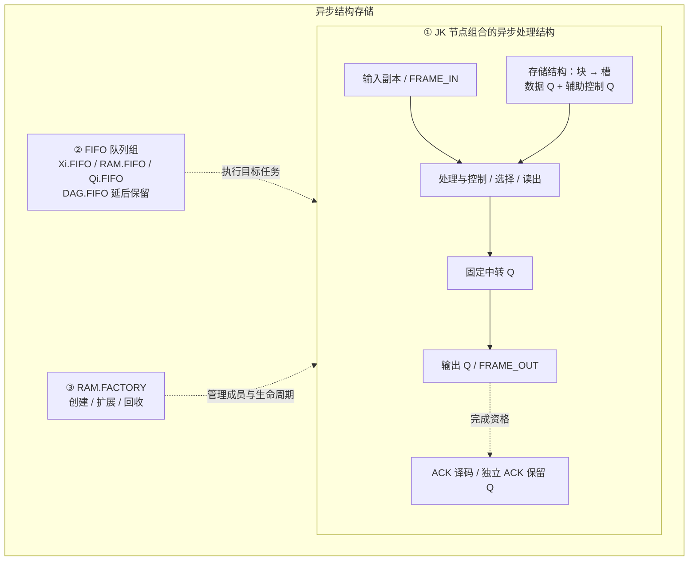

# JK 异步结构存储模块（逻辑单元设计草稿）

> 2026-10-19 整理。本文件统一维护异步结构存储模块的规则、设计、确认差异及实验记录；基础计算规则以 [JKRD V5.0.0](../JKRD.md) 为准。业务行为已确认的部分与尚未完成的结构设计分别列明，文档升级不表示演示器已经符合全部现行规则。
>
> **节点没有豁免。** 链尾、池节点、停用节点均遵守 V4 延续的节点约束。现有演示中的多节点互引仍不满足沿用的 DAG 约束，见 [实现边界](#implementation-boundary)。环判定与监督、快照与恢复统一放在 JKRD 的延后处理区。

## 一、来源、范围与三个组成部分

来源包括 [原始差异稿 E01–E67](../drafts/JKRD-V5.0.0-diff.md)、[后续补充与纠正](../drafts/JKRD-V5.0.0-notes.md)、本次用户确认的交互执行方案，以及本次“按三个区域更新 V5、不批准节点豁免”的指令。原稿保留历史文字，当前选择以本文及 [V5 更新对照](../drafts/JKRD-V5.0.0-integration.md) 为准，不再把已否决或已替换的提案列作待批准规则。

模块负责持续接收、逐帧独立保存、按序递交、ACK 重发或消费、按需扩展与安全回收。它由以下三部分协作：

| 部分 | 职责与归属 |
| --- | --- |
| JK 节点组合的异步处理结构 | 输入副本、FRAME 节点、处理与控制节点、存储块/槽的数据 Q 及辅助 Q、选择/读出、中转、输出、ACK 译码及保留数据节点；所有业务数据和控制状态在这些 JK q 中 |
| FIFO 队列组 | 保存节点任务及其锁存参数，按优先值和队内顺序执行 EX；RAM.FIFO 是队列组的一员。队列里是任务，节点仍属于其结构 |
| RAM.FACTORY | 创建、连接、登记、扩展、释放与回收结构，维护成员、容量及世代；它管理的存储节点仍属于第一部分 |



本图表示职责及流程，不作为逐节点 EX 引用图。外部 Xi、ACK、Yi 端口可放在结构框的接口区域展示，但不是内部 JK 计算节点。“存储结构”是第一部分的内部区域，不是第四种计算主体。

## 二、共用规则与模块边界

### 节点规则完整沿用，不设豁免

来源：V4 节点规则、原稿 E04–E07、E54；本次明确否决豁免。

- `initial_q` 唯一决定有状态/无状态，J 为 AND、K 为 XOR；EX 非空、扁平、从左到右完整执行。无状态 EX 以 J0 开头，有状态显式自引用只提供参数，不产生自触发。
- 每个现存 Q 的非自身来源数量 `ex_source ≥ 1`、被引用数量 `≥ 1`。被引用数量只计不同其他 Q 的真实 EX 引用及不同 Yi 的合法 `q_y` 绑定，自引用不计数。
- 链尾、停用、池节点与活动节点遵守同一约束。不执行 EX、`pro=q=`、工厂成员身份或管理连线都不豁免。
- 检查全部 Q 引用，排除合法有状态自引用后必须无环；不能用 `pro=q=` 把互引从图中排除。允许多节点反馈环的原稿方案与环监督一起延后。
- 无未完成依赖且满足删除条件的节点可以从模型安全移除；只保留空闲块/槽容量及世代记录，不等于保留零引用 Q。若池内仍保留 Q，这些 Q 仍须合法。
- 普通节点求值、传播与初始化遵守 JKRD。工厂动作和业务触发 cause 必须单独标注，不能用它们伪造 EX 参数来源。

### 输入与参数锁存属于基础修订

每个 Xi 唯一对应同编号 `Qi=J0K(Xi)`，输入副本可有状态或无状态。每次输入复制任务独立锁存本次 Xi；后续 Xi 更新不改写旧任务。输入副本发布的数据按事件型来源收齐并锁存，不用初始 q 补齐到达事件。这些是所有模型适用的 [V5 基础规则](../JKRD.md#input-latching)，不是本模块专属规则。

| 对象 | 保存内容与生命周期 |
| --- | --- |
| 输入复制任务 | 本次 Xi 值，执行使用自己的锁存参数 |
| 目标到达集合 | 尚未组成任务的事件型来源数据；同来源后到值可覆盖当前组，不提供业务帧配对 |
| 普通 EX 任务 | 收齐时独立锁存的事件型来源；普通有状态来源在执行开始读取最新 q |
| 整帧接力参数 | 有序数组、帧身份和宽度，接力完成前由任务独立持有 |
| 存储槽的 JK q | 尚未消费的业务数据，供长期保存 |
| 输出节点任务 | 触发入队时独立锁存的参数，后续中转改变不改写它 |
| ACK 保留 Q | 完成 FRAME_OUT 后保留的整帧数据与有效状态，供当前队首重发或消费判定 |

### FIFO 与任务归属

来源：原稿 E16、E24–E29、E63，后续归属纠正，以及本次环机制延后。

依次判定：输入副本任务进入 `Xi.FIFO=1`；其他 RAM.FACTORY 成员任务进入 `RAM.FIFO=2`；其余普通任务进入 `Qi.FIFO=5`。`DAG.FIFO=3` 保留在延后区，当前不向其分配任务。模块输出节点是 RAM 成员，其任务不能固定放入 Qi.FIFO。

每队先进先出，每次只取最高优先级非空队列的一个队首；完整 EX、RAM 事务及传播结束后重新选择，不中断当前任务。同一来源触发多个目标时，按目标 Q 数字编号升序分别入队，跨队执行先后由优先值决定。

FIFO 中只有节点任务，外部 send 和独立 Yi 输出不进入这些队列。业务帧顺序、输出准备请求及可复用块列表是模块业务/结构状态，不新增执行 FIFO。持续输入允许继续接入和锁存；严格优先级本身不保证低优先级推进，不据此承诺有限等待时间或无限物理内存。

## 三、帧输入、接力与观察节点

来源：E20–E23、E30–E32、E59–E64；补充 `input-*`、`task-payload`、`task-arrival`；本次已确认的 W 路复制、S/C 与完整帧交接。

| 接口 | 本模块采用的行为 |
| --- | --- |
| 数据输入 | 任意连续提交 W∈[1,8] 个 bit 的有序数组，0 和重复帧都独立处理；W 是数组长度，不增加长度位节点 |
| FRAME_IN=1 | 锁存整帧参数、帧 ID 与输入序号；非法宽度或非 bit 数据在接入前拒绝 |
| FRAME_IN=0 | 只清空未提交输入暂态，不取消已锁存输入任务、存储任务、数据槽或输出载荷 |
| ACK | 独立输入及译码，负责执行时队首的重发或消费；不由 FRAME_IN 替代 |
| FRAME_OUT | 本帧 W 个数据 Yi 之后的完成标记，首发 1、重发 0，不反馈为 FRAME_IN |

只形成本帧实际 W 路的数据复制任务，未使用通道不补零；控制端口任务另计。连续接入不要求先排空执行队列，也不因旧帧待消费而将等待转嫁为入口暂停。

每帧参数在 Xi 复制批次及第一个 RAM 存储任务之间独立接力，保留身份、顺序与宽度，移交完成后才释放上一持有者。存储完成后长期 bit 数据写入槽内恰好 W 个 JK q，不从输入副本最新值或普通到达集合重新拼帧。

既有实验选择输入副本 `pro=q=`，通过明确的整帧交接接口（whole-frame handoff）移交锁存帧。它是已确认的模块接入方式，不应画成普通结果 publication，也不修改通用触发表。其任务必须携带求值需要的独立来源参数；“帧 ID 相同”不能替代真实参数。

每种帧宽一组 S_W/C_W 观察节点：两者是相邻的两个 RAM 任务，分别完整执行 EX，观察本宽的校验与变化；“相邻”只指 RAM.FIFO 内次序，Xi.FIFO 仍可在任务边界先执行。相同 parity、变化为 0、重复 bit 或重复帧均不构成收帧/丢帧条件。

S/C 的功能与逐节点执行要求已确认；现有 S/C 互引拓扑属于 [已知实现差异](#implementation-boundary)，不能以本节功能要求批准环豁免。

<a id="factory"></a>

## 四、存储结构与 RAM.FACTORY

### 块、槽、节点与状态

来源：E27、E61、E63–E64；补充 `node-state`、`storage-*`；本次满 8 槽回收条件。

- 工厂维护成员表、块/槽、节点连接、编号、世代和容量；由工厂新建的节点必须登记。成员表决定 RAM 身份，输入副本仍按优先的 Xi 归属规则执行。
- A、B、C…每块每世代依次接纳最多 8 帧，一槽一帧，每帧占恰好 W 个数据 Q。满块数据 Q 共 8–64 个，辅助控制 Q 另计；8 槽不等于 8 个节点。
- 帧 bit 与业务控制标志保存在 JK q。帧 ID、位序、有序槽成员、块链和 generation 是结构元数据，不额外长期保存一份业务 bit 数组。
- 本模块 W=1–8、每块 8 槽只是本模型配置，不是所有 V5 模型的固定限制。
- 业务等待区可接在计算前保存原始输入，也可接在计算后保存结果；保存结果时同样必须在覆盖前独立接住当次事件数据。

### 工厂动作与真实节点任务

工厂动作绑定实际节点的 RAM 任务。该节点完整执行自己的 EX，并在同一个事务中提交获授权的结构操作、多个 q 写入和控制状态。选择、读出、中转及输出节点仍分别执行各自的 EX；一次事务不能把其他节点未执行的 EX 记作已执行。

| 阶段 | 本模块要求及尚未补齐的部分 |
| --- | --- |
| 任务形成 | 分别持有 Xi、事件型来源、帧参数或输出锁存数据；记录目标、成员归属、身份、世代、EX 版本与 cause。统一序列化格式延后 |
| 修改前检查 | 工厂权限、槽宽、世代、EX、pro、q_y、成员关系、待执行任务及到达集合；存在依赖的目标或来源不能静默删除、改 EX 或换队列 |
| 提交 | 节点分配与连接、q、槽链、成员和控制状态原子提交；其他任务只见事务前或事务后状态 |
| 发布 | 成功提交后才依据最终 q 与 pro 发布；同一事务多次写同一来源，只按最终值判定一次。补充提出来源 Q 数字升序、各来源目标数字升序；具体动作清单仍须逐项对应 |
| 世代 | 节点与块复用递增 generation；旧任务不得命中新世代，输出目标仍受世代与 EX 版本保护 |
| 失败与重试 | 整体回滚、保留任务/载荷并允许重试为设计方向；失败任务存放、后续推进、资源不足和重试的完整协议尚未实现与定稿，不得默默丢帧 |

通用工厂操作清单、权限及与每类节点 EX 的绑定仍须补齐；现有实验绑定只证明其指定流程，不定义通用可执行创建/删除语法。RAM.FACTORY 不是新增的 J/K 操作单元。

### 扩展、依赖、释放与复用

按 A 的 8 槽 → B 的 8 槽 → C…顺序接纳。当前块本世代名额耗尽时，优先复用满足条件的释放块，否则新增块。资源允许时按需增长，不用预设固定块数作为业务入口容量。

消费只释放当前帧；本世代已经用过的槽不提前回填。**整块进入回收/复用必须同时满足：本世代已接纳 8 帧、全部帧已消费、所有未完成依赖已解除。** 部分使用块即使活帧数为 0，仍保留本世代继续使用剩余槽，不提前增加世代。

依赖包括待执行任务的目标/未锁存来源、到达集合、未完成首发准备、真实 EX 引用及输出目标。输出参数锁存可解除对原槽数据的依赖，不能解除输出目标保护。安全回收不能删除仍有消费者的 Q，也不能留下违反引用下限的池 Q。

复用时递增世代，按新帧宽重新建立合法节点与槽关系；必要时补充节点。不用 cause、工厂管理线或仅作显示的关系凑引用数量。

### 链式节点的使用方法

来源：原稿 E07、E63，按本次用户纠正采用。

“只定义首个节点、其余自动延伸”描述链式节点的构建用法，可用于组织块、槽和节点池。同类节点按确定的连接方式有序展开；活动、停用、池是生命周期标记，不替代 initial_q 的状态分类。

展开后的每个节点仍有自己的编号、合法 EX、状态与真实连接，满足引用下限及无环约束。链尾必须有合法的后继使用者或 q_y 绑定；池节点、停用节点同样如此。自动延伸不意味着免于定义实际引用、免于执行规则或获得链尾豁免。

`J0K(Qi)` 是合法的 bit 复制写法示例，可在既有 EX 语法内定制；它不是在 EX 中加入任意结构元数据或工厂操作的新语法。

<a id="output-ack"></a>

## 五、输出、FRAME_OUT 与 ACK

来源：E23、E29、E33、E63；补充 `ack-*`、`output-*`；本次确认的输出锁存和 FRAME_OUT 后 ACK 资格。

### 固定中转、逐节点输出与参数锁存

保留 8 个固定数据中转 Q 和 1 个标记中转 Q；输出节点 `O.ex=J0K(R)` 与 q_y 固定。选择、读出、中转、O 各自进入所属队列执行 EX，不能直接更新 Yi 替代 O 的求值与发布。

输出准备按请求次序进行；前一批已完成“中转 → 输出任务参数”的锁存后，才开始下一批准备。准备请求属于业务状态，控制标志在 JK q 中，身份与顺序属于结构元数据；它不是额外执行 FIFO。

每个输出任务在触发入队时锁存自己的求值参数，整个 EX 使用同一组值。后续中转或原槽的改变不能改写旧任务；已锁存任务可在原槽安全释放后继续完成，但输出目标尚有任务时不得改 EX、换世代或删除。

本帧只输出实际 W 个数据 Yi，顺序与输入 bit 数组一致，随后发布 FRAME_OUT：首发 1，重发 0。固定 8 路输出资源不意味着每帧补发至 8 bit。

### 完成后才建立 ACK 保留数据与资格

**W 个数据 Yi 完成且 FRAME_OUT 完成后，才建立供 ACK 使用的整帧保留 q 和有效状态。** 保留数据使用独立 JK q，与存储槽、中转 Q、任务锁存参数分别存在，不能由后续中转覆盖。

资格须对应当前队首的帧身份。中转准备完毕、首位 Yi 已发、S/C 校验通过或仅有待执行输出任务，都不能提前开放 ACK。

ACK 仍采用 L：每次输入独立锁存，经输入副本进入译码节点的 RAM 任务，按到达顺序处理；动作作用于**执行时**的队首和资格，不绑定 ACK 外部到达时的帧。两个译码节点可形成任务，但只与该次锁存值匹配者执行业务动作；不得用 pro 代替动作许可。

| ACK 任务执行时的状态 | ACK0 | ACK1 |
| --- | --- | --- |
| 空帧队列，或当前队首没有有效保留数据 | 忽略，不记录待重发命令 | 忽略，不消费、不记录待消费命令 |
| 当前队首已完成 FRAME_OUT 且保留数据有效 | 从独立 ACK 保留 q 建立重发请求，帧和消费位置不变 | 消费当前队首，立即撤销旧资格，推进队首并安排下一帧首发 |
| ACK1 后新队首尚未完成自己的 FRAME_OUT | 忽略 | 忽略 |

“完成前忽略”按 ACK 任务实际执行时判定。若 ACK 在完成前到达、任务在完成后执行，且当时队首有资格，则正常处理；不按外部到达时点提前丢弃。

ACK0 复用已完成输出的保留 q，不重新读取原槽。ACK1 后旧批次已锁存任务继续使用自己的参数，但旧 FRAME_OUT 不能使已消费帧重新有效，也不能覆盖新队首的保留数据或替新帧开放资格。每次更新资格前均核对帧身份与消费状态。

第一帧使业务队列由空转非空时安排首发；ACK1 消费后为新队首安排首发。FRAME_IN 不触发消费、重发或下一帧递交，FRAME_OUT 也不代替消费 ACK。

## 六、确认差异与剩余边界

### 修改前后对照

| 事项 | 原稿 / 旧提案 | 本次整理采用 |
| --- | --- | --- |
| 模块划分 | 异步结构、存储结构、RAM.FACTORY、RAM.FIFO 容易被看成四个同级模块 | 三个组成部分；存储结构归 JK 节点结构，RAM.FIFO 归队列组 |
| 输入与参数 | V4 复制时读取最新 Xi，输入副本必须有状态 | 基础规则改为逐次锁存，输入副本可有/无状态，事件型来源收齐后锁存 |
| ACK 条件 | 原稿仅规定空队列忽略，没有完成资格 | 当前队首 FRAME_OUT 完成且独立保留 q 有效后才允许 ACK0/1 |
| ACK0 数据 | 补充 ack-replay 提议重新捕获原槽 | 复用已完成的 ACK 保留 q |
| 旧批次完成 | 原稿只规定输出锁存后独立完成 | 已消费帧的旧完成不能重新授予资格，不能覆盖下一帧 ACK 数据 |
| 块回收 | 补充仅写全块无活帧且依赖安全 | 还须本世代实际接纳满 8 帧；部分使用的空块继续剩余槽 |
| 节点豁免 | 原稿待定；补充允许空闲池 Q 被引用数为 0 | 明确否决，所有现存 Q 遵守同一规则；安全删除与容量记录不构成豁免 |
| 级联 | 曾列作新增基础结构写法并关联豁免待定 | 符合既有规则的链式构建方法，展开后逐节点合法 |
| 环、快照 | 原提取稿与存储流程混列 | 完整方案归 JKRD 延后区，仅保留模块对其未来接口的要求 |
| 实验范围 | 真实 EX、任务及引用计数通过定向测试 | 保留原验证范围，同时明确多节点互引仍不满足当前 DAG 约束 |

保留的纠正：RAM 输出节点任务进入 RAM.FIFO；Yi 不是独立任务；撤回依赖“输出在 Qi、ACK 在 RAM”的连续 ACK 推论。旧 `ack-burst` 不作为设计依据，旧 V5 演示器的 18 项测试也不是本模块的规则一致性证据。

### 延后与尚未定稿

本模块剩余工作逐项列在 [V5 待处理总清单](../drafts/JKRD-V5.0.0-pending-index.md#storage)，包括合法拓扑、接力、计算接入、工厂与失败协议；已确认行为与待设计细节分别标注。

环许可、SCC 判定、DAG.CARE、定时队列与监督恢复见 [JKRD 环延后区](../JKRD.md#deferred-rings)。静态结构/完整现场、成员与世代、任务载荷、到达集合、输出及 ACK 进度、格式校验和指纹见 [JKRD 快照延后区](../JKRD.md#deferred-snapshot)。本文件不另行发布一套环或快照契约。

模块内仍待补齐：在保留 DAG 与全部引用约束下的完整可执行拓扑、通用工厂操作权限与任务绑定、失败回滚/重试/后续推进协议。持续高优先级输入下的公平推进没有获批新规则。

历史 43 节点原型总容量 3、满时拒收且串行提交，只证明有限原型；不能把这些限制写回本模块。历史 Q39 数据递交、Q41 消费确认与 Q40 内部状态保持原记录，接口及历史 pro 仍需另外对齐，详见 [静态原型](static-prototypes.md) 与 [锁存和动态等待区](latch-dynamic-waiting.md)。

<a id="implementation-boundary"></a>

## 七、交互实验与验证记录

### 当前实现边界

入口为 [本地 HTML](../../web/async-structural-storage/index.html)，采用原生 HTML、CSS、JavaScript 和 SVG；[engine.mjs](../../web/async-structural-storage/engine.mjs) 提供指定流程实验，[app.mjs](../../web/async-structural-storage/app.mjs) 依据执行记录绘图，[engine.test.mjs](../../web/async-structural-storage/engine.test.mjs) 保存定向验证。

现有实验真实执行输入、存储、ACK、输出、扩展与回收，包含节点 EX、q、任务参数、归属和引用检查。**它仍不是现行 V5 的完整合规实现**：`reset` 中 S_W/C_W 双向引用，`_retention` 中数据与辅助保持节点互引，ACK_READY/ACK1 也互引；`validate` 检查引用下限，但不拒绝这些多节点环，`_scc` 只识别与展示环。`pro=q=` 不使这些连接免于 V4 延续的 DAG 约束。本次只更新文档，没有把这些拓扑改造或环许可视为完成。

SCC 识别不等于 DAG.CARE。失败重试、完整运行快照及恢复未实现；页面重置、状态查看和布局保存均不是运行检查点。以下既有测试与浏览器记录只证明记录中的指定行为，不能消除上述拓扑差异。

### 展示要求

节点保留在所属结构中，FIFO 框显示任务卡片；块展开为槽、数据 Q 和辅助 Q。点击可查类型、q、EX、pro、队列归属、执行状态、来源及被引用关系、任务参数、帧身份、宽度、次数、世代与依赖。

真实 EX 引用、任务 cause、工厂管理、成员关系和整帧交接分别画线，不能把视觉连线作为引用计数依据。支持折叠、缩放、定位、单步、连续运行、暂停、调速；动画来自实际执行记录，完整 EX 和事务保持原子性。三部分职责图与实际节点拓扑分开说明，未实现机制明确标识。

### 来源、实现位置与历史验证记录

以下保留既有实验记录，本次文档更新未重跑这些测试。案例期望来自用户确认及相应来源条款，不以执行器的同一判断函数计算期望。2026-10-18 本地运行 `engine.test.mjs`，17 项定向测试通过；下表只记录实际覆盖。测试同时逐步检查引用、待执行任务身份和队首资格，不把测试通过扩展为全部 V5 语义或任意交错证明。

| 来源 → 本次预期行为 | 实现位置 | 定向验证案例 | 状态 |
| --- | --- | --- | --- |
| E20–E23、E64；本文 W 路与 whole-frame handoff 选择 → 每帧独立锁存，只复制实际 W 路，清空暂态不丢已提交帧 | engine.mjs `submitFrame`、`_act`、`_store` | 1 bit/8 bit、连续同值全零、改变宽度、清空暂态；核对实际 W 路复制轨迹与独立参数 | 通过 |
| 本次 S_W/C_W 选择 → 相邻 RAM 任务真实求值，parity 仅观察 | engine.mjs 初始化 S/C、`_act`、`step` | 同宽两帧的 S1/C1/S2/C2 次序与独立 XOR 期望；单步可见 S 已执行而 C 尚未执行 | 通过 |
| E25、E29、E63；本文逐节点选择 → RAM 输出节点与辅助节点各自执行，Yi 来自 O 发布 | engine.mjs `_queueFor`、`_selected`、`_lockOutput`、`step` | 本模型 Xi/RAM 归属；每步仅一个 EX 写；独立求值逐记录核对；固定 O.ex/q_y 与 W 个 Yi 后 FRAME_OUT | 通过 |
| 本次 FRAME_OUT 资格选择 → 提前 ACK0/ACK1 无业务动作，执行时资格决定是否接受 | engine.mjs `_ackAction`、`_completeOutput` | 两种 ACK 执行在完成前均忽略；只有数据 Yi 时无资格；到达在完成前、执行在完成后的 ACK 正常接受 | 通过 |
| E63 输出锁存；本次 ACK 保留 q 选择 → 重发复用已完成载荷，旧任务独立，旧完成不复活资格 | engine.mjs `_startPreparation`、`_lockOutput`、`_completeOutput` | 重发与消费交错；原块已经回收换代而旧重发尚未完成；实际 R 首发读 D、重发读 H | 通过 |
| storage-growth/recycle；本次满 8 槽条件 → 未满空块继续本世代，满块全消费且依赖为 0 才复用 | engine.mjs `_store`、`_dependencies`、`_collectGarbage` | 部分使用块排空后继续使用；17 帧跨 3 块；安全满块优先复用；每步待执行来源与目标仍存在 | 通过 |
| E07、E25、E63；本次不豁免选择 → 活动引用闭合，任务身份和世代不被静默替换 | engine.mjs `validate`、`reconfigureNode` | 每步检查真实 EX/q_y 引用和任务版本/世代；禁止改写待执行目标及未锁存来源；非法改写回滚 | 通过 |
| 本次范围选择 → 未实施的环监督、失败重试和完整快照明确标注 | index.html、app.mjs 机制说明 | 浏览器规则面板区分实际执行、SCC 识别与只展示设计的机制；不宣称完整运行恢复 | 浏览器核对通过 |

本模型没有非 RAM 的环内或普通计算节点，因而 DAG.FIFO / Qi.FIFO 保留结构和优先值展示，未以本组测试证明任意外部网络的调度。未验证完整快照、环监督、失败重试或任意交错穷举。运行历史及输出记录仅作观察，执行器不使用它们重建业务数据；业务帧始终由节点 q 和未完成任务持有。

浏览器已操作验证：输入 `1011` 并提前提交 ACK，首发结果仍为 `1011 / FRAME_OUT=1`；随后输入 `010` 并提交 ACK0、ACK1，得到旧帧 `1011 / FRAME_OUT=0` 和新帧 `010 / FRAME_OUT=1`，有效队首为 F2。已检查单步/连续运行、节点定位、任务参数、引用与 q_y 连线、缩放、模块折叠及规则边界；该流程未出现浏览器警告或错误。这是代表性界面验证，不是所有视口和交互组合的完整回归。

### 本地运行

在项目根目录运行：

```sh
python3 web/async-structural-storage/serve.py
```

打开终端打印的本地地址。默认端口为 8765；若被占用，使用 `--port 0` 自动选取可用端口。服务仅绑定 `127.0.0.1`，Ctrl+C 停止。HTML 使用原生 ES 模块，需要通过此 HTTP 服务打开，无需安装前端依赖或构建。

具备 Node.js 18 或更新版本时，运行定向测试：

```sh
node --test web/async-structural-storage/engine.test.mjs
```

先提交一帧并单步查看 Xi → S/C → 选择 → R → O → FRAME_OUT。也可在队列未排空时连续提交帧和 ACK，检查其实际入队及执行次序。FRAME_OUT 前后资格以 `ACK_READY` 的 q 为准。

### 画板编辑（2026-10-19）

外框、模块、节点分组、存储块、槽及 FIFO 框都提供以下显示操作：

- 拖动标题旁的 `⠿`，在所属容器内自由调整位置；拖动右边、下边或右下角调整宽高。移动、尺寸手柄也支持方向键，默认每次 10 px，按住 Shift 为 1 px。
- 点选画框后，用画板工具栏输入宽高或设置颜色；宽高输入留空可恢复自适应。内容按可用宽度换行、重排，固定高度下可在框内滚动。折叠暂时收起高度，展开恢复。
- “恢复此框”只恢复当前框；“恢复全部布局”恢复所有视觉设置及框内滚动位置。位置、宽高、颜色自动保存到本机浏览器，在执行重绘和页面刷新后保留。
- “全屏”展开画板，退出按钮或 Esc 返回。浏览器不支持原生全屏时铺满当前窗口。

这些设置仅是视图偏好，不属于运行快照；拖动不改变模块成员、节点状态、任务队列或执行顺序。执行过程中拖动会暂缓场景 DOM 重建，松手后呈现最新执行状态，执行器继续按原有规则运行。引用线按当前可见节点位置重绘，折叠或框内滚动遮住的节点不绘制悬空连线。

实现位于 `web/async-structural-storage/frame-layout.mjs`、`frame-layout.css`、`canvas-fullscreen.mjs`、`canvas-fullscreen.css`，由 `app.mjs` 集成。浏览器定向核对包括 100% / 60% 缩放下的拖动、角点调宽高、节点重排及框内滚动、颜色、折叠恢复、刷新保留、运行并跟随任务时拖动、动态 B2 槽独立设置、布局重置保持 STEP 与存储块、引用端点随位移更新，以及全屏进入/退出。此次编辑未修改执行器；上述界面检查不扩展历史定向测试的模型语义验证范围。
