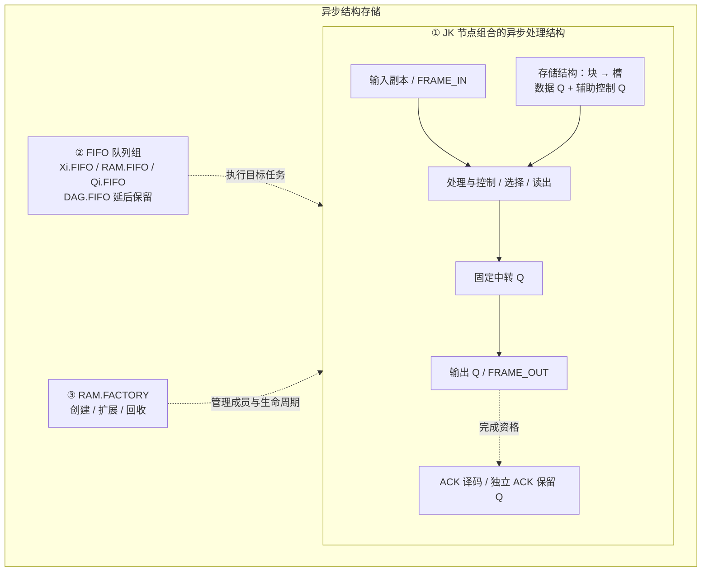
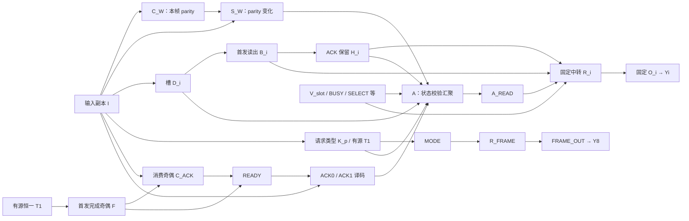
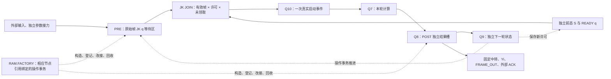

# JK 异步结构存储模块（逻辑单元设计草稿）

> **2026-10-21 最新设计：** 按全部实际参数就绪后入队的确认，已在[第十三节](#a03-readiness-redesign)重构 A03 业务、输出、ACK 的 JK 就绪结构，并更新75任务人工推导及6份动态检查点。第八至十一节保留历史候选，其49任务与同事务未来参数依赖已被替代；不能混作本轮证据。未写执行器，未修改 JKRD。

> 2026-10-19 整理。本文件统一维护异步结构存储模块的规则、设计、确认差异及实验记录；基础计算规则以 [JKRD V5.0.0](../JKRD.md) 为准。业务行为已确认的部分与尚未完成的结构设计分别列明，文档升级不表示演示器已经符合全部现行规则。
>
> **节点没有豁免。** 链尾、池节点、停用节点均遵守 V4 延续的节点约束。现有演示中的多节点互引仍不满足沿用的 DAG 约束，见 [实现边界](#implementation-boundary)。环判定与监督、快照与恢复统一放在 JKRD 的延后处理区。

2026-10-21 新增 [合法拓扑候选设计](#topology-proposal)及[模型 JSON 与直接验证](#model-design-evidence)：已展开固定结构、动态构造实例及有限业务模型；待用户确认后再实现执行器，现有实验状态未因此改变。

同日继续补齐 [A03 与 RAM.FACTORY 通用动态接入](#dynamic-integration)：按用户新确认，**Q 由 JK 求值机制执行 EX；RAM.FACTORY 根据相应节点引用触发操作事务，自身不执行 EX**。新增前后等待区、晚到帧和旧轮回收的完整实例与参数化构造。

## 一、来源、范围与三个组成部分

来源包括 [原始差异稿 E01–E67](../drafts/JKRD-V5.0.0-diff.md)、[后续补充与纠正](../drafts/JKRD-V5.0.0-notes.md)、本次用户确认的交互执行方案，以及本次“按三个区域更新 V5、不批准节点豁免”的指令。原稿保留历史文字，当前选择以本文及 [V5 更新对照](../drafts/JKRD-V5.0.0-integration.md) 为准，不再把已否决或已替换的提案列作待批准规则。

模块负责持续接收、逐帧独立保存、按序递交、ACK 重发或消费、按需扩展与安全回收。它由以下三部分协作：

| 部分 | 职责与归属 |
| --- | --- |
| JK 节点组合的异步处理结构 | 输入副本、FRAME 节点、处理与控制节点、存储块/槽的数据 Q 及辅助 Q、选择/读出、中转、输出、ACK 译码及保留数据节点；所有业务数据和控制状态在这些 JK q 中 |
| FIFO 队列组 | 保存节点任务及其锁存参数，按优先值和队内顺序执行 EX；RAM.FIFO 是队列组的一员。队列里是任务，节点仍属于其结构 |
| RAM.FACTORY | 创建、连接、登记、扩展、释放与回收结构，维护成员、容量及世代；它管理的存储节点仍属于第一部分 |



本图表示职责及流程，不作为逐节点 EX 引用图。外部 Xi、ACK、Yi 端口可放在结构框的接口区域展示，但不是内部 JK 计算节点。“存储结构”是第一部分的内部区域，不是第四种计算主体。

## 二、共用规则与模块边界

### 节点规则完整沿用，不设豁免

来源：V4 节点规则、原稿 E04–E07、E54；本次明确否决豁免。

- `initial_q` 唯一决定有状态/无状态，J 为 AND、K 为 XOR；EX 非空、扁平、从左到右完整执行。无状态 EX 以 J0 开头，有状态显式自引用只提供参数，不产生自触发。
- 每个现存 Q 的非自身来源数量 `ex_source ≥ 1`、被引用数量 `≥ 1`。被引用数量只计不同其他 Q 的真实 EX 引用及不同 Yi 的合法 `q_y` 绑定，自引用不计数。
- 链尾、停用、池节点与活动节点遵守同一约束。不执行 EX、`pro=q=`、工厂成员身份或管理连线都不豁免。
- 检查全部 Q 引用，排除合法有状态自引用后必须无环；不能用 `pro=q=` 把互引从图中排除。允许多节点反馈环的原稿方案与环监督一起延后。
- 无未完成依赖且满足删除条件的节点可以从模型安全移除；只保留空闲块/槽容量及世代记录，不等于保留零引用 Q。若池内仍保留 Q，这些 Q 仍须合法。
- 普通节点求值、传播与初始化遵守 JKRD。工厂动作和业务触发 cause 必须单独标注，不能用它们伪造 EX 参数来源。

### 输入与参数锁存属于基础修订

每个 Xi 唯一对应同编号 `Qi=J0K(Xi)`，输入副本可有状态或无状态。每次输入复制任务独立锁存本次 Xi；后续 Xi 更新不改写旧任务。输入副本发布的数据按事件型来源收齐并锁存，不用初始 q 补齐到达事件。这些是所有模型适用的 [V5 基础规则](../JKRD.md#input-latching)，不是本模块专属规则。

| 对象 | 保存内容与生命周期 |
| --- | --- |
| 输入复制任务 | 本次 Xi 值，执行使用自己的锁存参数 |
| 目标到达集合 | 尚未组成任务的事件型来源数据；同来源后到值可覆盖当前组，不提供业务帧配对 |
| 普通 EX 任务 | 收齐时独立锁存的事件型来源；普通有状态来源在执行开始读取最新 q |
| 整帧接力参数 | 有序数组、帧身份和宽度，接力完成前由任务独立持有 |
| 存储槽的 JK q | 尚未消费的业务数据，供长期保存 |
| 输出节点任务 | 触发入队时独立锁存的参数，后续中转改变不改写它 |
| ACK 保留 Q | 完成 FRAME_OUT 后保留的整帧数据与有效状态，供当前队首重发或消费判定 |

### FIFO 与任务归属

来源：原稿 E16、E24–E29、E63，后续归属纠正，以及本次环机制延后。

依次判定：输入副本任务进入 `Xi.FIFO=1`；其他 RAM.FACTORY 成员任务进入 `RAM.FIFO=2`；其余普通任务进入 `Qi.FIFO=5`。`DAG.FIFO=3` 保留在延后区，当前不向其分配任务。模块输出节点是 RAM 成员，其任务不能固定放入 Qi.FIFO。

每队先进先出，每次只取最高优先级非空队列的一个队首；完整 EX、RAM 事务及传播结束后重新选择，不中断当前任务。同一来源触发多个目标时，按目标 Q 数字编号升序分别入队，跨队执行先后由优先值决定。

FIFO 中只有节点任务，外部 send 和独立 Yi 输出不进入这些队列。业务帧顺序、输出准备请求及可复用块列表是模块业务/结构状态，不新增执行 FIFO。持续输入允许继续接入和锁存；严格优先级本身不保证低优先级推进，不据此承诺有限等待时间或无限物理内存。

## 三、帧输入、接力与观察节点

来源：E20–E23、E30–E32、E59–E64；补充 `input-*`、`task-payload`、`task-arrival`；本次已确认的 W 路复制、S/C 与完整帧交接。

| 接口 | 本模块采用的行为 |
| --- | --- |
| 数据输入 | 任意连续提交 W∈[1,8] 个 bit 的有序数组，0 和重复帧都独立处理；W 是数组长度，不增加长度位节点 |
| FRAME_IN=1 | 锁存整帧参数、帧 ID 与输入序号；非法宽度或非 bit 数据在接入前拒绝 |
| FRAME_IN=0 | 只清空未提交输入暂态，不取消已锁存输入任务、存储任务、数据槽或输出载荷 |
| ACK | 独立输入及译码，负责执行时队首的重发或消费；不由 FRAME_IN 替代 |
| FRAME_OUT | 本帧 W 个数据 Yi 之后的完成标记，首发 1、重发 0，不反馈为 FRAME_IN |

只形成本帧实际 W 路的数据复制任务，未使用通道不补零；控制端口任务另计。连续接入不要求先排空执行队列，也不因旧帧待消费而将等待转嫁为入口暂停。

每帧参数在 Xi 复制批次及第一个 RAM 存储任务之间独立接力，保留身份、顺序与宽度，移交完成后才释放上一持有者。存储完成后长期 bit 数据写入槽内恰好 W 个 JK q，不从输入副本最新值或普通到达集合重新拼帧。

既有实验选择输入副本 `pro=q=`，通过明确的整帧交接接口（whole-frame handoff）移交锁存帧。它是已确认的模块接入方式，不应画成普通结果 publication，也不修改通用触发表。其任务必须携带求值需要的独立来源参数；“帧 ID 相同”不能替代真实参数。

每种帧宽一组 S_W/C_W 观察节点：两者是相邻的两个 RAM 任务，分别完整执行 EX，观察本宽的校验与变化；“相邻”只指 RAM.FIFO 内次序，Xi.FIFO 仍可在任务边界先执行。相同 parity、变化为 0、重复 bit 或重复帧均不构成收帧/丢帧条件。

S/C 的功能与逐节点执行要求已确认；现有 S/C 互引拓扑属于 [已知实现差异](#implementation-boundary)，不能以本节功能要求批准环豁免。

<a id="factory"></a>

## 四、存储结构与 RAM.FACTORY

### 块、槽、节点与状态

来源：E27、E61、E63–E64；补充 `node-state`、`storage-*`；本次满 8 槽回收条件。

- 工厂维护成员表、块/槽、节点连接、编号、世代和容量；由工厂新建的节点必须登记。成员表决定 RAM 身份，输入副本仍按优先的 Xi 归属规则执行。
- A、B、C…每块每世代依次接纳最多 8 帧，一槽一帧，每帧占恰好 W 个数据 Q。满块数据 Q 共 8–64 个，辅助控制 Q 另计；8 槽不等于 8 个节点。
- 帧 bit 与业务控制标志保存在 JK q。帧 ID、位序、有序槽成员、块链和 generation 是结构元数据，不额外长期保存一份业务 bit 数组。
- 本模块 W=1–8、每块 8 槽只是本模型配置，不是所有 V5 模型的固定限制。
- 业务等待区可接在计算前保存原始输入，也可接在计算后保存结果；保存结果时同样必须在覆盖前独立接住当次事件数据。

### 工厂动作与真实节点任务

异步结构中的 Q 任务由 JK 求值机制执行自身 EX；RAM.FACTORY 根据明确绑定的节点引用及本次任务结果触发**操作事务**。工厂可作为节点的操作行为，本身没有 EX，不伪装为另一个有 q/pro 的 Q。两者共用已确认的 RAM 原子任务边界；需要更新业务 q 时，每个 Q 仍由 JK 求值机制实际执行自己的 EX。工厂负责分配、连接、登记、结构推进、删除及复用，不以直接写 q 代替 JK 计算。

选择、读出、中转及输出节点仍分别执行各自的 EX；一次事务不能把其他节点未执行的 EX 记作已执行。多 EX 表示同一个任务边界内的多个真实 JK 求值步骤，**不表示 RAM.FACTORY 负责解释或执行 EX**。具体引用、行为阶段及操作权限见[第十节](#dynamic-integration)。

| 阶段 | 本模块要求及尚未补齐的部分 |
| --- | --- |
| 任务形成 | 分别持有 Xi、事件型来源、帧参数或输出锁存数据；记录目标、成员归属、身份、世代、EX 版本与 cause。统一序列化格式延后 |
| 修改前检查 | 工厂权限、槽宽、世代、EX、pro、q_y、成员关系、待执行任务及到达集合；存在依赖的目标或来源不能静默删除、改 EX 或换队列 |
| 提交 | 节点分配与连接、q、槽链、成员和控制状态原子提交；其他任务只见事务前或事务后状态 |
| 发布 | 成功提交后才依据最终 q 与 pro 发布；同一事务多次写同一来源，只按最终值判定一次。补充提出来源 Q 数字升序、各来源目标数字升序；具体动作清单仍须逐项对应 |
| 世代 | 节点与块复用递增 generation；旧任务不得命中新世代，输出目标仍受世代与 EX 版本保护 |
| 失败与重试 | 整体回滚、保留任务/载荷并允许重试为设计方向；失败任务存放、后续推进、资源不足和重试的完整协议尚未实现与定稿，不得默默丢帧 |

通用工厂操作清单、权限及节点行为绑定已在[第十节](#dynamic-integration)补为设计候选；尚未实现，也不定义新的可执行创建/删除 EX 语法。现有实验绑定只证明其指定流程。RAM.FACTORY 不是新增的 J/K 操作单元。

### 扩展、依赖、释放与复用

按 A 的 8 槽 → B 的 8 槽 → C…顺序接纳。当前块本世代名额耗尽时，优先复用满足条件的释放块，否则新增块。资源允许时按需增长，不用预设固定块数作为业务入口容量。

消费只释放当前帧；本世代已经用过的槽不提前回填。**整块进入回收/复用必须同时满足：本世代已接纳 8 帧、全部帧已消费、所有未完成依赖已解除。** 部分使用块即使活帧数为 0，仍保留本世代继续使用剩余槽，不提前增加世代。

依赖包括待执行任务的目标/未锁存来源、到达集合、未完成首发准备、真实 EX 引用及输出目标。输出参数锁存可解除对原槽数据的依赖，不能解除输出目标保护。安全回收不能删除仍有消费者的 Q，也不能留下违反引用下限的池 Q。

复用时递增世代，按新帧宽重新建立合法节点与槽关系；必要时补充节点。不用 cause、工厂管理线或仅作显示的关系凑引用数量。

### 链式节点的使用方法

来源：原稿 E07、E63，按本次用户纠正采用。

“只定义首个节点、其余自动延伸”描述链式节点的构建用法，可用于组织块、槽和节点池。同类节点按确定的连接方式有序展开；活动、停用、池是生命周期标记，不替代 initial_q 的状态分类。

展开后的每个节点仍有自己的编号、合法 EX、状态与真实连接，满足引用下限及无环约束。链尾必须有合法的后继使用者或 q_y 绑定；池节点、停用节点同样如此。自动延伸不意味着免于定义实际引用、免于执行规则或获得链尾豁免。

`J0K(Qi)` 是合法的 bit 复制写法示例，可在既有 EX 语法内定制；它不是在 EX 中加入任意结构元数据或工厂操作的新语法。

<a id="output-ack"></a>

## 五、输出、FRAME_OUT 与 ACK

来源：E23、E29、E33、E63；补充 `ack-*`、`output-*`；本次确认的输出锁存和 FRAME_OUT 后 ACK 资格。

### 固定中转、逐节点输出与参数锁存

保留 8 个固定数据中转 Q 和 1 个标记中转 Q；输出节点 `O.ex=J0K(R)` 与 q_y 固定。选择、读出、中转、O 各自进入所属队列执行 EX，不能直接更新 Yi 替代 O 的求值与发布。

输出准备按请求次序进行；前一批已完成“中转 → 输出任务参数”的锁存后，才开始下一批准备。准备请求属于业务状态，控制标志在 JK q 中，身份与顺序属于结构元数据；它不是额外执行 FIFO。

每个输出任务在触发入队时锁存自己的求值参数，整个 EX 使用同一组值。后续中转或原槽的改变不能改写旧任务；已锁存任务可在原槽安全释放后继续完成，但输出目标尚有任务时不得改 EX、换世代或删除。

本帧只输出实际 W 个数据 Yi，顺序与输入 bit 数组一致，随后发布 FRAME_OUT：首发 1，重发 0。固定 8 路输出资源不意味着每帧补发至 8 bit。

### 完成后才建立 ACK 保留数据与资格

**W 个数据 Yi 完成且 FRAME_OUT 完成后，才建立供 ACK 使用的整帧保留 q 和有效状态。** 保留数据使用独立 JK q，与存储槽、中转 Q、任务锁存参数分别存在，不能由后续中转覆盖。

资格须对应当前队首的帧身份。中转准备完毕、首位 Yi 已发、S/C 校验通过或仅有待执行输出任务，都不能提前开放 ACK。

ACK 仍采用 L：每次输入独立锁存，经输入副本进入译码节点的 RAM 任务，按到达顺序处理；动作作用于**执行时**的队首和资格，不绑定 ACK 外部到达时的帧。两个译码节点可形成任务，但只与该次锁存值匹配者执行业务动作；不得用 pro 代替动作许可。

| ACK 任务执行时的状态 | ACK0 | ACK1 |
| --- | --- | --- |
| 空帧队列，或当前队首没有有效保留数据 | 忽略，不记录待重发命令 | 忽略，不消费、不记录待消费命令 |
| 当前队首已完成 FRAME_OUT 且保留数据有效 | 从独立 ACK 保留 q 建立重发请求，帧和消费位置不变 | 消费当前队首，立即撤销旧资格，推进队首并安排下一帧首发 |
| ACK1 后新队首尚未完成自己的 FRAME_OUT | 忽略 | 忽略 |

“完成前忽略”按 ACK 任务实际执行时判定。若 ACK 在完成前到达、任务在完成后执行，且当时队首有资格，则正常处理；不按外部到达时点提前丢弃。

ACK0 复用已完成输出的保留 q，不重新读取原槽。ACK1 后旧批次已锁存任务继续使用自己的参数，但旧 FRAME_OUT 不能使已消费帧重新有效，也不能覆盖新队首的保留数据或替新帧开放资格。每次更新资格前均核对帧身份与消费状态。

第一帧使业务队列由空转非空时安排首发；ACK1 消费后为新队首安排首发。FRAME_IN 不触发消费、重发或下一帧递交，FRAME_OUT 也不代替消费 ACK。

## 六、确认差异与剩余边界

### 修改前后对照

| 事项 | 原稿 / 旧提案 | 本次整理采用 |
| --- | --- | --- |
| 模块划分 | 异步结构、存储结构、RAM.FACTORY、RAM.FIFO 容易被看成四个同级模块 | 三个组成部分；存储结构归 JK 节点结构，RAM.FIFO 归队列组 |
| 输入与参数 | V4 复制时读取最新 Xi，输入副本必须有状态 | 基础规则改为逐次锁存，输入副本可有/无状态，事件型来源收齐后锁存 |
| ACK 条件 | 原稿仅规定空队列忽略，没有完成资格 | 当前队首 FRAME_OUT 完成且独立保留 q 有效后才允许 ACK0/1 |
| ACK0 数据 | 补充 ack-replay 提议重新捕获原槽 | 复用已完成的 ACK 保留 q |
| 旧批次完成 | 原稿只规定输出锁存后独立完成 | 已消费帧的旧完成不能重新授予资格，不能覆盖下一帧 ACK 数据 |
| 块回收 | 补充仅写全块无活帧且依赖安全 | 还须本世代实际接纳满 8 帧；部分使用的空块继续剩余槽 |
| 节点豁免 | 原稿待定；补充允许空闲池 Q 被引用数为 0 | 明确否决，所有现存 Q 遵守同一规则；安全删除与容量记录不构成豁免 |
| 级联 | 曾列作新增基础结构写法并关联豁免待定 | 符合既有规则的链式构建方法，展开后逐节点合法 |
| 环、快照 | 原提取稿与存储流程混列 | 完整方案归 JKRD 延后区，仅保留模块对其未来接口的要求 |
| 实验范围 | 真实 EX、任务及引用计数通过定向测试 | 保留原验证范围，同时明确多节点互引仍不满足当前 DAG 约束 |

保留的纠正：RAM 输出节点任务进入 RAM.FIFO；Yi 不是独立任务；撤回依赖“输出在 Qi、ACK 在 RAM”的连续 ACK 推论。旧 `ack-burst` 不作为设计依据，旧 V5 演示器的 18 项测试也不是本模块的规则一致性证据。

### 延后与尚未定稿

本模块剩余工作逐项列在 [V5 待处理总清单](../drafts/JKRD-V5.0.0-pending-index.md#storage)，包括合法拓扑、接力、计算接入、工厂与失败协议；已确认行为与待设计细节分别标注。

环许可、SCC 判定、DAG.CARE、定时队列与监督恢复见 [JKRD 环延后区](../JKRD.md#deferred-rings)。静态结构/完整现场、成员与世代、任务载荷、到达集合、输出及 ACK 进度、格式校验和指纹见 [JKRD 快照延后区](../JKRD.md#deferred-snapshot)。本文件不另行发布一套环或快照契约。

模块内仍待补齐：在保留 DAG 与全部引用约束下的完整可执行拓扑、通用工厂操作权限与任务绑定、失败回滚/重试/后续推进协议。持续高优先级输入下的公平推进没有获批新规则。

历史 43 节点原型总容量 3、满时拒收且串行提交，只证明有限原型；不能把这些限制写回本模块。历史 Q39 数据递交、Q41 消费确认与 Q40 内部状态保持原记录，接口及历史 pro 仍需另外对齐，详见 [静态原型](static-prototypes.md) 与 [锁存和动态等待区](latch-dynamic-waiting.md)。

<a id="implementation-boundary"></a>

## 七、交互实验与验证记录

### 当前实现边界

入口为 [本地 HTML](../../web/async-structural-storage/index.html)，采用原生 HTML、CSS、JavaScript 和 SVG；[engine.mjs](../../web/async-structural-storage/engine.mjs) 提供指定流程实验，[app.mjs](../../web/async-structural-storage/app.mjs) 依据执行记录绘图，[engine.test.mjs](../../web/async-structural-storage/engine.test.mjs) 保存定向验证。

现有实验真实执行输入、存储、ACK、输出、扩展与回收，包含节点 EX、q、任务参数、归属和引用检查。**它仍不是现行 V5 的完整合规实现**：`reset` 中 S_W/C_W 双向引用，`_retention` 中数据与辅助保持节点互引，ACK_READY/ACK1 也互引；`validate` 检查引用下限，但不拒绝这些多节点环，`_scc` 只识别与展示环。`pro=q=` 不使这些连接免于 V4 延续的 DAG 约束。本次只更新文档，没有把这些拓扑改造或环许可视为完成。

SCC 识别不等于 DAG.CARE。失败重试、完整运行快照及恢复未实现；页面重置、状态查看和布局保存均不是运行检查点。以下既有测试与浏览器记录只证明记录中的指定行为，不能消除上述拓扑差异。

### 展示要求

节点保留在所属结构中，FIFO 框显示任务卡片；块展开为槽、数据 Q 和辅助 Q。点击可查类型、q、EX、pro、队列归属、执行状态、来源及被引用关系、任务参数、帧身份、宽度、次数、世代与依赖。

真实 EX 引用、任务 cause、工厂管理、成员关系和整帧交接分别画线，不能把视觉连线作为引用计数依据。支持折叠、缩放、定位、单步、连续运行、暂停、调速；动画来自实际执行记录，完整 EX 和事务保持原子性。三部分职责图与实际节点拓扑分开说明，未实现机制明确标识。

### 来源、实现位置与历史验证记录

以下保留既有实验记录，本次文档更新未重跑这些测试。案例期望来自用户确认及相应来源条款，不以执行器的同一判断函数计算期望。2026-10-18 本地运行 `engine.test.mjs`，17 项定向测试通过；下表只记录实际覆盖。测试同时逐步检查引用、待执行任务身份和队首资格，不把测试通过扩展为全部 V5 语义或任意交错证明。

| 来源 → 本次预期行为 | 实现位置 | 定向验证案例 | 状态 |
| --- | --- | --- | --- |
| E20–E23、E64；本文 W 路与 whole-frame handoff 选择 → 每帧独立锁存，只复制实际 W 路，清空暂态不丢已提交帧 | engine.mjs `submitFrame`、`_act`、`_store` | 1 bit/8 bit、连续同值全零、改变宽度、清空暂态；核对实际 W 路复制轨迹与独立参数 | 通过 |
| 本次 S_W/C_W 选择 → 相邻 RAM 任务真实求值，parity 仅观察 | engine.mjs 初始化 S/C、`_act`、`step` | 同宽两帧的 S1/C1/S2/C2 次序与独立 XOR 期望；单步可见 S 已执行而 C 尚未执行 | 通过 |
| E25、E29、E63；本文逐节点选择 → RAM 输出节点与辅助节点各自执行，Yi 来自 O 发布 | engine.mjs `_queueFor`、`_selected`、`_lockOutput`、`step` | 本模型 Xi/RAM 归属；每步仅一个 EX 写；独立求值逐记录核对；固定 O.ex/q_y 与 W 个 Yi 后 FRAME_OUT | 通过 |
| 本次 FRAME_OUT 资格选择 → 提前 ACK0/ACK1 无业务动作，执行时资格决定是否接受 | engine.mjs `_ackAction`、`_completeOutput` | 两种 ACK 执行在完成前均忽略；只有数据 Yi 时无资格；到达在完成前、执行在完成后的 ACK 正常接受 | 通过 |
| E63 输出锁存；本次 ACK 保留 q 选择 → 重发复用已完成载荷，旧任务独立，旧完成不复活资格 | engine.mjs `_startPreparation`、`_lockOutput`、`_completeOutput` | 重发与消费交错；原块已经回收换代而旧重发尚未完成；实际 R 首发读 D、重发读 H | 通过 |
| storage-growth/recycle；本次满 8 槽条件 → 未满空块继续本世代，满块全消费且依赖为 0 才复用 | engine.mjs `_store`、`_dependencies`、`_collectGarbage` | 部分使用块排空后继续使用；17 帧跨 3 块；安全满块优先复用；每步待执行来源与目标仍存在 | 通过 |
| E07、E25、E63；本次不豁免选择 → 活动引用闭合，任务身份和世代不被静默替换 | engine.mjs `validate`、`reconfigureNode` | 每步检查真实 EX/q_y 引用和任务版本/世代；禁止改写待执行目标及未锁存来源；非法改写回滚 | 通过 |
| 本次范围选择 → 未实施的环监督、失败重试和完整快照明确标注 | index.html、app.mjs 机制说明 | 浏览器规则面板区分实际执行、SCC 识别与只展示设计的机制；不宣称完整运行恢复 | 浏览器核对通过 |

本模型没有非 RAM 的环内或普通计算节点，因而 DAG.FIFO / Qi.FIFO 保留结构和优先值展示，未以本组测试证明任意外部网络的调度。未验证完整快照、环监督、失败重试或任意交错穷举。运行历史及输出记录仅作观察，执行器不使用它们重建业务数据；业务帧始终由节点 q 和未完成任务持有。

浏览器已操作验证：输入 `1011` 并提前提交 ACK，首发结果仍为 `1011 / FRAME_OUT=1`；随后输入 `010` 并提交 ACK0、ACK1，得到旧帧 `1011 / FRAME_OUT=0` 和新帧 `010 / FRAME_OUT=1`，有效队首为 F2。已检查单步/连续运行、节点定位、任务参数、引用与 q_y 连线、缩放、模块折叠及规则边界；该流程未出现浏览器警告或错误。这是代表性界面验证，不是所有视口和交互组合的完整回归。

### 本地运行

在项目根目录运行：

```sh
python3 web/async-structural-storage/serve.py
```

打开终端打印的本地地址。默认端口为 8765；若被占用，使用 `--port 0` 自动选取可用端口。服务仅绑定 `127.0.0.1`，Ctrl+C 停止。HTML 使用原生 ES 模块，需要通过此 HTTP 服务打开，无需安装前端依赖或构建。

具备 Node.js 18 或更新版本时，运行定向测试：

```sh
node --test web/async-structural-storage/engine.test.mjs
```

先提交一帧并单步查看 Xi → S/C → 选择 → R → O → FRAME_OUT。也可在队列未排空时连续提交帧和 ACK，检查其实际入队及执行次序。FRAME_OUT 前后资格以 `ACK_READY` 的 q 为准。

### 画板编辑（2026-10-19）

外框、模块、节点分组、存储块、槽及 FIFO 框都提供以下显示操作：

- 拖动标题旁的 `⠿`，在所属容器内自由调整位置；拖动右边、下边或右下角调整宽高。移动、尺寸手柄也支持方向键，默认每次 10 px，按住 Shift 为 1 px。
- 点选画框后，用画板工具栏输入宽高或设置颜色；宽高输入留空可恢复自适应。内容按可用宽度换行、重排，固定高度下可在框内滚动。折叠暂时收起高度，展开恢复。
- “恢复此框”只恢复当前框；“恢复全部布局”恢复所有视觉设置及框内滚动位置。位置、宽高、颜色自动保存到本机浏览器，在执行重绘和页面刷新后保留。
- “全屏”展开画板，退出按钮或 Esc 返回。浏览器不支持原生全屏时铺满当前窗口。

这些设置仅是视图偏好，不属于运行快照；拖动不改变模块成员、节点状态、任务队列或执行顺序。执行过程中拖动会暂缓场景 DOM 重建，松手后呈现最新执行状态，执行器继续按原有规则运行。引用线按当前可见节点位置重绘，折叠或框内滚动遮住的节点不绘制悬空连线。

实现位于 `web/async-structural-storage/frame-layout.mjs`、`frame-layout.css`、`canvas-fullscreen.mjs`、`canvas-fullscreen.css`，由 `app.mjs` 集成。浏览器定向核对包括 100% / 60% 缩放下的拖动、角点调宽高、节点重排及框内滚动、颜色、折叠恢复、刷新保留、运行并跟随任务时拖动、动态 B2 槽独立设置、布局重置保持 STEP 与存储块、引用端点随位移更新，以及全屏进入/退出。此次编辑未修改执行器；上述界面检查不扩展历史定向测试的模型语义验证范围。

<a id="topology-proposal"></a>

## 八、合法拓扑候选设计（2026-10-21，待确认）

本节按用户“先推理给出结构，设计确认后再用代码实现”的要求整理。它是候选结构，不是已批准规则或现有页面的实现说明。此前提前进行的代码修改已撤回，现有演示仍保留第七节所述边界。本次直接构造设计 JSON、推导公式与事件序列，区分已完成的模型审查和确认后才进行的执行验证。

依据当前 JKRD V5、本文已确认的输入/输出/ACK/生命周期规则；不采用旧 `jk-network-generator` 的契约、执行器或快照格式。目标是在不增加 J/K 指令、不豁免节点、不允许多节点环的条件下，给出完整存储路径。动态创建、连接和回收仍属于已确认的 RAM.FACTORY 职责；本文提出其在本结构中的具体绑定，等待设计确认。

### 1. 结构选择

1. **S/C 单向连接。** S_W 计算新旧 parity 的差异，C_W 直接计算本帧 parity；S 引用 C，C 不再引用 S。两任务分别携带同帧锁存参数，仍先 S 后 C。
2. **首发读出与 ACK 保留分开。** 数据路径为 `D_i → B_i → H_i → R_i → O_i`，首发可由 B 直接进入 R；H 在首发 FRAME_OUT 完成时才捕获 B。H 不引用 R 或 O。
3. **ACK 资格用 JK 状态表示。** 使用首发完成奇偶 F、消费奇偶 C_ACK，`READY = F XOR C_ACK`。消费时 C_ACK 复制 F，立即撤销资格。
4. **标记支路独立。** 请求类型来自有源常量 1 或本次 ACK0 锁存的 0，不引用 ACK 译码输出或 READY。这样不会形成“资格→标记→资格”的 EX 环。
5. **所有现存节点真实闭合引用。** 被动观察、未选中槽和控制节点经过显式校验汇聚 A、固定读出 A_READ，进入数据中转的透明引用；不增加诊断 Yi。该选择的含义和代价见第 4 小节，需与整体设计一起确认。



图中只画主要真实 EX 引用方向。事务触发、工厂管理与队首推进是另外的关系，不用于引用计数。全部真实边由下面的 EX 表确定。D、C_ACK 等合法有状态自引用不画入 DAG。

### 2. 完整固定节点表

下列为**拟采用的物理编号**，不对应当前旧演示编号。固定部分共 71 个 Q，动态槽及请求节点从后续编号分配。业务接入讨论中的 Q7/Q8/Q9/Q10i 是角色名，不能与此表输入端口编号混淆。

全部固定节点均有状态，初值仅 Q42、Q48 为 1，其余为 0。Q0–Q9 的复制任务进入 Xi.FIFO，其余是 RAM.FACTORY 成员、进入 RAM.FIFO。除 Q62–Q70 的 `pro=q=0/1` 外，其余 `pro=q=`。下面的区间与公式逐个展开覆盖全部固定节点；`i=0..7`，`W=1..8`。

| 编号 / 符号 | 完整 EX 或展开式 | 作用与后继 |
| --- | --- | --- |
| Q0–Q9 / I_i | `J0K(Xi)` | Q0–Q7 数据，Q8 FRAME_IN，Q9 ACK；供相应计算/控制及 A 引用 |
| Q(8+2W) / S_W | `J0K(Q0)…K(Q(W−1))K(C_W)J(Q8)` | 计算本帧 parity XOR 旧 C_W；由 A 使用 |
| Q(9+2W) / C_W | `J0K(Q0)…K(Q(W−1))J(Q8)` | 保存本帧 parity；由 S_W、A 使用 |
| Q(26+i) / B_i | 空闲 `J0K(Qi)`；首发准备 `J0K(D_i)` | 首发单独读出任务；供 H_i、首发 R_i 和 A 使用 |
| Q(34+i) / H_i | `J0K(Q(26+i))` | 首发完成后捕获 B_i；供重发 R_i 和 A 使用 |
| Q42 / T1 | `J0J(Q8)K1` | 有源恒一，供 BUSY、CACHE_VALID、首发类型等使用 |
| Q43 / BUSY | `K(Q42)` | 准备开始/结束各翻转一次；供 SELECT、A 使用 |
| Q44 / CACHE_VALID | `J0K(Q42)` | H 首次完成捕获后置一；供重发 SELECT、A 使用 |
| Q45 / F | `K(Q42)` | 仅当前队首首发完成事务执行，读取 T1 当前 q=1 翻转；供 C_ACK、READY、A 使用 |
| Q46 / C_ACK | `J0K(Q46)K(Q45)J(Q9)K(Q46)` | 自身旧 q 固定；ACK1 时复制 F，ACK0 时保持；供 READY、A 使用 |
| Q47 / READY | `J0K(Q45)K(Q46)` | F XOR C_ACK；供 ACK0、ACK1、A 使用 |
| Q48 / MODE | 空闲 `J0K(Q42)`；准备 `J0K(K_p)` | 复制当前请求类型；供 R_FRAME、A 使用 |
| Q49 / ACK0 | `J0K1K(Q9)J(Q47)` | 本次锁存 ACK 为 0 且有资格时得 1；供 A 使用，业务动作另记因果 |
| Q50 / ACK1 | `J0K(Q9)J(Q47)` | 本次锁存 ACK 为 1 且有资格时得 1；供 A 使用，业务动作另记因果 |
| Q51 / A | `J0K(U0)…K(Un)` | 对第 4 小节指定的全部上游 Q 作 XOR；供 A_READ 使用 |
| Q52 / A_READ | `J0K(Q51)` | 固定读出，隔离 A 的动态来源集合；供所有 R_i 使用 |
| Q(53+i) / R_i | 空闲 `J0K(H_i)K(Q52)K(Q52)`；准备 `J0K(B_i或H_i)J(SELECT)K(Q52)K(Q52)` | 首发选 B_i，重发选 H_i；供固定 O_i 使用 |
| Q61 / R_FRAME | `J0K(Q48)` | 标记中转；供 FRAME_OUT 使用 |
| Q(62+i) / O_i | `J0K(Q(53+i))` | q_y 绑定 Yi，按任务自己的锁存参数输出 |
| Q70 / FRAME_OUT | `J0K(Q61)` | q_y 绑定 Y8；W 个数据 Yi 后输出首发1/重发0 |

表中 `…` 只表示按编号展开一串 K 操作，`B_i或H_i` 在准备时选择一个真实来源，不是新增 EX 语法。A 的来源集合明确如下，因此无需用未定义的“辅助节点”补全此表。

### 3. 动态节点与状态保持

| 节点 | 初值与 EX | 引用闭合和使用时点 |
| --- | --- | --- |
| 每槽恰好 W 个 D_i | 初值 0；装载 `J0K(Qi)`，使用本帧锁存参数；完成装载后改为 `J0J(Qi)K(D_i)` | 保持阶段只有自身旧值决定结果；非自身来源仍是真实 Qi，后继为 A 和被选中时的 B_i |
| 每槽 V_slot | 初值 1；消费时执行 `J0J(Q42)` 得 0 | SELECT/A 使用；尚未回收的已消费槽也保持合法 |
| 每请求 K_p | 初值 0；首发执行 `J0K(Q42)`；重发执行 `J0K(Q9)`，使用该次 ACK0 的锁存值 | 类型保存在 K_p.q；MODE/A 使用，参数移交后删除 |
| 每活动请求 SELECT | 初值 0；`J0K(V_slot或CACHE_VALID)J(BUSY)` | 独立 RAM 任务；由当前 R_i 和 A 引用，准备完成后删除 |

D 的保持可以直接推导：`J0J(Qi)` 恒得 0，随后 `K(D_i)` 恢复执行开始时固定的自身旧 q。没有 D↔辅助保持节点的环。初始化不是一次 EX；装载和保持 EX 的切换属于同一构造事务，外部不观察半完成结构。

未使用的槽只表示容量记录，不预留零引用 Q。已存在的槽不因消费而自动免检；块满 8 次接纳、全消费且依赖解除后，才原子断开可删除结构的观察引用并删除节点。复用容量记录时递增世代。

### 4. 引用闭合与 DAG 的推理

A 的集合 U 是当前所有固定 S_W/C_W、B/H、T1/BUSY/CACHE_VALID/F/C_ACK/READY/MODE/ACK（Q10–Q50，共 41 个），以及全部现存 D/V_slot/K_p/SELECT。排除输入副本、A 自身、A_READ、全部 R_i、R_FRAME 和输出 Q。来源按节点编号展开并去重。

**参数可用性修正：A 不直接引用 Q0–Q9。** 准备事务没有十路输入副本的完整事件参数，不能把它们当作普通 Qi_q 最新值读取。输入副本已有 S/C、B 的空闲连接、T1、ACK 等真实后继，无需再由 A 使用来满足引用下限。

A 真实计算一份状态 XOR 校验；R 中两次 `K(A_READ)` 使用同一固定参数，数值抵消。因此这个校验路径不改变业务数据，也不以校验结果决定收帧、丢帧或输出标记。这是**显式的透明引用方案**，不是额外功能承诺或引用豁免：JKRD 按真实 EX 来源计数，重复引用分别执行、数量去重；全字面量常量禁令也不禁止上述有源表达式。

采用这一方案有明确原因：有限 DAG 中，每个现存 Q 都要求至少一个其他 Q 使用者或合法 Yi，那么每条末端路径必须通向 Yi。S/C 等只观察且不改变业务输出的节点，也必须有这样的真实路径。此方案保持现有 9 个 Yi，但引入了数值透明的计算和随节点数增长的校验成本。**是否采用这种透明引用，是本版需要确认的具体结构选择**，不能仅因为它满足计数就隐藏其代价。

A_READ 用于隔离依赖：若 R 直接引用可改接的 A，R 等待期间的来源保护会阻止扩容修改 A.EX。增加固定 `A_READ=J0K(A)` 后，在**开始准备的当前事务内**完成连接并执行 A、A_READ，之后才排入 SELECT；SELECT 不附带尚待执行的 A/A_READ EX。这样，后续存储事务扩展 A 时不存在它们的待执行任务，R 保护的是 EX 固定的 A_READ。A.q 表示最近一次准备启动时的校验，不宣称实时跟踪所有状态。仍须检查实际依赖，不能因为成对 XOR 抵消就豁免保护。

若把 A/A_READ 绑定到已经入队的 SELECT 附带 EX，随后存储事务再改 A.EX，就会违反依赖保护；本次将求值提前到准备启动的原子边界，明确排除这一构造。

无环性可以按以下层次直接核对：

- I 在最前；C_W 只读 I，S_W 读 I/C_W；D 读 I及合法自身旧 q；B 读 D/I，H 读 B。
- T1 读 I；BUSY/CACHE_VALID/V_slot/F 读 T1；K_p 读 T1 或原始 ACK 输入；标记支路为 K_p→MODE→R_FRAME→FRAME_OUT，资格支路为 F→C_ACK→READY→ACK 译码。
- SELECT 只读 V_slot/CACHE_VALID 与 BUSY；以上节点进入 A→A_READ→R_i→O_i。R_FRAME 的另一末端是 FRAME_OUT。
- 不存在 O/R_i→H、ACK 译码→K_p/MODE、S_W→C_W 的反向 EX 边。排除允许的有状态自引用后，无边返回前层。

这给出了候选图的 DAG 构造论证，不是声称现有演示已经满足它。拓扑序也不是执行顺序：S 先执行读旧 C，再让 C 更新，依靠的是已确认的独立任务次序与状态读取规则。

### 5. ACK 与输出生命周期推导

C_ACK 的表达式等价于：

```text
C_ACK_new = C_ACK_old XOR ((C_ACK_old XOR F) AND ACK_latched)
```

因此 ACK=0 保持原值，ACK=1 复制 F。自身参数在整个 EX 内固定，不能使用执行到一半的累加器替代自身旧 q。

| 阶段 | F、C_ACK 的关系 | READY | 动作 |
| --- | --- | --- | --- |
| 初始 / 上一帧已消费 | 相等 | 0 | ACK0/ACK1 都忽略 |
| 当前队首 W 位及首发 FRAME_OUT 完成 | F 翻转，C_ACK 不变 | 1 | 同一事务内逐 H 执行捕获，再计算资格 |
| 接受 ACK0 | 都不变 | 1 | 从 H 准备重发 |
| 接受 ACK1 | C_ACK:=F | 0 | 同一事务消费队首并撤销资格 |
| 下一队首首发完成 | F 再翻转 | 1 | 捕获下一帧 H，再开放资格 |
| 已消费帧的旧重发完成 | 都不变 | 不改变 | 不捕获 H、不重新授予资格 |

F 的来源是 T1 当前 q=1，不引用 R_FRAME 或发布事件的 FRAME_OUT Q。首发身份判断通过当前真实 FRAME_OUT 任务的结果及帧身份选择事务动作，符合条件时才执行 F 自己的 EX。这样不把输出节点的锁存例外扩展到 F 的普通 Qi_q 来源，也不因 FRAME_OUT publication 另外触发 F。具体 EX 执行与事务因果分开。

B 保存本次首发读出，直到对应首发完成才供 H 捕获；H 不从输出 O 反向复制。下一帧首发要等前一帧有效 ACK1 才能安排，而 ACK1 又必须在前一帧首次完成后有效，因而不会提前用下一帧 B 覆盖当前首次捕获。重发只读取 H；已经锁存的输出任务不再依赖 H 后续变化。

CACHE_VALID 只表示曾建立保留数据，不能代替 READY 或帧身份匹配。每次完成还要核对当前队首、帧身份和批次类型；身份与世代属于结构元数据，不将旧批次完成当作新的首发。

### 6. 任务与事务的具体绑定提案

已有 RAM 事务边界允许真实执行多个 EX；以下方案要求**每次业务 q 更新都执行该 Q 自己的 EX**，不借直接写 q 省掉计算。选择、B、R、O 仍各自执行独立任务，S/C 保持相邻两个 RAM 任务。

| 阶段 | 拟执行的节点与结构动作 | 保护要求 |
| --- | --- | --- |
| 整帧交接 | S、C 分别锁存同帧数据；S 事务分配 D/V、逐 D 装载并安装保持 EX | 移交前不释放原参数；不从最新输入拼帧 |
| 请求形成 / 开始准备 | 创建 K_p 并执行其 EX；BUSY 翻转、MODE 复制 K_p；连接 SELECT/B/R/A；执行 A、A_READ 后排 SELECT | 类型保存在 JK q；只在上一批已锁存后准备下一批；A/A_READ 求值不跨任务等待 |
| SELECT 任务 | 独立执行 SELECT；依序排 B（仅首发）、R、R_FRAME | 不绑定将来才执行的 A/A_READ，允许后续存储在合法边界扩展 A |
| B / R 任务 | 各自执行读出及中转 | 未锁存来源保护，不能提前改接 B |
| R_FRAME 任务 | 执行标记；R 全部完成后安全脱离 B 的原槽引用，保持 B.q；锁存 O/FRAME_OUT 参数；断开并删除已结束请求；BUSY 翻转 | 在新任务形成前完成必要改接；固定 O.ex/q_y 不变 |
| FRAME_OUT 任务 | 先完成 W 位后的标记；符合当前队首首发条件时，逐 H 捕获，再执行 CACHE_VALID、F、READY | 捕获与资格在同一可见边界完成，旧批次不执行这些更新 |
| ACK0 任务 | 译码后，有资格才创建重发请求 | 使用本次 ACK 锁存值；不读原槽 |
| ACK1 任务 | 译码后，有资格才执行 V_slot 清零、C_ACK 复制 F、READY 重算；推进队首 | 返回任务边界时资格已撤销；不依赖晚到的最新 ACK 值 |
| 回收 | 检查满8/全消费/无依赖；断开 A 的可管理观察边并删除整块节点 | 不能断开仍被实际任务保护的边；空闲容量不冒充存活 Q |

**事务依赖必须覆盖附带 EX，不能只登记主节点。** 例如待执行首发 FRAME_OUT 不仅保护 B 来源，还应绑定 H[0..W−1]、CACHE_VALID、F、READY 的目标世代与 EX 版本，以及这些 EX 的未锁存来源。否则等待期间改写 H 的 EX，就可能使首发正确、重发错误。新建节点尚不存在时按创建事务确定；依赖执行时队首的 ACK 动作则须在执行边界解析并绑定其实际对象，不能提前绑定到到达时队首。

已绑定目标/来源不得在等待期间删除、换世代或改 EX；执行前重新核对身份。该项是已有生命周期约束在多 EX 事务中的具体展开，不是节点豁免或新 FIFO。

**执行时条件分支的绑定是本候选的具体选择，待确认。** S、ACK、Q61 的准备启动分支取决于执行时的请求及 BUSY。分支选中后，在当前原子事务中解析 A/A_READ 等实际对象，绑定当时世代/EX 版本并立即执行，不预留跨任务等待的 A/A_READ 附带 EX。已经明确并绑定的首发 FRAME_OUT 附带目标仍完整保护。不能一边把 A 预绑定为未来任务的目标，一边又允许等待期间扩展 A.EX；也不能以条件分支为理由改写其他已有依赖。这是模块内动作绑定提案，不宣称通用工厂协议已经定稿。

### 7. Q7/Q8/Q9/Q10i 的业务接入候选

若业务必须保留独立 Q9 状态角色，可按轮次展开，避免同一批物理节点互引：

```text
Q9_(t−1) ───────────────→ Q7_t → Q8_t → Q9_t → Q10_(t+1)
等待区本项 D_t → Q7_t                       Q10_(t+1) → Q7_(t+1)
Q10_t ─────────→ Q7_t
```

Q7_t 计算本轮；Q8_t 独立保存该轮结果；Q9_t 保存下一轮状态；无状态 `Q10_(t+1)=J0J(Q9_t)K1` 在 Q9_t 每轮发布后产生完成事件，因此相同结果也能释放下一轮。首轮用独立有源启动节点发出一次事件，不靠初始化自动发布。前置等待区递交原始输入，后置等待区接住每轮结果，各自管理消费。

例如只用于说明次序的 1 bit 累计 XOR，初态 0、输入 `1,0,1,1`：各轮 Q7/Q8/Q9 的结果为 `1,1,0,1`；每轮 Q10 都发布完成 1。第二轮结果虽仍为 1，也必须回写完成后才能启动第三轮。此为直接公式推导，不是代码测试报告，也不把 XOR 选作所有业务的默认算法。

本次已把上述四轮推导落实为[完整 22 节点 JSON](../../assets/async-structural-storage-v5-design/business-four-rounds.json)。输入预装在四个 JK q，单次 X0=1 启动；每轮的结果保存和状态回写是不同节点任务。完成节点无状态，下一轮同时引用它和有状态前态，所以前态事件不会提前或重复启动下一轮。末轮完成通过该独立标本的 Y4 合法闭合，不增加存储模块的输出接口。

这证明有限四轮的连接和事件推导可以成立，不等于通用接入已经实现。此前列出的下一帧晚到、节点晚创建、前态完成保留、旧轮回收及前后等待区同时接入，现已在[第十节](#dynamic-integration)补齐构造设计。初始化不产生事件，不能靠回放已过去的 Q9 发布补齐新节点；新增方案用独立 READY q 和新 GO 求值解决该问题。

### 8. 确认范围与后续验收

本版优先请求确认以下结构选择：S/C 单向公式；B/H 分离；F/C_ACK 奇偶资格；标记支路独立；A→A_READ 透明引用闭合；上表模块内真实多 EX 事务；Q7 业务按轮展开方向。其中引用闭合的额外计算成本、事务附带目标的保护及轮次回收成本均已明示。

直接推理已给出公式等价、DAG 分层、引用闭合、具体模型数据和关键生命周期案例，见下一节。**执行器实现与运行验证等待设计确认**，届时依据独立预期核对：

| 来源 → 预期行为 | 拟实现位置 | 确认后验证案例 |
| --- | --- | --- |
| JKRD 非自身来源/被引用≥1，完整 Q 图 DAG | 构造器与逐事务结构检查 | 每个固定/动态节点；静默环、自引凑数量、无后继链尾、悬空引用反例 |
| 每次 Xi 与帧参数独立锁存 | 输入复制、S/C 与 D 装载 | W=1–8、重复0/1、连续输入、FRAME_IN 清除、Xi 穿插 S/C |
| 当前队首完成后才有 ACK 资格 | H/F/C_ACK/READY | 完成前两种 ACK；到达早执行晚；重发/消费交错；旧完成不复活 |
| 输出任务独立，首发1/重发0 | B/H/R/O 与标记支路 | W 位顺序、参数锁存后中转改变、旧槽删除后输出继续 |
| 满8/全消费/无依赖才复用 | 工厂生命周期和事务身份 | 部分空块不回收；增长；事务附带目标改 EX 被拒绝；世代复用 |
| Q9 回写后释放下一轮 | 按轮展开业务结构 | 重复结果也完成；下一轮读正确前态；前后等待区同时接入 |

这些是后续验收要求，不是已经通过的测试记录。通用工厂失败/重试、环监督、快照恢复、外部消费者迁移仍按原清单待处理，不以本结构候选提前关闭。

<a id="model-design-evidence"></a>

## 九、第一模块的模型 JSON 与直接验证（2026-10-21）

### 1. 可审阅的设计数据

| 文件 | 已构造的内容 | 边界 |
| --- | --- | --- |
| [storage-structure.json](../../assets/async-structural-storage-v5-design/storage-structure.json) | 71 个固定 Q 的逐项 EX、pro、initial_q、9 个 q_y、成员归属及完整拓扑序 | 空结构设计；不声称仅加载节点就能完成动态业务 |
| [construction-and-cases.json](../../assets/async-structural-storage-v5-design/construction-and-cases.json) | 7 个动态 Q、6 处 EX 替换构成 78 节点活动图；逐帧装载、首发准备/输出、参数与事务绑定；15 个直接推导案例 | 通过“基础完整图＋明确增删改”描述构造；不是新工厂指令标准或运行轨迹文件 |
| [business-four-rounds.json](../../assets/async-structural-storage-v5-design/business-four-rounds.json) | 22 节点的四轮业务标本，完整输入/输出与初值，结果及事件次序推导 | 预装四项、单次启动；通用动态前后接入仍待补 |

这里的 JSON 是**设计数据**，不采用旧生成器契约，也不提前定义延后的 V5 快照 schema。`role`、成员描述、构造步骤和推理案例均是本地说明字段；`initial_q` 仍只定义节点类型及创建初值。活动实例中的 `reasoned_q_overrides_from_base_initial` 是手工推导值，不是恢复检查点。示例输入 bit 数组仅是案例前提；运行设计把长期数据保存在 D/H/K 等 JK q 中。

### 2. 结构验证：按规则直接给出证明

**节点数量。** 固定部分为 `10 输入＋16 S/C＋8 B＋8 H＋9 控制＋2 校验＋9 中转＋9 输出＝71`。每个现存槽增加 `W 个 D＋1 个 V`，每个请求增加 1 个 K，活动准备另有 1 个 SELECT。两帧 `[1,0]`、`[0]` 加一个请求及 SELECT，增加 `3＋2＋1＋1＝7`，共 78。尚未使用的六个槽是容量元数据，不创建 Q。

**真实来源与使用者。** 输入副本引用自己的 Xi；S/C 只引用本宽实际输入及 FRAME_IN，S 另读 C；B/H/D、控制和校验都在逐项 EX 中有非自身来源。输入副本已有真实后继；Q10–Q50 及所有动态 Q 由 A 使用；A→A_READ→R→O→Yi；R_FRAME→FRAME_OUT→Y8。双 `K(Q52)` 计一个来源但执行两次。自引用只用于 D 保持及 C_ACK 自身旧值，不拿来满足数量下限。

**DAG。** 两份存储设计都附完整拓扑序；所有非自身 Q 边沿序前进。创建槽只增加 `I→D/V→B或A`，请求只增加 `T1或ACK输入→K→MODE` 和 `V或CACHE_VALID、BUSY→SELECT→R或A`；输出不反向参与资格或保留数据计算。删除只在所有其他依赖解除后移除 A 的对应边和节点，不添加回边。业务四轮模型的非自身边全部从较小编号指向较大编号，末轮完成有独立 Yi 使用者。

**参数。** S/C 与 D 装载使用各帧自己的输入事件参数；普通有状态来源在每个 EX 开始时固定当前 q；仅模块输出任务使用已确认的输出锁存协议。A 不读缺失的十路输入事件；F 只读 T1 当前 q；自引用参数在整条 EX 内不变。节点静默不消除数据引用，也不自动制造后继任务。

**动态可见性。** 新 D 先以本帧锁存值执行装载 EX，再安装保持 EX；成员登记、A/B 等连接与初始化位于同一个原子构造事务，提交后的图才对外可见。开始准备时直接执行 A/A_READ，完成后才排 SELECT，避免待执行附带 EX 阻止后续扩容。首发 FRAME_OUT 的 H/F/READY 等附带 EX 则必须作为真实未来依赖保护，不能遗漏。

在上述推导后，仅用独立的只读 JSON/EX 解析核对数据，没有执行任何 EX 或调度任务。检查了重复键/编号、完整 EX 语法、初值分类、自引用、Xi 专用引用、pro、q_y、悬空来源、来源/使用者下限及给定拓扑序；构造增删改也只合成内存中的节点表。

| 检查边界 | Q 数 | 有状态 / 无状态 | Yi 数 | 结果 |
| --- | --- | --- | --- | --- |
| 固定空结构 | 71 | 71 / 0 | 9 | 上述静态检查通过 |
| 两帧与活动准备 | 78 | 78 / 0 | 9 | 上述静态检查通过 |
| 请求移交后删除 K/SELECT | 76 | 76 / 0 | 9 | 上述静态检查通过 |
| 独立四轮业务 | 22 | 13 / 9 | 5 | 上述静态检查通过 |

四个边界的最小非自身来源数和最小被引用数均为 1。该核对不证明工厂分支已经获准、事务实现正确或任意执行轨迹安全。

### 3. 数据与事件的直接推导

| 范围 | 前提与推导 | 识别错误的反例 |
| --- | --- | --- |
| A02：帧宽与独立接力 | 任意 W 的 parity 为本帧 W 位 XOR；S=`parity XOR old C`，C=`parity`。连续 f1=`[1,0]`、f2=`[0]` 即使先执行完全部 Xi，f1 的 D0 仍为 1，f2 的 D0 为 0 | 从最新 Q0 重拼 f1 会错误得到 0；按 S=0 丢帧会丢掉重复帧或偶 parity 帧 |
| A02：清除 | FRAME_IN=0 只清未提交暂态；已排 S/C 各自携带 Q8=1 和原帧数据 | 清除旧载荷、取消已排任务或改用当前 Q8=0 均不符合接力规则 |
| A05：资格 | 初始 `(F,C)=(0,0)`；首发完成 `(1,0)`；ACK0 不变；ACK1 `(1,1)`；下一首发完成 `(0,1)`。READY 每阶段为 `0,1,1,0,1` | 提前置 READY、用 FRAME_OUT 的事件再次触发 F、旧重发翻转 F，都会破坏该序列 |
| A05：重发与消费 | 有效 ACK0 的请求先于随后 ACK1 产生的新帧首发请求。旧请求先读 H 并锁存输出，之后新帧才能替换 H；旧任务持有自己的值及标记 0 | 在接受 ACK0 时仅留通知，直到新 H 建立后再读，会混帧；旧完成捕获 H 会覆盖新帧 |
| A04：回收 | 接纳数不足 8：即使全消费也继续余槽；满 8 且全消费仍要等依赖归零；满足后删除旧 Q，复用世代加一 | 只按活帧数为 0 回收、只保护主任务 Q70、不保护其附带 H/B，均不满足生命周期 |
| A03：逐轮业务 | 初态 0，对 `1,0,1,1` 累计 XOR 为 `1,1,0,1`。每轮保存→回写→完成，四次完成均为 1 | 第二轮值不变时跳过发布，会使第三轮无法启动；将有状态回写与无状态完成都当独立触发会重复计算 |

这些结论来自公式、引用结构与已确认的队列规则。JSON 语法及静态引用核对是文档一致性检查；没有运行新执行器，也没有以历史测试替代此处推导。任意交错的完整动态验证、浏览器动画、失败重试与快照不在已验证范围。

### 4. 来源 → 行为 → 设计位置 → 验证出口

| 来源 | 预期行为 | 本次设计位置；未来实现位置 | 直接验证及待完成部分 |
| --- | --- | --- | --- |
| JKRD“节点规则 / 来源引用与关系” | 每 Q 真实来源和使用者 ≥1，完整 Q 图无环，无豁免 | storage `nodes/initial_q/q_y/manual_dag_certificate`、construction `active_example`；未来构造器与结构校验器 | 固定图、活动实例和四轮标本已逐项构造；任意动态事务序列待运行验证 |
| JKRD“任务保存与参数取值”；本稿第三节 | 每次 Xi 独立、整帧移交、S/C 相邻且不筛帧 | construction `construct_f1_transaction/construct_f2_transaction/task_contracts`；未来输入与存储事务 | W=1/8、连续/重复、清除、参数独立已有推导；端到端执行待做 |
| 本稿第四节与 `task-identity` | 原子创建/改接，完整依赖保护，满8/全消费/无依赖才复用 | construction `task_contracts/reasoned_cases`；未来工厂事务及依赖登记 | 构造与回收条件推导已给出；通用权限、失败原子性仍属 F01–F04 |
| 本稿第五节与用户 FRAME_OUT 后 ACK 确认 | 独立 H、执行时资格、固定输出锁存，旧完成不复活 | storage Q34–Q50、Q62–Q70；construction `first_output_of_active_example`；未来输出/ACK 事务 | 奇偶不变量及指定交错已推导；全部交错和实际执行未验收 |
| [业务角色定义](latch-dynamic-waiting.md) | 每轮结果独立保留，前态回写后才释放下一轮 | business `nodes/direct_reasoning`；未来动态业务接入构造器 | 22 节点四轮标本完成；通用接入设计后续补于第十节，执行尚未实现 |

### 5. 本次处理结果与待确认处

- **已完成设计数据与直接核对：** A01 固定图和具体动态实例；A02 参数接力；A04 节点构造与依赖/回收条件；A05 资格和输出生命周期。
- **A03 分阶段进度：** 本节先完成四轮 JK 标本；通用动态接入的构造设计已续补于第十节。设计数据与运行实现分别记录，不把标本通过扩大为完整执行验证。
- **具体结构待确认：** A→A_READ 的透明引用闭合及其 O(现存节点数) 校验成本、B/H 分离、奇偶资格、模块内多 EX 事务与执行时条件分支的绑定、按轮展开方式。没有申请节点豁免、新 J/K 运算或反馈环许可。
- **未实施：** 执行器、页面、自动展开/回收代码及运行测试。这里的模型和推理不改变第七节对现有演示的差异记录。

<a id="dynamic-integration"></a>

## 十、A03 与 RAM.FACTORY 通用动态接入设计（2026-10-21）

### 1. 本次依据与交付

用户本次确认：“RAM.FACTORY 的触发和行为是根据异步结构的相应节点引用，也可以把 RAM.FACTORY 当作一个节点行为，但 RAM.FACTORY 不是执行 EX，是执行一个操作事务。”本设计采用这个职责边界，基础 EX、状态、传播、引用和 FIFO 仍遵守当前 JKRD V5。未使用旧生成器，也未修改 JKRD 或 README。

| 设计数据 | 内容 |
| --- | --- |
| [a03-dynamic-structure.json](../../assets/async-structural-storage-v5-design/a03-dynamic-structure.json) | 首帧已保存并领取、Q7 尚待执行时的完整 **80 个 Q**；全部 EX、初值分类、pro、q_y、工厂行为引用与成员明确展开 |
| [a03-late-frame-structure.json](../../assets/async-structural-storage-v5-design/a03-late-frame-structure.json) | 首轮完成并回收旧轮后，第二帧晚到、后区尚未 ACK 时的完整 **87 个 Q**；无悬空旧节点 |
| [a03-factory-transactions.json](../../assets/async-structural-storage-v5-design/a03-factory-transactions.json) | 通用构造契约、7 类工厂操作、节点行为绑定、4 个具体结构边界、12 个直接推导场景及拒绝条件 |

这三份文件是设计数据，`initial_q` 表示各节点创建初值；部分当前 q 是直接推导值，不是运行快照。旧 71 节点固定核继续提供外部输入、S/C 观察和 POST 输出/ACK；新增 Q 从 Q71 开始，删除后不压缩旧编号。本组新编号独立于第九节旧标本，不将两组动态节点直接拼接。80/87 节点是有限时刻的完整实例，动态增长规则不以它们为容量上限。

### 2. 前后等待区同时接入

采用**同一模块中的两个独立有序槽区**，共用 RAM.FACTORY 和既有 FIFO 队列组：



该图表示阶段流程；Q7→Q8→Q9 是复制阶段的真实 EX 来源，复制后会改接自保持。虚线是工厂操作关系，不计入 EX 引用，也不形成已获准的多 Q 反馈环。

- **PRE** 保留原始输入。外部仍只复制实际 W 个输入，沿用 S/C 独立接力。前区的内部消费条件是“本轮结果已独立保存、状态已回写”，不会伪造外部 ACK 或声称内部交接已经输出 Yi/FRAME_OUT。
- **POST** 每轮创建独立结果 Q8。内部结果通过真实 Q.EX 复制接入，不伪造 Xi/FRAME_IN；对外仍完整遵守既有 FRAME_OUT 后才允许 ACK 的协议。
- **下一轮前态** 使用独立 Q9。后区尚未消费时，Q8 留在 POST，Q9 可供业务继续计算；结果保存与跨轮状态不共用一个会被覆盖的 Q。
- PRE、POST 各自以每块每世代 8 次接纳组织容量。两个区没有额外执行 FIFO；帧序、槽关系、轮身份是结构元数据，数据及许可/领取状态保存在 JK q。

POST 从空变为非空时，先登记有序首发请求，类型保存在真实 K.q。**只有该请求位于请求队首且 BUSY=0，才能建立当前 SELECT、改接 B/MODE/R 并开始准备。** POST 已空仍可能有 ACK1 前接受的旧重发正在准备；此时只保留新请求，等既有 R_FRAME 完成锁存移交后继续，不能抢占或提前改接。具体 P2 首轮实例以“无旧准备请求、BUSY=0”为前提，因此可立即建立 Q84/Q85。

### 3. 完整一轮的 JK 结构

T1 沿用 Q42，当前 q 恒为 1。除 GO 为无状态 `pro=q=1` 外，下表均为有状态 `pro=q=`；外部输出仍沿用固定核的 `pro=q=0/1`。

| 物理 Q / 角色 | 创建初值、真实 EX | 生命周期 |
| --- | --- | --- |
| Q71 / GC_CHECK | 初值0；`J0J(Q42)K1` | 永久回收检查节点，后续真实 RAM 任务绑定回收行为；A 使用它 |
| Q72 / 初始前态 S | 初值0；`J0J(Q42)K(Q72)` | 本轮读取；新前态独立保存后才能回收 |
| Q73 / 初始 READY | 初值1；`J0J(Q42)` | 首轮许可；领取时执行自身 EX 清0。初始化不发布事件 |
| Q74 / PRE.D0 | 初值0；装载 `J0K(Q0)`；再安装 `J0J(Q42)K(Q74)` | 装载使用本帧锁存值；长期只保存在本 Q |
| Q75 / PRE.V | 初值1；`J0J(Q42)` | 回写完成后清0；领取时仍为1 |
| Q76 / PRE.CLAIM | 初值0；`J0K(Q42)` | 本项领取时置1；不引用 JOIN，避免反向环 |
| Q77 / JOIN | 初值0；`J0K1K(Q76)J(Q75)J(Q73)` | `(1 XOR CLAIM) AND V AND READY` |
| Q78 / Q10_GO | 无初值；`J0K(Q77)`；`pro=q=1` | 领取边界内真实执行一次；发布的1为 Q7 独立锁存 |
| Q79 / Q7 | 初值0；`J0K(Q74)K(Q72)J(Q78)` | 累计 XOR 的具体算例；自己的真实任务执行 |
| Q80 / POST.Q8 | 初值0；复制 `J0K(Q79)`；再安装 `J0J(Q42)K(Q80)` | 每轮结果独立保存；慢 ACK 只延长它的保留 |
| Q81 / 新 Q9 | 初值0；复制 `J0K(Q80)`；再安装 `J0J(Q42)K(Q81)` | 下一轮前态，不再引用旧 Q8/Q7 |
| Q82 / 新 READY | 初值0；完成时 `J0J(Q81)K1`；再安装 `J0J(Q42)` | 真实求值为1，后续领取时清0；不依赖重播过去事件 |
| Q83 / POST.V | 初值1；`J0J(Q42)` | 有效外部 ACK1 时由自身 EX 清0 |
| Q84 / 首发 K | 初值0；`J0K(Q42)` | 沿用已有输出请求结构 |
| Q85 / 首发 SELECT | 初值0；`J0K(Q83)J(Q43)` | 独立 RAM 任务；沿用固定 B/R/O 输出路径 |

**领取是一次原子决定。** JK 求值器先执行 JOIN。若结果为1，依次实际执行 CLAIM、旧 READY、GO；其中 GO 读取刚才保留的 JOIN=1，不能在它之前重算 JOIN。提交后 GO 的唯一 publication 按普通规则形成 Q7 任务。另一次接入检查必须重新执行 JOIN，此时 CLAIM=1 或 READY=0，所以不能再次启动。

新 PRE 帧在当前计算期间到达时只追加。当前 PRE 队首仍保持 V=1、CLAIM=1，旧 READY 已为0；不会从尚未回写的旧前态启动另一轮。若完成后已有下一帧，就在完成边界重新求其 JOIN；若没有，只保留新 S/READY，等待新的实际接入任务。

只为当前队首建立轮片段，以 PRE 槽身份/世代和旧 frontier 身份作为唯一轮关联。同一关联已存在时只重算其 JOIN，不重复分配 GO/Q7；没有 PRE 队首就不创建空壳节点。身份关联属于结构记录，CLAIM/READY 才是领取与完成的业务状态，不能用外部布尔代替。

### 4. 迟到帧与通用业务模板

首轮输入1、前态0，得到结果1。Q80 和 Q81 通过各自 EX 实际复制1，Q82 实际求得1。Q80/Q81 随后改为根来源加自身旧值的保持 EX，Q82 改为清除 EX；改 EX 不执行它、不改变已保存 q，也不发布事件。

下一帧晚到时，新轮直接引用仍存在的 `Q81=1 / Q82=1`。具体 JSON 中，第二帧0保存在 Q86，Q87 是 V、Q88 是 CLAIM：

```text
Q89 JOIN = J0K1K(Q88)J(Q87)J(Q82)
Q90 GO   = J0K(Q89)                         pro=q=1，无状态
Q91 Q7   = J0K(Q86)K(Q81)J(Q90)             有状态、静默
```

新 JOIN 得1，执行领取并产生一次**新的** GO 事件，Q91 得 `0 XOR 1=1`。旧 Q79 已删除，不参与此次计算。两次结果均为1仍各自完成保存、回写和许可更新。

这不是只适用于 XOR 的接入协议。单个有状态业务节点的原始 EX 为 `e` 时，新一轮以 `J0K(S_previous)` 加载前态，再逐操作展开 `e`：输入副本 Q 来源替换成对应 D，显式自身参数替换成独立旧前态 S，最后加 `J(GO)`；业务节点仍不能直接引用 Xi。GO 的锁存值为1，因此只提供启动依赖。若原 EX 首位是 J0，它正常清掉加载前态，不改变原算法含义。

多输入、输出和状态位采用同一方式：实际 W 个前槽数据位，实际 M 个后槽结果位，每个跨轮状态位独立 carrier。接入方必须提供有限 JK DAG 的完整 EX、位序、输出及状态清单；每个节点实际求值，最后才保存结果和建立下一 READY。需要多个 EX 的业务模板必须列出拓扑求值计划与完成节点；本设计不把“任意旧事件网络或反馈环自动转换”假装成通用接入已经解决。

### 5. 工厂引用、操作与 EX 的职责边界

工厂行为放在独立 `node_behavior` 描述中，明确 `primary_Q_refs / phase / operation`。主任务的真实 Q 完成自己的 EX 后，依据该引用绑定进入操作阶段；工厂自身不增加一条 EX，不增加 q/pro，也不作为 Q 的合法使用者凑引用数。

| 主任务引用 | JK 求值机制实际执行 | RAM.FACTORY 操作事务 |
| --- | --- | --- |
| 当前 PRE 的 S_W | S_W、实际 W 个 D 装载、JOIN；成功时 CLAIM/READY/GO | 创建完整 PRE/轮片段，登记成员和帧序；只对执行时的真实队首选择本轮 |
| 本轮 Q7 | Q7、各 Q8、各 Q9、新 READY、PRE.V | 创建 POST 与新 frontier；保存后改接自保持，推进 PRE，登记旧轮可退休候选 |
| Q71 | Q71 自身 EX | 执行时解析当前候选、依赖、世代；安全改 A 并删除旧片段；没有候选则操作为空 |
| SELECT、R_FRAME、FRAME_OUT、ACK | 保留原设计中的各真实 EX 与独立任务 | 输出请求管理、锁存移交、队首身份和回收；仍遵守 H 与 ACK 的既有条件 |

工厂通用操作范围定为：**分配完整片段、绑定或断开引用、登记成员与槽、请求真实 Q 求值、推进槽队首、回收已脱离旧轮、释放并复用整块容量**。完整允许/拒绝条件写在 JSON 的 `factory_operations`，包括禁止直接 `write_q`、工厂 `eval(EX)`、初始化假发布、固定输出改写及节点豁免。

本模块的既存节点不通过这些操作改变 initial_q 分类、pro 或队列归属。新节点按模板确定这些属性；本事务新建的复制节点，在全部前序使用完成后才安装保持 EX，不能借构造名义修改外部既有任务保护的来源或目标。

同一个原子任务内，`evaluator_steps` 与 `factory_operation_steps` 分属两个执行主体。Q7 的新结果先存在本事务暂存区，后一个 Q8 EX 开始时读取它，Q9 再读取 Q8 新值；每条 EX 内参数固定，各条 EX 之间可见已完成前序结果，外部统一提交。**不能把整个事务的所有来源都冻结成事务开始前的旧 q。** 这是本次对多 EX 绑定的具体设计细化。

行为只绑定顶层主任务，不对每个附带 EX 自动递归调用工厂钩子。静默节点允许显式绑定操作行为，这不等于普通 publication；只有最终满足 pro 的 Q 才发布。首轮中 JOIN、CLAIM、READY、Q7、Q8、Q9 都静默，只有 GO 发布并按普通规则排 Q7。

本方案拟在提交边界先登记明确的后继任务请求，再统一处理 GO 等结果传播；同一次 Q publication 仍按目标编号升序入队。这样可以先排 Q71，再排后续真实计算。**这一模块内请求与发布的具体先后是待确认的绑定细节**，不是已经修改 JKRD 的通用调度规则。没有新增工厂 FIFO 或“工厂 EX 任务”。

### 6. 旧轮回收与块复用

第一轮 Q7 的任务尚在执行时，即使 Q8/Q9 已保存，也不能删除当前目标 Q79。完成事务只请求后续真实 `Q71=J0J(Q42)K1` 任务。Q71 执行时当前 Q79 已完全结束，才检查旧片段的真实依赖并回收。

首轮具体过程：

1. Q80 的结果与 Q81 的前态分别实际复制，Q82 实际得到完成许可。
2. Q80、Q81 改为 T1 自保持，Q82 改为以后领取时使用的清除 EX，解除它们对旧业务轮的引用。
3. 当前事务不删除 Q79；后续 Q71 事务才能原子移除 A 的旧观察边并删除 `Q72/Q73/Q77/Q78/Q79`。
4. PRE 的 `Q74/Q75/Q76` 是本世代已用槽，虽然已消费，未满8时仍保留合法结构并继续使用剩余槽。POST 的 `Q80/Q83` 只按独立结果槽的消费和整块条件回收。

因此，**旧业务轮的删除、PRE 块复用、POST 块复用是三个不同生命周期**。旧计算链不会被未 ACK 的 POST 结果永久牵住；旧前态已迁到新的独立 S，晚到帧也不要求保留整条历史链。全部 q 仍须有非自身来源和真实使用者。

GC 在执行时解析候选，不把 cause 中旧轮编号当作必须长期保护的来源。每次主任务可以独立请求 Q71，不按相同目标去重，也不使用外部 `gcPending` 布尔。重复 Q71 任务仍真实求值，若旧身份已消失则无删除；GC 不自行无限追加 GC。

删除检查覆盖当前和待执行目标、未锁存来源、部分到达集合、附带 EX、待发布使用、输出目标及世代/版本。仍有依赖就保留；不能把“退休”标记当豁免。块只能在本世代满8、全部 V=0、无依赖后删除节点并释放容量；后续复用 generation 加一。默认保持分配编号稳定，不压缩重编号，任何旧世代身份不得命中新对象。

检查以**拟原子删除集合的外部依赖**为准：旧轮集合内的 `Q72→Q79`、`Q77→Q78→Q79` 等真实边随节点一起删除，不要求先把每个节点变成零引用。先在候选最终图中移除可删除旧轮，再检查 PRE 整块释放，或将两者合并为一个删除集合；同次拟删除的旧 Q7 不应单独阻止满8块回收。集合外仍存活的真实引用与任务依赖必须解除，A 的可管理观察边也必须在同一提交中移除。

### 7. 引用闭合与动态构造证明

**A 不订阅 GO。** A 的新来源仅为有状态 Q；GO78/GO90 是无状态来源，已经由本轮 Q7 真实使用。若机械地把它们加入 A，GO 会给 A 制造事件型参数、自动任务或未收齐集合，破坏 A 的求值与可改接边界。本模型明确排除这种构造。

每轮的真实方向为 `T1→D/V/CLAIM/S/READY`，再由 `CLAIM/V/READY→JOIN→GO→Q7`；D/S 也只向 Q7 前进。复制时暂时有 `Q7→Q8→Q9→READY_new`，完成后后三者改成 T1 自保持/清除来源。其余有状态节点经 A→A_READ→固定中转→输出闭合；POST 的直接读出支路仍是 Q8→B→H/R→O。不存在 Q7→旧 S、JOIN→CLAIM 或输出→计算的反向 EX 边。

每次增长只增加这个有向片段；改为根来源的保持表达式不引入回边；删除在活跃使用者脱离后与 A 更新同时提交。由初始图和这些构造步骤，可归纳得到任意有限接纳次数下的 DAG 与引用闭合，容量取决于资源而非预置帧数。该结构证明以所列事务前置条件成立为前提，不是任意实现都安全的承诺。

### 8. 直接验证与状态

已用独立只读解析核对下列图的 EX 语法、初值分类、Xi 专用约束、pro/q_y、真实非自身来源与使用者、全部 Q 图 DAG，以及 A 不含 GO 等无状态来源；没有求值 EX 或运行调度。

| 构造阶段 | Q 数 | 有状态 / 无状态 | A 来源数 | 静态结果 |
| --- | --- | --- | --- | --- |
| P1 首帧已领取 | 80 | 79 / 1 | 49 | 通过 |
| P2 完成后、GC前 | 86 | 85 / 1 | 55 | 通过 |
| P2 复制表达式尚未改为保持的暂存图 | 86 | 85 / 1 | 55 | 通过；不是对外可见中间提交 |
| P3 GC后、等待下一帧 | 81 | 81 / 0 | 51 | 通过 |
| P4 晚到帧已领取 | 87 | 86 / 1 | 56 | 通过；独立完整文件与声明的增删改一致 |

这项核对仅覆盖所列结构与构造数据，不证明操作事务的执行器实现、全部实际交错或失败恢复。

| 来源 / 约束 | 推导案例与预期 | 设计位置 |
| --- | --- | --- |
| 用户确认工厂执行操作事务；JKRD 真实 EX | 工厂不执行算式、不直接写业务 q；每个复制/标志更新有自己的 EX | `ownership / behavior_binding_contract / factory_operations` |
| 输入接力、业务前后接入 | 输入 `1,0,1`、前态0；POST 暂不 ACK，仍逐项保存 `1,1,0`，PRE 逐轮推进 | `generic_construction / bindings` |
| 晚到与普通事件规则 | f1完成后无新帧，S=1/READY=1长期保留；f2=0晚到时发起新 JOIN/GO，结果1 | `P3/P4`、完整87节点实例 |
| Q9 回写后才释放下一轮 | f3在f2回写前到达，只追加；f2完成后用新前态计算f3；相同结果1也完成 | `next_frame_early / same_result_completes` |
| 独立任务与一次领取 | 两种接入原因各触发检查；第一次领取后，第二次重新求JOIN为0，不重复GO | `control_formulas / duplicate_reconcile` |
| 节点依赖与块条件 | 后续Q71删除旧业务轮；部分使用块不复用；满8且依赖清除后世代加一 | `P2/P3 / model_obligations / reasoned_scenarios` |

本轮完成的是**A03 参数化动态接入构造、两个完整实例，以及 F01/F02 的通用操作与绑定设计**。运行实现、任意交错穷举、浏览器验收尚未开展。F03/F04 的分配失败、回滚现场、失败任务存放与重试协议继续单列待处理；事务全有或全无是必须满足的要求，不代表这些失败机制已经实现。

具体待确认选择包括：PRE/POST 共用一模块的内部接入端口、非递归节点行为计划、显式后继请求与统一发布的边界次序，以及沿用并限制来源的 A 透明闭合。不申请节点豁免、新 J/K 指令或多节点环许可。


<a id="dynamic-checkpoint-evidence"></a>

## 十一、A03 动态检查点设计（2026-10-21 续补）

本次将第十节接到完整运行现场格式，仍只做设计和直接推理，不写执行器。详细字段、6个断面和任务序见[快照稿第10节](../drafts/JKRD-V5.0.0-snapshot-recovery-pending.md#a03-dynamic-checkpoints)。

- [完整候选契约](../../assets/v5-snapshot-design/a03-dynamic/checkpoint-contract.json)：保留71节点内核与W1–8通道角色，实例业务为W2累计异或；工厂只执行操作事务。每份检查点完整嵌入该契约。
- [CP1](../../assets/v5-snapshot-design/a03-dynamic/01-input-copy-midway.json) → [CP2](../../assets/v5-snapshot-design/a03-dynamic/02-pre-post-overlap.json) → [CP3](../../assets/v5-snapshot-design/a03-dynamic/03-partial-first-output.json) → [CP4](../../assets/v5-snapshot-design/a03-dynamic/04-ack-pair-and-retired-rounds.json) → [CP5](../../assets/v5-snapshot-design/a03-dynamic/05-old-replay-and-next-preparation.json) → [CP6](../../assets/v5-snapshot-design/a03-dynamic/06-next-frame-complete.json)：覆盖复制中途、PRE/POST同时接入、部分输出、ACK0/ACK1交错、旧重发与新准备共存、旧轮回收及下一帧完成。
- [独立推导](../../assets/v5-snapshot-design/a03-dynamic/reasoned-continuations.json)：49任务及每个断面的条件续算序列；首发帧1为`[1,0,1]`，重发为`[1,0,0]`，首发帧2为`[1,1,1]`，每组三项依次为Y0/Y1/FRAME_OUT。未来外部输入时点明确列出，不能在恢复时补造。
- [静态证据](../../assets/v5-snapshot-design/a03-dynamic/verification-record.json)：全部现存Q引用闭合与DAG、任务参数/保护、输出剩余位置及双指纹核对；无模型执行结论。

本次细化：已确定的附带 EX 在任务中保存目标、版本、参数与阶段顺序；T18包含清BUSY，T19包含第二位计算及本轮PRE.V清除。R_FRAME锁存后先恢复固定B/MODE/R的空闲EX，再脱离删除K/SELECT；可以在同一提交内开始下一请求，EX版本按最终已提交表达式是否变化递增一次。首发FRAME_OUT绑定受保护B的普通读取和完整H/资格更新；旧重发只有锁存标记，不会重新授予ACK资格。

本例清理了两轮旧计算结构，但PRE/POST块各仅接纳2帧，保持槽节点和世代1，不冒充满8块复用。所有存活节点仍遵守JKRD引用约束。A03检查点设计缺口已补齐；方案确认、执行恢复等价、任意交错及满8复用仍在[待处理清单](../drafts/JKRD-V5.0.0-pending-index.md#a03)保留。


<a id="transaction-ready-before-enqueue"></a>

## 十二、事务入队就绪的最新确认与旧候选修订范围

依据用户2026-10-21两次明确说明，事务所包含的**所有节点和操作所需参数必须实际准备好**，才由事务触发JK结构形成任务并加入对应FIFO。参数尚未产生就继续等待，不能因为存在一个未来内部计算计划而认定已就绪。准确原话与适用优先级见[最新补充](../drafts/JKRD-V5.0.0-notes.md#transaction-ready-before-enqueue)。

确认的先后关系为：

```text
前序计算按各自触发条件运行，产生实际结果
→ 事务触发JK结构检查全部所需参数
→ 缺任一参数：保留入队前等待，尚不形成该事务FIFO任务
→ 全部就绪：形成该事务任务，按目标归属加入FIFO
→ 被选中后按已有参数取值和原子边界执行
```

上图是确认的流程要求，尚不是完整节点/EX构造。它不改变普通Qi_q的取值方式，不把“0”当缺值，也不否定全部参数已就绪的多个独立EX共同参与事务。

### 需要重推的具体范围

| 旧候选位置 | 本次确认的影响 | 剩余设计 |
| --- | --- | --- |
| 第十节“同一事务前一EX的新值供后一EX读取” | 不能用尚未产生的结果满足入队条件；旧通用许可撤回 | 逐项列出实际参数及生产节点，由完成/就绪JK结构触发后续事务 |
| 业务COMP→POST结果保存→下一状态；K→MODE；A→A_READ | 存在本批结果尚未产生时就形成整个依赖计划的情形 | 调整计算与操作事务的边界，不能机械保留旧任务数和时序 |
| SELECT一次性排B/R/R_FRAME | 若后续任务需要本批尚未产生的读出/中转结果，不能只凭旧q已存在就认定就绪 | 复核各次入队的实际参数与完成凭据；这不是把所有普通q改成事件锁存 |
| FRAME_OUT资格链、ACK消费链 | 内部依赖需要重新构造，已确认的对外原子语义仍须保持 | FRAME_OUT后才有ACK资格；消费立即撤销资格；旧完成不得复活；不能拆出可见半完成状态 |
| 执行时才解析对象的条件分支 | 不再默认已经满足全部操作参数就绪 | 复核对象/身份及依赖如何准备，保持ACK执行时判定队首的原有要求 |
| 运行快照与恢复 | 旧任务和检查点来自此前事务划分 | 保存新就绪结构的q、未齐数据/依赖；未就绪事务不能伪装成已入FIFO；重新推导剩余任务与输出 |

ACK资格为0是一个有效参数值，不是参数缺失。译码执行时无有效保留数据的ACK仍忽略，不能挂起等待资格变为1。普通输入0和重复bit也仍是有效数据。

本节记录当时识别的修订范围。随后已按此确认完成[第十三节的新结构与75任务推导](#a03-readiness-redesign)，同名6份检查点更新为新候选。[修订状态记录](../../assets/v5-snapshot-design/a03-dynamic/readiness-revision-status.json)区分旧证据与本次结果；运行恢复等价尚未验证。


<a id="a03-readiness-redesign"></a>

## 十三、A03 全参数就绪结构与事务重划（2026-10-21）

本次补齐的是**结构、EX、JSON 和人工推导**。全部节点与操作所需的实际参数齐备后才形成对应 FIFO 任务；缺少本批结果时，等待留在 JK 结构或目标的 Qi_J0 到达集合中。普通 Qi_q 仍在各 EX 开始读取最新 q，0 和重复 bit 都是有效数据。RAM.FACTORY 仍只执行操作事务，业务 q 由真实 JK EX 更新。

本节替代第八至十一节中依赖事务内未来结果的设计及49任务序列；保留历史正文用于追溯。旧正文中的同名检查点链接现在指向本次更新文件，旧数字与旧阶段说明不能用于解释新 JSON。

### 13.1 当前设计数据

| 设计数据 | 内容 |
| --- | --- |
| [业务就绪结构](../../assets/async-structural-storage-v5-design/a03-readiness-business.json) | 两轮 W=2 的 PRE、JOIN/CLAIM、GO、无状态 COMP、COMMIT、POST、预留前沿、观察节点及回收集合；完整 EX 和初值 |
| [输出就绪结构](../../assets/async-structural-storage-v5-design/a03-readiness-output.json) | 请求领取、读出与中转完成节点、真实收齐门、批次锁存、FRAME_OUT 独立参数资格更新 |
| [ACK 就绪结构](../../assets/async-structural-storage-v5-design/a03-readiness-ack.json) | 每次 ACK 独立 DEC/ACT、译码时帧绑定、后续原子动作、陈旧动作忽略 |
| [完整内嵌契约](../../assets/v5-snapshot-design/a03-dynamic/checkpoint-contract.json) | `a03-w2-ready-checkpoint / draft-2`，包含当前固定核、上述三部分、任务字段、绑定和完整操作边界 |
| [75任务与条件续算](../../assets/v5-snapshot-design/a03-dynamic/reasoned-continuations.json) | 每个真实任务的目标、参数依据、独立预期及六个断面的剩余任务/输出 |
| [六份完整检查点说明](../drafts/JKRD-V5.0.0-snapshot-recovery-pending.md#a03-readiness-checkpoints) | 输入复制中途、非空到达集合、部分输出、ACK交错和旧节点回收 |

### 13.2 业务前后接入：先产生数据，再形成保存事务

```text
完整帧锁 → ACCEPT：预分配初0节点 + PRE.D独立加载 + PRE.V完成发布
PRE.V / previous.READY → JOIN、CLAIM各自排队 → GO锁存JOIN=1
GO → 每个实际通道的独立无状态COMP_i → COMMIT收齐全部COMP事件
COMMIT：POST.D_i和NEXT.S_i各自读取已有COMP锁；独立设置V/READY
NEXT.READY完成发布 → 观察节点；如后续PRE已接入，同时唤醒其JOIN/CLAIM
```

`JOIN = NOT CLAIM AND PRE.V AND previous.READY`，为无状态节点、`pro=q=1`。有状态 CLAIM 使用 `K1J(PRE.V)J(previous.READY)K(self)`，直接计算 `旧CLAIM OR (PRE.V AND previous.READY)`，不读取新 JOIN 结果。每轮 `JOIN.id < CLAIM.id`，同一次来源发布按编号先排 JOIN、再排 CLAIM。两完成来源各发布一次：若两次事件都先到，队列为 `JOINa,CLAIMa,JOINb,CLAIMb`；第一成功 JOIN 发布1后，CLAIM置1，第二 JOIN 得0。GO 使用自身任务锁存的无状态 JOIN=1，后来的 JOIN=0 不会改写它。

后帧早到时，其 JOIN 已引用前轮预分配的具体 NEXT.S/READY 身份；READY=0 时只完成检查，不产生 GO。前轮真实提交状态并发布 READY=1 后再唤醒。后帧晚到时，已完成前沿的 q 继续保留，后帧 PRE.V 的真实事件即可启动，无需补造旧事件。预分配初0不冒充计算结果。

COMP 每个实际通道独立执行，0/1都发布；COMMIT 按 Qi_J0 规则收齐所有 COMP 后才入队。POST.D 与 NEXT.S 分别使用已经收齐的 COMP 参数，不再采用 `COMP→POST.D→NEXT.S` 的同事务依赖。第二轮结果 `[1,1]` 使 COMMIT 的观察异或得0，仍正常保存，不把校验0当丢帧条件。

GO 后 CLAIM 的保持 EX 为 `J0J(Q42)K(self)K(PRE.V)K(PRE.V)`：保留 PRE.V 的真实消费者，两个 XOR 相消，旧 JOIN 删除后仍引用闭合。PRE.V 改为清0 EX，`pro=q=1` 使清0不发布。GO 前所有由两次完成事件形成的 JOIN/CLAIM 均应已完成；若实际依赖不符合该入队前提，不能让 GO 占住 RAM 队首等待或自旋，异常处理仍归 F03/F04。

每个 READY 保留一个有状态静默观察节点 `J0J(READY)K1`，即使还没有下一轮 JOIN 也有真实消费者。本例种子 Q101 不因初始化产生任务；Q88 完成后实际执行 Q100，Q123 完成后实际执行 Q125，两个观察任务已经计入75任务。旧 READY、其观察节点及旧计算轮一起经后续 GC 安全删除，部分使用块的槽节点继续保留。

### 13.3 输出：每个阶段等待本批实际完成

B 与读出完成节点都读取现成 POST.D；R 与中转完成节点都读取现成 B/H；R_FRAME 与标记完成节点都读取现成 MODE。完成节点真实执行 `J0K(S)K(S)K1`，数据0也发布完成事件1；它不读取同事务刚产生的主节点结果。事务整体提交后才发布这些实际 EX 结果。

读出门收齐本批完成事件才形成 R 阶段任务；LATCH 收齐其全部真实来源后才创建固定输出任务。8个数据中转 Q、1个标记中转 Q、固定输出 EX 和 q_y 保留。已锁存批次仍独立完成；输出准备请求是业务顺序，不是新增执行 FIFO。

**LATCH 生命周期的候选细化：** 本次允许在 LATCH 主EX、全部附带EX、最后一次参数读取均已结束，且其静默属性保证没有待发布自身事件、全部外部依赖也已解除时，在事务的最终原子提交中删除该临时 LATCH 及已结束片段。不得在任何活动 EX 内删除目标；尚有任务、到达集合、来源版本或外部真实使用者时交给后续 GC。此处明确取代旧第10.6节“整个当前事务期间一律不得删除当前目标”的较宽限定，但旧业务计算轮仍采用后续 Q71 GC。它限定删除发生的结束边界，不给予存活节点引用或依赖豁免。

**A/Q51 与 A_READ/Q52 在本次候选中作为真实引用锚，不执行批次校验。** 取消旧 `A→A_READ` 同事务求值链，不能继续声称它们验证本批数据。A 只连接需要闭合的静默状态节点；发布 READY 使用自己的观察节点，避免产生额外 A 任务并保护可变 A 版本。R 中重复 A_READ 引用真实求值但数值相消。

FRAME_OUT 的独立参数更新次序改为：先由 READY 执行 `J0K1K(F)K(C_ACK)` 读取旧 F/C，再由 H 读已存在 B、CACHE 读 T1，最后 F 切换。完整事务提交时才同时公开输出完成与保留资格，不使用本事务新 F 作为 READY 参数。ACK 消费同理先算 READY=0，再 `C_ACK:=F`，消费及撤销资格保持原子性。

### 13.4 ACK 的本次明确批准差异

用户已批准：**译码时确定当时帧和资格，触发后续独立原子事务；陈旧动作不转投下一帧。** 这与旧“译码和业务动作同一事务”的候选不同，是本次明确记录的行为边界调整。

Xi 复制只交接本次 ACK 锁存值，Q49 的真实 RAM 任务创建本次独立 DEC0/DEC1 与 ACT0/ACT1。各 DEC 执行开始读取当时队首、保留帧身份与 READY；真实 EX 得1才发布给其唯一 ACT。ACT 入队时已绑定该帧、槽/世代、H、控制目标和完整参数。执行时再次核对既存身份和资格；帧已消费或不再匹配时，业务动作为空，不重新绑定下一帧。

FRAME_OUT 前 READY=0 的 ACK0、ACK1 都直接忽略，不变成等待未来资格的请求。旧重发 FRAME_OUT 只输出自己的锁存标记，不能恢复已消费帧的资格。所有业务状态仍保存在 JK q。

当前 CP4 改存 T46 后的实际 DEC→ACT 断面：两个允许动作 T47/Q163、T48/Q174 均已锁存帧1，尚未执行；Xi为空，RAM仅有这两个具体任务。它们各自保存已确定帧、实际参数和待创建节点描述，恢复后不能重新译码或重新绑定队首。该断面保留真实实例，不仅在契约文字中声明 ACK 绑定。

### 13.5 来源、行为、设计与推导对应

| 来源条款 | 预期行为 | 设计位置 | 本次验证案例与边界 |
| --- | --- | --- | --- |
| 用户全部参数实际就绪后入队 | 不预排使用未来 COMP/B/R 结果的事务 | business COMMIT、output G_B/LATCH、内嵌事务契约 | CP2 的 LATCH 有部分到达而无对应任务；CP3 的 SAVE 已锁定 `[1,1]` 但尚未保存 |
| JKRD 的 Qi_J0 收齐与独立锁存 | 0同样到达；不同任务不共用可变参数 | COMP→COMMIT、输出完成节点→LATCH | 第二轮 COMMIT观察0仍保存；输入复制中途的CP1 |
| JKRD 同次发布目标编号顺序 | JOIN先于CLAIM，GO只产生一次 | `JOIN.id < CLAIM.id` 与状态/EX模板 | 前沿先到、帧先到、两完成事件同时在队列的直接推导 |
| FRAME_OUT 后才建立保留资格 | H与READY在完整输出完成时原子有效 | output `FRAME_OUT_qualification` | CP3仍无资格；T35/T75完成后分别建立帧1/帧2资格 |
| 本次批准 ACK 译码与动作分离 | ACT固定译码帧；陈旧动作忽略 | ack `decoder_contract/action_contract`、CP4实际绑定任务 | T46后的CP4保存T47/T48均锁定帧1且未执行；提前ACK译码T63/T64为0 |
| 全节点引用与无环约束 | 静默/待回收节点不豁免 | CLAIM末端引用、READY observer、A引用锚 | 六个全图的静态来源/用户/DAG核对；不代表运行证明 |
| 满8且消费完并解除依赖才复用 | 两帧的部分块不能回收为可复用容量 | GC及六份模块现场 | 旧业务轮删除、PRE/POST部分块保留；满8世代复用另待验证 |

**当前完成状态：** 已重构设计 JSON、75任务人工预期和6份检查点；静态检查及摘要以[本轮记录](../../assets/v5-snapshot-design/a03-dynamic/verification-record.json)为准。未写执行器，未做实际恢复与不中断运行的等价比较。任意交错、通用宽度、满8世代复用、失败回滚/重试和环监督仍在待处理清单中；本次未修改 JKRD 或 README。
