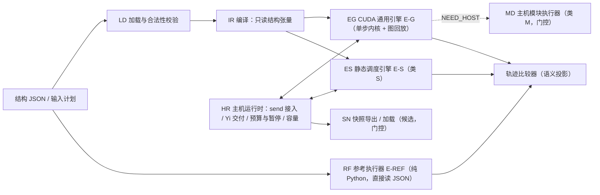

# JKRD V6.1.0 方案审查清单

日期：2026-10-26
基线：分支 `DRAFTS--V5.0.0@0a8cc58`，不含 `web/` 目录
主题：在 PyTorch `torch.cuda`（NVIDIA GPU）平台上实现 JK 模型的运行
状态：方案草案，所有条目均待审查。本稿已由五个独立视角（来源引用、语义一致、类 S 推论证伪、CUDA 技术、完整性）对抗审查，并按核实后的意见修订。本文没有修改 JKRD、README，也没有编写正式代码或在 GPU 上运行。

本文分三部分：可行性分析（§2）、需要处理的问题（§3）、具体实现方案（§4–§6）。条目编号保持稳定，便于逐项确认、修改或否决；没有明确反对不视为批准。

**编号约定**（避免与节点号、任务号、V5 待处理项混淆）：

| 前缀 | 含义 |
| --- | --- |
| `DQ01…` | 待用户裁定的决策 |
| `SEM1…` | 必须保持的执行语义 |
| `PS1…` | 并行来源 |
| `PT01…` / `VX01…` | 平台问题 / 验证问题 |
| `LD`、`RF`、`IR`、`EG`、`ES`、`HR`、`MD`、`SN`、`FT` | 实现项分组（§4.2） |
| `PH0…` | 实施阶段 |
| `V5-A01`、`V5-F03`…… | PEND 中的 V5 待处理项 |
| `节点 Q49` / `RC-T11` | 模型节点 / RC 推导中的任务 |

---

## 0. 结论摘要

1. **基础规则子集在语义上可行【推论】。** 剖面 `JKRD-V5-base` 覆盖无环、静态结构的模型，并排除：RAM 事务与工厂操作、整帧接力、模块输出锁存、显式后继请求。对这类模型，可以在 `torch.cuda` 上实现与 JKRD V5.0.0 逐任务一致的运行。前提是任务选择、到达集合、锁存载荷和入队次序全部用显式数据结构实现，不借用 CUDA 自身的并发机制（stream 优先级、原子追加）来表达 JK 的次序。JKRD:140、294、312、338 涉及的事务、帧参数和输出锁存属于类 M，其可行性取决于门控决策。
2. **单实例通用模型不预期加速。** V5 的执行是全序过程：一次一个任务，每个任务后重新选择，`Qi_q` 在任务开始时读取最新 q（JKRD:139, 298, 329–335）。每任务一次主机往返的方案，吞吐上限约为每秒 10⁵ 任务（[W2], [W3]）。GPU 的收益只来自三处：多实例批量、单任务内的大扇出、类 S 模型的层级并行（§2.4）。
3. **异步结构存储模块（类 M）只能放在第二阶段。** 它依赖以下尚未定稿的事项（PEND:39–54, 185）：
   - V5-F01 工厂操作集；
   - V5-F03/F04 失败与重试；
   - 显式请求与发布次序的候选；
   - V5-A01–A05 的候选设计；
   - 模块编号的分配命名空间。
4. **快照只能按候选格式实现。** V5-S01–S09 均未定稿（PEND:76–84），本版只能作为实验功能。环继续延后（V5-R01–R07），加载时拒绝一切多节点环。
5. **第一项交付必须是独立参考执行器。** 当前没有任何 V5 执行器（MOD:845；PEND:5；CC:4275 把执行器、EX 解释器、调度器列为 deferred）。`web/` 演示的偏差见 INTEG:125, 173。75 任务推导和 6 份检查点都只是人工推导加静态核对。没有独立参考，GPU 结果无从判定。
6. **本机不能开发或测试 CUDA。** 本机为 macOS，torch 2.13.0，没有 CUDA、nvcc、Triton。CUDA 部分需要 Linux + NVIDIA 机器；CPU 参考执行器和 IR 可以在本机完成。

**建议优先审查：** DQ01 工作负载形态；DQ03 实现等价口径；DQ04、DQ16 输入接受点与输出交付点；DQ06 资源不足的平台层处理；DQ13 代码位置（§3.1）。

---

## 1. 依据与状态口径

### 1.1 依据文件

| 简称 | 文件 | 本次采用的状态 |
| --- | --- | --- |
| JKRD | [docs/JKRD.md](JKRD.md) | 现行计算契约 V5.0.0，唯一规则主源 |
| INTEG | [drafts/JKRD-V5.0.0-integration.md](drafts/JKRD-V5.0.0-integration.md) | 原稿 E01–E67 的采纳、延后、否决记录 |
| NOTES | [drafts/JKRD-V5.0.0-notes.md](drafts/JKRD-V5.0.0-notes.md) | 2026-10-21 两项用户确认（就绪后入队；ACK 译码与动作分开）；46 条历史补充提案不整体视为规则 |
| PEND | [drafts/JKRD-V5.0.0-pending-index.md](drafts/JKRD-V5.0.0-pending-index.md) | 31 项待处理总清单及“不重新打开的事项” |
| MOD | [logic_units/async-structural-storage-draft.md](logic_units/async-structural-storage-draft.md) | 模块设计草稿：第一至六节为整理后的模块规则；第十三节为最新候选 |
| SNAP | [drafts/JKRD-V5.0.0-snapshot-recovery-pending.md](drafts/JKRD-V5.0.0-snapshot-recovery-pending.md) | 快照、恢复、校验与指纹的候选设计，延后 |
| RING | [drafts/JKRD-V5.0.0-ring-supervision-pending.md](drafts/JKRD-V5.0.0-ring-supervision-pending.md) | 环许可与监督，延后 |
| CC | [checkpoint-contract.json](../assets/v5-snapshot-design/a03-dynamic/checkpoint-contract.json) | A03 `a03-w2-ready-checkpoint / draft-2` 完整契约，候选 |
| RC | [reasoned-continuations.json](../assets/v5-snapshot-design/a03-dynamic/reasoned-continuations.json) | 75 任务人工推导及六个断面 |
| CEN | [continuation-example-notes.json](../assets/v5-snapshot-design/continuation-example-notes.json) | draft-1 三节点续算例及反例 |
| B4R | [business-four-rounds.json](../assets/async-structural-storage-v5-design/business-four-rounds.json) | 22 节点四轮业务例，状态 `proposal_directly_reasoned_not_executed`（B4R:3） |
| LU | [logic-units.md](logic_units/logic-units.md)、[counters-events.md](logic_units/counters-events.md)、[static-prototypes.md](logic_units/static-prototypes.md) | V5 之前的结构与验证记录，尚未按 V5 复核（PEND:95） |

**不作为依据：**
- `web/`：按要求排除。
- 未跟踪的 `docs/plan.V6.md`：只在附录 A 中核对。
- 历史测试记录（NOTES:73）。
- 旧专题的事件队列轨迹：V5 只排队任务，事件即时传播（JKRD:169, 237）。

外部技术事实编号为 [W1]…，链接见附录 B，于 2026-10-24 检索、2026-10-26 复核；标注“未证实”的条目不作为方案依赖。

### 1.2 状态标记

| 标记 | 含义 |
| --- | --- |
| 【现行】 | JKRD V5.0.0 已生效的规则 |
| 【确认】 | 用户已明确确认的行为，包括： · 就绪后才入队（NOTES:16–25） · ACK 译码与动作分开（NOTES:27–36） · FRAME_OUT 之后才有资格 · 满 8 帧才复用 · 输出任务独立锁存（PEND:180） · Xi 与帧参数按 Qi_J0 方式锁存（PEND:121） · 跨队列依赖由设计结构决定（PEND:126） |
| 【候选】 | 已设计、尚待确认的模块或快照方案 |
| 【延后】 | 未启用：环、DAG.FIFO、DAG.CARE、定时队列、正式快照格式；原稿 V5 md5 不采用（INTEG:96） |
| 【否决】 | 不得恢复：节点豁免（JKRD:15；INTEG:10）；为迁就演示放宽 DAG（INTEG:125） |
| 【提议】 | 本方案新提出的实现选择或规则补充，待审 |
| 【推论】 | 由来源条款推导出的结论 |

---

## 2. 可行性分析

### 2.1 V5 执行语义的并行边界

以下次序与数据依赖是 V5 结果的组成部分，任何 GPU 方案都必须逐项保持：

| # | 语义 | 来源 | 对并行的含义 |
| --- | --- | --- | --- |
| SEM1 | 一次只执行一个任务；完整 EX、RAM 事务及其传播不被打断 | JKRD:139, 335, 338 | 同一实例内没有并发任务 |
| SEM2 | 每个任务及其传播结束后，从最高优先级重新检查 Xi→RAM→Qi；跨队列先后依赖是设计结构所需 | JKRD:329, 334；PEND:126 | 不能连续处理低优先级队列，也不能按拓扑层批量执行 |
| SEM3 | 同一次传播触发的多个目标，按目标 Q 编号升序入队 | JKRD:272 | 编号带有语义；并发原子追加会打乱次序 |
| SEM4 | `Qi_q` 来源在任务开始时读取最新 q；同一目标的下一任务读取前一任务提交的 q | JKRD:298–300 | 前序提交必须对后续任务可见，形成跨任务数据依赖 |
| SEM5 | Xi 与事件型来源在形成任务时锁存；到达集合同源覆盖，收齐后锁存并清空，各目标的集合相互独立 | JKRD:277–289, 299, 310 | 同源事件必须按发生次序更新 |
| SEM6 | 不合并、不去重：相同目标、相同值的任务各自执行、各自发布 | JKRD:258, 269–270 | 不能套用逻辑仿真中“同周期合并”的做法 |
| SEM7 | 一次 send 的全部端口按 Xi 编号升序完成交接后，才选择下一任务 | JKRD:379–383 | 主机与设备只能在完整边界交接 |
| SEM8 | 有状态自引用固定为任务开始时的 q；同一来源重复出现时使用同一读取值；重复操作仍分别执行 | JKRD:150, 301, 305 | 求值使用固定参数；不得读取累加中间值，也不得删去重复操作 |
| SEM9 | 触发条件：目标含 Qi_J0 来源时，只有收齐全部不同的 Qi_J0 来源才形成任务，Qi_q 来源的事件既不单独触发，也不改变到达集合；不含 Qi_J0 来源时，每次 Qi_q 来源事件形成一个任务；节点自身的结果不触发自身 | JKRD:84, 88, 159, 171, 184, 234–235, 284, 482 | 后继表必须区分三种边（IR01） |
| SEM10 | 模块输出节点采用显式锁存：任务触发时固定输出参数，执行时使用锁存值。该例外不推广到普通节点或附带 EX | JKRD:312；NOTES:207；SNAP:100 | 只出现在类 M（MD09） |

**结论【推论】：** 同一实例内的任务构成全序。物理并行只有在完全重现这一全序及其数据效果时才可采用（见 DQ03）。拓扑层级只是 DAG 校验的副产品，不是执行次序（MOD:404）。

### 2.2 平台事实

| 事实 | 依据 | 对方案的约束 |
| --- | --- | --- |
| V100、CUDA 10.1、内核自身执行 2.9 µs 时，含执行时间的每核总耗时：每核后同步 9.6 µs，每步一次同步 3.8 µs，CUDA graph 3.4 µs。扣除执行时间后，开销约为 6.7、0.9、0.5 µs | [W2] | 每任务一次主机往返不可取，调度必须驻留在设备端 |
| Python 层逐任务调度的开销在 10–100 µs 量级 | [W3] | 不能用 Python 循环逐任务调用小型 torch 算子 |
| stream 优先级只是提示，不抢占，也不保证次序 | [W8] | FIFO 优先级必须在数据中显式实现 |
| CUDA graph 要求静态地址与拓扑，不允许同步和主机控制流，回放时不执行主机工作；`torch.cond` 可映射为 IF 条件节点 | [W5], [W7] | 全部 JK 状态放在预分配张量中，标量参数从设备内存读取。只有张量地址变化才需要重新捕获，结构表内容的变化由内核从设备内存读取 |
| CUDA 运行时自 12.4 起提供 WHILE 条件节点，C++ 扩展可以直接构建；`torch.while_loop` 能否降级为 WHILE 节点，在正式版本中**未证实** | [W6], [W16] | 原生 WHILE 节点可列为 PH0 的微基准候选；不依赖 `torch.while_loop` |
| 跨线程块自旋等待，只在协作网格或簇内有前进保证；传统原子操作只有 relaxed 语义，发布需要 release/acquire；warp 投票指令不提供内存次序 | [W9], [W10] | 一个实例由一个 warp 或 CTA 独占，不做跨块等待 |
| 非法地址等错误是粘性的：整个 CUDA 上下文作废，必须重启进程。OOM 可以捕获 | [W11] | 批量运行时，一次错误丢失同进程内的全部实例 |
| 最新 PyTorch 为 2.14.1。2.15（预定 2026-10-28）起不再提供 CUDA 12.x 包，最低 sm_75。Triton 只支持 Linux，且需要 CC≥8.0 | [W1], [W12], [W13] | 需要固定版本基线（DQ14） |
| macOS 没有 CUDA；MPS 不是 CUDA | 本机检查（`torch.cuda.is_available()=False`，`torch.version.cuda=None`，无 nvcc）；[W17] | CUDA 开发与测试需要远程 Linux GPU 环境（PT01） |

### 2.3 并行来源评估

| 来源 | 是否保持语义 | 收益条件 | 状态 |
| --- | --- | --- | --- |
| PS1 多实例批量：同一结构的多份独立运行，各自持有完整状态 | 是：实例之间没有事件或数据交互 | 并发实例达到数百以上 | 【提议】范围待 DQ01/DQ02 |
| PS2 单任务内扇出：并行更新多个后继的到达集合，再按目标编号保序压缩入队 | 是：各目标的集合相互独立（JKRD:286），入队次序由压缩保证 | 存在大扇出节点 | 【推论】 |
| PS3 类 S 层级并行：控制与数据分离（§2.4） | 是：逻辑任务次序固定，只并行求值；需要版本化取值（ES03） | 类 S 模型，调度可复用 | 【推论】+【提议】 |
| PS4 事务内多个 EX 并行求值 | 是：事务内各 EX 互不读取同事务新值，这由用户确认的就绪规则决定（NOTES:16–22） | 事务内 EX 较多 | 【确认】不读同事务新值；【候选】附带 EX 声明格式（CC:20, 23） |
| 队内或跨队列任务的波前并行 | 否：违反 SEM2–SEM4 | — | 排除 |
| 用 stream 优先级实现三条 FIFO | 否（[W8]） | — | 排除 |
| 原子尾指针并发入队 | 否：次序不确定，违反 SEM3 | — | 排除 |
| 乐观执行加回滚（Time Warp 类） | 理论可行，但需要完整现场回滚，而快照尚未定稿 | — | 不纳入本版 |

已有 GPU 逻辑仿真的加速，都来自同层大量门或大量激励的并行（[W14]），对应 PS1 与 PS3；没有先例能加速单一、严格串行的事件流。

### 2.4 模型分类与适用路径

| 类别 | 判定条件 | 调度是否依赖数据 | 适用引擎 |
| --- | --- | --- | --- |
| **类 S** | 结构静态；全部节点 `pro ∈ {q=0/1, q=}`；没有 RAM 事务和工厂操作；不绑定任何模块协议（输出锁存、整帧接力、显式后继请求、ACK 译码绑定）；RAM 成员身份只影响队列归属 | 否【推论】 | E-G 或 E-S |
| **类 G** | 与类 S 相同，只是存在 `q=0` 或 `q=1` 过滤 | 是 | E-G |
| **类 M** | 含 RAM 事务、RAM.FACTORY、动态结构或任何模块协议绑定（异步结构存储模块） | 是 | E-G 加主机事务（门控，§4.2 MD 组） |

在类 S、类 G 中声明 RAM 成员身份时，所用格式本身是候选（SNAP 的 modules 字段），因此为【提议】。

**类 S 推论与证明要点。** 取控制状态 C =（三条队列中各任务的目标序列，各目标到达集合中已到达的来源集合，已接受的输入序号，已完成任务数）。在类 S 中，每一类判断都只取决于结构和 C：

- 任务选择只看队列是否为空（JKRD:329）。
- 参数总能取得，JKRD:227 的分支不可达：`Qi_q` 来源都是有初值的有状态节点；事件型来源（任何输入副本以及无状态节点，JKRD:27, 87）在收齐时锁存；Xi 锁存在复制任务中。
- 是否发布只看 pro（JKRD:248, 251）。
- 是否收齐只看占用位（JKRD:281–284）。
- 队列归属只看目标身份（JKRD:328）。
- 入队次序只看编号（JKRD:272）。
- Yi 只看 q_y 与是否发布（JKRD:395）。
- send 接入只看 C 与输入计划（DQ04）。

因此，控制轨迹（任务目标、队列归属、入队次序、发布与 Yi 事件的位置）是（结构，输入计划，起始到达集合占用状态）的函数，与 initial_q 和 send 的 bit 值无关。

本次审查用一个只依据 JKRD 编写的独立脚本做了证伪尝试：3800 个合法类 S 模型、128000 次运行，控制轨迹差异为 0，JKRD:227 分支命中 0 次；允许 q=0/q=1 的对照组可以检出差异。脚本未入库，这一结果只是支持证据，不是证明。§5.3 把同类实验列为回归检查；只要出现一个反例，E-S 路径即作废。

### 2.5 结论

- **可行：** E-G 可以精确实现类 S 与类 G 的 V5 基础规则（单实例与多实例）；在类 S 上，E-S 可以提供单实例层级并行和多实例位切片。
- **有条件可行：** 类 M 可以先由主机执行事务、模块交接与派发，设备保存状态，以保持语义。能否成为正式能力，取决于 DQ07–DQ10、DQ17 与 V5-F01、V5-F03、V5-F04 的裁定。
- **不预期：** 单实例类 G 在 GPU 上快于优化后的 CPU 实现。原因是每个任务都是一条串行依赖的显存访问链，单个 warp 的串行访存延迟高于 CPU 缓存命中的串行执行。这是量级判断，PH0 微基准给出实测数据后再定量，不预先承诺加速比。

---

## 3. 需要处理的问题

### 3.1 规则与设计层（需要用户裁定）

| 编号 | 问题 | 依据与现状 | 影响 | 建议（均为【提议】） |
| --- | --- | --- | --- | --- |
| **DQ01** | 本版的工作负载形态：单个大模型的低延迟、多实例吞吐，还是两者都要 | 分支内没有相关表述 | 决定 PH3/PH4 的先后与优化重点 | 两者都覆盖。PH3 先做通用多实例引擎（单实例是批量为 1 的特例），PH4 补类 S 层级并行 |
| **DQ02** | 多实例批量的规则地位 | JKRD 只描述单个“当前运行实例”（JKRD:288） | 批量执行是否属于合规实现 | 在 V6.1 增补：同一结构的多个实例各自持有完整运行状态，相互之间没有事件或数据交互；批量执行不得改变任何实例的逐任务轨迹 |
| **DQ03** | 实现等价的判定口径 | JKRD:599 规定了优化验证需要核对的可观察项，但对象是模型优化，不是执行器实现 | 决定 PS2/PS3/PS4 能否采用物理并行 | 增补：物理执行可以并行或乱序，只要每个实例按序提交的逻辑任务次序，以及 JKRD:599 所列的全部可观察项，与单任务语义完全一致 |
| **DQ04** | 输入接受点 | JKRD 规定“更新 Xi 即形成任务；send 交接完成后才选下一任务”（JKRD:369–383），但没有规定物理到达与任务边界的对应关系。SNAP:155 的候选用 `accepted_input_sequence` 标记切点 | 设备批量回放期间到达的输入在哪个边界生效 | 定义“接受边界”：运行时在某个完整边界接入整次 send，记录接受时的已完成任务数和输入序号。缓冲中、尚未接入的输入不算已更新。允许最多延迟一次回放（K 个任务）才接入，需要用户确认 |
| **DQ05** | 同一次发布中多个 Yi 的交付次序 | JKRD:391–401 只规定即时接收、不等待队列 | 输出轨迹比较的口径 | 不把未定义的次序固化为语义：轨迹比较时，同一次发布内的 Yi 按集合比较。另作实现约定：同一次发布内按 Yi 编号升序分配输出序号，以保证序号可复现（供 HR02、FT02、SN01 使用） |
| **DQ06** | 资源不足的平台层处理 | PEND:128：明确失败或保留策略归 V5-F03/F04，不默认丢帧，不加正常入口拒收。PEND:54：失败任务的存放与推进不得由代理定案 | GPU 预分配容量下，队列、载荷环、输出环可能耗尽 | 平台层只采用“任务开始前容量保证”：不开始可能因容量失败的任务，停在边界扩容。扩容失败时，实例停在原边界，状态不变并报告；能否在该边界继续，由本项裁定。send 在接入前检查容量，不足时整次报错、不接受——这是否构成“入口拒收”，需用户裁定 |
| **DQ07** | 事务信封的通用契约 | 事务内各 EX 互不读取同事务的新结果：这由 2026-10-21 用户确认的就绪规则决定（NOTES:16–22；PEND:52, 122），属【确认】，不再作为选项。CC:19–35 的候选还规定：主 EX 加声明的附带 EX，按列出次序执行；每个附带 EX 各有不可变参数池；条件组在信封入口按事务前状态判定一次；私有装载与恢复 EX；planned_creations；同一来源多次写入只按最终值发布一次；protected_reads 与操作目标保护 | 类 M 的前置条件 | 确认上述候选项是通用契约，还是 A03 特例 |
| **DQ08** | 显式后继请求与发布的次序 | CC:23 候选：先按声明次序登记显式后继请求，再一次发布实际 EX 结果；同一次发布按目标升序。多来源按来源编号升序只是历史提案（NOTES:359；PEND:185）。显式请求也出现在非事务任务的完成边界：最后一路帧复制形成相邻的 S/C（RC-T3→RC-T4、RC-T5），ACK 复制请求节点 Q49 派发 | 类 M 的入队次序；不确认就无法逐位复现 RC | 确认 CC:23 的次序，并说明它同样适用于非事务任务的完成边界。补充多来源发布的规则。`event-handoff` 参数策略（CC:3534）不在 draft-1 枚举中，须确认后才加入 |
| **DQ09** | 运行时结构变更后，何时复核合法性 | V5-R02 延后（PEND:63）；JKRD:160–162 要求全部现存 Q 无环、满足引用下限 | 类 M 的结构提交 | 每次结构提交前，在候选结构上完整复核，不通过则拒绝该操作；拒绝之后如何处理，归 DQ17 |
| **DQ10** | RAM.FACTORY 的操作接口 | V5-F01 的 7 类通用工厂原语为当前待确认设计：分配、绑定或断开、成员与槽登记、请求真实 Q 求值、队首推进、旧轮回收、整块复用。原文件保留作基线（PEND:51；a03-factory-transactions.json:3，状态为 `prior-candidate-requires-rederivation-for-all-parameters-ready-before-enqueue`）。CC:4255–4273 的 17 个 `normal_operations` 是 A03 的具体事务种类，由上述原语组合而成，两者层级不同 | 类 M 的操作接口 | 7 类原语作为接口层，17 种 A03 事务作为契约层，均待 V5-F01 确认 |
| **DQ11** | 快照格式 | V5-S01 有两层版本，均为候选：通用核心 `draft-1`（SNAP:28, 45）；A03 W=2 本例的声明式扩展 `draft-2-a03-ready`（readiness-format-extension.json:4–7；SNAP:317；PEND:76）。只支持 draft-1 的消费者必须拒绝后者（readiness-format-extension.json:61）。两层是有意分层，并不矛盾 | 导出与加载能否声称合规 | 本版只作为实验功能实现，不冒充正式格式；续算判等用语义投影（SN03）。待裁定：两层关系是否定稿，扩展是否推广到 A03 以外 |
| **DQ12** | V6.1 规则修订的落点与授权 | AGENTS.md 要求修改 JKRD 须明确授权，并列出差异 | DQ02–DQ06、DQ16 的规则层部分能否写入 JKRD | 方案确认后，另行提交 JKRD V6.1.0 修订差异稿 |
| **DQ13** | 实现代码放在哪里 | README：JK 仓库是规则、设计与验证材料的主源，消费者另行实现 | 仓库结构与依赖 | GPU 运行时作为新的消费者项目（例如 `JK_TORCH`）；JK 仓库只放规则、方案与共享验收数据 |
| **DQ14** | 目标硬件与软件基线 | [W1], [W12], [W13] | 构建与 CI | Linux + NVIDIA sm_80 及以上（可选用 Triton）；torch 固定为实施时的稳定版（2.14.x 或 2.15.x），CUDA 13.x。若不用 Triton，最低 sm_75 |
| **DQ15** | 能否把“排空后再提交”（drain 模式）作为调用方选择的运行模式 | JKRD 示例采用这种输入顺序，但声明它不是运行时的入口限制（JKRD:420, 506） | E-S 能否复用调度 | 作为调用方显式选择的模式提供，运行时不强制 |
| **DQ16** | 输出交付点 | JKRD:391, 401 要求外部 Yi 即时接收，不等待队列清空 | 在 K 步回放下，应用要到回放结束才看到 Yi | 设备写入输出环即视为“接收”，应用可见延迟的上界为一次回放。这只改变外部时序，不改变逐任务轨迹；需要用户确认 |
| **DQ17** | 类 M 事务失败或模块操作被拒绝后的处理 | V5-F03/F04 待设计；PEND:54 规定存放位置与推进策略不得由代理定案；CC:741、MOD:807 规定不得占住 RAM 队首等待或自旋 | 类 M 能否正式启用 | 由用户裁定。裁定之前，运行时只报告失败，并把实例标为 FAULT（不可续算、不可导出），不把这一处理称为 JK 语义（FT01、MD07） |

### 3.2 V5 待处理项对本版的影响

| V5 项 | 现状（PEND 行号） | 对 V6.1 的影响 | 门控阶段 |
| --- | --- | --- | --- |
| V5-A01 完整合法拓扑 | 新候选完整图已做静态核对，运行未实现（39） | 类 M 测试拓扑的来源。演示图有环，不能使用（PEND:138；INTEG:173） | PH5 |
| V5-A02 整帧接力 | 待确认后实现（40） | 接力载荷的生命周期，FRAME_IN 处理（MD08） | PH5 |
| V5-A03 计算前后接入 | 75 任务人工推导（41） | 类 M 主要验收向量，只覆盖 W=2 的单一交错 | PH5/PH6 |
| V5-A04 生命周期与回收 | 候选；满 8 帧复用没有动态向量（42） | 节点池、世代、GC | PH5 |
| V5-A05 输出与 ACK | ACK 边界已确认，其余为候选（43） | 输出锁存、资格 | PH5 |
| V5-F01 工厂操作 | 待确认（51） | 阻塞类 M（DQ10） | PH5 |
| V5-F02 事务就绪 | 规则已确认，绑定为候选（52） | 事务形成条件 | PH5 |
| V5-F03 失败回滚与资源不足 | 待设计（53） | 阻塞类 M 的失败路径；约束平台容量策略（DQ06） | PH3/PH5 |
| V5-F04 失败任务保存与重试 | 待设计；不得由代理定案（54） | 本版不实现重试或失败队列（DQ17） | PH5 门控 |
| V5-R01–R07 环、DAG.CARE、定时队列 | 延后（62–68） | 加载时拒绝环；DAG.FIFO 不分配任务；不加定时队列 | PH1 起 |
| V5-S01–S09 快照 | 候选（76–84） | PH6 实验；S09 的续算等价是 PH6 的验收 | PH6 |
| V5-V01 消费者迁移 | 外部未复核（92） | 本运行时是新消费者，须独立取证 | — |
| V5-V02 任意网络中的 FIFO 与触发 | 规则已确认，通用场景待验证（93） | PH1/PH3 的核心验收 | PH1/PH3 |
| V5-V03 独立预期与反例 | 待补（94） | 贯穿各阶段 | 全程 |
| V5-V04 旧结构按 V5 复核 | 待复核（95） | 夹具来源；旧事件轨迹不能作为 V5 预期 | PH1 |
| V5-U01、V5-D01 | 界面与文档 | 无关 | — |

### 3.3 平台与工程问题

| 编号 | 问题 | 处理方向 |
| --- | --- | --- |
| PT01 | 本机没有 CUDA | 准备远程 Linux GPU 主机或 CI；本机只做 CPU 参考执行器、IR、op schema 和 CPU 实现的 opcheck |
| PT02 | 每任务主机往返的成本 | 调度驻留设备端：批量单步内核加 CUDA graph 回放，或常驻内核（EG04） |
| PT03 | 入队次序的确定性 | 禁止原子尾指针追加；按目标编号保序压缩（EG03） |
| PT04 | 内存可见性 | 一个实例由一个 warp 或 CTA 独占；主机与设备只在边界交接；共享位图字的并行写入使用原子位运算，或由单线程写整字（IR02） |
| PT05 | CUDA graph 约束 | 状态放在预分配张量中；只有地址变化需要重新捕获。可把各张量基址放进设备端描述符表，扩容时只更新描述符（【提议】，由 PH0 微基准验证） |
| PT06 | 队列、载荷环、输出环的容量 | 任务前容量保证，在边界扩容或读出（IR03、HR04；DQ06） |
| PT07 | 动态结构（类 M） | 节点池、变长 EX 字节码区、分段邻接表；逻辑编号与物理槽分离；带世代（MD05） |
| PT08 | 粘性错误：同进程全部实例与显存数据作废 | 引擎内核不使用设备端 assert 或 `__trap`，不变量违例只写 FAULT；可选“主机检查点 + 接受输入日志”的确定性重放（FT02）；不承诺跨进程恰好一次（SNAP:164） |
| PT09 | 错误异步报告，可能归到错误的任务 | 调试模式下每步同步，并使用 compute-sanitizer |
| PT10 | torch 版本节奏 | 2.15 起不再提供 CUDA 12.x 包且最低 sm_75；不依赖原型 API。需要设备端循环时，用 C++ 直接构建 CUDA WHILE 条件节点（[W6]） |
| PT11 | 逻辑编号决定入队次序 | 设备物理槽与逻辑编号分离；后继表与保序压缩一律按逻辑编号排序。类 M 的编号取自契约声明的分配命名空间，不假定按创建先后递增（LD04） |
| PT12 | EX 长度会变化 | 节点 A 的 EX 随动态节点数增长（W=2 时有 45–65 个来源），采用变长字节码 CSR，不用定宽 |

### 3.4 验证问题

| 编号 | 问题 | 处理方向 |
| --- | --- | --- |
| VX01 | 没有既有执行器 | 先建独立参考执行器，用条款独立推导的预期来验证它（§5.1） |
| VX02 | 现有向量有限 | 类 G/S 可用 JKRD 示例表、CEN、B4R；类 M 可用 RC 与 CP1–CP6（只覆盖 W=2 的单一交错）；LU 需经 V5-V04 复核后改造 |
| VX03 | 只比较输出不够 | 比较完整轨迹。错误清空到达集合的实现，在主例中可能得到相同输出（SNAP:231）；RC 没有覆盖“旧输出执行前中转被覆盖”的反例（RC:5088–5094） |
| VX04 | md5 不适合用于续算判等 | md5 载荷包含任务的 `cause`、`context` 等历史或身份字段以及分配器（SNAP:115, 123, 206；审计用的 metadata 不进入指纹，SNAP:51）。这些取值依赖实现细节，续算判等改用语义投影 |
| VX05 | 共享代码会掩盖错误 | 参考执行器不复用 GPU 引擎的解析、分类、调度代码，直接读取 JSON |
| VX06 | 随机合法模型的生成 | 生成器须保证引用下限、DAG、输入副本、q_y 合法，并对生成器本身做非法变体的反例测试 |

---

## 4. 实现方案

### 4.1 总体结构

E-REF 不经过 IR，以免 IR 的解析或分类错误同时影响参考实现和被测实现（VX05）。

### 4.2 逐项方案

#### LD．模型表示与加载

| 编号 | 方案 | 状态 | 验收依据 |
| --- | --- | --- | --- |
| LD01 | **规则剖面与能力声明**：运行时声明支持 `JKRD-V5-base`（Xi/RAM/Qi=1/2/5；无环；静态结构；不含 RAM 事务、工厂操作、整帧接力、模块输出锁存、显式后继请求）。类 M、快照为可选能力，未声明的能力一律拒绝 | 【提议】 | 含 DAG.FIFO 任务、多节点环、监督状态、未声明模块协议的输入均被拒绝 |
| LD02 | **结构合法性**： · initial_q 决定分类，每个节点至多出现一次 · 无状态节点的 EX 首个操作必须为 J0 · EX 只含合法单元，扁平、非空 · 拒绝纯常量节点 · 输入副本为唯一同号的 `J0K(Xi)`，占用 Q0..Q(N-1)，其余节点编号 ≥ N · Xi 只能被其副本引用 · `ex_source ≥ 1`，被引用数 ≥ 1 · pro 只能省略，或取 q=0/1、q=0、q=1、q= · 无状态节点不得自引用，也不得用 `q=` · 每个 Yi 恰好绑定一个已存在、pro 为 `q=0/1` 的 Q · 全部现存 Q 的引用图无环：排除合法的有状态自引用，不按 pro 过滤 | 【现行】JKRD:63, 81, 83–89, 135–163, 246–256, 393–399, 596 | 每条规则至少一个拒绝反例，例如： · 被 `pro=q=` 掩盖的环 · 零引用的池节点 · 无状态 EX 为 `K1K(Q0)` · 输入副本编号不连续 · `pro="q=2"` · q_y 指向不存在的 Q |
| LD03 | **来源分类**：节点状态分类与来源类别分开保存。 ① 事件型来源：输入副本（无论有无状态）和无状态节点 ② `Qi_q` 来源：有状态的普通节点 ③ 模块输出锁存：RAM 输出节点的任务在触发入队时锁存其有状态来源，执行时不读最新 q。只在类 M 中实现，不推广到普通节点或附带 EX | ①② 【现行】JKRD:27, 87；INTEG:19 ③ 【现行】JKRD:312，【确认】PEND:180 | 有状态输入副本作为来源时，必须等待其事件（JKRD:422–432 示例）；输出锁存见 MD09 |
| LD04 | **逻辑编号与设备索引**： · 逻辑编号不复用、不截断（SNAP:64, 117） · 设备物理槽与逻辑编号通过映射分离；后继表与保序压缩一律按逻辑编号排序，每次结构提交后重建受影响部分 · 类 M 的新编号取自模块契约声明的分配命名空间，运行时不自行发号。A03 候选为 `named-never-reused-reserved-id-ranges` 加 planned_creations，创建次序不保证编号递增（CC:4058, 4214；CP1 已有节点 Q101、尚无 Q75） | 编号规则【候选】；映射与排序【提议】，依据 JKRD:272 | 编号空洞、预留编号乱序创建、删除最高编号之后，入队次序与 E-REF 一致 |
| LD05 | **EX 编译**：编译为字节码 `(op, operand)`，操作包括 J0/J1/K0/K1、J/K(实时来源)、J/K(锁存槽 k)、J/K(自身固定值)。重复操作保留；同一来源只占一个槽、只读取一次；保留源文本用于导出 | 【现行】语义 JKRD:150–152, 238, 301, 305 | 用独立真值表核对；重复引用不重复触发；`K(Q)K(Q)` 互相抵消 |

#### RF．参考执行器 E-REF

| 编号 | 方案 | 状态 | 验收依据 |
| --- | --- | --- | --- |
| RF01 | **独立标量实现**：纯 Python，不依赖 torch，直接读取 JSON；逐步对应 JKRD 的执行流程（JKRD:340–348）；不与 GPU 引擎共享解析、分类或调度代码 | 【提议】AGENTS.md 第 4 条 | 通过 §5.1 的全部独立预期 |
| RF02 | **轨迹格式**：每个任务记录以下内容。 · 序号、队列、目标（编号、世代） · 固定参数：锁存值、读取值、自身起点 · 结果、q 变化（只记有状态节点）、是否发布 · 事务任务：按声明次序记录每个附带 EX 的目标、参数与结果 · 新入队任务：按次序列出，标注来自发布、显式请求还是接力，附载荷 · Yi 输出：发布序号、Yi、值 · 到达集合变化 send 接入另记接受边界、端口、值、输入序号 | 【提议】覆盖 JKRD:599 的全部可观察项，并对应 RC 的 `independently_derived_bound_results` 与 `enqueues_in_order` | 只改变一项可观察行为的变异实现，必须被比较器发现 |
| RF03 | **输入计划**：输入表示为“在第 k 个完整边界接入的 send”；每次 Xi 到达分配一个输入序号，一次 send 不另占序号 | 【提议】依据 DQ04，对齐 SNAP:117 候选 | 同一计划在 E-REF、E-G、E-S 上的接受边界和输入序号相同 |

#### IR．IR 与数据布局

| 编号 | 方案 | 状态 | 验收依据 |
| --- | --- | --- | --- |
| IR01 | **只读结构张量**： · 节点标志：有状态、输入副本、pro、队列类 · EX 字节码 CSR · 每个目标的事件型来源槽表 · 后继 CSR：按目标逻辑编号升序，每项属于以下三类之一 　① 事件型来源 → 写入目标的到达槽 k 　② Qi_q 来源，且目标不含事件型来源 → 每次事件生成一个任务 　③ Qi_q 来源，且目标含事件型来源 → 不生成后继项（JKRD:284） 　有状态自引用不生成边（JKRD:159, 171） · Yi 绑定表 | 【现行】语义 SEM9 +【提议】布局 | 由 IR 反向导出的结构与源 JSON 语义一致；SEM9 反例（§5.1） |
| IR02 | **每实例状态**： · q：uint8，之后可位压缩。无状态节点的槽只作执行暂存，不属于实例状态；观察、导出、比较只使用 initial_q 声明的有状态成员 · 到达集合 present/value 位图：若多个目标共享同一个位图字，并行置位和收齐后清空必须用 `atomicOr`/`atomicAnd`，或先汇成整字再由单线程写入 · 三条环形任务队列，每条配套各自的载荷环：载荷按该队入队次序分配，按该队出队次序释放；每个目标的载荷位宽由 IR 静态确定 · 计数器：已完成任务数、输入序号、输出序号、任务序号 · 设备状态字：RUN/IDLE/NEED_GROW/NEED_DRAIN/NEED_HOST/FAULT，与主机请求字分开 · 每实例剩余任务预算 · Yi 输出环；可选的轨迹环 结构加载只写入声明的初值，不执行 EX，不发布，不写到达集合（JKRD:259） | 【提议】 | 在边界导出的逻辑状态与 E-REF 相同；两个共享同一位图字的目标同时到达时，到达位都保留；持续 Xi 输入与长 Qi 链交替时，载荷环占用保持有界 |
| IR03 | **容量元数据**：每个节点统计本任务可能实际形成的入队数（只计 IR01 中 ① 收齐后和 ② 两类，按队列分别计），以及对应载荷位数和 q_y 绑定的 Yi 数。任务开始前同时检查队列空槽、各载荷环空位、Yi 输出环空位，启用时也检查轨迹环。类 M 任务另计契约中的显式请求数和 planned_creations 增量；拿不到上界时转 NEED_HOST，由主机预检 | 【提议】依据 DQ06 | K=1024、输出环容量 16、每步都发布 Y0：不丢输出，环满时停在边界 |

#### EG．CUDA 通用引擎 E-G

| 编号 | 方案 | 状态 | 验收依据 |
| --- | --- | --- | --- |
| EG01 | **执行映射**：一个实例由一个 warp 独占，大扇出模型可用一个 CTA；实例之间没有共享的可写状态，没有跨块等待 | 【提议】依据 [W9] | 批量运行时，每个实例的轨迹与单独运行完全相同 |
| EG02 | **单步内核**：每次启动，令每个处于 RUN 且预算大于 0 的实例完成恰好一个完整任务。 1. 按 Xi→RAM→Qi 取第一条非空队列的队首 2. 容量预检 3. 出队 4. 取锁存参数，读取 `Qi_q` 的最新 q 和自身 q 5. 按字节码完整求值 6. 提交 7. 按 pro 发布：并行更新各后继的到达集合，按逻辑编号保序压缩，分别追加到所属队列 8. Yi 写入输出环 9. 计数器递增，预算减一 预检失败时，不改变任何队列、到达集合与计数器，也不保留本次选择；扩容或读出之后，从 Xi.FIFO 重新选择。选中的任务属于类 M 的主机路径时，转 NEED_HOST | 【现行】语义 JKRD:316–348（选择、求值、发布、入队）+【提议】容量预检与 NEED_*（DQ06）+【推论】参数不足只在类 M 中可达（§2.4） | 与 E-REF 的轨迹逐项相等 |
| EG03 | **保序入队**： · 任务计数：warp 模式用 `__ballot_sync` 加 `__popc` · 载荷偏移：按载荷位宽加权，用 warp 前缀和（`__shfl_up_sync`），每条队列分别计算 · CTA 模式：先在 warp 内计数，再用 block 级前缀和（如 `cub::BlockScan`）得到各 warp 的起始偏移 · 扇出超过一个 warp 或 CTA 宽度时，分块循环，并携带各队列的累计偏移 · 禁止多个线程用 `atomicAdd` 竞争尾指针 | 【提议】依据 JKRD:272、[W10] | 扇出 ≥ 33（warp 模式）以及 ≥ 65（CTA 模式）且跨两个队列的反例，入队次序正确 |
| EG04 | **多步执行**：把 K 个单步内核捕获为一张 CUDA graph 回放，K 可调。回放之间，主机按固定次序工作：主机路径任务（MD02）→ send 接入 → Yi 读出 → 扩容。 候选方案（只在 PH0 微基准显示有收益后采用）： ① C++ 构建的 CUDA WHILE 条件节点，条件为“仍有 RUN 且预算大于 0 的实例” ② 常驻内核：主机经映射的锁页主机内存邮箱（`cudaHostAllocMapped`）交接，设备端用 system 作用域的 acquire/release；放在专用非阻塞流或独立进程中，常驻期间同进程禁止 `cudaFree`、`torch.cuda.empty_cache`、`torch.cuda.synchronize` 及 legacy 默认流操作；只在没有显示看门狗的 Linux 计算卡上使用 | 【提议】依据 [W2], [W5], [W6], [W9], [W10] | K=1 与 K=1024 的轨迹相同；常驻期间注入 `empty_cache` 与 OOM 重试路径，不出现死锁 |
| EG05 | **流与同步**：引擎的全部内核在同一个 PyTorch 当前流上执行；Yi 与轨迹读出使用固定的锁页缓冲，事件同步之后才使用；不依赖 stream 优先级 | 【提议】依据 [W8] | 用 Nsight Systems 或 CUPTI 统计每个回放周期内的同步调用：每次回放之后恰好一次事件同步 |
| EG06 | **算子封装**：C++/CUDA 扩展通过 `torch.library` 注册。每个被修改的张量使用各自的别名集，依次标注 `Tensor(a!)`、`Tensor(b!)`……，不返回被修改的张量。opcheck 在本机对 CPU 实现运行，在 Linux GPU 主机上对 CUDA 实现再运行一次 | 【提议】依据 [W4] | 两处 opcheck 都通过；本机通过不代表 CUDA 实现的修改声明正确 |
| EG07 | **预算、单步与暂停**：每个实例在设备内存中有剩余任务预算：`run(N)` 设为 N，`step` 设为 1，`pause` 设为 0。预算与 send 只在两次回放之间、在同一流上写入，因此暂停在当前回放结束的完整边界生效，最多再执行 K 个任务；需要立即暂停时取 K=1。主机请求字与设备状态字分开。暂停期间 send 仍可接入并形成任务，但不执行 | 【现行】语义 JKRD:384 +【提议】实现 | 1000 个实例批量运行时只对实例 i 单步，其余实例的已完成任务数不变；暂停期间接入的输入形成任务但不执行 |
| EG08 | **位压缩（可选）**：q 和到达值按位压缩以节省带宽，不改变调度逻辑；共享字的写入规则同 IR02 | 【提议】 | 压缩前后轨迹相同 |

#### ES．静态调度引擎 E-S（只用于类 S）

| 编号 | 方案 | 状态 | 验收依据 |
| --- | --- | --- | --- |
| ES01 | **适用判定**：加载时逐模型核对类 S 的结构条件（§2.4）；不满足则只用 E-G | 【推论】+【提议】 | 含输出锁存节点、接力请求或 `q=0/q=1` 的模型被判为非类 S；§5.3 未发现反例 |
| ES02 | **符号调度**：按规则只模拟控制流、不计算值，得到完整的任务序列、入队次序和 Yi 事件位置，按键缓存。键为（边界时三条队列中按次序的任务目标序列及各任务载荷的来源位置，到达集合占用状态，send 端口集合）；在 drain 模式下队列为空，键退化为后两项 | 【提议】 | 符号调度的序列与 E-REF 在任意值下的任务序列相同 |
| ES03 | **数据流层级化**：所有值按产生它的任务实例寻址，每个任务的结果单独保存为一个版本。依赖关系为： ① 事件型来源参数，依赖本组到达集合中该来源最后一次到达对应的发布任务；被覆盖的到达不构成依赖。复制任务的 Xi 依赖被接受的 send 输入 ② `Qi_q` 来源，依赖本任务逻辑开始前该来源的最后一次提交；没有提交时取 initial_q ③ 仅当目标有状态，且 EX 实际使用起点（含显式自引用，或 EX 中没有 J0）时，依赖自身上次提交；无状态目标的各任务之间没有依赖 按最长路径分层，同层并行求值，状态序列按提交次序重建。若要原地保存 q，必须再加反依赖：同一节点的下一次提交，排在所有读取其前一版本的任务之后 | 【推论】+【提议】 | 逐任务的值与 E-REF 相同。反例：Q0=J0K(X0)，Q1=J0K(Q0)，Q2=K(Q0)（有状态，pro q=），Q3=J0K(Q1)，Q4=J0K(Q3)K(Q2)，Y0 绑定 Q4；排空模式下两次 send(X0=1)。Y0 必须依次为 0、1；原地保存而不加反依赖的实现会得到 1、1，必须被比较器检出 |
| ES04 | **批量位切片**：每个 int64 承载 64 个实例的同一位，J/K 就是 AND/XOR 字运算，没有分支。 · 同一个字内的实例必须共享相同的结构、send 端口序列、接受边界和起始到达集合占用状态，只允许 initial_q 与 send 值不同；不满足时按调度键分组，或回退到 E-G · 打包用按位 OR 累积，拆包用 `((w >> k) & 1)`，k ∈ [0, 63]，不使用 uint64 · 调度编译为设备内存中的字节码，由少数几个解释内核执行；图节点数与调度长度无关，不为每个 J/K 操作捕获一个 torch 算子 | 【提议】，参考 [W14] 的批量激励做法 | 64、65、4096 个实例与逐个单独运行结果相同；端口集合或接受边界不同的两个实例不会被装进同一个字 |
| ES05 | **轨迹重建**：任务序列取自调度，值取自层级求值，二者合成与 E-REF 相同格式的完整轨迹（测试模式） | 【提议】 | 与 E-REF 轨迹逐项相等 |
| ES06 | **适用边界**：只在 drain 模式（DQ15）下、段起点三条队列都为空时使用。异步到达的 send 一律在段结束边界接入，这等于 DQ04 中的延迟接入（K 等于段长），须 DQ04 获准后才启用；未获准时，异步输入不用 E-S，也不做段内回滚。段内暂停时，从段起点用 E-G 重算到暂停边界 | 【提议】 | 回退前后的轨迹连续一致 |

#### HR．主机运行时与外部接口

| 编号 | 方案 | 状态 | 验收依据 |
| --- | --- | --- | --- |
| HR01 | **send 接入**：校验非空、端口合法、值为 0/1；在完整边界按 Xi 编号升序逐个形成复制任务并锁存；每次 Xi 到达分配一个输入序号；记录接受边界；返回本次接受的输入序号区间，不表示计算已完成 | 【现行】JKRD:376–385 +【提议】接受点（DQ04） | 两次连续输入 1、0 之后，复制任务各自锁存 1、0（JKRD:458–469） |
| HR02 | **Yi 交付**：发布时，设备把（输出序号、发布任务序号、Yi、值）写入输出环，同一次发布内按 Yi 编号升序取号；主机按序号读出，交给应用。输出序号不表示业务 ACK 或持久化确认 | 【现行】语义 JKRD:391–406 +【提议】交付点（DQ16）与编号约定（DQ05） | 值为 0 的输出保留；未发布时不重复输出旧值（JKRD:484–493） |
| HR03 | **运行控制**：`run(最多 N 个任务)`、`step`、`pause`、`resume`、空闲判定，由 EG07 的预算实现；预算只在完整任务边界生效，不改变优先级，不增加轮转或配额 | 【现行】JKRD:336–337；PEND:127 | 持续的高优先级输入下，低优先级任务可能一直得不到执行；这是现行语义，不得“修复” |
| HR04 | **扩容次序**：分配新张量 → 在同一流上复制状态 → 捕获并实例化新图；全部成功后，才释放旧图与旧张量。任一步 OOM 时，丢弃新对象，旧图与旧张量保持可用，实例停在原边界并报告；能否在该边界继续，由 DQ06 裁定 | 【提议】 | 注入 OOM 后，实例状态与 OOM 前的边界逐字段一致 |
| HR05 | **观察**：只在完整边界读取有状态成员的 q、队列和到达集合；不提供提交一半的状态 | 【现行】JKRD:338 | 读取接口不会读到半提交状态 |

#### MD．异步结构存储模块（类 M，门控）

| 编号 | 方案 | 状态 | 验收依据 |
| --- | --- | --- | --- |
| MD01 | **前置条件**：DQ07、DQ08、DQ10、DQ17，以及 V5-F01、V5-F03、V5-F04 的裁定；V5-A01 拓扑确认。未确认之前只做实验，结果不作为合规结论 | 门控 | — |
| MD02 | **主机路径执行**：E-G 在选择步骤选中主机路径任务（事务任务，或带模块交接的复制任务）时，实例转为 NEED_HOST。此时 Xi.FIFO 必须为空，或该任务本身就是 Xi 任务。从进入 NEED_HOST 到主机完成提交、请求登记与发布，期间不接入任何 send；之后接入的 send，其接受边界记为该任务完成后的边界。 主机按声明次序求值主 EX 与附带 EX：每个附带 EX 使用自己的不可变参数池，不读取同事务的新值，条件组在信封入口判定一次。在候选结构上校验权限、保护、世代、引用和 DAG；原子写回 q 与结构；按 DQ08 的次序登记请求并发布；同一来源只按最终 q 与 pro 发布一次 | 【确认】不读同事务新值（NOTES:16–22）+【候选】信封语义（CC:19–35）+【提议】实现 | 在 NEED_HOST 期间到达的 send：其复制任务排在该任务之后、下一个 RAM 或 Qi 任务之前执行。CP3 中 RC-T36 的附带次序为 Q119、Q120、Q121、Q122、Q124、Q123、Q112（不是编号序）；RC-T35 先求 READY（节点 Q47），再求 H、CACHE、F |
| MD03 | **入队就绪**：事务任务只能由 JK 结构在全部实际参数就绪后形成；执行器不用主机的 ready 标志代替结构，不让未就绪的事务占住队首或自旋；0 是有效数据 | 【确认】NOTES:16–25；MOD:807 | CP2 中节点 Q99（LATCH）已有部分来源到达，但没有对应任务（SNAP §11） |
| MD04 | **显式后继请求**：支持非发布产生的请求任务，包括 S/C 接力、节点 Q49 派发、G 准入、节点 Q71 GC，各带独立的锁存载荷；次序按 DQ08 | 【候选】CC:23 | RC-T11 依次入队节点 Q71、Q104、Q100，这不是纯编号升序；RC-T3→T4、T5，RC-T39→T41，RC-T40→T42 均按次序入队 |
| MD05 | **动态结构存储**： · 编号不复用；世代与 EX 版本随任务冻结，执行前核对 · 删除只在最终原子提交时进行，并对整个删除集合检查外部依赖，集合内部的边不阻止整体删除；不在活动 EX 内删除 · 实现：节点池、变长 EX 字节码区、分段邻接表 | 规则【候选】CC:4058, 4214；SNAP:64, 117, 143；MOD:682, 684, 817；NOTES:199。实现结构【提议】 | 旧世代任务不能命中新对象；删除集合内部的边不阻止整体删除 |
| MD06 | **ACK**：DEC 在执行时读取队首和资格，并绑定帧；ACT 只核对绑定的帧，若已失效则不做业务动作，也不转投下一帧；READY=0 的 ACK 直接忽略，不挂起等待 | 【确认】NOTES:27–36；MOD:825–831 | CP4 中 RC-T47、RC-T48 都绑定帧 1；恢复之后不重新译码 |
| MD07 | **失败**：DQ17 裁定之前，事务校验失败或模块操作被拒绝时，运行时只报告，并把实例标为 FAULT（不可续算、不可导出）；不保留失败任务，不重试，不继续选择，也不把这一处理称为 JK 语义 | 待裁定，受 PEND:54 约束 | 失败注入后没有半提交，没有发布，实例不再执行 |
| MD08 | **输入接力与 FRAME_IN**： · send 接入时：W∉[1,8] 或含非 bit 的帧在接入前拒绝 · FRAME_IN=1：封存数组、帧 ID 与输入序号 · FRAME_IN=0：只清除 `input_staging`，不取消已锁存的任务和载荷 · `handoffs` 记录作为实例状态保存 · 最后一个复制任务完成、形成相邻的 S/C、删除 handoff，三者在同一个原子步骤内完成，由主机路径执行 | 【确认】FRAME 行为（MOD:88–94；NOTES:143, 151）+【候选】handoff 状态（SNAP:131–132, 141） | RC-T3 依次入队 RC-T4、RC-T5；CP1 现场 handoff 保有整帧数据，S/C 尚未入队 |
| MD09 | **输出锁存**：模块输出节点在触发入队时锁存参数，执行时使用锁存值，后续中转改变不影响旧任务；H、F、READY 等附带 EX 仍读取实时值 | 【现行】JKRD:312；【确认】PEND:180；SNAP:100 | 独立推导“旧输出执行前中转被覆盖”的反例（RC 未覆盖） |

#### SN．快照与恢复（候选格式，门控）

| 编号 | 方案 | 状态 | 验收依据 |
| --- | --- | --- | --- |
| SN01 | **导出**：只在完整边界进行。暂停后读取同一版本的设备状态，生成候选 runtime 文档：静态结构和无模块现场用 `draft-1`；只有嵌入 `a03-w2-ready-checkpoint` 契约的现场用 `draft-2-a03-ready`；其他类 M 模型拒绝导出，直到 V5-S01 定稿。不保存设备指针、物理槽布局和派生索引；批量运行时覆盖全部实例 | 【候选】SNAP:28–34, 104–139, 153–155, 317 | CEN 的检查点可以由 E-G 的运行导出复现 |
| SN02 | **加载**：隔离校验 → 重建派生索引 → 原子安装 → 保持暂停。零 EX，零事件，零补任务，零 Yi 重放 | 【候选】SNAP:157–162 | CEN:98–108 中属于加载的反例（补发 Y0、丢弃到达集合、把到达集合补成任务）以及 CEN:109 起的部分到达分支，都被拒绝或断言失败 |
| SN03 | **判等**：续算与不中断运行之间，比较语义投影（结构、EX 与版本、有状态成员的 q、队列中的任务与载荷、到达集合、分配器、模块状态）以及剩余轨迹；指纹只用于规范化字节测试 | 【提议】 | 剩余轨迹比较能识别 CEN 中属于执行的反例（重读最新 q、合并任务、跳过发布、按全局任务号执行等）；现有 6 份检查点与 2 份 draft-1 文档的指纹，可以用规范 JSON 加 MD5 精确复算 |
| SN04 | **拒绝**：存在环监督状态、DAG.FIFO 任务、未提交事务或失败现场时，拒绝导出或加载 | 【候选】SNAP:34 | 构造上述每种状态，都被拒绝 |

#### FT．故障与恢复

| 编号 | 方案 | 状态 | 验收依据 |
| --- | --- | --- | --- |
| FT01 | **分类**： ① 正常无动作，都不是故障：参数不足结束、READY=0 的 ACK、陈旧的 ACT、被 pro 过滤而未发布 ② 平台可恢复：容量扩容、读出输出环、发生在边界的 OOM（HR04） ③ 粘性 CUDA 错误：同一进程内全部实例与显存数据作废，必须重启进程。引擎内核不使用设备端 assert 或 `__trap`，不变量违例只写 FAULT 并返回；引擎路径中不调用可能触发设备端断言的 torch 索引算子 ④ 类 M 的事务失败按 MD07 处理 | ① 【现行/确认】 ②③ 【提议】依据 [W11] ④ 待 DQ17 | ① 不会进入任何故障路径 |
| FT02 | **重建（可选）**：主机保留最近一个完整边界的检查点（覆盖批量中的全部实例），以及其后接受的 send 与接受边界日志；重启后确定性重放到故障前的边界；已交付的 Yi 按输出序号去重。不承诺跨进程恰好一次 | 【提议】；SNAP:164 尚未定义 | 重放后的状态与故障前最后一个边界一致 |

### 4.3 关键语义对应表

| 来源条款 | 预期行为 | 实现位置 | 验证依据 |
| --- | --- | --- | --- |
| JKRD:329, 334 严格优先级、每任务后重新选择 | 新到的 Xi 任务在下一个边界优先执行 | EG02 选择步骤；HR01；MD02 | JKRD:447–456 示例；RC-T19 至 RC-T21 先于 RC-T16 执行（SNAP:337） |
| JKRD:272 同一次传播按目标编号升序 | 同一队列内按编号入队，跨队列按优先级 | EG03；LD04 | JOIN.id < CLAIM.id 时只产生一次 GO（MOD:801）；跨队列扇出反例；乱序创建编号的反例 |
| JKRD:298–300 Qi_q 在开始时读取 | 后执行的任务看到前一任务的提交 | EG02 参数读取；ES03 版本化 | JKRD:553–563 示例；ES03 反例 |
| JKRD:299, 310 锁存 | 复制任务使用到达时的值 | HR01；IR02 载荷环 | JKRD:458–469（依次锁存 1、0） |
| JKRD:277–289 到达集合 | 同源覆盖；收齐后锁存并清空；旧任务不清空新的一组 | EG02 发布步骤；IR02 | JKRD:471–482；CEN 主例与分支例 |
| JKRD:184, 284 Qi_q 事件不触发含 Qi_J0 参数的目标 | 不形成任务，不写到达集合 | IR01 第 ③ 类；EG02 | 反例：Q2=J0K(Q0)K(Q5)，其中 Q0 为输入副本，Q5 为有状态普通节点；Q5 发布后不得形成 Q2 任务，也不得改动 Q2 的到达集合；B4R 的门节点 |
| JKRD:27, 87；INTEG:19 输入副本是事件型来源 | 不用初值补齐，等待事件 | LD03 | JKRD:422–432 |
| JKRD:244–259 pro | 只在完整 EX 结束后判断一次；未发布不等于发送 0 | EG02 | JKRD:484–493 |
| JKRD:301, 305 自引用与重复引用 | 读取值固定 | LD05；EG02 | C_ACK 类 EX 的反例（MOD:414） |
| JKRD:258, 269–270 不合并 | 每次触发形成一个任务 | EG02；ES02 | 两次 send(1,1) 得到两次输出 0（JKRD:434–445） |
| JKRD:312 输出锁存 | 输出任务使用触发时锁存的值 | LD03 ③；MD09 | 独立推导“旧输出执行前中转被覆盖”的反例 |
| JKRD:379–383 send 交接 | 整次 send 在同一个边界接入 | HR01；MD02 | 多端口 send 的中间状态不可观察 |
| JKRD:160–163 无环 | 加载时拒绝环 | LD02 | 被 `pro=q=` 掩盖的环被拒绝 |
| NOTES:16–25 就绪后才入队 | 参数缺失时不进入 FIFO | MD03 | CP2（SNAP §11） |
| NOTES:27–36 ACK 译码时绑定帧 | 陈旧的 ACT 不转投下一帧 | MD06 | CP4；ACK.R05（CC:4008） |
| JKRD:338 事务原子 | 只能看到提交前或提交后的状态 | MD02；HR05 | S17 无效检查点用例（validation-and-fingerprint-cases.json:239） |

---

## 5. 验证方案

### 5.1 独立预期来源（按采用次序）

1. **JKRD 示例表**（JKRD:422–493, 524–563）：逐任务与输出的预期，来自现行规则文本。
2. **CEN 三节点续算**：
   - 预期（CEN:87–97）：任务序列 T8、T9、T10、T6、T11；剩余 Y0 输出 `[1,0]`；最终 q `(0,1,0)`；下一个任务序号 12。
   - 反例：CEN:98–108。
   - 部分到达的补充分支：CEN:109 起。
3. **B4R 22 任务**：任务次序 Q0…Q21，Y0–Y4 依次为 1、1、0、1、1（B4R:47–48），状态为 `proposal_directly_reasoned_not_executed`（B4R:3）。PH1 须用独立脚本复算，并把脚本作为夹具存档。
4. **条款反例集**：SEM1–SEM10 与 §4.3 的每一行，至少一个能识别错误实现的反例。例如：
   - 提前冻结 q；
   - 自引用读取累加值；
   - 原子追加打乱次序；
   - 合并同值任务；
   - 旧任务清空新的一组；
   - 有状态输入副本按最新 q 读取；
   - Qi_q 事件单独触发含 Qi_J0 参数的目标；
   - ES03 的原地覆盖反例；
   - 输出锁存被中转覆盖。
5. **LU 结构**：先经 V5-V04 复核，再改造为 V5 合法夹具（加输入副本与门节点）；只采用真值表作为值函数检查，旧事件轨迹不作为预期。
6. **RC 75 任务与 CP1–CP6**：类 M 的验收向量，用于 PH5/PH6；须在 DQ08 确认之后才能要求逐位一致。它只覆盖 W=2 的单一交错，不能代替 PH5 中其他情况的独立推导。

### 5.2 差分测试

用随机生成的合法模型和随机输入计划，要求 E-REF、E-G、E-S 的轨迹逐项相等。E-REF 须先通过 §5.1，差分结果才有意义。

### 5.3 类 S 推论的回归检查

条件相同：同一结构、同一输入计划（端口序列，以及按已完成任务数定义的接受边界）、同一起始到达集合占用状态。在此条件下随机改变 initial_q 和 send 值多次运行，E-REF 的控制轨迹必须相同。同时运行一组允许 q=0/q=1 的对照，确认测试装置能检出差异。这项实验只能证伪，不能代替 §2.4 的论证；出现一个反例，即作废 E-S。

### 5.4 报告口径

每个阶段分别报告：已实现、已验证、未覆盖、已知偏差。测试通过只证明实际覆盖的行为；测试数量、GPU 运行正常、多个代理意见一致，都不能代替规范一致性证据。测试失败时，先核对规范、实现和断言，不为通过而修改预期。平台层的停顿（容量、OOM）按已知偏差列出。

---

## 6. 分阶段计划与交付门槛

| 阶段 | 内容 | 前置决策 | 交付 | 验收 | 明确不覆盖 |
| --- | --- | --- | --- | --- | --- |
| PH0 | 环境与决策 | DQ01, DQ03, DQ04, DQ13, DQ14, DQ16 | 远程 GPU 环境；微基准（启动、同步、图回放、条件 WHILE 节点、映射内存读取标志）；裁定记录 | 微基准数据；决策逐项记录 | 任何 JK 执行 |
| PH1 | 加载校验与参考执行器 | — | LD01–LD05、RF01–RF03 | §5.1 第 1–5 项全部通过；LD02 的反例全部被拒绝 | GPU；类 M |
| PH2 | IR 与比较器 | DQ05 | IR01–IR03；轨迹比较器；随机模型生成器 | IR 往返一致；变异实现被比较器发现 | GPU |
| PH3 | CUDA 通用引擎 | DQ02, DQ06 | EG01–EG07、HR01–HR05、FT01 | 类 S/G 与 E-REF 差分一致；批量运行等于单独运行；预算、暂停、单步、扩容、输出环满的反例 | 类 M；快照 |
| PH4 | 静态调度引擎 | DQ04, DQ15 | ES01–ES06 | §5.3 无反例；与 E-REF 差分一致；ES03 反例被检出；单实例层级并行与位切片的性能报告 | 类 G/M |
| PH5 | 模块（门控） | DQ07–DQ10, DQ17；V5-F01, V5-F03, V5-F04, V5-A01 | MD01–MD09 | 与 RC 75 任务逐任务一致（含附带 EX 结果与入队来源）。另按 AGENTS 第 4 条为以下情况独立推导预期：W=1 与 W=8、FRAME_IN=0 清除、连续全 0 帧、第 9 帧增长、满 8 整块复用与世代加一、部分使用块保留、旧输出执行前中转被覆盖、节点 Q49 派发任务待执行时的边界 | 环 |
| PH6 | 快照（门控） | DQ11；V5-S01, V5-S05, V5-S06 | SN01–SN04、FT02 | CEN 与 CP1–CP6 的加载与续算判等；拒绝用例 | 正式格式发布；恰好一次交付 |
| PH7 | 性能与稳健性 | — | EG08；常驻内核或 WHILE 节点评估；粘性错误演练 | 端到端吞吐与延迟、同步成本、峰值显存；每项优化都通过逐任务轨迹对照 | 预先承诺的加速比 |

建议的依赖顺序：PH0 → PH1 → PH2 → PH3 →（PH4 与 PH5 可并行）→ PH6 → PH7。

---

## 7. 待确认决策汇总

建议按以下次序审查，每项回复“确认、修改或否决”：

1. **DQ01、DQ02**：工作负载形态；多实例批量的规则地位。
2. **DQ03**：实现等价口径——物理并行必须与按序提交的逻辑轨迹完全一致。
3. **DQ04、DQ16、DQ15**：输入接受点与输出交付点（是否允许延迟一次回放）；drain 模式。
4. **DQ06**：资源不足的平台层处理，以及它与 V5-F03/F04 的分界。
5. **DQ13、DQ14**：代码位置；目标硬件与软件版本。
6. **DQ05**：同一次发布内的 Yi 次序不作为语义，以及输出编号约定。
7. **DQ07–DQ10、DQ17**：类 M 的信封契约、请求与发布次序、结构复核、工厂接口、失败处理（可推迟到 PH5 前）。
8. **DQ11、DQ12**：快照实验范围；V6.1 规则修订的提交方式。

---

## 附录 A．与未跟踪的 `docs/plan.V6.md` 的关系

`docs/plan.V6.md` 是 2026-10-23 的 V6.0.0 方案，不在分支内容之中，本文没有把它作为依据。逐条核对的结论如下。

**数字与名称有来源支持，不是凭空编造。** 包括：75 任务、旧 49 任务、W=1–8、每块每世代 8 帧、`draft-1` 与 `draft-2-a03-ready`、`planned_creations`、F/M 双指纹、CP4、六个检查点、READY 先读旧 F/C、JOIN.id < CLAIM.id 等。

**问题在于状态标注：**
- 该文定义了“继承”和“提议”两个标记，但大部分条目没有使用，候选设计看起来像既有规则（E03、E04、D02、D05）。
- D02 采用了 V5-F01 的 7 类原语，但没有说明其所在文件的状态为“须按就绪规则重推”（a03-factory-transactions.json:3）。
- 把三部分写成“JK 模型的组成”。它们是异步结构存储模块的三部分；JK 模型由 Xi、Q、Y 组成。
- 把六个检查点称为“格式”。它们只是 `draft-2-a03-ready` 的六份样例。

**新增语义未加标记，或与来源存在张力：**
- F03 规定“失败后实例停止选择新任务，显式 `retry_failed`”。这与 MOD:807、CC:741 中“不能占住 RAM 队首等待或自旋”相冲突，也违反 PEND:54“存放位置与推进策略不得自行定案”。
- H01 的 API 名称、`retry_failed`、“故障”步进结果，来源中都不存在。
- D04 预先引入了资源预留，而这属于尚未设计的 V5-F03。

**遗漏：** B07 只覆盖事务提交时的次序，遗漏了复制任务之后的显式请求——最后一路复制形成相邻的 S/C，ACK 复制请求节点 Q49 派发。

**本文的对应处理：**
- 每个条目都带状态标记。
- 失败处理交由用户裁定（DQ17、MD07），本版不实现重试或失败队列。
- 工厂接口区分 7 类原语与 17 种 A03 事务（DQ10）。
- 非事务边界的显式请求并入 DQ08、MD04、MD08。

## 附录 B．外部技术依据（2026-10-24 检索，2026-10-26 复核）

| 编号 | 内容 | 链接 |
| --- | --- | --- |
| W1 | PyTorch 发布与 CUDA 版本矩阵（最新为 2.14.1；2.15 预定 2026-10-28） | https://github.com/pytorch/pytorch/releases ；https://github.com/pytorch/pytorch/blob/main/RELEASE.md |
| W2 | CUDA Graphs 入门（V100，CUDA 10.1，内核 2.9 µs；每核总耗时 9.6/3.8/3.4 µs） | https://developer.nvidia.com/blog/cuda-graphs/ |
| W3 | CUDA Graph 指南：框架层启动开销分解 | https://docs.nvidia.com/dl-cuda-graph/cuda-graph-basics/introduction.html |
| W4 | `torch.library` 自定义算子；C++ 自定义算子教程（多个被修改张量使用不同别名） | https://docs.pytorch.org/docs/2.14/library.html ；https://docs.pytorch.org/tutorials/advanced/cpp_custom_ops.html |
| W5 | PyTorch CUDA 语义：图捕获约束、`torch.cond`、图内存管理 | https://docs.pytorch.org/docs/2.14/notes/cuda.html |
| W6 | CUDA 条件节点（IF/WHILE 自 12.4；IF/ELSE、SWITCH 自 12.8；条件体内不能有协作内核） | https://developer.nvidia.com/blog/dynamic-control-flow-in-cuda-graphs-with-conditional-nodes |
| W7 | CUDA graph 约束（参数在捕获时固定；可用描述符间接寻址） | https://docs.nvidia.com/dl-cuda-graph/cuda-graph-basics/constraints.html |
| W8 | CUDA 异步执行：stream 与优先级 | https://docs.nvidia.com/cuda/cuda-programming-guide/02-basics/asynchronous-execution.html |
| W9 | CUDA 执行模型：前进保证 | https://docs.nvidia.com/cuda/cuda-programming-guide/05-appendices/cuda-cpp-execution-model.html |
| W10 | CUDA 内存模型、原子操作、warp 投票 | https://docs.nvidia.com/cuda/cuda-programming-guide/05-appendices/cuda-cpp-memory-model.html ；https://docs.nvidia.com/cuda/cuda-programming-guide/05-appendices/cpp-language-extensions.html |
| W11 | CUDA 错误类型（粘性错误）；`torch.cuda.OutOfMemoryError` | https://docs.nvidia.com/cuda/cuda-runtime-api/group__CUDART__TYPES.html ；https://docs.pytorch.org/docs/2.14/generated/torch.cuda.OutOfMemoryError.html |
| W12 | PyTorch 2.15 停止发布 CUDA 12.6 包，最低 sm_75 | https://dev-discuss.pytorch.org/t/notice-cuda-12-6-wheels-will-no-longer-be-published-from-pytorch-2-15-drops-maxwell-pascal-volta/3432 |
| W13 | Triton 支持平台（Linux，CC≥8.0） | https://github.com/triton-lang/triton |
| W14 | GPU 逻辑仿真先例：RTLflow 批量激励、GATSPI | https://research.nvidia.com/publication/2022-08_rtl-cuda-gpu-acceleration-flow-rtl-simulation-batch-stimulus ；https://ar5iv.arxiv.org/html/2203.06117 |
| W15 | CUDA 12.6 直线图常数时间启动 | https://developer.nvidia.com/blog/constant-time-launch-for-straight-line-cuda-graphs-and-other-performance-enhancements |
| W16 | `torch.while_loop`（原型）；降级为 WHILE 节点仅见会议海报，**未证实** | https://raw.githubusercontent.com/pytorch/pytorch/main/torch/_higher_order_ops/while_loop.py ；https://research.ibm.com/publications/shape-stable-dynamic-control-flow-in-pytorch-cuda-graphs |
| W17 | PyTorch MPS 后端说明（Metal，不是 CUDA） | https://docs.pytorch.org/docs/2.14/notes/mps.html |
