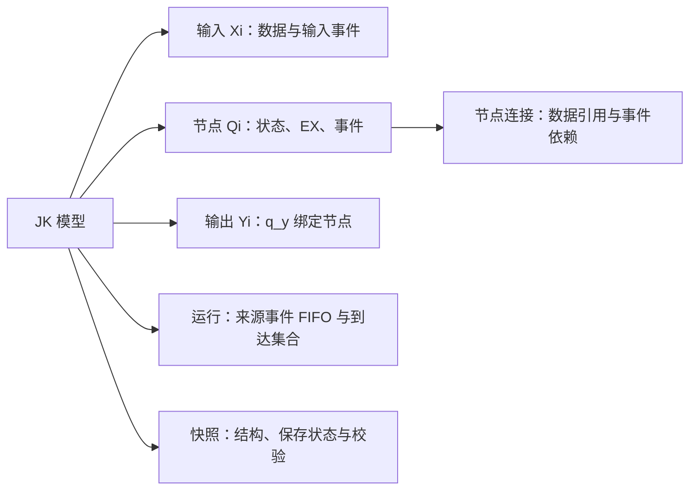
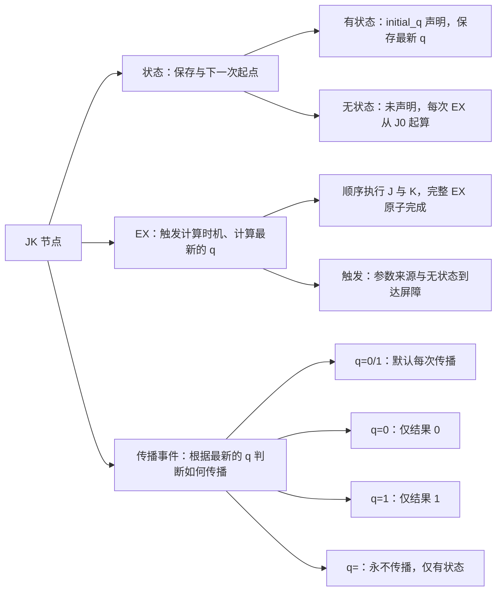
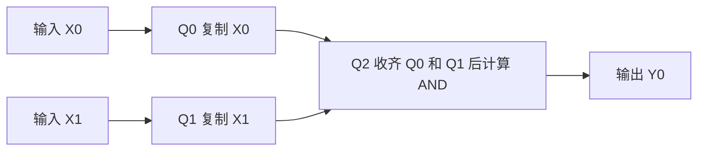

### 本页是 JK 空间的统一且唯一计算契约 JKRD 定义，定义包含：JK 节点状态、EX 顺序、事件触发与传播、FIFO 执行、模型组成、快照格式和优化边界。

## JK_NET、JK_LOGIC、ModelShow 及其他相关 JK 项目均以 JK 空间为规则与设计主来源，并引用本页，不重复定义 JKRD 内容。

## 具体结构及验证分别记录在专题页，不由旧代码或历史测试另行定义规则。

## **阅读顺序**：模型概览 → 节点规则 → 事件执行 → 设计与运行示例 → 快照与校验 → 优化与验证边界。

## 模型概览

| 组成 | 标记 | 职责 |
| --- | --- | --- |
| 输入位 | `X0..Xn` | 接收外部 bit 0 或 1 数据，并产生输入到达事件 |
| JK 节点 | `Q0..Qn` | 可保存当前 q，按自己的 ex 执行计算，再按条件传播事件。彼此连接为运行结构 |
| 输出位 | `Y0..Yn` | 通过 q_y 绑定一个已有 Q 节点，输出 bit 0 或 1 数据 |

#### 设计的核心是把计算公式分解成一个或多个节点的 `ex` 和连接结构，把需要保留的数据（带记忆）写成有状态节点的 q，把何时执行写成参数来源和事件规则，并用节点的传播条件决定计算完成后是否发布事件。同一个 Q 结果可以供多个后继节点和输出复用，引用数量为 ≥ 1，被引用数量 ≥ 1。计算依赖从 ex 解析，输出依赖从 q_y 解析，无需另存一套计算关系。

### JK 模型组成概览



### JK 节点组成概览

| 分支 | 职责 |
| --- | --- |
| 状态 | 决定是否保留数据（带记忆） q，有状态的下一次计算从 q 开始 |
| EX | 决定何时开始计算（传播事件触发/事件执行）、如何计算出本次 q |
| 传播事件 | 决定 EX 计算完成后的传播条件 |




## 节点规则

### 节点分类与状态保存

| 分类 | ex 与 initial_q 的要求 | q 的作用 |
| --- | --- | --- |
| 有状态节点 Qi_q | 在 initial_q 中出现一次；ex 一般不以 J0 开头 | 保存并跨输入轮次保留 q；q 始终是 ex 的最新结果，且始终会被模型保存。若 ex 以 J0 开头，该次执行仍先清零，再按后续操作计算。 |
| 无状态节点 Qi_J0 | 未出现在 initial_q 中；ex 必须以 J0 开头 | 每次执行先清零，结果作为临时计算值按传播条件发布 |

节点分类只由 initial_q 决定：出现在 `initial_q["0"]` 或 `initial_q["1"]` 中的 Q 是有状态节点，并且仅出现一次；未列入的 Q 是无状态节点。J0 是执行时的清零操作，不是状态分类标记；不能因为 ex 以 J0 开头而将已列入 initial_q 的节点判为无状态或拒绝它。本文保留 Qi_q 和 Qi_J0 两个记号，分别表示按 initial_q 判定的有状态和无状态节点。无状态节点仍须满足 J0 开头的合法性要求；这项要求不反向决定分类。是否依赖旧 q 与是否保存状态是不同概念，无状态节点也可按传播条件发布事件以触发下游，并暂存计算结果。

### J 和 K 的基本规则

这里的 J 和 K 是项目自定义的布尔操作。每一步使用上一步的 q 和当前参数 x，执行后得到新的 q。

```text
J(x): q ← q AND x
K(x): q ← q XOR x
```

| q | x | J 执行后的 q | K 执行后的 q |
| --- | --- | --- | --- |
| 0 | 0 | 0 | 0 |
| 0 | 1 | 0 | 1 |
| 1 | 0 | 0 | 1 |
| 1 | 1 | 1 | 0 |

| ex 中的字面量参数操作 | 效果 |
| --- | --- |
| `J0` | 置 0 |
| `J1` | 保持 q |
| `K0` | 保持 q |
| `K1` | 翻转 q |
| `J0K1` | 在完整 ex 中先置 0 再翻转，得到 1；不能单独作为节点 ex |

### EX 格式与顺序计算

| 功能 | 严格 ex |
| --- | --- |
| 复制 X0 | `J0K(X0)` |
| NOT X0 | `J0K1K(X0)` |
| X0 AND X1 | `J0K1J(X0)J(X1)` |
| X0 OR X1 | `J0K1K(X0)J(X1)K(X0)` |
| X0 XOR X1 | `J0K(X0)K(X1)` |
| X0 XNOR X1 | `J0K1K(X0)K(X1)` |
| X0 NAND X1 | `J0K1J(X0)J(X1)K1` |
| X0 NOR X1 | `J0K1K(X0)J(X1)K(X0)K1` |

这些表达式说明一次完整 ex 的值函数。含多个直接 Xi 参数的节点可能在一行输入中执行多次，因此还需要结合下面的事件规则理解中间传播和最终输出。`J0` 与 `J0K1` 分别从 0 和 1 开始，不能互相替换。

ex 是非空、扁平的 J/K 操作序列，严格从左到右执行。允许的 token 只有 `J0`、`J1`、`K0`、`K1`、`J(Xi)`、`K(Xi)`、`J(Qi)`、`K(Qi)`。每个 Q 的 ex 必须至少引用一个 Xi 或 Qi；这一要求同时适用于有状态和无状态节点。禁止 `ex=""`空 ex 的节点。严格格式不接受空槽、空白、别名和嵌套表达式；复杂逻辑通过引用其他 Q 节点拆分。

操作次序会改变结果。例如 q 为 0、X0 为 0、X1 为 1 时，`J(X0)K(X1)` 得到 1，`K(X1)J(X0)` 得到 0。一个 ex 的操作执行过程是原子的，其他事件不会插入它的中间；完整 ex 结束后先提交本节点 q，再判断传播条件，满足条件才向下游发布事件。

### 常量节点的定义及拒绝

纯常量参数计算节点指 ex 的全部操作仅包含`J0`、`J1`、`K0`、`K1` 作为完整节点 ex。该约束按参数来源判定，不因合法表达式某次计算得到 0 或 1 就将其判为非法。拒绝存在该类常量节点！

## 事件执行

### 参数来源与触发约束

触发执行计算时读取 Xi 当前值或 Qi_q 最新实际 q 或收齐的 Qi_J0 值

| 目标 ex 的参数情况 | 允许的来源 | 执行条件 |
| --- | --- | --- |
| 没有 Qi_J0 参数 | 0、1、Xi、Qi | 每一个非常量参数更新事件执行一次完整 ex |
| 至少有一个 Qi_J0 参数 | 0、1、Xi、Qi | 收齐该目标全部 Qi_J0 来源后执行，Xi 和 Qi_q 更新不触发执行；计算时读取 Xi 当前值及 Qi_q 最新实际 q |

所有引用有状态节点 Qi_q 的目标，无论是否具有 Qi_J0 到达屏障，都在执行 ex 时读取来源最新的实际 q，不使用较早排队事件的历史 q 值。读取不执行来源节点的 ex，也不改变来源 q；消费旧 Qi_q 更新通知不得回滚或覆盖计算可见的最新 q。初始化或从快照恢复 q 不自动执行 ex、不主动发布更新事件；字面量 `0/1` 本身也不产生参数更新事件。节点计算仅由到达条件触发，不设置纯常量节点初始化执行或读取时执行的特殊路径。对每个目标，Qi_J0 来源按不同源节点构成到达集合；同一来源在 ex 中使用多次，只形成一条 source→target 事件关系。未满足触发执行条件时，同一Qi_J0 来源多次到达将只记录最后一次到达的数据，该参数的历史数据将被覆盖！如需依次执行所有历史数据，就引入异步结构模块！

### 事件传播条件

每个 Q 节点采用一种传播条件，默认是 `q=0/1`。条件中的 q 专指本次完整 EX 执行结束后的最新计算结果，不取中间操作值，也不与上次结果比较。传播条件适用于该节点向所有直接消费者发布的事件。

| 传播条件 | 发布行为 | 适用节点 |
| --- | --- | --- |
| `q=0/1` | 每次完整 EX 执行结束后都发布一次事件，作为默认条件 | 有状态、无状态 |
| `q=0` | 仅当本次完整 EX 的最终结果为 0 时发布一次事件 | 有状态、无状态 |
| `q=1` | 仅当本次完整 EX 的最终结果为 1 时发布一次事件 | 有状态、无状态 |
| `q=` | 永不发布事件，无论本次结果为 0 还是 1 | 仅有状态 |

未配置传播条件时采用默认 `q=0/1`；显式的 `q=` 是第四种条件，表示不允许任何结果触发传播，不表示未配置、q 没有值或前后结果相等。`q=` 节点必须按 initial_q 成员身份判定为有状态；无状态节点配置 `q=` 应拒绝，不能据此自动把节点改为有状态。

处理顺序固定为：满足触发条件 → 执行完整 EX → 提交最新 q → 立即判断传播条件 → 满足时将一次更新事件加入 FIFO 队尾。条件不满足时也已经完成本节点计算和 q 更新。只在完整 EX 结束时判断一次，不因中间的 J0 清零而发布；已经入队的事件不在出队时按来源当前 q 重新过滤。

`q=` 仅关闭本节点向下游发布事件的行为，不关闭其输入触发或 EX 执行。节点照常保存最新 q，其他节点在由别的来源触发时仍可读取它，q_y 也可绑定并读取它；读取不会反过来执行该节点。该节点仍须满足 EX 非空、至少引用一个 Xi 或 Qi 等现有合法性要求。

相同结果连续出现时，每次分别判断条件。例如连续两次得到 1，在 `q=1` 或 `q=0/1` 下发布两次事件，在 `q=0` 或 `q=` 下不发布。初始化和快照恢复仍只设置 q，不因 q 符合传播条件而自动发布事件。

未发布事件不等于向下游发送 0。无状态来源被过滤的事件不计入目标的到达集合；尚未收齐的数据仍按既有规则跨轮保留。已发布事件满足的是来源当次计算结果条件；目标稍后执行时，对有状态来源仍读取最新实际 q，因此读到的 q 不一定等于发布时的 q。

### FIFO 事件执行规则

一次 send 是有序事件处理过程。一行中的各输入值逐个到达，不能先把整行全部替换成新值，再统一计算一次。

1. 保留上一轮的 X 和 Q 可读值，以及尚未收齐的 Qi_J0 到达数据。

2. 按 X0、X1 等端口顺序把本行输入事件放入 FIFO。

3. 取出一个事件，并按目标 Q 编号升序通知直接消费节点。Xi 事件仅更新该 Xi 的可读值；Qi_J0 事件按其携带的到达值更新目标链接缓存。Qi_q 事件是更新通知，不得用历史事件值回滚或覆盖来源最新的实际 q；目标执行时始终读取该来源最新 q。所有已实际发布并入队的事件仍按 FIFO 消费，触发次数不因通知值过时或相同而减少，也不在出队时重新检查传播条件。

4. 目标没有 Qi_J0 参数时，每收到一次参数更新就原子执行一次完整 ex。

5. 目标有 Qi_J0 参数时，Xi 更新只刷新该 Xi 可读值，Qi_q 更新通知不触发该目标执行且不覆盖最新实际 q；Qi_J0 到达保存或覆盖该目标链接上的值。

6. 最后一个未到达的 Qi_J0 来源到达时，锁存全部 Qi_J0 链接值、读取当时的 Xi 可读值和所有 Qi_q 来源最新的实际 q，执行 ex，然后清空该目标的到达集合。

7. 完整 ex 结束后立即更新本节点 q，并以本次完整结果判断节点的传播条件。条件满足时把一次 q 更新事件加入 FIFO 队尾；条件不满足或采用 `q=` 时不入队。对有状态节点，无论是否发布事件，后续目标计算都立即可读取其最新 q，无需等待通知出队；这不改变已入队事件的 FIFO 顺序。

8. FIFO 排空后读取 q_y 对应的 Q 值作为本行输出，保留尚未收齐的到达数据供后续 send 使用。

输入值与上一次相同仍产生更新事件；节点 q 没有变化也照常判断传播条件，满足时仍发布一次结果更新事件，默认 `q=0/1` 始终发布。同一行可能使同一节点执行多次。Qi_J0 到达值属于具体的来源到目标链接，重复到达覆盖该链接待消费的值；一次执行只清空该目标自己的集合。

### 输出绑定与数据历史

运行时事件 FIFO 负责来源通知的执行顺序，不自动提供每项业务数据的独立保存。有状态来源的旧通知到达时，读取仍是最新实际 q；无状态来源同一到达槽在屏障未收齐前可被后续值覆盖。要保证每次输入或输出均被使用，必须显式构建逐项数据保存结构。

`q_y` 是对外输出绑定，不会因绑定而增加触发、缓存或历史重放。FIFO 排空后的最终读取与逐次 publication 的事件消费需分别描述。内部状态只在结构内部读取与扩展时使用；具体异步原型对外仅保留 `Y0→Q39` 数据递交、`Y1→Q41` 有效消费确认已处理，Q40 和内部状态不列为外部 Y。这是该模块的接口约定，不限制所有模型必须具有两个 Y。

## 设计与运行示例

### 组合条件与携带数据的事件

`changed`、`unchanged`、`rising`、`falling` 可以由保存旧值、比较本次值及 `q=1` 发布的多个 JK 节点组合实现，不新增为内置传播条件。比较必须先于旧值回写；多来源到达槽不等于逐项历史存储。完整 EX、编号时序及定向验证见 [JK计数器与事件组合](https://chatgpt.com/space/page_6d1b00ae5d888191b820fcb7a40bb11d)。

控制是否发布与事件携带的数据可以在一个输出事件中完成。有效数据为 0 时也须发布，不能把数据输出节点一律配置为 `q=1`；可让许可节点只发布 1，再触发数据节点以 `q=0/1` 发布本次 0/1 数据。43 节点参考结构的 Q39 采用此模式，见 [JK异步结构静态原型](https://chatgpt.com/space/page_49e5ba0ff7e88191b27dee5f9778d2dc)。

### 锁存与动态等待区

#### 已确认的数据保存要求

需要保留每次数据时，每次到达均独立保存到新增或分配的有状态存储节点，再按到达顺序追加队尾；相同数据也是不同项。前一项内部处理或消费尚未结束时，新输入仍持续保存。等待区不设固定业务总容量，由存储结构按需扩展、在消费后回收或复用；锁存与确认只控制逐项消费，不把等待转嫁为入口暂停。

该模式可按需装在计算前以保存全部输入，也可装在计算后以保存全部结果。输出侧须在该次结果被覆盖前独立保存，不能用之后读取最新 q 代替历史结果。详细角色和闭环见 [JK锁存与动态等待区](https://chatgpt.com/space/page_e5e9e0d2df6481919ab152dec8208cde)。

#### 待定义的动态机制与原型边界

现有扁平 J/K EX 与静态节点表尚未定义创建、连接、释放节点的操作；动态结构管理、生命周期和恢复格式须另行具体设计并验证。已有 43 节点固定原型仅验证有限闭环，其总容量 3、满时拒收及串行入口测试协议不满足完整动态需求，也不能作为正式模式限制。

### 运行示例

以下示例除特别注明外，所有节点均采用默认传播条件 `q=0/1`。

#### 用到达屏障汇合两个输入

下面的 AND 设计先用 Q0 和 Q1 分别复制输入，Q0 和 Q1 均不列入 initial_q，再让 Q2 等待这两个无状态来源。每行中 Q0 和 Q1 各执行一次，Q2 收齐后执行一次，最终 Y0 为 X0 AND X1。



#### 有状态节点保存累计奇偶

设 `Q0.ex = K(X0)`、初始 q 为 0、`Y0→Q0`。按顺序输入 1、1、0、1，输出为 1、0、0、1。这说明 q 是运行记忆，相同输入 1 连续到达两次也会执行两次。

| 输入轮次 | X0 | 执行前 q | 执行后 q |
| --- | --- | --- | --- |
| 1 | 1 | 0 | 1 |
| 2 | 1 | 1 | 0 |
| 3 | 0 | 0 | 0 |
| 4 | 1 | 0 | 1 |

#### 只更新状态而不传播

设有状态节点 `Q0.ex = K(X0)`、初始 q 为 0、传播条件为 `q=`，并令 `Y0→Q0`。依次输入 1、1、0 时，Q0 仍执行三次，q 和每轮 Y0 依次为 1、0、0，但 Q0 不发布任何更新事件。若其他节点仅依赖 Q0 的通知来触发，则不会被这些更新触发；若由其他来源触发且合法引用 Q0，则读取当时 Q0 的最新实际 q。

#### 一行输入触发两次完整计算

设 `Q0.ex = K(X0)K(X1)`，初始 q、X0、X1 都为 0，提交一行 `[1,1]`。该节点没有 Qi_J0 参数，因此收到 X0 和 X1 两个事件时各执行一次。

| 到达事件 | 计算时的 X0 和 X1 | 完整 ex 的计算 | 更新后的 q |
| --- | --- | --- | --- |
| X0 到达 1 | 1 和 0 | 0 XOR 1 XOR 0 | 1 |
| X1 到达 1 | 1 和 1 | 1 XOR 1 XOR 1 | 1 |

最终输出是 1，两次计算都发布事件。若把 `[1,1]` 合并为一次计算会得到 0，改变模型行为。需要从固定起点计算 XOR 时可用 `J0K(X0)K(X1)`；需要等齐两个计算来源再向下游传播时，可使用前面的 Qi_J0 到达屏障。

#### 到达集合可以跨输入轮次

设目标等待无状态来源 Q0 与 Q1，某一轮按“Q1 第一次到达 → Q0 到达 → Q1 第二次到达”的顺序处理。Q0 到达时，目标收齐并消费第一对；随后到达的第二个 Q1 值留在该目标的到达槽中。下一轮 Q0 先到达时，可以与这个上轮保留值配对。若两次 Q1 都在 Q0 到达之前发生，则第二次只覆盖同一到达槽，不会保存为两项。到达集合没有默认的行号配对机制；若任务要求同一批数据配对，网络设计和调度需要明确保证这一点。

## 快照与校验

### 快照字段与恢复范围

快照是可加载的节点结构和指定状态 q 的表示。`nodes[].ex` 定义有序计算，`initial_q` 同时确定有状态节点集合并保存快照时刻的有状态 q，加载后作为起始状态；即使节点 ex 以 J0 开头，也不在加载时提前清零或执行，`q_y` 确定输出绑定。

| 字段组 | 含义 |
| --- | --- |
| name 和 format | 名称与框架标记，format 不作为语义版本分支或拒绝条件 |
| nodes | 连续编号 Q0 至 Qn 的 id、ex 及可选 propagation，按 Q 编号排序；propagation 默认值规范化为省略，非默认值保留 |
| initial_q | 以成员身份确定有状态 Q，分别按当前 q 为 0 和 1 列出，各数组按编号排序；有状态 Q 可以 J0 开头，未列入的 Q 为无状态 |
| q_y | 按 Y 编号排列的 Y 到 Q 映射 |
| inputs 和 outputs | 有序 X 和 Y 端口的身份映射 |
| input_bits 和 output_bits | 输入输出位宽，当前标准快照各不超过 216 |
| jk_bits 和 jk_bits_max | 实际节点数与该模型的容量上限 |
| ex_source_max 和 ex_source_sum | 单节点及全模型的非常量参数使用次数统计 |
| ex_operation_max 和 ex_operation_sum | 单节点及全模型的操作 token 数量统计 |
| md5 和 format_md5 | 指定结构载荷的规范 JSON 指纹 |
| created_at | UTC 日期小时与 Unix 纳秒时间戳组成的生成标记 |

表内节点容量与统计字段描述现有静态快照，不是动态等待区的固定数据总容量。动态增删节点后怎样维护编号、连接、容量统计及保存恢复，尚需形成明确编码与执行契约；已确认的动态设计要求不表示静态快照已具备动态格式。

临时 Qi_J0 到达集合、此前的可读 X 以及无状态 Q 的运行结果不写入标准快照。因此加载能恢复指定的状态节点 q，不能一般性恢复原来未完成的跨轮到达现场。若业务需要长期保存某个临时值，应把它转成有状态节点承载；若需要完整断点续跑，还需要单独定义完整运行现场的持久化契约。

### 统计与结构指纹

ex_source 统计的是非常量参数使用次数，不是去重后的来源数。例如 `J0K(X0)K(X0)` 有两个非常量参数使用位置，但仅有一个不同来源。统计字段由实际结构计算，不能把显示统计误当成 ex 的固定长度限制。

```text
canonical JSON: UTF-8，键排序，无空格和换行，数组保留规定顺序
normalized_nodes = nodes 省略显式 propagation="q=0/1"，保留非默认 propagation
stateful_ids = initial_q["0"] 与 initial_q["1"] 合并，按 Q 数值编号升序
md5        = MD5({nodes: normalized_nodes, initial_q, q_y} 的 canonical JSON)
format_md5 = MD5({nodes: normalized_nodes, q_y, stateful_ids} 的 canonical JSON)
```

`md5` 包含已保存的状态 q；`format_md5` 包含有状态节点 ID 集合，但不包含它们的 0/1 值。stateful_ids 是指纹载荷中的派生集合，不要求新增快照顶层字段。同一成员集合在 0 和 1 列表之间改变状态值，不改变结构指纹；改变有状态成员集合或非默认传播条件会改变结构指纹。名称、时间与展示坐标不在这两个载荷中。哈希用于结构身份和一致性检查，不能替代功能验证。临时区允许同 MD5 多次出现，后续操作宜同时核对 `md5` 与 `created_at`。

#### 旧快照兼容策略

旧快照迁移仅接受所有节点均无 propagation 字段、结构合法且两个旧指纹均精确匹配的完整快照；使用副本规范化并重算新指纹，不原地改写输入。当前格式须匹配两个新指纹，不接受新旧混配或非默认条件借用旧指纹；format 字符串仍不作为语义版本分支或拒绝条件。该策略须由实现及测试落实，本页不据此宣称迁移测试已通过。

### 结构校验与功能验证

现行设计要求严格校验 token 语法、引用范围、节点顺序、以 initial_q 成员身份为准的分类及重复或冲突初始化、无状态节点的 J0 开头要求、输出端口、统计字段、Qi_J0 到达 DAG 和哈希，并对每个 Q 强制检查 ex 非空、至少引用一个 Xi 或 Qi。所有纯常量参数计算节点及空 ex 节点都应拒绝，包括在 initial_q 中保存了 q 的节点。传播条件只允许本页定义的四种，未配置时默认 `q=0/1`，并必须拒绝无状态节点采用 `q=`。结构合法说明符合执行契约；目标功能是否正确仍由参考输入输出及序列测试判定。

### 快照 JSON 示例

下方 JSON 用于说明基础静态快照的字段组织。正式导出时，哈希、时间、端口及统计字段由构建器生成；加载前须通过结构、统计及双指纹校验。固定字段顺序、可读缩进，数组按既定方式展开。示例节点没有显式传播条件，按默认 `q=0/1` 解读。节点可配置 `propagation`，取值仅为 `q=0/1`、`q=0`、`q=1`、`q=`；缺省与显式 `q=0/1` 语义相同。导出与计算指纹前省略默认值，保留非默认值；`q=` 仅允许有状态节点。

```json
{
  "name": "对当前 JK 节点组的描述",
  "md5": "e46627f52ca9a3974fddc75020b20ef0",
  "format": "jk-logic-structure-V3.1.0",
  "format_md5": "ffa29e95fda77c10a8d531dd409af33f",
  "created_at": "2026-08-22T04:1787372535000000000",
  "input_bits": 4,
  "jk_bits_max": 16,
  "jk_bits": 6,
  "output_bits": 4,
  "ex_source_max": 3,
  "ex_operation_max": 5,
  "ex_source_sum": 12,
  "ex_operation_sum": 23,
  "nodes": [
    {"id": "Q0", "ex": "J0K1J(X0)K1"},
    {"id": "Q1", "ex": "J0K1J(X1)K1"},
    {"id": "Q2", "ex": "J0K1J(Q0)J(Q1)K1"},
    {"id": "Q3", "ex": "J(X0)J(X2)K(Q0)"},
    {"id": "Q4", "ex": "J0K1J(Q2)K(X1)"},
    {"id": "Q5", "ex": "J(X3)J(Q1)K(Q3)"}
  ],
  "initial_q": {
    "0": [],
    "1": ["Q3", "Q5"]
  },
  "q_y": [
    {"Y0": "Q2"},
    {"Y1": "Q3"},
    {"Y2": "Q4"},
    {"Y3": "Q5"}
  ],
  "inputs": [
    {"X0": "X0"},
    {"X1": "X1"},
    {"X2": "X2"},
    {"X3": "X3"}
  ],
  "outputs": [
    {"Y0": "Y0"},
    {"Y1": "Y1"},
    {"Y2": "Y2"},
    {"Y3": "Y3"}
  ]
}
```

## 优化与验证边界

### 优化方法与证明范围

常量值化简应在证明状态和事件行为保持等价的前提下使用字面量 `0/1`，不得创建或保留纯常量参数 Q 节点，不得把任一保留节点的 ex 化简为空或只含字面量参数。q_y 仍须绑定已有的合法 Q 节点，不能为固定输出另建 `J0` 或 `J0K1` 占位节点。违反这些条件的候选优化必须拒绝。

单节点表达式缩短应枚举完整的 `旧 q + 所有参数 → 新 q` 真值表，保留参数集合、传播条件及由 initial_q 决定的有状态或无状态分类，证明较短 ex 等价。有状态节点允许 J0 开头，不能通过增删 J0 来推断或改写状态分类；无状态节点优化后仍须以 J0 开头。J1 和 K0 是恒等操作，可在满足证明条件时移除；结果仍必须非空，且至少引用一个 Xi 或 Qi。优化后要重新检查节点分类、来源约束、触发行为和事件发布行为，不能只因最终数值相同就接受删边或改变事件来源。

这类证明限定在单节点、既定来源集合和分类之内。它不证明整个网络节点数最少，也不自动证明任意重连、删边、常量折叠或跨轮调度都保持完整事件行为。优化后还应核对最终输出、状态序列、执行次数、事件发布次数、到达条件和待消费缓存。达到枚举限制必须报告未完成，不能视为已经证明最小。

检查 DAG： `Qi→目标` 的到达依赖边检查 DAG，即这些边不能形成自环或循环等待。

### 规则来源与实现边界

本页最初依据 JK_NET 文档整理，现按用户逐次确认的最新规则维护。README、代码、测试、生成器、技能或历史模型如不一致，应记录差异并按 JK 空间现行规则修正。传播条件语义、propagation 字段及默认规范化、结构指纹加入有状态节点 ID 集合已获确认；实现与迁移仍须验证。动态结构创建、连接、释放与复用、生命周期及恢复契约尚未定案，不因上述已确认规则而视为已批准或已实现。

规则与设计约束需要由实现及定向验证落实。结构合法、单节点真值等价和具体示例通过分别说明各自的证明范围，不能相互替代，也不证明任意网络事件等价、训练收敛或泛化。既有示例的验证记录及其边界见 [JK_NET代码实现整体架构与训练设计](https://chatgpt.com/space/page_51b815ec35f4819187173841fe6679fd)。

### 专题与实现入口

| 页面 | 负责内容 |
| --- | --- |
| [JK逻辑单元库](https://chatgpt.com/space/page_50b62c37737c8191b27998f3c7128760) | 基础布尔单元与可复用结构入口 |
| [JK计数器与事件组合](https://chatgpt.com/space/page_6d1b00ae5d888191b820fcb7a40bb11d) | 计数器、前后值比较及组合事件的结构与验证 |
| [JK锁存与动态等待区](https://chatgpt.com/space/page_e5e9e0d2df6481919ab152dec8208cde) | 持续接收、逐项保存、按需伸缩、递交与确认 |
| [JK异步结构静态原型](https://chatgpt.com/space/page_49e5ba0ff7e88191b27dee5f9778d2dc) | 有限异步原型、模型 JSON、Q39 与 Q41 接口及验证边界 |
| [JK_NET代码实现整体架构与训练设计](https://chatgpt.com/space/page_51b815ec35f4819187173841fe6679fd) | JK_NET 代码模块、训练流程及源码与现行规则的衔接状态 |