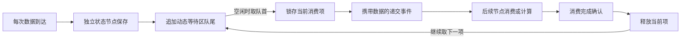

锁存结构与动态等待区构成可按需接入的异步模式：每次数据到达都保存为独立的一项，等待区按到达顺序排队，锁存结构逐项递交给后续节点，收到消费确认后再递交下一项。入口持续接收与下游逐项消费分别进行。本页明确已经确认的设计目标，并区分现有静态示例与尚待实现的动态结构。

## 已确认的动态存储要求

每次输入到达，结构立即为该次数据分配独立的有状态存储节点，保存本次数据并将其加入队尾。连续两次相同数值也是两项独立输入；数据为 0 同样需要保存。尚未消费的数据不能被后续输入覆盖。

入口不需要等待前一次输入的内部事务结束，也不需要等待消费者确认。结构内部负责确定到达次序、完成保存和维护队列连接。等待区没有预设的固定总容量；它随待处理项增加节点，在数据消费后删除或复用已释放节点，形成可以伸缩的存储结构。具体选择删除还是复用属于待落实的结构机制。

固定容量满时拒收、要求调用方逐条等待内部事件处理完，均不是这个动态模式的目标要求。此前围绕有限模型提出的入口额度和外部串行提交约束，不作为本模式的接入条件。

## 锁存递交与确认闭环

1. **保存与入队**：冻结该次到达的数据，写入专属状态节点，完成队尾连接。新输入继续执行这一过程。

2. **递交**：锁存结构空闲时取出队首，作为当前消费项，向后续节点发布携带该项数据的事件。

3. **等待确认**：当前项保持可用，直到消费者完成使用或计算并返回确认；等待期间其他输入继续入队。

4. **释放与继续**：确认后释放当前项占用的存储，将下一队首递交给消费者；队列为空时恢复空闲。

确认对应当前消费项，每项完成后确认一次。一次确认可能立即引出下一项递交，因此重复旧确认不能自动视为无害。这里的逐项递交顺序由锁存结构保证，不限制新数据继续进入等待区。

## 在 Q7 前后按需接入

放在 Q7 前面时，等待区保存所有输入，锁存结构逐项交给 Q7 计算。若 Q7 的计算依赖上一轮结果，则本轮状态回写完成后，再释放下一项给 Q7，避免连续两次计算读到同一个尚未更新的旧状态。

放在 Q7 后面时，等待区保存 Q7 每一轮产生的结果，锁存结构逐项交给后续节点消费。Q7 可以采用有状态节点；每轮结果必须在该轮完成时写入对应存储项，不能仅排入通知，等到通知被消费时才读取已经变化的 Q7 最新值。

两处可以分别安装，也可以同时安装。需要保存每次输入或输出时采用该模式；只需要最新值的连接，不因此被要求建立逐项数据队列。

## Q7 Q8 Q9 Q10i 的设计角色

这些编号表达讨论中的角色，不是静态 43 节点示例的编号表。

|角色|作用|
|---|---|
|Q7|执行本轮 EX 并产生结果；可将自身历史状态移交给独立状态节点保存|
|Q8|保存 Q7 的结果；要保留每一次结果时，将这一保存职责扩展为每项独立的状态节点|
|Q9|保存供 Q7 下一轮读取的上一轮结果；本轮回写完成是释放下一轮计算的依据|
|Q10i|控制首轮启动以及后续计算的释放，等待 Q9 更新完成后才允许下一项进入计算|

Q10i 的无状态触发节点构想需要配合保存等待信息的结构。它承担触发角色，本身不等于完整的数据等待区。Q8 单个状态值也只能代表最近保存的一份结果；动态等待区需要为尚未消费的各项保留独立存储。以上角色已经明确，动态版的完整节点连接仍待具体构造。

若直接用 Q9 的更新事件解除等待，Q9 须在每轮回写后传播，例如采用 `q=0/1`。结果与上轮相同也表示本轮已经完成，不能用数值是否变化代替完成确认。

## 数据保存与事件传播的区别

依据 [JK规则与设计](https://chatgpt.com/space/page_1cee9c7aae188191be3608cbf94fb889)，读取有状态来源时读取其最新实际 q，排队的旧通知不会使该节点自动提供历史值。无状态来源的通知携带本次结果，目标将其保存到对应来源的到达槽；同一来源再次到达而其他来源尚未到齐时，这个槽会被覆盖。

因此，运行时事件 FIFO 负责安排通知的处理顺序；本模式的数据 FIFO 负责保存每一项尚未消费的数据。事件排队、一个到达槽或一个最新 q，都不能直接替代逐项数据存储。使用外部程序的 deque 保存业务数据，也不能作为纯 JK 存储结构已经实现的证据。

## 静态示例与动态目标的边界

现有 43 节点组合模型采用一个在途槽和两个等待槽，验证了有限结构中的保存、确认和自动递交闭环。它仍依赖固定节点图以及逐条完成的入口事务，只能作为受限示例，不能宣称已经实现本页的动态增长与入口接收要求。

该示例最终对外映射为 `Y0=Q39`，表示递交数据；`Y1=Q41`，表示有效消费者确认已经处理。Q31 至 Q36 是内部状态存储，Q40 是内部请求接受节点，Q42 是内部拒收节点。q_y 只规定对外名称与节点的对应关系，不改变节点执行或事件调度。

## 尚待落实的动态结构机制

当前 J 和 K 运算只改变 q；现有 EX 引用和静态节点表尚未定义自动创建节点、释放节点或修改连接的操作。要落实本页目标，还需明确节点分配与复用、到达数据保存、队首队尾连接、消费后回收的结构语义，以及这些动作如何与现有事件执行规则配合。

后续实现应验证入口持续到达时每项都能独立保存，动态连接不会遗漏或重复数据，Q7 状态回写与下一次计算顺序正确，消费确认能够推进队列并回收存储。JK 空间中的这项目标已经明确；动态结构管理的具体构造和执行器支持仍待实现与验证。

节点生命周期还需明确：新节点的初值与可见时刻、事件仍引用待释放节点时的处理、队首队尾更新与到达次序的一致性，以及动态结构的保存和恢复格式。现有静态节点连续编号与引用校验规则继续有效；动态扩缩怎样保持或扩展这些约束，须在规则页明确后再实现。

## 相关结构与验证

具体 EX、比较与写回顺序见 [JK计数器与事件组合](https://chatgpt.com/space/page_6d1b00ae5d888191b820fcb7a40bb11d)；递交确认、入队出队、独立请求确认入口及完整 43 节点 JSON 见 [JK异步结构静态原型](https://chatgpt.com/space/page_49e5ba0ff7e88191b27dee5f9778d2dc)。

动态版保持两个对外语义口：有效数据递交与有效消费确认完成。Q39／Q41 是受限原型中的具体编号；内部 busy、数据槽、有效位用于内部连接与扩展。对每次数据的消费应观察对应节点的逐次 publication，排空后读取一个最近 q_y 值不会自动重放历史事件。