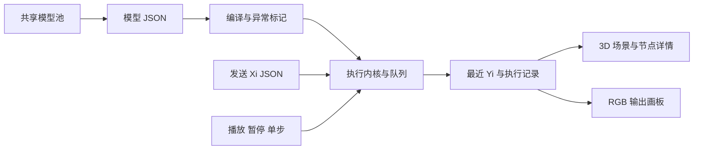

ModelShow 是已设计 JK 网络模型的测试、执行追踪与 3D 展示工具。本页说明其代码职责、实际运行方式、站点部署和页面操作流程。JK 空间是 ModelShow、JK_NET、JK_LOGIC 及其他相关 JK 项目的统一规则与设计主来源；模型的规范依据由 [JK规则与设计](https://chatgpt.com/space/page_1cee9c7aae188191be3608cbf94fb889) 维护，不在各项目另行定义。训练和结构生成见 [JK_NET代码实现整体架构与训练设计](https://chatgpt.com/space/page_51b815ec35f4819187173841fe6679fd)。项目文档、代码、测试或历史模型说明如与空间不一致，应明确差异并按空间现行规则修正。

源码核对日期为 2026年9月29日，本地基线为 `49b4b6b6d1466a6d327431afe6d6dd44703ecb33`，核对时工作区无 Git 改动。2026年10月1日按 JK 空间现行规则及本次对话修订文档；以下旧实现差异必须修正，不作为测试工具的兼容豁免。历史源码行为和操作记录保留供定位及定向验证比较；本文修订不表示源码已修复、动态存储已实现或站点已重新部署。

## 项目职责与数据流

| 层次 | ModelShow 的职责 |
| --- | --- |
| 页面结构与配置 | 原生 HTML 固定面板和模板，CSS 负责样式；递归冻结的 APP_CONFIG 按图片输入、输出画板、播放、场景、列表和信号分支集中管理默认值 |
| 模型编译 | 解析节点、固定 ID 与 tag、状态初始化和输出映射，建立来源与目标关系，并记录节点异常 |
| 运行内核 | 保存持久 q、来源缓存、不可变队列参数副本、最近输出及执行记录；浏览器时钟与渲染不参与该内核 |
| 播放与场景 | 控制暂停、单步、时间预算和传播动画；Three.js WebGPU 绘制网络，布局由 Web Worker 计算 |
| 输入与输出扩展 | 图片像素生成 Xi JSON；Yi 的最近值组合为 RGB 画板数据，显示配置单独保存 |
| 模型池与服务 | 前端管理模型；本地 Node.js 服务和 Sites Worker 共用权限与版本逻辑，线上由项目 R2 持久化 |

固定控件与变长行的结构保留在 HTML 及原生 template 中；JS 克隆模板、填值、绑定事件和更新运行数据。选择与异常用 class，固定外观由 CSS 管理。Canvas/WebGPU 绘制承担图像和场景数据的可视化职责。

| 当前页面默认项 | 值与兼容说明 |
| --- | --- |
| 网络布局 | 5D；当前源码和本次 Chrome 页面均为此值，旧 README 与部分渲染说明仍写 4D |
| 播放 | 自动播放开启，1×，跳过动画；无待执行项时等待输入 |
| 图片提取 | b1.png，3×3 原图像素，RGB 8 位、逐像素 RGB、低位优先、白色透明底色 |
| 新输出画板 | 3×3、关闭显示、缩放 3 倍；旧 outputDisplay 缺少 scale 时按 1 倍恢复 |
| 队列与历史 | 队列虚拟滚动，每行 36px；历史保留最多 400 条，面板显示最近 60 条 |

## ModelShow 源码基线的运行方式

导入首先检查 `nodes`、`initial_q` 和 `q_y` 的基本结构。固定 Q 编号使用非负十进制整数，按 BigInt 数值排序；独立 tag 和兼容尾缀统一解析为固定身份。输入 Xi 从表达式实际引用中提取，元数据中的未引用输入不生成端口。节点错误保留展示，并阻止该节点及依赖它的部分运行，独立合法部分继续运行。

运行内核依据 initial_q 判断是否保存持久 q。无初值节点需以 J0 开头；表达式解析允许去除空白，并完整消费字符串。空表达式、无法解析字符、重复固定 ID、初始化冲突和不存在的引用会形成异常。它提供可观察的编译与隔离机制，不承担严格快照全部字段的一致性校验。

1. 加载或重载时恢复初始 q，清空队列、临时参数、输出、执行计数和历史；纯字面量参数节点按编号排入执行队列。初始化 q 本身不发布结果。

2. 一次“发送信号”先校验所有匹配输入，再按 Xi 编号顺序投递本次全部输入；缺失端口不投递，多余字段忽略。任何匹配值不是数字 0/1 时，整次发送不投递输入。

3. 对目标而言，Xi 和无状态 Q 都属于需要缓存并收齐的临时来源。来源去重后各等一次；同源重复到达覆盖当前缓存，同源多个 token 保留多次运算和展示线。

4. 条件满足后将目标加入队尾，同时复制并冻结临时参数值、清空该目标缓存。重复满足条件可以形成多个队列项；同一次来源发布的目标按编号排序。

5. 消费队首时读取有状态来源的当前 q，按完整 ex 求值、写回本节点持久 q（如有），随后发布结果并追加新触发项。完整执行项不被发送或下一项计算打断。

6. Yi 收到结果后立即更新最近值，未收到值显示“未输出”；Yi 不进入执行队列。未收齐的缓存可继续等待后续发送。

暂停仍允许发送并形成缓存和队列；它停止消费下一执行项。单步先跳过旧展示记录，再执行一个完整队列项并保持暂停。重载恢复初始模型运行现场后也保持暂停。模型切换重新构建运行内核；下载或导出保存模型及显示配置，不把当前 q、缓存、队列和播放进度保存成运行断点。

| 观察与保护项 | 实际含义 |
| --- | --- |
| 网络概览 EX 总量 | 已解析的节点表达式中 J/K 操作项总数，包含字面量和重复引用；加载模型时统计 |
| 累计执行次数 | 已完成节点求值次数，每节点和全局分别记录 |
| 页脚 EX 累计操作总量 | 已完成求值中实际执行的 J/K 操作项累计次数；重载或换模型清零 |
| 跳过动画 | 默认按每帧 4 ms×倍速预算串行消费队列，界面在帧尾刷新；单项不打断，每帧最多 10,000 次执行 |
| 逻辑队列保护 | 长度达到 10,000 时停止自动执行并拒绝新发送，可单步或重载；一个原子投递可以越过阈值，已触发项不截断 |
| 展示记录保护 | 普通动画下待播放输入记录达到 400 条时拒绝新发送；跳过动画清除这些展示记录，不重放计算 |
| 高次数标红 | 超过 1,000 次执行的提醒，不能据此判断已证明循环 |

动画消费已发生的事件记录，不重新触发计算。跳过与倍速改变消费速度；在相同初始状态、相同输入交错位置下沿用同一执行顺序。运行中手动再次发送的时机可能因速度改变而落在不同队列项之间，操作验收应固定暂停、发送和消费顺序。

## 与 JK规则与设计 的差异

下表区分 2026年9月29日源码基线行为和必须落实的目标要求。旧差异不构成可选计算模式；修正及定向测试完成前，不能将基线执行结果视为符合 JK 规则的验收结果。

| 对应规范章节 | 源码基线行为 | 必须落实的规则要求 |
| --- | --- | --- |
| FIFO 事件执行规则；参数来源与触发约束 | Xi 也进入临时到达集合；一次发送先投递全部输入，再消费节点执行项 | 按 Xi 顺序将输入事件加入 FIFO，Xi 事件逐个更新对应可读值，Qi_q 通知不得回滚来源最新实际 q，并按目标 Q 编号通知。没有 Qi_J0 来源时每次非常量参数更新执行完整 ex；有 Qi_J0 来源时只以不同 Qi_J0 来源构成屏障，Xi 更新刷新对应可读值，Qi_q 更新通知不触发目标。收齐时锁存 Qi_J0 链接值、读取当时 Xi 及所有 Qi_q 来源最新实际 q、原子执行并清空该目标集合；立即写回 q，将结果事件加入队尾。旧 Qi_q 通知仍按 FIFO 触发，任何目标执行都不读取其历史 payload 作为状态 q。节点完整 EX 提交最新 q 后按传播条件决定是否入队，同值结果仍分别判断；未收齐缓存跨 send 保留 |
| 节点分类与状态保存 | 以 initial_q 是否赋值确定持久状态，仅检查无初值节点以 J0 开头 | 仅按 initial_q 成员身份分类：有状态 Q 必须且只能在 0 或 1 列表出现一次，EX 可有或无首 J0；无状态 Q 不在 initial_q 中，EX 必须以 J0 开头 |
| 节点合法性与参数来源 | 纯字面量参数节点在加载、重载时排队执行；读取有状态 q 不调用来源 ex | 拒绝全部纯字面量参数节点和空 ex；所有 Q 至少引用一个 Xi 或 Qi。初始化、恢复及读取 q 均不得执行来源 ex 或主动发布事件 |
| 表达式 ex 的顺序语义 | 允许空白、tag 兼容引用和稀疏固定编号；空 ex 已拒绝 | 计算依据必须是规则规定的严格 token、连续有序 Q 编号和有效 Xi/Qi 引用；tag 仅作展示元数据，不替代计算引用或放宽 ex 语法 |
| 参数来源与触发约束；到达 DAG | 未检查状态读取编号限制和无状态到达 DAG，使用局部异常隔离与队列阈值 | 无 Qi_J0 来源的目标只能读取编号更小的 Qi_q；有 Qi_J0 来源时允许任意编号 Qi_q。仅抽取 Qi_J0→目标边检查 DAG；队列阈值、异常隔离不能代替结构校验 |
| 快照格式与恢复边界 | 不核验原 MD5、统计字段、容量及连续编号，管理和导出保留原字段 | 按规则校验引用、节点顺序、分类、端口、实际统计、容量、到达 DAG 和规范 JSON 哈希；format 不作为语义分支或拒绝条件。结构或已保存状态改变后，重算相应统计和指纹。规范化 nodes 省略默认 propagation、保留非默认值；md5 使用 {nodes, initial_q, q_y}，format_md5 使用 {nodes, q_y, stateful_ids}，其中 stateful_ids 为两初始列表合并后按 Q 数值升序的 ID 集合，不含 0/1 状态值。旧结构指纹须重算；迁移按规则页的实施兼容策略验证，不表示测试已通过 |
| 状态、EX 与事件分支；传播条件 | 历史运行步骤未包含四种可配置传播条件；本文未重新核对源码接入状态 | 状态决定 q 的保存和起算状态，EX 决定本次值，事件决定触发及完成后发布。`q=0/1` 默认始终发布、`q=0` 仅结果 0 发布、`q=1` 仅结果 1 发布、`q=` 永不发布且仅允许有状态节点；先提交 q 再过滤，不发布不等于不更新，已排队事件出队时不重新过滤。已批准节点 propagation 字段，值仅为上述四种；缺省表示始终传播，导出与计算指纹时省略显式默认 q=0/1、保留非默认值，q= 仅允许有状态节点。字段、规范化及身份哈希要求已定，源码接入和验证状态须另行核对 |
| 输出与恢复边界 | Yi 显示最近发布值；下载不保存当前运行 q 或未完成缓存 | 一行正式输出在 FIFO 排空后读取 q_y 绑定的 Q；中间结果可作追踪显示。标准快照保存指定时刻的有状态 q，不包含旧 X、无状态结果及待消费缓存；不得声称能恢复完整未结束现场 |

锁存＋等待区模式的最新要求是持续接收并独立保存每次输入，由存储结构按需增加或分配有状态节点、维护 FIFO、在消费确认后推进并回收或复用。不能把“内部处理结束后才能再次输入”或“固定总容量、满时拒收”作为正式需求。现有 43 节点模型仅为 1bit、1 个在途项＋2 个等待项的固定受限原型；动态创建、挂接、回收/复用以及任意时点到达的完整实现与验证尚未完成，ModelShow 也不能凭成功导入该原型就宣称已支持动态存储。

该原型对外只绑定 `Y0→Q39` 与 `Y1→Q41`：Q39 的一次发布既表示本次有有效数据，也携带 0/1 数据；Q41 表示一次有效消费确认已处理。Q31～Q36 等状态只供内部结构和扩展使用，Q40 请求接受通知不列为外部 Y。运行追踪必须区分一次次事件和节点最近值：连续相同值仍可对应多次有效递交，仅查看排空后 q_y 的最终值不能恢复中间事件数量。

设计详见 [JK锁存与动态等待区](https://chatgpt.com/space/page_e5e9e0d2df6481919ab152dec8208cde)；有限模型与完整 JSON 见 [JK异步结构静态原型](https://chatgpt.com/space/page_49e5ba0ff7e88191b27dee5f9778d2dc)。

模型池、tag、布局、图片提取和 outputDisplay 是 ModelShow 的管理或展示扩展。它们的界面含义以本页为准；模型本体的设计准则仍由 [JK规则与设计](https://chatgpt.com/space/page_1cee9c7aae188191be3608cbf94fb889) 统一维护。 这些扩展不得改变 ex、来源到达、状态更新和正式输出的计算语义。

## 页面操作流程

### 导入或切换模型

1. 点击顶部“模型管理”，从永久或临时组选择模型，或点击“选择 JSON 文件”，也可在“模型 JSON”中粘贴完整内容。

2. 点击“导入 JSON”应用内容。合法导入会重新初始化运行现场；JSON 或顶层结构无效时，窗口保留错误提示且原有效模型继续保留。

3. 查看模型名称、原 MD5、网络概览和节点异常。MD5 缺少时显示“未提供”，界面显示的 MD5 不代表已重新验算。

4. 使用“下载模型”保存当前编辑内容；需要当前已应用的画板配置时，也可在输出窗口使用“导出模型及画板配置”。

### 发送与追踪计算

1. 需要固定测试顺序时先暂停，再在“输入信号 JSON”填写当前 Xi 的数字 0/1。

2. 点击“发送信号”，确认成功、忽略字段或错误提示；暂停状态下检查待执行队列，不会自动继续计算。

3. 点击“单步”消费一项，观察节点详情中的实际读取参数、每步求值、前后 q、最近输出和次数；点击“继续”消费剩余项。

4. 需要看传播过程时关闭“跳过动画”，用速度滑块调整动画；跳过开启时滑块调整计算预算。

5. 重新开始同一测试用“重载”，随后单步或继续。检查等待参数、输出及计数，区分未输出与数字 0。

2026年9月29日源码基线的六节点操作记录：暂停后发送 `{"X0":1,"X1":0,"X2":1,"X3":0}`，初始出现 Q0、Q1 两个待执行项；第一步完成 Q0，累计一次执行、4 次 EX 操作。继续后队列排空，Y0～Y3 都为 1，累计 6 次执行、23 次 EX 操作。该结果限定于此示例及此起始状态；共享池默认条目被更换后不能直接沿用。 此处的队列项、单步与执行次数属于旧调度记录，不能沿用为修正后逐来源 FIFO 的期望值；应以权威规则重新生成并核对回归结果。

### 从图片生成输入

1. 点击“输入数据提取”，使用 b1.png、b2.png 或“更换图片”导入 PNG、JPEG、WebP。

2. 设置原图像素选区及坐标，选择 RGB/灰度、通道排列、每字节位序和透明底色；缩放与平移只影响查看。

3. 核对“所需位数 / 模型 Xi 数量”。两者必须完全相等才可填入，不会补零、截断或新增 Xi；3×3 RGB 8 位需要 216 个实际 Xi。

4. 检查像素与 JSON 预览后点击“填入信号输入框”，随后在主页面另行点击“发送信号”。填入本身不产生执行事件。

按原图从左到右、从上到下采样；默认逐像素 RGB、每字节低位优先。透明像素先与所选底色合成，再按需要转灰度。图片和选区属于当前页面会话，刷新后本地图片需重新导入；最大文件 32 MiB、解码图像 1,600 万像素、单次 65,536 位。位数预览可省略文本，实际填入使用完整 JSON。

### 配置与保存输出画板

1. 点击“输出渲染”，设置行列并点击“调整画板”，可勾选“显示画板”；默认新画板 3×3、关闭、3 倍大小。

2. 点击一盏灯，使用独立 R/G/B 或 RGB 打包，选择有序 Yi、位序、亮度换算，也可设置显示层的固定亮度。

3. 灯编辑先保留为草稿；点击“应用到此灯”才保存。关闭重开、切换模式或无损转换不自动覆盖已应用配置。

4. 批量分配先核对所需/可用 Yi，选择灰度复用或分别 RGB，再点击“批量应用到所有灯”；数量不足时拒绝，不循环填充。

5. 点击“导出模型及画板配置”下载或复制 JSON。导出包含已应用 outputDisplay，保留模型原字段和 MD5；未应用草稿不进入导出。

画板支持 1～32 行列、每通道 1～64 位和 0.25～8 倍缩放。最近 Yi 更新时立即聚合；缺失、未输出或异常的绑定会使对应通道未就绪并熄灭，其他通道继续显示。固定亮度只作用于显示层，不新增计算节点。画板位于输出侧，点击“重制视角”将其纳入取景。

### 查看场景与节点详情

左拖旋转，右拖、中拖或 Shift＋左拖平移，滚轮围绕指向位置缩放。点击场景节点或底部节点按钮查看详情，再次点击同一节点或空白处取消选择。可切换 1D、2D、3D、4D、5D、自动；4D/5D 是排列策略名，实际场景仍使用 XYZ 坐标。自动选择属于启发式评分，不保证全局最短连线或当前视角遮挡最少。

布局切换保留运行状态并终止旧布局任务；导入另一模型使用当前默认 5D，重载保留所选档位。布局和模型切换保留相机，超出取景时用“重制视角”。“纯黑背景”“隐藏名称和次数”在导入后继续保留。全屏隐藏底部节点列表和播放栏，选中节点时显示浮层详情；退出或按 Esc 恢复。GPU 错误时暂停并显示“恢复 3D”，恢复保留模型和运行现场，计算保持暂停。

### 管理共享与本页模型

| 操作 | 在线共享池 | 后端未连接或结果未确认 |
| --- | --- | --- |
| 读取与切换 | 获取当前池，按永久/临时分组选择 | 使用已读池或示例，保留本页临时项 |
| 导入 | 合法模型新增为共享临时项 | 保留为本页临时项，可切换和下载 |
| 入池 | 临时项移入永久组，需要管理员口令 | 暂不可用；恢复连接后，本页项先上传再移入永久组 |
| 删除 | 临时项公开删除；永久项需要管理员口令 | 共享删除暂不可用；在线删除本页临时项只移除本页记录 |
| 下载 | 保存编辑内容及适用的显示配置 | 可用，应在刷新前保存本页临时模型 |

本页临时模型只保存在页面内存，关闭重开管理窗口保留，刷新整页会丢失。恢复连接不自动上传；共享保存结果未确认时先重新打开管理窗口核对，避免重复提交。版本冲突会提示刷新核对后重试；口令错误不作为断线处理。永久模型管理未配置口令时，该类操作保持不可用。

## 本地运行与构建

运行需要 Node.js 22.12+、pnpm 和支持 WebGPU 的浏览器。首次安装依赖使用 `pnpm install`，然后按下面的命令选择环境。WebGPU 初始化失败会显示提示，项目没有 WebGL 回退。

| 命令 | 用途与默认地址 |
| --- | --- |
| `./dev.sh` | Vite 开发前端，127.0.0.1:5173；按终端实际输出的端口访问 |
| `./dev.sh api` | 本地模型池 API，127.0.0.1:5174，可与开发前端并行运行 |
| `./dev.sh build` | 构建完整前端、Sites Worker 和托管清单 |
| `./dev.sh preview` | 预览前端构建产物，通常 127.0.0.1:4173；不启动 Sites Worker |
| `./dev.sh serve` | 本地 Node.js 服务提供已构建前端及持久模型池，默认 127.0.0.1:4173 |

开发源码由 Vite 更新；生产预览在源码变化后应先重新构建再刷新。默认前端请求相对地址 `./api/model-pool`，VITE_MODEL_POOL_API_URL 可在开发或构建时覆盖。本地 API 使用独立文件池，不连接线上 R2；口令可由本机环境配置，线上密钥独立管理。不要通过 file:// 打开页面入口。

## 站点部署与存储设计

| 核对项 | 2026年9月29日返回的状态 |
| --- | --- |
| 当前访问入口 | [https://0-0.cc](https://0-0.cc)，Sites 返回的公开访问入口 |
| 平台部署地址 | [https://jkms.cczzrsl.chatgpt.site](https://jkms.cczzrsl.chatgpt.site) |
| 已发布版本 | V5，部署状态 succeeded；记录时间为 2026年9月14日 |
| 版本来源 | 与上述本地 Git 基线相同的提交 |
| 托管方式 | Sites Worker、静态前端资源与项目 R2 绑定 BUCKET |

站点沿用已有项目，项目身份与逻辑 R2 绑定由托管清单保存，不另建替代 Site。构建产生 client 前端目录、server/index.js Worker 入口及托管清单；前端资源匹配后直接提供，其余请求由 Worker 处理。模型池 API 为 `/api/model-pool`，兼容 `/example.json` 也返回当前 R2 池。

R2 只保存 `model-pool.json`，池结构为 version、revision、temporary、permanent；条目身份和时间在模型外层，原模型 JSON、tag、outputDisplay 和 MD5 原样保留。首次对象不存在时以打包种子条件创建，已有池、读错误或损坏内容不会被种子覆盖，重新部署也不重置池。构建移除 client 中的静态 example.json，避免遮住 Worker 返回的最新数据。

共享修改经 POST 提交；临时导入和删除公开，入池与永久删除使用服务端 MODEL_POOL_TOKEN。可选 MODEL_POOL_ALLOWED_ORIGINS 限制跨来源请求，同源默认允许。客户端 revision 与读取时的 R2 ETag 同时保护写入；冲突返回 409，不自动重放。读写请求使用 no-store，API 请求体上限 32 MiB，前端读写超时分别为 5 秒和 10 秒。

后续发布顺序为：确认需要发布的源码与当前访问范围；如需 Git 提交，按用户约定先获得提交批准；将同一提交推送到 Sites 源码仓库并据此构建、打包；保存匹配的云端版本，再部署该已保存版本；最后读取部署状态至成功并核对返回地址。运行配置与密钥通过 Sites 单独管理，不放入前端产物或模型 JSON。完整源码上传与发布应基于相应授权。

开发、build、preview、serve 只完成本地工作。云端版本保存与部署是两个独立阶段，保存版本不代表已经上线。本文记录现有部署及流程，本次没有提交 Git、上传源码、重新部署或修改线上模型池。

## 核对依据与验证范围

运行与页面依据当前本地源码：`/Users/cong/Desktop/VSCode/CODEX/ModelShow/src/core/engine.js`、`/Users/cong/Desktop/VSCode/CODEX/ModelShow/src/core/playback.js`、`/Users/cong/Desktop/VSCode/CODEX/ModelShow/src/config.js`、`/Users/cong/Desktop/VSCode/CODEX/ModelShow/src/main.js` 及其 input、output、models、scene 功能模块。

操作和部署说明对照 `/Users/cong/Desktop/VSCode/CODEX/ModelShow/docs/usage.md`、`/Users/cong/Desktop/VSCode/CODEX/ModelShow/docs/model-format.md`、`/Users/cong/Desktop/VSCode/CODEX/ModelShow/docs/rendering.md`、`/Users/cong/Desktop/VSCode/CODEX/ModelShow/docs/hosting.md`，并核对 `/Users/cong/Desktop/VSCode/CODEX/ModelShow/.openai/hosting.json`、`/Users/cong/Desktop/VSCode/CODEX/ModelShow/scripts/build.mjs` 与 Worker、R2 服务源码。源码和旧文字不一致处已按当前配置说明。

2026年9月29日用外部 Chrome 查看当时源码页面，确认 WebGPU 已连接、默认 5D、暂停发送、单步及示例最终输出/计数、无效 JSON 保留原模型、离线管理提示、图片位数不匹配时禁止填入，以及输出窗口的默认值和应用/导出入口。上述部署状态在该次核对时由 Sites 读取。检查限定于这些路径，未运行全流程回归、性能基准或线上模型池写入，也未证明 ModelShow 与规范在任意网络上的事件或状态等价。本次文档对齐未重跑这些检查；源码修正后须定向覆盖规则示例、同值事件、多次执行、跨轮缓存、initial_q 分类、四种传播条件与非法结构拒绝、快照及优化边界。动态存储另需验证每次输入独立捕获、处理期间持续到达、扩缩/回收、FIFO 与确认闭环，不能沿用固定原型通过结果替代。